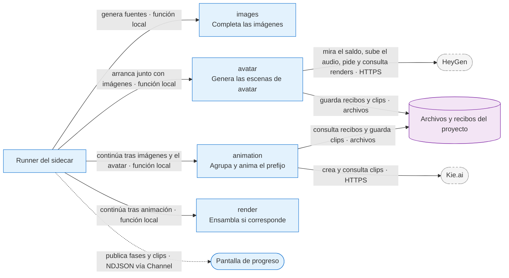

# Arquitectura

Fuente de verdad sobre **cómo está construido** este sistema y **cómo fluye**. Se lee
antes de tocar código.

Este documento es de referencia: describe la forma del sistema. Las **reglas** para
escribir código están en [CLAUDE.md](../CLAUDE.md), y las **decisiones** con su
justificación en [docs/adr/](adr/). La misma forma del sistema, dibujada en
diagramas, está en [docs/diagrams/](diagrams/).

> [!IMPORTANT]
> **Cambio de dirección (2026-08-13,
> [ADR-0007](adr/ADR-0007-invoke-reemplaza-al-servidor-local.md)), materializado por la
> [ADR-0010](adr/ADR-0010-pipeline-por-stages-y-migracion-por-modulos.md):** el
> servidor local Hono (ADR-0002) queda **reemplazado**. El puente entre la app y el
> sistema operativo es `invoke()` de Tauri, y el pipeline se reescribe guiado en
> `pipeline/` como **sidecar Node por job** — sin servidor HTTP, sin puerto: Rust lo
> lanza, le pasa el job por stdin y reenvía su progreso NDJSON por el `Channel` del
> invoke. El entitlement firmado desaparece como concepto. La mecánica actual y la
> receta para extender el pipeline están en la **sección 4**; el flujo completo de
> guion a video (y su edición posterior), en la **sección 5**. La migración por
> módulos de ADR-0010 quedó completa con Library
> ([ADR-0014](adr/ADR-0014-modulo-library-edicion-sobre-stages.md)).
>
> **Dirección futura
> ([ADR-0032](adr/ADR-0032-proveedores-en-servidor-y-creditos-de-vimo.md),
> propuesta):** las llamadas a proveedores se unificarán en un servidor de Vimo
> con créditos propios y sin claves del usuario; en el sidecar quedará solo lo
> local (FFmpeg, ensamblado y descarga de assets). Hasta entonces rige BYO-keys
> con saldo por proveedor ([ADR-0031](adr/ADR-0031-saldo-por-proveedor-precheck-y-pausa-retomable.md)).

---

## 1. Frontera del sistema

**Todo corre en la máquina del usuario.** Este repositorio no despliega ningún
servidor: la aplicación empaqueta el pipeline (sidecar Node) y el binario de FFmpeg, y
las únicas llamadas remotas del pipeline son a los proveedores externos, con las
claves del propio usuario.

El repositorio tiene **tres carpetas de código**, una por pieza del sistema: `src/`
(la SPA en la webview), `src-tauri/` (Rust) y `pipeline/` (el sidecar del pipeline,
que vive como proceso solo mientras corre un job):

```
UI ── invoke("start_pipeline_job" + Channel) ──► Rust ── spawn por job ──► sidecar vimo-pipeline
UI ◄── Channel del invoke (eventos) ──────────── Rust ◄── NDJSON stdout ── (runner → stages → providers)
```

El sidecar invoca a FFmpeg y llama a los proveedores externos (TTS · transcripción ·
LLM · imágenes · música). La SPA solo habla con Rust vía `invoke()` (con un `Channel`
para los eventos de cada job) y con las dos piezas remotas propias de Vimo, que no
generan video: **Supabase** (la identidad del usuario y la subida de diagnósticos) y el
servidor de **vimo.click**.

El servidor de vimo.click (`vimo-landing`, otro repositorio: Pages Functions de
Cloudflare) resuelve el veredicto de acceso y los interruptores de salida
(`verificar-acceso`,
[ADR-0006](adr/ADR-0006-autenticacion-doble-flujo-oauth-y-gate-por-loaders.md)), ofrece
a soporte el panel donde se revisan los diagnósticos
([ADR-0038](adr/ADR-0038-logs-de-diagnostico-por-ejecucion-en-supabase.md)) y, desde la
Entrega 1 de las gemas por secciones
([ADR-0048](adr/ADR-0048-gemas-por-secciones-y-agente-reconstructor.md)), aloja el
**agente reconstructor** (`POST /api/estilos/reconstruir`): recibe la gema completa que
pegó el usuario, la ordena en secciones con un modelo y deja una fila por intento en
`gem_rebuild_logs`. Corre ahí y no en el sidecar porque usa la clave de Vimo, que no
puede viajar dentro de la app: el sidecar solo tiene las del usuario. La SPA lo llama
únicamente desde el `api/` de `videos`, con `vimoServerFetch`
(`src/modules/common/fetcher/`), que adjunta la sesión de Supabase; el sidecar no lo
conoce.

Desde la Entrega 3 del catálogo
([ADR-0049](adr/ADR-0049-catalogo-remoto-administrado.md), tras
`features.remoteCatalog`) el mismo servidor **aloja el catálogo de estilos**: la tabla
`catalog_styles` de Supabase (borrador y copia publicada de cada gema) y el bucket
público `previews-gemas` con las muestras de los estilos nuevos, que solo escribe
`vimo-landing` con el service role. La SPA le pide el catálogo publicado
(`GET /api/catalogo`) al abrir Crear y el sidecar lo deja en `<carpeta raíz>/_catalog/`
con sus muestras (`catalog-styles-sync`); sin red sirve el último sincronizado y, si
nunca sincronizó, las 38 gemas empaquetadas. Un admin crea, edita, genera muestras
(con sus claves, por el sidecar, subidas al bucket por URLs firmadas que emite el
servidor), publica, oculta y elimina estilos desde la pestaña Catálogo
(`/api/admin/catalogo/**`). El sidecar sigue sin conocer vimo.click: los orígenes
permitidos de descarga y de subida le llegan en el payload.

| Responsabilidad                               | Dónde vive                        |
| --------------------------------------------- | --------------------------------- |
| Pantallas, navegación, estado de la UI        | `src/`                            |
| Rutas, diálogos nativos y acceso a archivos   | `src/` + plugins de Tauri         |
| Lanzar, escuchar y cancelar jobs del pipeline | `src-tauri/`                      |
| Las 8 fases que generan el video              | `pipeline/` (stages)              |
| Llamadas a los proveedores externos           | `pipeline/` (providers)           |
| Ensamblado del video                          | FFmpeg, invocado por el sidecar   |
| Registro, login y sesión                      | Supabase                          |
| Acceso y reconstrucción de gemas (agente)     | Servidor de vimo.click            |
| Catálogo de estilos publicado y su edición    | Servidor de vimo.click + Supabase |
| Claves de los servicios pagos (BYO-keys)      | keychain del SO (ADR-0011)        |

Lo que **no** existe en `src/` y no debe aparecer: FFmpeg, modelos de IA, llamadas
directas a proveedores, orquestación de fases ni claves de esos servicios. FFmpeg viaja
en la aplicación, sí, pero como binario declarado en `src-tauri/`, nunca como código de
la interfaz. Si un cambio empieza a necesitar algo de esa lista dentro de `src/`, el
cambio va en `pipeline/` (o en un comando Rust si es puente con el SO).

### Quién manda sobre los archivos

La línea es explícita, porque si ambos lados calculan rutas terminan divergiendo:

- **Tauri decide el _dónde_**: elige el directorio de trabajo dentro del directorio de
  datos de la aplicación y expone el diálogo nativo para que el usuario guarde el MP4
  donde quiera.
- **El sidecar decide el _qué_**: recibe ese directorio (`projectDir`) y las rutas de
  binarios (`binaryPaths`) dentro del `PipelineJob`, y escribe ahí sus artefactos. No
  asume rutas propias.
- **La SPA no escribe artefactos del pipeline.** Usa la API de filesystem de Tauri solo
  para leer el resultado, revelarlo en el explorador de archivos y guardarlo.

---

### Motor alternativo Flow

Desde la integración local descrita en [ADR-0058](adr/ADR-0058-flow-como-motor-de-imagenes.md),
Rust administra además un coordinador persistente de la extensión. La SPA sigue
usando `invoke`; sólo los procesos nativos usan su HTTP loopback autenticado.
Catálogo y Mi estilo conservan sus fases. Flow sustituye la generación de
imágenes, incluidas muestras y regeneración; no añade un pipeline paralelo.
El diagrama, contratos, fallos y límites de confianza viven en la ADR.
La recuperación de Multimagen y el consentimiento para completar sólo imágenes
faltantes con un proveedor pago se rigen por
[ADR-0054](adr/ADR-0054-recuperacion-multimagen-y-completado-pago.md); las
regeneraciones concurrentes por escena, por
[ADR-0055](adr/ADR-0055-regeneracion-concurrente-por-escena.md). Estas decisiones
conviven con el layout del editor de ADR-0056 y los contratos de avatar de ADR-0057.
La preparación aislada de la aceptación de Flow está documentada aparte en
[ADR-0059](adr/ADR-0059-flow-qa-nativa-aislada.md): su identidad, puertos y carpetas
son de QA y no forman parte de la configuración del producto.

---

## 2. Stack

| Capa            | Tecnología               | Rol                                                                      |
| --------------- | ------------------------ | ------------------------------------------------------------------------ |
| Interfaz        | React 19                 | Componentes y estado de la UI                                            |
| Lenguaje        | TypeScript               | Toda la fuente de `src/`                                                 |
| Build           | Vite                     | Servidor de desarrollo y bundle de producción                            |
| Empaquetado     | Tauri 2 (Rust)           | Aplicación nativa de escritorio y gestión de sidecars                    |
| Navegación      | React Router v7          | Árbol de rutas y vistas                                                  |
| Estado servidor | TanStack Query           | Caché, reintentos y consulta de progreso                                 |
| Estilos         | TailwindCSS              | Sistema de estilos                                                       |
| Autenticación   | Supabase                 | Identidad del usuario                                                    |
| Pipeline        | TypeScript (`pipeline/`) | Sidecar Node por job: stages, providers y prompts (ADR-0010)             |
| Render          | FFmpeg                   | Binario que invoca el sidecar; build LGPL con codificadores por hardware |
| Paquetes        | pnpm                     | Instalación y scripts                                                    |

Las **versiones exactas** están en [package.json](../package.json) y
[src-tauri/Cargo.toml](../src-tauri/Cargo.toml). No se duplican acá: se desactualizan.

**Plataformas:** Windows, macOS y Linux. Móvil queda fuera mientras el render dependa de
FFmpeg como binario local — ver la
[ADR-0002](adr/ADR-0002-servidor-local-como-sidecar-de-tauri.md).

---

## 3. Estructura de archivos

### Raíz del repositorio

```
vimo/
├── CLAUDE.md              convenciones de código (obligatorias)
├── README.md              qué es el proyecto y cómo levantarlo
├── index.html             plantilla HTML que carga Vite
├── package.json           dependencias y scripts
├── eslint.config.js       reglas de ESLint (incluye react-hooks y react-refresh)
├── .prettierrc.json       formato de código
├── vite.config.ts         build, plugins y el alias @/ → src/
├── tsconfig.app.json      configuración de TypeScript para src/
├── tsconfig.pipeline.json configuración de TypeScript para pipeline/
├── docs/                  documentación del proyecto
│   ├── ARCHITECTURE.md    este archivo
│   ├── CONTRIBUTING.md    proceso de trabajo (inglés)
│   ├── CONTRIBUTING.es.md proceso de trabajo (español)
│   └── adr/               decisiones de arquitectura
├── public/                archivos servidos tal cual (se copian a dist/)
├── scripts/               build-sidecar.mjs (empaqueta el sidecar Node SEA), fetch-binaries.mjs (descarga ffmpeg/yt-dlp pineados), target-triple.mjs (helper compartido), release-targets.mjs (targets de release, ADR-0034), run-pipeline-harness.mjs, ab-scene-wardrobe.mjs (A/B con claves reales del vestuario por escena, matriz en ab/), build-update-manifest.mjs y build-demo-pack.mjs; test/ agrupa guards y regresiones provisorios (check-locales, check-demo, …) pendientes de migrar a un framework de pruebas
├── pipeline/              el pipeline de video: sidecar Node por stages (ADR-0010)
├── src/                   la interfaz  ← el grueso del trabajo
└── src-tauri/             el lado nativo y los sidecars
```

### `pipeline/` — el sidecar del pipeline (ADR-0010)

Paquete TypeScript puro, fuera de `src/`: la app solo puede consumir sus tipos con
`import type` (contrato de eventos y job); el runtime lo ejecuta Rust como proceso
hijo por job, sin servidor ni puerto. Se empaqueta como **binario único con Node
SEA** (`scripts/build-sidecar.mjs`: esbuild → blob SEA → runtime Node, ~110 MB)
en `src-tauri/binaries/vimo-pipeline-<target-triple>`, declarado como
`externalBin`; los hooks `beforeDevCommand`/`beforeBuildCommand` lo regeneran,
así **dev y producción usan el mismo binario** — el sidecar nunca depende del
Node del sistema (una app lanzada desde Finder no hereda el PATH de la
terminal). Para iterar el pipeline por CLI: `pnpm pipeline <subcomando>` (corre
`pipeline/main.ts` con el Node local); tras editar `pipeline/`, reiniciar
`tauri dev` regenera el binario.

```
pipeline/
├── main.ts                entrada del sidecar: subcomandos, job JSON por stdin, NDJSON out
├── runner/                contrato: PipelineJob, PipelineEvent, Stage, contexto y emitter, y el corredor de fases (`run-stages.ts`; una fase puede correr junto con otra, ADR-0013)
├── commands/              subcomandos por dominio: <dominio>/ con sus handlers y su mapa subcommands.ts (music/, voices/, characters/, avatars/, videos/)
├── stages/                las 8 fases de Create + su registro: voice/, transcription/, scene-cuts/, scene-prompts/, images/, avatar/, animation/, render/ (ADR-0013, ADR-0057), y shared/ con lo que usan varias fases
├── avatar/                el avatar dentro del video (ADR-0057): nombres de los archivos de una escena de avatar, el planificador de apariciones y, desde la 2g, dónde termina cada una y cuánto puede durar (`appearance-cut.ts`, `resize-limits.ts` y `resize-plan.ts`, puros y browser-safe: la interfaz y el sidecar hacen la misma cuenta; `resize-words.ts` lee las palabras para el plan), la orientación del look (la comparten Crear y el sidecar), el carril de una escena con HeyGen (huellas del pedido, corte del audio, recibos `creating`/`pending` con `Idempotency-Key`, descarga y ajuste del clip al tramo sin retimar) y la operación que comparten la fase `avatar` y el comando del editor (cosecha antes que pago, el saldo antes de cada escena, de a diez —el tope de la cuenta de HeyGen— y el ffmpeg local en su propio límite), y desde la 2e el escritor del movimiento de las apariciones con Avatar V e IV (`motion-prompt.ts`: un `motion_prompt` en inglés por escena, en un solo llamado al modelo de texto de las animaciones y con plantillas por posición como respaldo; nunca frena el render, solo propaga la cancelación)
├── narration/             frases de la narración, la unidad de continuidad del avatar (ADR-0057)
├── project/               la carpeta de un proyecto en disco: rutas tipadas, metadata (las escrituras de `project.json` del proceso van en una fila por archivo), scenes.json y referencias de personajes (ADR-0009)
├── providers/             estrategia por servicio externo: llm/ (DeepInfra), music/ (Evolink), tts/ (ai33 — ADR-0053; DubVoice: Minimax · ElevenLabs · Edge; ElevenLabs directo — ADR-0024), image/ (Fal · Evolink), transcription/ (Deepgram), ytdlp/ (BGM, overlay y la ficha de un video para clonar su estilo), avatar/ (HeyGen: avatares y sus looks, assets, creación desde foto, looks desde un prompt, saldo, el borrado de un avatar propio y los renders de las escenas de avatar —crear, consultar y buscar por la marca del título— — ADR-0057)
├── prompts/               prompts de sistema como datos versionados (biblia visual, director de escenas, bloques del redactor, estilos)
├── config/                PipelineConfig + ApiKeys + BinaryPaths, con defaults inyectables
├── types/                 tipos del dominio (json, llm, music, voices, characters, avatar, images, scenes, video-project)
└── utils/                 utilidades compartidas: escritura atómica, ffmpeg, duración de media, concurrencia, seguridad de contenido, época de la historia
```

**Límites entre fases:** la carpeta de una fase es privada. Una fase importa de
su propia carpeta, de `stages/shared/` (el LLM del job, la biblia visual y el
saneado de prompts, que usan varias) y de las capas de abajo (`providers/`,
`project/`, `prompts/`, `utils/`) — nunca de las tripas de otra fase. Si dos
fases necesitan lo mismo, sube a `stages/shared/`. Se verifica con:

```
grep -rn "from '\.\./[a-z-]*/" pipeline/stages/*/*.ts | grep -v "context\|shared/"
```

Hoy quedan dos excepciones declaradas, las dos de `images/` hacia
`scene-prompts/` (`fallback-prompt` y `regeneratePromptsForRejected`): la pasada
de recuperación de imágenes reescribe prompts rechazados por content-policy, y
esa capacidad es de la fase anterior. La dependencia va en el sentido del
pipeline y no hay ciclo.

Guards del contrato (ADR-0010 y ADR-0013, aplicados también por ESLint): nada en
`pipeline/` lee `process.env` ni escribe a consola — la config viaja en el
`PipelineJob` y todo output es un evento NDJSON del emitter. `spawn` existe SOLO
en `utils/ffmpeg.ts` y `providers/ytdlp/download.ts`, y siempre con la ruta que
llegó en `binaryPaths`: una app lanzada desde Finder no hereda el PATH.

Junto al sidecar viajan **ffmpeg** y **yt-dlp** como `externalBin`
(`scripts/fetch-binaries.mjs`, con URL y SHA-256 pineados por target triple:
macOS arm64, macOS x64 y Windows x64). Rust los resuelve junto a `current_exe` —con
`.exe` en Windows— y los inyecta en `PipelineJob.binaryPaths` (ADR-0013, ADR-0026,
ADR-0034).

### `src/` — la interfaz

Organizada **por módulo de dominio**, no por tipo de archivo. No existen carpetas
globales `components/`, `hooks/` ni `types/`.

```
src/
├── main.tsx                 punto de entrada: monta React y los providers
├── App.tsx                  shell de la aplicación
├── router/index.ts          árbol de rutas: vistas de los módulos bajo su layout
├── i18n/index.ts            configuración de i18next (los textos viven en public/locales/)
├── layouts/                 cascarones de la app
│   ├── AuthenticatedLayout/ shell con sidebar + navbar (app con sesión)
│   ├── EditorLayout/        pantalla completa para el editor de proyecto (ADR-0056)
│   └── GuestLayout/         full-screen para login / acceso denegado
├── assets/                  imágenes, fuentes y CSS global (css/main.css)
└── modules/
    ├── common/              lo transversal: fetcher, queryClient, supabase, UI, brand,
    │                        components/ (UI compartida entre módulos)
    ├── auth/                sesión y acceso: OAuth Google, guards del router, verificación
    ├── videos/              creación de video (hoy: vista Create maquetada)
    ├── setup/               arranque: splash (entrada de la app en `/`)
    └── <modulo>/            un dominio del producto
        ├── api/index.ts     única capa que habla con el exterior
        ├── components/      componentes del módulo
        ├── hooks/           hooks del módulo
        ├── types/           un archivo por dominio
        ├── views/<Vista>/   una vista por carpeta
        └── constants.ts     rutas, claves de query y demás constantes
```

Las reglas que gobiernan esta estructura —límites entre módulos, barriles permitidos,
dónde vive cada tipo de archivo, cómo se colocan las traducciones— están en
[CLAUDE.md](../CLAUDE.md). No se repiten acá para que no se contradigan.

**La cadena de datos es fija y no se saltea ningún eslabón:**

```
componente → hook (TanStack Query) → api/ del módulo → common/fetcher → exterior
```

`modules/common/fetcher/` es el único borde de la interfaz con el exterior y tiene tres
transportes: `fetcher.ts` (HTTP, legado del servidor local), `pipeline.ts` (jobs del
sidecar vía `invoke` + `Channel` — ver la sección 4) y `vimoServer.ts` (vimo.click con
la sesión de Supabase, `vimoServerFetch` — ver la sección 1). Ningún componente ni hook
llama a `fetch`, `invoke` de pipeline ni `listen` directamente.

### `src-tauri/` — el lado nativo y los sidecars

```
src-tauri/
├── tauri.conf.json    ventana, iconos, externalBin con los sidecars y el endpoint del updater
├── tauri.windows.conf.json  instalador NSIS y WebView2; Tauri lo mezcla solo en Windows
├── tauri.updater.conf.json  createUpdaterArtifacts; solo lo pasa el workflow con --config (ADR-0027)
├── Cargo.toml         dependencias de Rust (incluye tauri-plugin-shell, single-instance y updater)
├── build.rs           script de build de Tauri
├── src/               código Rust: lanza los sidecars y los detiene al salir
│   └── <módulo>/tests/  tests unitarios del módulo, un archivo por archivo de producción
├── binaries/          los sidecars, con sufijo de target triple
├── capabilities/      permisos, incluido el de ejecutar sidecars
├── icons/             iconos de la aplicación
└── gen/               código generado (no se edita a mano)
```

Los binarios de `binaries/` **deben llevar el sufijo del target triple** en el nombre
(`vimo-server-x86_64-apple-darwin`); es el requisito de Tauri que más se olvida. Cada
instalador incluye únicamente los binarios de su plataforma.

Del lado del bundle, Tauri empaqueta `dist/` (la clave `frontendDist`), los iconos y los
`externalBin`. Nada de `docs/` viaja dentro de la aplicación.

#### Tests de Rust

Se corren con `pnpm test:tauri` (equivale a `cargo test --lib` en `src-tauri/`); para
un módulo, `cargo test --lib diagnostics`. Rust ofrece dos tipos de test y acá se
usa uno solo:

- **Unitarios, en una carpeta `tests/` dentro del módulo.** Cada archivo de
  producción termina con `#[cfg(test)] #[path = "tests/<archivo>.rs"] mod tests;`
  y su test vive en `src/<módulo>/tests/<archivo>.rs`. Para el compilador es igual
  que un `mod tests { … }` inline (es hijo del módulo, `use super::*` ve lo privado,
  no entra al binario), pero el código de test no ensucia el de producción. Es la
  única forma de tener los tests en archivo aparte **sin** abrir visibilidad
  (`pub(crate)`) solo para testear; por eso el `#[path]` es deliberado.
- **De integración, en `src-tauri/tests/`.** Cada archivo es un crate externo que
  solo ve la API pública de `app_lib`. Reservado para probar comandos Tauri
  completos con `tauri::test::mock_app`; hoy no hay ninguno y `diagnostics` ni
  siquiera es `pub` desde `lib.rs`, así que desde ahí no existe.

Para que un módulo sea testeable, lo que depende de `AppHandle` se parte en dos: una
función sobre `&Path` (o el dato concreto) con la lógica, y un wrapper público con
`AppHandle` que solo resuelve el path y delega. Los tests que tocan disco usan
`tempfile::tempdir()`. `diagnostics/spool.rs` y `diagnostics/tests/spool.rs` son el
ejemplo de referencia.

---

## 4. El pipeline hoy: jobs, subcomandos y cómo extenderlo

Esta sección describe la mecánica **vigente** (ADR-0010, materializada con AI Music):
cómo viaja un job de punta a punta y qué piezas hay que tocar para agregar una
operación nueva. Es la referencia para los próximos módulos (voces, characters, …).

### Anatomía de un job

```
componente → hook → api/ del módulo
                      │
                      ▼
        common/fetcher/pipeline.ts        startPipelineJob / runPipelineJob
                      │
        invoke("start_pipeline_job",      el Channel viaja DENTRO del invoke:
                payload + Channel)        cada job tiene su propio canal
                      │
                      ▼
        Rust (src-tauri/src/pipeline/)
          commands.rs  spawnea `vimo-pipeline <subcomando>` y reenvía su
                       stdout NDJSON por el Channel; devuelve el jobId
          job.rs       arma el PipelineJob: claves API desde el keychain
                       (cacheadas por sesión), projectsRoot desde Ajustes
                      │  el job viaja por stdin (nunca por argv)
                      ▼
        sidecar vimo-pipeline (pipeline/)
          main.ts      lee el job de stdin, despacha por la tabla SUBCOMMANDS
          handler      corre con PipelineContext y emite eventos NDJSON
                       hasta terminar en job-completed | job-failed
```

Los contratos viven en `pipeline/runner/` y Rust **no los redeclara**: arma y reenvía
JSON tal cual (por eso `src/` puede consumirlos con `import type`).

- **Entrada** — `PipelineJob` ([runner/job.ts](../pipeline/runner/job.ts)): `jobId`,
  `projectDir?`, `projectsRoot?`, `config?`, `apiKeys`, `binaryPaths`, `payload?`.
  Lo arma Rust ([job.rs](../src-tauri/src/pipeline/job.rs)); las claves salen del
  keychain (ADR-0011) y **nunca pasan por el webview**.
- **Salida** — eventos NDJSON por stdout ([runner/events.ts](../pipeline/runner/events.ts)):
  `job-started`, `progress`, `log`, `stage-*`, y los terminales `job-completed`
  (con `result`) o `job-failed` (con `code` estable para i18n). El emitter
  ([runner/emitter.ts](../pipeline/runner/emitter.ts)) es la única escritura a stdout
  de todo `pipeline/`.
- **Cancelación** — cooperativa: `cancel_pipeline_job` escribe `{"type":"cancel"}` por
  stdin y el sidecar aborta vía `AbortController`; si stdin ya no acepta escrituras,
  Rust mata el proceso como fallback.
- **Errores** — `PipelineFailure(code, message)` ([runner/failure.ts](../pipeline/runner/failure.ts)):
  `code` es la clave estable que la UI traduce; `message` es diagnóstico para logs,
  nunca texto user-facing.

### Los dos modos de consumo en la UI

[src/modules/common/fetcher/pipeline.ts](../src/modules/common/fetcher/pipeline.ts) es
el único punto de `src/` que habla con los jobs, y expone dos primitivos:

|                     | `startPipelineJob`                     | `runPipelineJob`               |
| ------------------- | -------------------------------------- | ------------------------------ |
| La promesa resuelve | cuando el job **arranca**              | cuando el job **termina**      |
| Devuelve            | `PipelineJobHandle` (jobId + stop)     | el `result` final tipado       |
| Eventos intermedios | llegan todos al callback               | se ignoran                     |
| Errores             | evento `job-failed` al callback        | rechaza con `PipelineJobError` |
| Cuándo usarlo       | jobs largos con progreso y cancelación | consultas y acciones puntuales |

`runPipelineJob` está construido sobre `startPipelineJob`; en música, solo la
generación usa el modo streaming — el resto (créditos, historial, sugerir prompt)
es request/response.

### Receta: agregar un subcomando nuevo

En orden, con música como ejemplo vivo de cada paso:

1. **Tipos del contrato** en `pipeline/types/<dominio>.ts`: params del payload y
   forma del result (deben ser JSON serializables).
2. **Handler** en `pipeline/commands/<dominio>/<nombre>.ts` con la firma
   `(context: PipelineContext) => Promise<result>`. Reglas del contrato (las aplica
   ESLint): nada lee `process.env` ni escribe a consola — la config viaja en el job y
   todo output pasa por `context.emitter`; los fallos se lanzan como
   `PipelineFailure` con `code` estable; las operaciones largas respetan
   `context.signal`.
3. **Registrarlo** en el mapa `subcommands.ts` de su dominio
   (`pipeline/commands/<dominio>/subcommands.ts`); si el dominio es nuevo, esparcir
   su mapa en la tabla `SUBCOMMANDS` de [pipeline/main.ts](../pipeline/main.ts).
   Rust no se toca: `start_pipeline_job` es genérico.
4. **Proveedor externo nuevo** (si lo hay): estrategia en
   `pipeline/providers/<servicio>/`. Si requiere clave propia, se agrega al catálogo
   del módulo `api-keys` (`providers.ts`) y a `ALL_PROVIDERS` en Rust
   (`src-tauri/src/api_keys/`): con eso la clave entra sola en `job.apiKeys`.
5. **Lado UI**: el `api/` del módulo envuelve el subcomando con `runPipelineJob` o
   `startPipelineJob`; el mapa `code → clave i18n` va en el `constants.ts` del módulo
   y los textos en los **tres** catálogos de `public/locales/`.
6. **Probar**: `pnpm pipeline <subcomando>` corre el sidecar por CLI con el Node
   local; en la app, reiniciar `tauri dev` regenera el binario SEA.

Cuando llegue Create, las fases largas se modelarán como **stages** encadenadas
(`pipeline/runner/stage.ts` + `stages/`) dentro de un job, con checkpoint para
reanudar; los subcomandos sueltos de `commands/` siguen siendo el camino para
operaciones de un solo paso.

Desde 2026-09-12, la narración conserva además recibos atómicos por solicitud
TTS pendiente. Reanudar consulta la tarea remota conocida; no repite un POST
incierto. Rust excluye jobs simultáneos del mismo proyecto dentro de la app.
Ver [ADR-0035](adr/ADR-0035-recibos-de-voz-y-previews-interactivas.md) y
[límites y pruebas de recuperación](fixes/2026-09-12-fix-voice-resume/voice-resume.md).

### Logs de diagnóstico

Cada job deja un registro redactado que soporte busca por correo + proyecto
([ADR-0038](adr/ADR-0038-logs-de-diagnostico-por-ejecucion-en-supabase.md)). Rust
lo arma mientras reenvía los eventos (`src-tauri/src/diagnostics/`), lo guarda en
`<appLogDir>/diagnostics/<jobId>.json` y el módulo `src/modules/diagnostics/` lo
sube a la tabla `diagnostic_logs` de Supabase. Un subcomando nuevo queda cubierto
sin escribir nada; pero de cada evento solo se sube una **allowlist de claves**
(`ALLOWED_EVENT_KEYS` en `diagnostics/redaction.rs`): si agregás a un evento una
clave útil para diagnosticar, sumala ahí — y nunca una que lleve contenido del
usuario (guion, prompts, rutas). La ADR-0057 sumó `dropped` (las apariciones del
avatar que no cupieron, en `avatar-planned`); el progreso de cada render de HeyGen
(`avatar-scene-progress`) se muestrea como todo `*-progress` sin porcentaje: uno cada
30 s por tipo de evento, no por escena (con diez renders en paralelo queda uno solo).

`failed_stage` es la primera fase que sigue en curso cuando llega `job-failed`. Desde la
entrega 2h el corredor puede correr dos fases a la vez (`images` y `avatar`, ADR-0013), así que
el registro (`recorder.rs`) guarda las fases en curso en el orden en que arrancaron y
`stage-completed` y `stage-skipped` sacan solo la suya. Con las reglas de fallo del corredor
eso nombra la que de verdad falló (si fallan las dos, `images`). Es una heurística, no un dato
del evento: si falla el gancho que guarda el avance de la que manda después de su
`stage-completed`, el corredor corta a la otra y el fallo queda anotado con ella. Sigue siendo
una sola fase: ni el spool ni la fila del webview cambian.

Tres reglas más para que el log sirva a soporte:

- **Toda fila lleva `project_name`.** `diagnostics/subject.rs` lo resuelve desde el
  subcomando y el payload: el proyecto (`projectId` / `projectIds`, o `name` en una
  creación fallida) o, si no hay proyecto, la entidad con prefijo fijo (`Estilo: X`,
  `Personaje: X`, `Avatar: X`, `Voz: X`, `Música`, `Demo`). Un subcomando nuevo que
  trabaje sobre un proyecto manda `projectId` en el payload aunque el handler no lo use.
  Así `avatar-render-scenes` (ADR-0057) es del proyecto en Rust y, en el webview, la
  palabra `scene` lo archiva en `videos` (`SUBCOMMAND_MODULE_KEYWORDS`) aunque su nombre
  empiece con `avatar`.
- **Los errores de proveedor son estructurados.** Un proveedor lanza
  `PipelineFailure(code, message, { provider, httpStatus })`; el `job-failed` reenvía
  ambos y llegan a `error_provider` / `error_http_status`. Todo reintento o fallback
  de proveedor emite además `provider-failure` (`pipeline/utils/provider-failure.ts`)
  con `recovered: true`, para que un fallo que el pipeline absorbió no desaparezca del
  log de una ejecución `completed`.
- **La revisión de soporte se marca en la fila.** El panel admin de vimo.click pone
  `seen` / `seen_at` / `seen_by` en las ejecuciones `failed`, `crashed` y `cancelled`
  (enmienda 2026-09-23 de la ADR-0038, `PATCH /api/admin/diagnosticos` con service
  role). La app no lee ni escribe esas columnas y la marca se borra con la fila a los
  30 días.

---

## 5. Flujo principal: de guion a video

Es el flujo central del producto y lo implementa el módulo `videos` (Create)
sobre el runner de stages del sidecar (ADR-0013). La interfaz **dispara y
observa**; el sidecar **ejecuta**; el disco **es el estado**.

### Forma

```
UI ── invoke("start_pipeline_job", "run-video-pipeline") ──> Rust ── spawn ──> sidecar
UI <──────── Channel (NDJSON: stage-*, scene-*, *-progress) ─────── Rust <────┘
                                    │
                    <projectsRoot>/<slug>/  ← todo artefacto queda acá
```

### Antes de arrancar

1. **La interfaz** exige sesión iniciada y claves de API
   (`useRequiredApiKeys({ requirements: MODULE_API_KEY_REQUIREMENTS.videos })`:
   las cuatro categorías). Si falta alguna, monta `MissingApiKeysNotice` (modal
   con el nombre de cada clave y CTA que abre su tarjeta en Claves de API) en
   vez de arrancar un trabajo condenado. Cada módulo registra sus claves en
   `MODULE_API_KEY_REQUIREMENTS` (`src/modules/api-keys/constants.ts`).
2. Reúne el formulario: nombre, guion (o audio propio), estilo, cantidad de
   escenas, proveedor/modelo/calidad de imagen, voz y sus ajustes, personajes y
   su frecuencia, música de fondo y overlay. Con `features.newCatalog`
   encendido y fuera de la demo ([ADR-0039](adr/ADR-0039-catalogo-sobre-el-carril-de-mi-estilo.md),
   Entrega 2 de [ADR-0048](adr/ADR-0048-gemas-por-secciones-y-agente-reconstructor.md)),
   la pestaña Catálogo muestra las 38 gemas de la casa
   (`pipeline/prompts/catalog-gems/`) como tarjetas del carril de Mi estilo
   («Usar en este video», «Ver» con muestras, etiquetas y modo de personaje,
   «Pasar a mi estilo»): un estilo del catálogo nuevo viaja como
   `options.customStyle` con `catalogStyleId`, con segundos por escena y
   modelo de prompts, sin cantidad de escenas ni frecuencia. Con el
   interruptor apagado sigue el catálogo viejo, byte por byte. Con
   `features.remoteCatalog` además ([ADR-0049](adr/ADR-0049-catalogo-remoto-administrado.md),
   Entrega 3), la pestaña sincroniza el catálogo publicado en vimo.click
   (`_catalog/`), y un admin con conexión ve todos los estilos con su estado y
   los administra desde ahí. Con el avatar presentador
   ([ADR-0057](adr/ADR-0057-escenas-de-avatar-con-heygen-sobre-la-narracion.md)) la
   tarjeta de Crear ofrece los avatares de la biblioteca y, de cada uno, solo los looks
   con la orientación del formato del video (`lookOrientationFit`, la misma regla con la
   que el sidecar los acepta): un look generado con «Crear escenario» guarda la
   orientación del formato pedido cuando HeyGen no informa la suya
   (`preferredOrientation`: 16:9 horizontal, 9:16 vertical, 1:1 cuadrado, que no sirve en
   ningún formato de video; 4:5, 5:4 y `auto` quedan sin orientación). Sin clave de HeyGen
   la tarjeta se ve apagada y el formulario que se valida, se estima y se envía lleva el
   avatar apagado (`withAvatarKey`, derivado en el render, no un efecto): nunca un
   `options.avatar` sin con qué generarlo. Con la tarjeta encendida, un look pedido con
   «Crear escenario» o un avatar que entrena se sigue cada 15 s
   (`useProcessingAvatarsRefresh`) y aparece al terminar sin salir de Crear.
   Desde la entrega 2c las tarjetas de la fila «Avatar» (`CreateAvatarCard`) tienen la
   forma del video (`AVATAR_LOOK_FRAME_CLASSES`) y muestran el look de cada avatar para
   ese video —el elegido en el elegido, el de por defecto (`defaultAvatarChoice`) en los
   demás— con el nombre del look y «+N looks» en blanco sobre un degradado. Al montar
   Crear solo la tarjeta del elegido pide el listado de HeyGen (`useAvatarRemoteLooks`,
   sobre `useStockLooks`: gratis, con la caché por grupo del panel de la biblioteca y el
   `ownership` en un solo lugar); las demás muestran su look si la biblioteca bajó su
   vista previa (solo las tres de la tarjeta, `AVATAR_CARD_LOOK_PREVIEWS`) o la cara del
   avatar, y piden recién con la intención de mirarlas: el mouse quieto encima o el foco
   visible del teclado (`usePreviewActivation`, sobre `useHoverIntent`), que también
   pasa el video mudo. Debajo, el botón «Look» (`CreateAvatarLooks`) despliega la grilla
   con todos los looks del avatar mirado —también de uno sin look para el formato, que
   no pide nada hasta abrirse—, el principal primero, cada uno con su formato
   (`lookFormatOf`, completado con el listado) y su forma real dentro de la celda.
   Los que no sirven para el video se ven atenuados y dicen por qué, según
   `lookUnfitReason` (`selectableAvatar.ts`, la regla con la que `avatarLooksFor`
   ofrece). Desde la entrega 2d la grilla es una lista de botones (una `ul` con un `li`
   por look; `aria-haspopup="dialog"`; el elegido lleva `aria-current` y dice «Elegido»)
   y tocar una ficha no elige el look: abre su reproductor (`CreateLookPlayer`, sobre el
   `LookPlayerDialog` de Avatares, con el video entero, o «sin video» si el listado de
   HeyGen no lo trae) y «Usar» lo elige, cierra el reproductor y la grilla y deja el
   foco en el botón «Look». El look que no sirve abre igual y dice por qué con una frase
   entera, sin «Usar»: el reproductor traduce el motivo sin variables, así que
   `LOOK_PLAYER_REASON_KEYS` (`constants.ts`) tiene su clave por motivo, aparte de las
   etiquetas de la ficha (`LOOK_UNFIT_REASON_KEYS`). El reproductor sigue a lo que se
   muestra: si cambia el avatar que se mira o se deshabilita el formulario, se cierra
   sin elegir y no se reabre solo al volver. Cerrar sin elegir devuelve el foco a la
   ficha (`returnFocusRef`; tras «Usar» apunta al botón «Look», porque la ficha se va
   con la grilla). El aviso de moderación es un recuadro `role="note"` con su título.
   Desde la entrega 2e (diseño §21.3), con un look elegido la tarjeta ofrece el motor
   (`CreateAvatarEngine`: un `radiogroup` propio, fuera de la grilla de looks, con Avatar
   V, IV y III en el orden de `AVATAR_ENGINE_CHOICES`, cada uno con su descripción y el
   costo de este video a su tarifa por minuto; el que el look no admite
   —`avatarEngineAvailable`— queda apagado y dice por qué; una sola parada de Tab y las
   flechas eligen) y el movimiento (`CreateAvatarExpressive`): «Movimiento más expresivo»,
   un `Switch` con su ayuda en un tooltip, solo con IV, el único motor donde el proveedor
   tiene `expressiveness` (diseño §23.1: con V y con III no se ve, ni apagado); con IV y un
   look de video se ve apagado y dice por qué, y no sale la línea «Vimo escribe el
   movimiento de cada aparición…», porque ahí el proveedor no acepta `motion_prompt` y la
   frase sería falsa. Esa línea sale con IV y un look de foto, dentro de la caja del
   interruptor, y con V suelta, solo si su avatar tiene con qué moverse (abajo).
   `avatarEngine` es una preferencia: el motor que sale es `selectedAvatarEngine` (`avatarEngineFor` sobre los
   `supportedEngines` que `SelectedAvatar` copia del look al elegirlo: el preferido si el
   look lo admite; si no, el primero en III, IV, V), derivado en el render, así que elegir
   otro look nunca parchea el motor. Ese es el motor que viaja en `options.avatar.engine`
   y el que cobran la tarjeta del costo y el pre-check; `expressive: true` viaja solo
   prendido y si `selectedAvatarExpressiveAvailable` (`avatarMotionSupport(…).expressiveness`:
   IV con un look de foto; con V nunca, aunque la persona lo haya prendido antes con IV: su
   preferencia queda en el formulario); con Avatar III y apagado, `options.avatar`
   es byte a byte el de antes de la 2e. Un look sirve si admite al menos un motor con
   tarifa (`lookUnfitReason`), y la elección guardada deja de valer si el look ya no admite
   alguno de los motores de su copia (`isSelectedAvatarCurrent`: el selector avisa y el
   envío se frena; al elegirla de nuevo la copia trae los motores de hoy y la preferencia
   no se toca; un motor ganado no la invalida). En el grupo, Alt, Ctrl o Meta con una
   flecha no mueven el motor (son atajos del historial y del sistema). El motor llega
   también a la tarea (`avatarEngine` de las opciones de corrida, copiado por
   `useCreateTask` a `CreateTask` y a la pausa de confirmación; `LibraryProgress` lo lee de
   `options.avatar.engine` al rearmar la pausa desde el disco): la línea del avatar del
   diálogo de cantidad y del paso de segundos cobra a la tarifa del motor del proyecto, y
   una tarea guardada antes de la 2e, que no lo trae, a la de Avatar III.
   Desde la entrega 2f (diseño §22) la tarjeta suma, debajo de «Empieza con el avatar»,
   «3 veces en 2 minutos» (`CreateAvatarThreeInTwo`: la `CheckboxRow` de siempre con su
   ayuda en un tooltip fuera de la etiqueta; apagada por defecto, manda solo
   `{ avatarThreeInTwoMinutes }`, y `options.avatar.threeInFirstTwoMinutes: true` viaja
   solo prendida, al final del objeto). Prendida avisa el mínimo (con menos de
   `AVATAR_EARLY_APPEARANCES` apariciones salen 3) y el tope (con más de
   `AVATAR_EARLY_MAX_SECONDS` s por aparición, las tres primeras duran hasta ese tope,
   hoy 32 s), y esos avisos son la descripción de la casilla (`CheckboxRow` acepta
   `describedBy`, que va a `aria-describedby` del `input`: solo los ids de los avisos que
   se ven). El costo cuenta lo que sale: `avatarRequestedAppearances` y
   `avatarRequestedSeconds` (`max(n, 3)` apariciones y las tres primeras a
   `min(s, tope)`, a partir de la forma de `ProjectAvatarOptions`) alimentan, por
   `createAvatarAppearances` y `createAvatarSeconds`, el total de la tarjeta, el costo de
   cada motor, el pre-check y las imágenes libres de `estimateCreateCost`, y por
   `estimateResumeCost`, lo que falta cobrar al reanudar antes del corte; así Crear y
   reanudar no divergen. Además `SelectedAvatar` copia `motionReference`
   (`avatarHasMotionReference`: un avatar de stock o con un gemelo digital la tiene) y,
   con Avatar V y un look de foto de un avatar propio sin gemelo digital (R-2f-1,
   `avatarMotionReferenceMissing`), no sale la línea «Vimo escribe el movimiento…»: el
   render sale con el movimiento propio de V y la frase sería falsa. Desde la 2g (diseño
   §23.1) `motionReference` ya no decide «más expresivo», que con V no existe:
   `selectedAvatarExpressiveAvailable`, la regla que comparten el interruptor y
   `createProjectPayload`, solo mira el motor y el tipo de look. Un borrador sin el campo
   cuenta como que sí. El formulario
   sobrevive a la navegación dentro de la sesión: `CreateView` se siembra del
   borrador en memoria del módulo (`utilities/createDraft.ts`, nunca en disco), salvo lo
   que ninguna pantalla de Crear edita y solo siembra Ajustes (la duración de escena de
   las gemas y su pausa), que sale siempre de la preferencia actual. Lo escribe en cada
   cambio —un formulario intacto (la semilla de las preferencias con la que Crear se
   montó, sin borrador) no se guarda, tampoco al volver con «Crear otro», así Crear sigue
   tomando las preferencias y las claves del momento; uno restaurado de un borrador sí, y
   con un borrador ya escrito se refleja todo— y al volver al
   formulario («Crear otro» o cerrar la confirmación de escenas, en su manejador y no en
   un efecto), y lo descarta recién cuando el proyecto ya existe (el aviso
   `onProjectCreated` de `startCreation`, que llega una vez y solo con la tarea
   vigente): un pre-chequeo que frena, una cancelación o un `createProject` que falla lo
   dejan. La autonavegación al editor no lo guarda; la demo no lo lee, no lo escribe ni
   lo descarta. Cerrar sesión no lo borra, como la tarea en curso; un reinicio sí. Los
   enlaces («Crear escenario», «Administrar avatares», «Ir a Claves API») siguen siendo
   enlaces.
3. **Pre-flight del proveedor de voz** (`probe-tts`): valida contra los
   endpoints de LISTADO —no gasta créditos— y avisa antes de arrancar un
   pipeline largo. El resultado se cachea 2 minutos en la UI.
4. **Pre-check de saldo** (ADR-0031): `useCreateCostCheck` estima el gasto
   por proveedor (voz por caracteres × `VOICE_COST_FACTORS`, imágenes por
   escenas × precio de la calidad —sin las escenas de avatar, que no llevan
   imagen—, el avatar presentador por los segundos que salen (con «3 veces en 2
   minutos», `createAvatarSeconds`) × la tarifa del motor con el que
   sale el look (`selectedAvatarEngine`) —en dólares de HeyGen, comparados solo
   con una billetera en `usd`—, música de
   fondo informativa) y lo cruza con los saldos leídos
   (`compareCostLines`). Con saldo leído e insuficiente el envío se frena y
   `InsufficientCreditsAlert` ofrece recargar (`billingUrl` del catálogo de
   `api-keys`); un saldo ilegible solo avisa. Al enviar, `verify()` re-lee el
   saldo justo antes de arrancar.
5. `create-video-project` crea la carpeta del proyecto con `project.json`,
   `script.txt` y las referencias de los personajes; con audio propio,
   `upload-narration` lo copia (o transcodifica) a `narration.mp3`. Con avatar
   presentador (ADR-0057), después de validar todo lo local (biblioteca, grupo, look,
   orientación y vista previa) y antes de crear la carpeta, hace UNA lectura gratis de
   la cuenta de HeyGen (`getBalance`): una clave que HeyGen rechaza (401 o 403) rechaza
   la creación con `avatar_invalid_key`, sin clave el código es `missing_api_key`, y si
   HeyGen no responde (red, 429, 5xx, o no contesta en 8 s: la lectura lleva su propio
   plazo y no repite el 429) solo avisa y el proyecto se crea; el saldo no
   frena acá (lo comparan Crear y la fase antes de pagar). Es lo que evita descubrir una
   clave muerta con la voz y las imágenes ya pagadas, porque la fase `avatar` corre
   después de ellas.

**Biblioteca de avatares (ADR-0057, entregas 1b, 2b, 2c, 2d y 2g).** La vista `AvatarLibrary`
muestra una `AvatarCard` por avatar en una grilla donde cada fila mide lo que su tarjeta
más alta y las tarjetas de una fila miden lo mismo: un mosaico sin huecos con la cara
del escenario principal y hasta dos miniaturas, donde cada imagen reproduce, muda, el video
de su look al pasar el mouse (el foco visible del teclado en el nombre, el de la
principal). Los videos salen del listado de HeyGen del avatar (`useStockLooks`, gratis,
con la caché de 5 min que comparte con el panel), pedido recién cuando la persona se
detiene en la tarjeta (`useHoverIntent`: el mouse quieto `HOVER_FETCH_DELAY_MS` = 250 ms
o el foco del teclado; cruzar tarjetas no lanza un proceso del sidecar por cada una).
«Agregar de stock» abre `StockLooksDialog` en dos niveles. El primero lista los avatares
(grupos) con los filtros de `useStockGroupFilters`: la categoría —solo el stock público:
Profesional = estudio, Comunidad = gemelos, Estilo de vida = el resto, por la
clasificación de `avatar-stock-types` (`useStockTypes`; si falla o llega vacía, el aviso
y todo) y Favoritos, marcados con el corazón (etiqueta fija, estado en `aria-pressed`) y
guardados en el store `avatars.json` de la app (`useStockFavorites`: el corazón queda
deshabilitado hasta leer lo guardado; escrituras en cola y relectura tras un fallo; el
hook nunca escribe por su cuenta: un favorito que el listado completo de HeyGen ya no
trae no se borra del store, solo se oculta y en la sesión deja de contar para la
auto-carga de Favoritos; quitar uno con el teclado desde Favoritos deja el foco en el corazón vecino o
en el chip)—, el género y la búsqueda; con un filtro activo la grilla pide páginas sola
hasta mostrar `STOCK_FILTER_MIN_VISIBLE` tarjetas (nunca tras un error, mientras
clasifica ni cuando la categoría ya no puede sumar), y una tarjeta sin video de grupo
reproduce el de su look de portada (`coverLookVideoUrl`). En el segundo nivel y en el
panel del avatar (`AvatarDetailDialog`), un clic en una ficha abre `LookPlayerDialog`
(`useOpenLook` recuerda qué look y adónde vuelve el foco), un diálogo de Radix anidado
(Escape cierra solo él) con el reproductor del look —`LookPlayer` + `useLookPlayback`,
montado con una `key` por URL: el video entero sobre un escenario oscuro, que arranca
solo al abrirse (entrega 2d) con sonido o, si el navegador lo rechaza por su política de
reproducción automática (`NotAllowedError`), silenciado y con «Activar el sonido» (otro
rechazo no lo silencia; si tampoco arranca silenciado, queda en pausa con el sonido; una
respuesta que llega con el reproductor cerrado no toca el video); barra con tiempo,
velocidad, silencio y pantalla completa; en el panel espera la lista de HeyGen antes de
decir «sin video» y el video que llega después también arranca solo— y una acción al pie
según de dónde se abre (`LookPlayerAction`): «Cargar a la biblioteca» (agrega el avatar
con ese look como principal y abre su panel) o «Abrir en tu biblioteca» en el stock;
«Usar como principal» o «Es el escenario principal de este avatar» en el panel; «Usar» en Crear; el motivo
(`lookUnusableReasonKey`) si el look no sirve. Mientras carga, el reproductor no se
cierra y el foco espera en el escenario. Eliminar un avatar (entrega 2d) es
`AvatarDeleteMenu`, con su estado en `useAvatarDeleteMenu`, el mismo en la tarjeta y el
panel de la biblioteca y en «Mis avatares» (ahí arriba a la izquierda de la imagen, con
el mouse o el foco): el botón despliega ahí mismo, con el foco en la primera opción (el
patrón de un botón de menú; el mousedown nunca mueve el foco dentro del menú, así se
comporta igual en WebKit, donde un clic no enfoca un botón; al abrir, las opciones se
traen a la vista con `scrollIntoView({ block: 'nearest' })`, antes de elegir nada, y armar
«Seguro» y cerrar enfocan sin desplazar, con `focus({ preventScroll: true })`: con la
opción de HeyGen a medias a la vista, armarla la traería entera y «Seguro», más bajo,
caería sobre la lista), «Eliminar
de la lista», que saca el avatar de la biblioteca sin otro paso (`avatar-delete`; sigue
en HeyGen), y, en
un avatar propio (`ownership: 'own'`), «Eliminar permanentemente de HeyGen», en rojo,
que se vuelve «Seguro» en su mismo lugar, con «Cancelar» en el de la lista: en «Mis
avatares» la columna se apoya abajo; en la biblioteca (desde la entrega 2g, diseño §23.5)
el velo cubre la imagen entera, con ancho explícito (`w-full`: WebKit, el motor de la app,
le resta el relleno horizontal a una capa absoluta con `inset-x-0` y `aspect-ratio` y sin
ancho, y la dejaba más angosta y más baja que la imagen; Chrome la estira bien y no deja
ver el error), y es una grilla de tres filas que centra las opciones, con la advertencia de
«Seguro» (11 px) en la de arriba, pegada a ellas y creciendo hacia arriba sin moverlas, de
modo que «Seguro» (una línea) queda centrado dentro del lugar de «Eliminar permanentemente
de HeyGen» y «Cancelar» sobre el de la lista; en el panel, las opciones son dos celdas
iguales. Así un clic de corrección nunca confirma («Seguro» queda descripto por la
advertencia); en «Mis avatares», la lista solo aparece si el avatar está en la
biblioteca. Cada botón del
menú ignora el segundo clic de un doble clic (`isSecondClickOfDoubleClick`) y las
repeticiones de una tecla sostenida (`ignoreHeldKey`), y ese segundo clic tampoco abre
lo que queda debajo: la imagen y el nombre de la tarjeta de la biblioteca y la tarjeta
de «Mis avatares» también lo ignoran. Sacarle el foco, Escape —mientras el menú está
abierto, escuchado en `window` y antes que Radix, lo cierra a él y no al diálogo de
atrás—, «Cancelar», volver a tocar el botón o tocar el velo lo cierran, y salir de la
tarjeta (o tocarla, sin abrir los looks) lo cierra quien la monta; al cerrar, el foco
vuelve al botón, que mientras elimina de HeyGen dice «Eliminando…» (en la tarjeta de la
biblioteca, un spinner con el texto para el lector de pantalla, y la tarjeta apagada).
Nada entra ni sale del DOM: lo oculto lleva `hidden` (el velo cerrado, `inert`) y los
botones del kit además la clase `hidden`; las clases del menú viven en
`utilities/avatarDeleteMenuClasses.ts` y el tipo de su variante en
`types/deleteMenu.ts`. `useAvatarMutations().deleteFromHeyGen` (`networkMode: 'always'`)
acepta un grupo o una entrada y, al lograrlo, saca la tarjeta de la caché
(`avatarsQueryKeys.stockGroupsOf('private')`) y de la lista de la biblioteca las
entradas que el sidecar quitó (`removedEntryIds`), avisa y relee la cuenta y la
biblioteca; `deleteAvatar` avisa con `avatars.toasts.eliminadoLista` y el nombre. La
biblioteca (`AvatarLibrary`) pasa a la tarjeta y al panel `onDeleteFromHeyGen` y
`deleting`: un borrado de HeyGen a la vez, como en «Mis avatares» (con uno en vuelo, el
botón de eliminar de las demás tarjetas y del panel queda apagado, `deleteDisabled`); el
diálogo del stock y el panel no se cierran (Escape, clic afuera ni la X) mientras el
borrado está en vuelo, y nunca hay un borrado junto a un alta. El foco del teclado pasa,
tras borrar, al botón vecino o a la pestaña en «Mis avatares» y a la tarjeta vecina en
la biblioteca (con la biblioteca vacía, a «Agregar de stock»), también con «Eliminar de
la lista» desde la tarjeta. El guard de la biblioteca mide la geometría con el CSS
compilado de la app en cuatro escenarios (11, 11b, 11c y 12: el 11c, el velo a todo el
ancho de la imagen y las opciones centradas a 450, 228 y 164 px); los demás corren sin CSS. Las
fichas de
looks (`LookChips`) dicen
su formato (`lookFormatOf`: 16:9, 9:16, 1:1, 4:5 o 5:4, con medidas finitas) en lugar de
la orientación; en el panel, las medidas salen del listado de HeyGen cuando la
biblioteca no guarda la orientación (`SizedLibraryLook`). Desde la entrega 2e un look sirve
si está listo y admite al menos uno de los motores III, IV o V con tarifa para su tipo
(`lookEngines`, en `utilities/lookUsability.ts`: `AVATAR_ENGINE_CHOICES` filtrado por
`avatarEngineAvailable`, en el orden V, IV, III; `VIMO_AVATAR_ENGINE` ya no existe), y
`lookUnusableReasonKey` —«Usar como principal», el pie del reproductor y «Cargar a la
biblioteca»— usa esa regla (el estado manda antes: un look que se genera o falló lo dice y
no «no compatible»). `LookEngineChips` pinta una pastilla por motor dentro de un
`role="group"` con el nombre `avatars.tarjeta.motoresAria` (los nombres unidos por comas),
con las pastillas en `aria-hidden` para que el lector de pantalla diga cada motor una sola
vez: en las fichas de looks (`LookChips`: stock, panel y reproductor, también el de Crear),
en la tarjeta de la biblioteca y en el encabezado del panel (los motores del look
principal); «No compatible con Vimo» solo si no admite ninguno y el look o el avatar está
listo. El velo que late sobre una vista previa mientras llega su video (`LookPreview`)
está siempre montado y se apaga con la opacidad: sacarlo del DOM en el blur de una tarjeta
devolvía el foco a la caja del diálogo.

**«Crear escenario» y el escenario principal (entrega 2g, diseño §23.5).** Todo texto que
decía «look principal» dice «escenario principal»; la pastilla «N looks» y los demás «look»
quedan como estaban. «Crear escenario» (`GenerateLookDialog`, y la ficha `GenerateLookCard` del
panel de un avatar propio) dice lo que cuesta: `AVATAR_LOOK_GENERATION_USD`, 1 US$ por
escenario (`pipeline/types/avatar.ts`, con su espejo en `src/modules/avatars/constants.ts`). El
proveedor no publica ese precio: la 2g lo estimó en 0,93 US$ desde el saldo del dueño (R-2g-1) y
el 2026-10-13 el dueño confirmó en su cuenta que cada escenario descuenta 1 US$. La cifra se
ve en una insignia con el formato de «Crear desde foto» (`LookPriceBadge`: moneda y monto con el
idioma activo, «por escenario · se descuenta de tu saldo de avatares») en el pie del diálogo y
entre el título y la ayuda de la ficha; la ficha apagada (un avatar del stock, uno que no está
listo, sin clave, o mientras responde el llavero) no promete una cifra, y con la constante en
`null` el diálogo vuelve a decir que se descuenta del saldo, sin monto.

**Subcomandos de avatares (`pipeline/commands/avatars/`, ADR-0057).** Doce, todos con
«avatar» en el nombre para que el diagnóstico los agrupe en su familia: `avatars-list`
(la biblioteca), `avatar-stock-groups` y `avatar-stock-looks` (el stock público de
HeyGen o los avatares propios, por páginas con cursor), `avatar-stock-types` (qué grupos
públicos son de estudio y cuáles gemelos), y `avatar-add`, `avatar-create-photo`,
`avatar-refresh`, `avatar-set-main-look`, `avatar-generate-look`, `avatar-balance`,
`avatar-delete` (solo local) y `avatar-heygen-delete`. **`avatar-stock-types`**
(entrega 2b) alimenta los filtros
«Profesional» y «Comunidad» del stock. El listado de grupos de HeyGen no trae tipo, tags
ni categoría, así que barre
`GET /v3/avatars/looks?ownership=public&avatar_type=studio_avatar|digital_twin` (gratis,
~45 pedidos y ~20 s, los dos tipos en paralelo, hasta 80 páginas por tipo) y devuelve
los ids de grupo de estudio y de gemelos, ordenados y sin repetir (los demás grupos son
avatares de foto), más `truncated` si algún recorrido llegó al tope. El resultado se
guarda 24 h en `<carpeta raíz>/avatars/.stock-types.json`
(`{ version: 1, fetchedAt, studioGroupIds, twinGroupIds, truncated }`; el listado de la
biblioteca ignora los nombres que no son un id): una caché vigente se sirve sin clave ni
pedidos (`fromCache: true`) y `refresh: true` la salta. Un archivo que existe pero no
sirve (no se puede leer, JSON roto, otra versión, `fetchedAt` inválido, ids o
`truncated` inválidos) vale como si no existiera y avisa una vez en el log, con el
motivo y sin la ruta; que no exista no avisa. Una fecha futura es una fecha válida: no
es vigente (se vuelve a barrer), pero la caché se lee y sirve de respaldo. **Fallo:** si
HeyGen falla y hay una caché legible —vencida, de fecha futura o vigente saltada por
`refresh`—, se sirve con un `log warn` con el código del fallo; sin caché el fallo sale
tal cual (`avatar_network`, `avatar_invalid_key`…); una escritura de la caché que falla
solo avisa; una cancelación sale siempre tal cual; y cuando un recorrido falla el otro
se aborta, para no seguir pidiendo páginas con el job terminado. Una barrida que no
devuelve ningún grupo de ningún tipo (y no llegó al tope de páginas) casi seguro es un
`data: []` pasajero: no se guarda y avisa; con una caché legible se sirve esa
(`fromCache: true`) y no se la pisa, y sin caché se devuelve lo barrido, así que la
siguiente llamada vuelve a barrer. **Motivo:** la API de HeyGen no expone categorías,
así que Vimo las deriva del tipo de look; en la app, `useStockTypes` pide la
clasificación una vez por sesión, salvo que venga sin ningún grupo: esa vence al
instante y se reintenta al reabrir el stock, y mientras se reintenta informa `isLoading`
(el diálogo dice «Clasificando…» en vez de mostrar categorías vacías). La caché de 24 h
entre sesiones vive en el sidecar.

**`avatar-heygen-delete { groupId, name? }`** (entrega 2c) borra de verdad un avatar
propio de la cuenta de HeyGen: `DELETE /v3/avatars/{group_id}` (gratis, con todos sus
looks; HeyGen no deja borrar grupos públicos ni de la comunidad, así que la interfaz lo
ofrece solo en un avatar propio: en «Mis avatares» y, desde la entrega 2d, en la tarjeta
y el panel de la biblioteca, siempre tras «Seguro»; `name` solo nombra la fila del log
de soporte, como en `avatar-add`). Antes de llamar valida el id (`[a-zA-Z0-9_-]`, hasta 128: un `.` o una
`/` cambiarían la ruta del pedido) y exige la carpeta raíz y la clave; cuando HeyGen
confirma, quita de la biblioteca todas las entradas de ese grupo (`removeGroupEntries`,
con el mismo `rm` con reintentos que `avatar-delete`, `removeAvatarFolder`) y devuelve
`{ groupId, removedEntryIds }`. **Fallo:** si HeyGen rechaza (401, 400, 429 tras sus
reintentos, 5xx o la red), la biblioteca no se toca; un 404 (el grupo ya no estaba) y un
2xx sin cuerpo cuentan como borrado; una carpeta que no se puede borrar avisa por el
log, con el código y sin la ruta, sigue en la biblioteca (su refresco la marcará
`avatar_group_missing`) y no tumba el job. **Motivo:** HeyGen primero y el disco
después: un fallo de HeyGen nunca saca de la biblioteca un avatar que sigue existiendo.

### Las ocho fases

**Actualización de Catálogo (2026-09-12, [ADR-0036](adr/ADR-0036-prompts-de-catalogo-sin-relleno.md)):**
la referencia histórica a «4 capas de garantía» queda reemplazada por streaming
con rotación acotada de modelos y validación por tarea. Director en lotes de hasta
12; cancelación sin relleno, checkpoints serializados y barrera de prompts válidos
antes de imágenes. Una respuesta genérica de respaldo ya no autoriza gasto.
Esa revisión de Catálogo no alteró las fases ni el transporte. [Causa, archivos y QA](fixes/2026-09-12-fix-catalog-scene-prompts/catalog-scene-prompts.md).

Cada una implementa `Stage { id, skip?, run }` y el runner
(`pipeline/runner/run-stages.ts`) las recorre emitiendo `stage-started` /
`stage-skipped` / `stage-completed`. **Toda fase es retomable**: si su artefacto
en disco es válido, `skip()` la saltea.

**Dos fases a la vez (entrega 2h, diseño del avatar §24.1,
[ADR-0013](adr/ADR-0013-modulo-create-runner-de-stages-y-binarios.md) y
[ADR-0057](adr/ADR-0057-escenas-de-avatar-con-heygen-sobre-la-narracion.md)).** Una fase
puede declarar `runsAlongside: <id>` y el runner la corre junto con esa fase: `avatar`
arranca con `images` (no usa nada de los prompts ni de las imágenes). Al llegar a la que
manda, el runner evalúa el `skip()` de las dos en orden (la salteada avisa `stage-skipped`
antes de que arranque la otra), emite los dos `stage-started` (imágenes primero) y las corre
a la vez; cada `stage-completed` llega, y la fase se anota en `completedStages`, apenas ella
termina, en cualquier orden: `completedStages` puede quedar con `avatar` antes que `images`
y nadie debe suponerlo. La acompañante corre con su propio `AbortController` unido a la
señal del job, en una copia del contexto que solo cambia `signal`. Si fallan las imágenes,
el runner corta el avatar, lo espera (sus recibos quedan guardados) y sale el fallo de las
imágenes; si falla el avatar, las imágenes terminan y se anotan, y después sale el fallo del
avatar (pausa por saldo o error); si fallan las dos, gana el de las imágenes y el del avatar
va al log como aviso con su código. Las escrituras de `scenes.json` de las imágenes (y la
del carril verbatim) van bajo el lease de checkpoint y conservan el `avatar` del disco
(`writeScenesKeepingAvatars`); las de `project.json` del proceso van en una fila, y la marca
de video desactualizado del avatar relee el disco dentro de ella (`markStoredVideoOutdated`):
así ni `completedStages` ni `videoOutdated` se pierden. Solo el runner emite `stage-*`
(ADR-0013).

| Fase            | Qué hace el sidecar                                                                                                                                                                                                                                                                                                                                                                                                                                  | Qué muestra la interfaz                                                                                                                                                                                                                                                                    |
| --------------- | ---------------------------------------------------------------------------------------------------------------------------------------------------------------------------------------------------------------------------------------------------------------------------------------------------------------------------------------------------------------------------------------------------------------------------------------------------- | ------------------------------------------------------------------------------------------------------------------------------------------------------------------------------------------------------------------------------------------------------------------------------------------ |
| `voice`         | Narración (TTS con cascada de carriles y troceo), música de fondo y overlay **en paralelo**                                                                                                                                                                                                                                                                                                                                                          | `voice-progress`, `bgm-progress`                                                                                                                                                                                                                                                           |
| `transcription` | Deepgram palabra a palabra, con puntuación (`sentenceEnd` en la palabra que cierra frase, ADR-0057), + duración real del audio medida decodificando                                                                                                                                                                                                                                                                                                  | fase en curso                                                                                                                                                                                                                                                                              |
| `scene-cuts`    | Corta la duración en N escenas por tiempo; con avatar, fija antes sus apariciones —arrancan en un inicio de frase y terminan entre dos palabras, cerca de los segundos elegidos— y corta solo lo libre (ADR-0057); con `confirmScenes`, **pausa** acá                                                                                                                                                                                                | `scenes-planned` (y `avatar-planned` con avatar, que con la pausa sale antes de ella) o el diálogo                                                                                                                                                                                         |
| `scene-prompts` | Biblia visual, director de escenas y redactor por escena (4 capas de garantía); toda escena con timestamps recibe prompt — la muda (texto vacío del corte clásico) se ilustra como pausa desde la narración vecina ([fix](fixes/2026-09-22-fix-silent-scene-images/silent-scene-images.md)); una escena de avatar no lleva prompt: los dos carriles la saltean (ADR-0057)                                                                            | `scene-prompt-ready` por escena; `scene-prompts-progress` (avance del stream, carril verbatim); `prompt-model-trouble` (el modelo elegido falló: se bloquea 1 h, ADR-0028); `job-failed` con `llm_prompt_language` si la gema pide otro idioma: se corrige la gema, sin bloquear el modelo |
| `images`        | Una imagen por escena (carril normal y carril de personaje en paralelo), con recuperación de las rechazadas; al primer rechazo por saldo aborta la fase entera (ADR-0031); una escena de avatar no lleva imagen: su imagen fija es la vista previa del look elegido, `avatar/look.<ext>` (ADR-0057); sus escrituras de `scenes.json` conservan el `avatar` del disco (2h)                                                                            | `scene-image-*` sobre la grilla; `images-recovery-pass` (`rewrite` devuelve la fila de prompts a «en curso» y reemite `scene-prompt-ready`; `retry` anota el reintento)                                                                                                                    |
| `avatar`        | Opcional (ADR-0057): arranca junto con `images` (ADR-0013, 2h); sube a HeyGen el audio de cada escena de avatar y pide el look con su propio fondo, en el formato del video, de a diez; guarda el intento antes del POST, sondea el render (plazo de 30 min) y ajusta el clip al tramo sin retimar. Cosecha recibos, mira el saldo antes de cada pago y no repite sola un rechazo definitivo (moderación o look no soportado). Sin avatar se saltea. | `avatar-scene-*` con el paso y el tiempo transcurrido; mientras corren las imágenes, la tarjeta de cada aparición con su porcentaje en la grilla; `avatar-provider-trouble` (aviso pasajero)                                                                                               |
| `animation`     | Opcional: agrupa las fuentes del prefijo en clips, conserva recibos y ajusta cada clip a su intervalo antes de publicarlo (ADR-0045). Sin animación automática se saltea. Una escena de avatar nunca se anima con Kie: sale de las marcas y su tramo viaja como cubierto.                                                                                                                                                                            | `scene-animation-*`; carga azul por clip y reproducción de los clips listos.                                                                                                                                                                                                               |
| `render`        | Chunks con ken burns → concat sin re-encode → mezcla de audio, overlay y color del estilo; el clip de una escena de avatar listo y vigente tiene prioridad sobre Kie y entra a velocidad 1; sin clip, desactualizado o más corto que su tramo menos 1 s, la escena sale estática con la vista previa del look y un `warn`; sus subtítulos van por frase (ADR-0057)                                                                                   | `render-progress` por sub-fase                                                                                                                                                                                                                                                             |

**Animación inicial (2026-09-29, [ADR-0045](adr/ADR-0045-prefijo-animado-por-parejas-y-fase-propia.md)):** el formulario ofrece solamente el primer minuto y lo limita al audio real. Se crean imágenes fuente cada 3 s hasta ese límite y la fase `animation` las agrupa en clips solicitados de 6 s. Desde el segundo 60, los cortes usan el intervalo estático elegido. La última pareja puede contener una cola parcial; sus bordes no se desplazan. El editor conserva su planificador existente. Los proyectos históricos de fuentes de 6 s y todos sus recibos se reanudan sin redistribuir escenas.



**Contrato:** el runner cierra `images` y `avatar` antes de iniciar `animation` (el avatar arranca junto con las imágenes, `runsAlongside`: las reglas del fallo, en el párrafo de arriba), y publica el clip listo después de guardar su manifiesto. La fase `avatar` guarda el intento de cada render antes del POST; si HeyGen no responde, el intento queda sin resolver y la próxima corrida lo busca por la marca de su `title` (adopta primero el render con el título exacto que salió, pedido también por ese título por si HeyGen filtra por igualdad, y, sin él, el que termine en la marca y no esté `failed`) o lo repite con la misma clave y el mismo cuerpo: nunca paga dos veces el mismo pedido. **Fallo:** una animación incompleta impide el ensamblaje de ese intento; reanudar conserva clips listos y consulta recibos pendientes antes de comprar trabajo nuevo. `avatar` vuelve a mirar el saldo de HeyGen antes de pagar cada escena (diseño §8): si no alcanza, o HeyGen dice que no hay saldo, no pide las que faltan, cosecha las que ya pidió y el proyecto queda pausado con `avatar_insufficient_credits` (el estimado y el saldo se comparan en millonésimas de dólar enteras, así una billetera igual a la cifra que muestra la interfaz alcanza); desde la entrega 2d una escena que falla por sí misma (render fallido, plazo vencido, moderación, un look que no sirve, la descarga o HeyGen caído) no frena la fase: termina con un aviso `warn` en el log y el video sale con la imagen fija del look en esa escena; terminada, la fase no vuelve a correr al reanudar por otra fase (su `skip` mira `completedStages`, donde el pipeline la anota solo si `run` terminó): esas apariciones se regeneran desde el editor, que también cosecha sin pagar un recibo `pending` vencido. Una pausa de la cuenta no la completa y reanudar retoma lo pendiente. Solo la cuenta la frena: si alguna falló por un código de la cuenta (`avatar_invalid_key`, `missing_api_key` o `avatar_insufficient_credits`), ese es el dominante —manda sobre cualquier otro fallo, sea cual sea el orden en que terminan las escenas— y la fase lanza ESE código, para que una clave que deja de servir a mitad de corrida no pase por una aparición fallida mientras un render pagado espera esa clave (`avatar_incomplete` queda solo en proyectos de antes de la 2d). La relectura del saldo no cuenta las escenas ya admitidas que todavía no se cobraron: detecta un gasto ajeno mayor que lo que está en vuelo, y uno menor lo ataja HeyGen con un 402. La cosecha de recibos va antes del saldo y puede repetir un POST con la MISMA `Idempotency-Key` (HeyGen deduplica, así que no cobra dos veces); si el original nunca llegó, esa repetición es en la práctica el primer pago y sale sin el chequeo, pero sin saldo HeyGen la rechaza con un 402 y la fase pausa. Si una escena de avatar se queda sin clip o quedó desactualizada, el render la muestra estática con la vista previa del look y avisa en el log: el video nunca queda con un hueco. Una lista y desactualizada no es pendiente aunque le falte el clip (`isAvatarScenePending`, con `isAvatarClipStale` de la vista y la narración vigente): reanudar no la paga y se regenera desde el editor (`avatar-render-scenes`, que pide por id); una lista y al día sin su clip sí es pendiente mientras la fase no terminó (se cosecha su recibo). Cuatro comportamientos de HeyGen solo se confirman con la cuenta real (la QA del dueño, ADR-0057): si la búsqueda por la marca del `title` encuentra un render que HeyGen todavía tiene en `waiting` o `pending`, si guarda 24 h el error de una clave de idempotencia (un 402 repetido con la misma clave, tras recargar), cuándo descuenta, al crear o al terminar el render, y cómo filtra `GET /v3/videos?title=` (por substring, por prefijo o por igualdad), si conserva el final del título de un render (la marca; hasta unos 170 caracteres en total) y en qué orden lista los renders y sus copias. **Motivo:** mostrar una fase distinta evita presentar imágenes todavía «generándose» cuando el trabajo pendiente es video. El puente Rust conserva su contrato genérico de reenvío de JSON.

**Qué hace el carril ante lo incierto (ADR-0057):** cada render tiene su recibo en `scene.avatar` y la regla es no pagar dos veces el MISMO pedido (misma huella) ni perder uno pagado. Un «no» definitivo al POST (un 4xx que no es 409 ni 429, o el cliente que no lo manda) cierra el recibo `failed` y el reintento usa la clave siguiente; todo lo demás lo deja `ambiguous`, y la corrida siguiente lo busca (por su título guardado y por la marca de su `title`) o repite la MISMA clave y el mismo cuerpo. Dos señales mantienen abierto el original: el cliente marca (`sawRequestInProgress`) todo rechazo que llega después de un `409 request_in_progress` del mismo pedido, porque HeyGen ya confirmó el original en vuelo, y en la REPETICIÓN de un recibo sin resolver un 401, 402, 403, 408 o 425 —o un rechazo por saldo— no dicen nada del original, así que lo dejan `ambiguous` (en el primer envío, esos mismos 401, 402 y 403 sí cierran el recibo `failed`; un 5xx que habla del saldo en una repetición lanza y deja la escena como estaba). La búsqueda no descarta un render cuyo estado Vimo no conoce si trae id y título (darlo por inexistente sería repetir el pedido). Un render que HeyGen rechazó para siempre —moderación o look no soportado— no se vuelve a pedir solo: repetirlo no se cobra pero falla igual, y la persona quedaría en un bucle de «Reanudá»; la escena queda `failed` con su código y un aviso, sin llamadas, hasta que cambie el look o la narración (otra huella) o la persona lo pida con `avatar-render-scenes` (`retryFinalRejection`; su botón en el editor es de la entrega 3). El mp4 final se marca desactualizado solo cuando una escena recibe un clip nuevo (el checkpoint que la deja lista lleva `newClip`), no con los recibos intermedios de un render que HeyGen después rechaza. Al entrar al carril de una escena se barren los temporales (`.cut-tmp.wav`, `.normalize-tmp.mp4`) que un job matado dejó para ella. **Fallo:** si guardar la intención falla no sale ningún POST; si guardar el `pending` falla después de un POST exitoso, en disco queda `creating` y la corrida siguiente repite la misma clave. **Motivo:** pagar una sola vez aunque el job muera: sin recibo guardado no hay POST.

**Título del render (entrega 2c, diseño §7.1):** cada POST lleva
`<nombre del video> · <marca>` (`avatarNamedVideoTitle`,
`pipeline/avatar/fingerprint.ts`: el `name` de `project.json` en NFC, sin espacios de
más y cortado en `AVATAR_VIDEO_TITLE_NAME_LIMIT` = 80 grafemas con `Intl.Segmenter`, así
ni un emoji compuesto ni una bandera quedan partidos; sin nombre, la marca sola), y el
intento guarda ese título exacto en la misma escritura de la intención, antes del POST
(`AvatarAttempt.title`, aditivo). Cada POST del intento manda el mismo cuerpo bajo la
misma `Idempotency-Key`: el título guardado, aunque el video haya cambiado de nombre, o,
en un recibo de antes de la 2c (que no lo tiene), la marca sola, como salió su POST
original; nada se escribe antes de una repetición. La recuperación (`findOwnVideo`,
`pipeline/avatar/lane.ts`) busca primero el render con el título EXACTO que salió: si el
recibo tiene un título guardado distinto de la marca, una página de
`GET /v3/videos?title=<título guardado>` (la OpenAPI dice que el filtro es por
substring; así también sirve si HeyGen filtra por igualdad o por prefijo), y después por
la marca `vimo:<proyecto>:scene-<id>:<hash8>`, hasta tres páginas. El exacto se adopta
con cualquier estado (es el nuestro; si está `failed`, el intento se cierra como con
cualquier render fallido, que HeyGen no cobra). Solo si no aparece, el que termine en la
marca con lo que sea delante (`endsWithAvatarVideoMarker`: HeyGen pudo guardar distinto
el nombre o el separador, y ninguna otra marca de Vimo puede terminar en la nuestra) y
no esté `failed`, el más avanzado (completado, después en curso, después de estado
desconocido; entre iguales, el primero del listado). Una copia hecha en HeyGen
(«`Copia de <título>`») también termina así, pero nunca le gana al exacto, y una
`failed` nunca se elige: si se adoptara, el intento se cerraría y se pagaría otro
render. Un título con la marca en otro lugar no se adopta. **Fallo:** si HeyGen truncara
el título y se perdiera la marca del final, el render no se reconoce ni por el exacto ni
por la marca, y el carril repite la misma clave (gratis dentro de las 24 h de HeyGen, un
pago doble después); sin el exacto, si una copia de HeyGen está tan avanzada como el
render pagado, la elección por estado y orden puede adoptar la copia. **Motivo:** el
pedido del dueño de llevar el nombre del video a HeyGen sin perder la recuperación sin
pago doble.

**El movimiento en el pedido (entrega 2e, diseño §7.1, §7.2 y §21):** el cuerpo de
`createVideo` suma `motion_prompt` y `expressiveness` al final y solo cuando vienen
(`engine` es el motor elegido, `{ type }` y nada más: con Avatar III el cuerpo, la huella,
la clave y el título son byte a byte los de antes de la 2e, así que los recibos guardados
se siguen cosechando sin pagar). El carril los toma de la escena (`avatarRequestMotion`):
el prompt recortado solo si el motor y el look lo admiten (`avatarMotionSupport`: V con
cualquier look; IV con uno de foto) y la escena no es `motionUnsupported`, y
`expressiveness: 'high'` solo con IV, un look de foto y «más expresivo»; con V y un prompt
de la persona, «más expresivo» suma `AVATAR_EXPRESSIVE_PROMPT_SUFFIX` al final del prompt
que viaja (si el prompt está vacío, viaja la frase sola). La huella del pedido
(`avatarRequestHash`) suma al final, solo cuando van, `['motion', prompt]`,
`['expressiveness', 'high']` y `['take', n]` con n > 0; los dos primeros quedan en el
recibo y una repetición manda los del recibo, no los de la escena. La huella del render
(`avatarRenderHash`) no cambia: editar el movimiento no deja el clip desactualizado.
**Fallo:** un 400 con `param` `motion_prompt` o `expressiveness` —o, desde la entrega 2f
(diseño §22.1), uno sin `param` de sobre JSON cuyo mensaje nombra uno de los dos por
palabra completa (`MOTION_FIELD_PATTERN`: así rechaza Avatar V el `motion_prompt` de un
avatar de foto propio sin gemelo digital, medido con una sonda gratis del 2026-10-12)—
es `avatar_motion_unsupported` (después del saldo, antes que la moderación y sin copiar el
texto de HeyGen, que podría repetir el prompt): el intento queda `failed`, la escena
`motionUnsupported` (se guarda antes de volver a pedir) y el carril pide enseguida, en la
misma corrida, el mismo pedido sin movimiento con otra huella y otra clave; en la cosecha,
que no tiene permiso para pagar, devuelve `needs-request` y lo pide después de mirar el
saldo; si ese también falla, sigue el camino de siempre. Con otro status (un 422) la
escena queda fallida y no se reintenta sin movimiento. Cambiar el movimiento de una escena
con un recibo en vuelo (`ambiguous`, o el `pending` de un `avatar_timeout`) cambia la
huella y paga un render nuevo; queda estacionado porque lo pide la persona con el costo a
la vista (R-2e-15). **Motivo:** que un look que no admite el movimiento no le cueste la
escena a la persona ni se pague dos veces el mismo pedido.

**Diez a la vez y la cuenta llena (entrega 2h, diseño §24.3):** el carril trabaja de a
`AVATAR_RENDER_CONCURRENCY` = 10 apariciones (el tope de una cuenta Pay-As-You-Go de HeyGen según
su documentación de límites, leída el 2026-10-13; antes, 3) con UN limitador por corrida
(`limitConcurrency`, que pasa el lugar en mano: nunca más de `max` a la vez, con la cola en orden de llegada).
El trabajo local —cortar el audio, normalizar el clip y leer un crudo que no se pudo
normalizar— pasa por otro límite de la corrida, `min(4, max(1, floor(núcleos lógicos / 2)))`
(`avatarLocalWorkConcurrency`), para que diez clips juntos no ahoguen la máquina mientras corren
las imágenes. Un `429` al pedir el render (`createVideo`) es la cuenta llena y no cobró nada: el
cliente espera el `Retry-After` (más 1 s, con tope de 2 min; sin encabezado, la creciente) y
repite el MISMO pedido —misma `Idempotency-Key`, mismo cuerpo—, cancelable y sin contarlo como
intento fallido, hasta `AVATAR_CREATE_RATE_LIMIT_PATIENCE_MS` = 10 min en total para el render
(compartidos con las esperas del 409 `request_in_progress`); un `retry_after` del cuerpo que no
es un número finito mayor o igual que cero no cuenta (se usa el encabezado o la creciente) y el
cliente nunca espera menos de 1 s. El carril avisa `render` recién cuando HeyGen aceptó el pedido
(la aparición está cobrada: `AVATAR_CHARGED_PHASES` en la app); hasta ahí va en `upload`, también
al reusar el audio, repetir un pedido sin respuesta o esperar una cuenta llena, y no avisa la
misma fase dos veces seguidas. **Fallo:** agotada la paciencia sale `avatar_rate_limited` (429)
como siempre: el intento queda `ambiguous` y la aparición sale con la imagen fija del look; la
espera de una cuenta llena no se anuncia (la aparición figura en `upload`). **Motivo:** terminar
antes con el tope de la cuenta, y que cancelar deje de ser un misterio: desde `render` la
aparición ya está cobrada.

**Escenas de avatar (ADR-0057):** Kie nunca anima una escena de avatar ni empareja una imagen del prefijo a través de ella. `pipeline/animation/avatar-coverage.ts` (puro, browser-safe) saca a las escenas de avatar de las marcas del planificador (`withoutAvatarSceneIds`) y pasa su tramo como cubierto (`avatarCoveredIntervals`), en el sidecar (`hasAnimationWork` y `generateSceneAnimations`; la marca del prefijo, `needsPrefixMarker`, solo comprueba que la escena no sea de avatar) y en las cuatro utilidades de la UI que planifican clips (rango del editor y su costo de reanudación, galería, panel de la escena y tarjetas del progreso): el planificador rechaza por larga una escena marcada de más de 12 s antes de mirar la cobertura, y una aparición dura de 5 a 60 s (5 desde la entrega 2d; antes 7), también después del corte (la cola final de menos de 3 s que el corte le pega al avatar ya cuenta en ese máximo). La cobertura cuenta toda escena de avatar, en cualquier estado (planeada, con el pedido en curso, fallida, desactualizada o lista), salvo un tramo que no llega a un cuadro de 25 fps: `avatarSceneSpan` (`pipeline/types/avatar.ts`) es la regla única de «avatar de largo cero» y la comparten el carril, la cobertura, la pista y el visor. El planificador, el render y el visor descartan un clip de Kie heredado bajo cualquier avatar: `timelineBlocks` y `clipAt` aplican la misma regla (`overlapsAnySpan`). **Fallo:** una marca del editor sobre un avatar se descarta sin error.

**Render con avatar (ADR-0057):** `collectRenderScenes` arma primero la candidata de cada escena de avatar con la misma vista que ya usan el timeline y el visor (`toSceneAvatarView`: clip listo, en disco y vigente por narración y por tramo) y la declara con el hueco cuantizado al cuadro, así el chunk la corre a velocidad 1 y nunca la retima. El tramo de toda escena de avatar, en cualquier estado, es suyo: un clip de Kie heredado que lo pise se descarta con un aviso. **Fallo:** sin clip que sirva (planeada, fallida, sin archivo, desactualizada, ilegible o más corta que su tramo menos 1 s —`ANIMATION_CLIP_PAD_SECONDS`, lo único que el chunk rellena con el último cuadro—) la escena sale estática con la vista previa del look (`avatar/look.<ext>`) y un `warn` (`avatar clip is too short` en el último caso); sin esa vista previa, el render y el export de clips fallan con `avatar_render_look_unavailable` (no con `render_missing_images`, ni con `avatar_look_unavailable`, que es el código de Crear: acá el proyecto ya existe y su look no se elige de nuevo), y si además faltan imágenes de escenas comunes gana `render_missing_images` (`clips_no_images` en el export), el camino de siempre. **Subtítulos:** los de una escena de avatar se parten por frase (`detectSentences` sobre `words.json`, recortadas al tramo) porque una aparición habla hasta 60 s; los de las demás escenas salen de su `scene.text`. Reemplazar la narración conserva `scene.text`: después de reemplazarla, los subtítulos de una escena de avatar salen de la transcripción nueva y los de sus vecinas del texto viejo, así que en el borde del avatar puede repetirse una palabra o faltar un subtítulo (la regla del punto medio lo amortigua). **Motivo:** la narración manda y el video no puede quedar con un hueco.

**El avatar en la pantalla de progreso (ADR-0057):** la fase `avatar` (entre imágenes y animación, en morado) se muestra solo con avatar y **por datos** (`hasAvatar` del proyecto, la fase en curso o escenas de avatar), porque una fase saltada nunca queda en `completedStages`: sin eso un proyecto sin avatar reanudado desde disco la mostraría pendiente y la culparía de un fallo. `PipelineAvatarPanel` muestra «Avatar n/m» con la fase del render y su reloj (el tiempo que informa el sidecar más el reloj local; vuelve a 0 entre la cosecha y el pedido nuevo). Los `avatar-scene-*` quedan en `SceneView.avatarActivity` (memoria; no sobrevive al reinicio) y, al terminar el job, un render anunciado que no se cerró (saldo, clave o cancelación) vuelve a «En espera». Cuatro cosas más que la persona tiene que poder ver y que las filas no dicen: las apariciones que no entraron (`avatarDropped`, que `avatar-planned` anuncia y la interfaz toma como un valor, no suma) salen en una nota siempre que sean más de cero: debajo de las fases cuando el panel del avatar no está a la vista y no hay pausa; si no, lo dice el propio panel o el diálogo de la pausa, también cuando no entró ninguna y la fase se saltea («Ninguna aparición del avatar entró en la narración (N descartadas): el video sale sin avatar»); HeyGen caído o degradado (`avatar-provider-trouble`, una vez por código y corrida) sale como un aviso pasajero traducido, uno a la vez, además del log; cuántas apariciones salen con la imagen fija del look (entrega 2d, abajo); y si un proyecto de antes de la 2d quedó en `avatar_incomplete` con un rechazo que reanudar no arregla como código dominante (moderación, look no soportado o pedido inválido), la cabecera no manda a «Reanudar» sino a renderizar desde el editor —sale con la imagen fija— o cambiar el look (`failureMessageOf`, `create.errors.avatarRejected`; con un código de la cuenta dominando, el texto de ese código). El reproductor de la biblioteca usa la misma cabecera para el mismo proyecto. Qué apariciones salen con la imagen fija del look (entrega 2d) lo decide una sola regla, `isAvatarFallback` (`utilities/avatarFallback.ts`), que comparten la fila de cada aparición, el aviso del final de Crear (`GenerationProgress`, contexto `progress`), el del reproductor de la biblioteca (`LibraryPlayer`, contexto `project`, solo con video) y el del editor (`project`): manda lo que pasó en la corrida y, si no, la vista; cuentan las fallidas y la lista que perdió su clip; una desactualizada no cuenta nunca y su fila dice «Desactualizada» (`create.progress.avatarStale`) y no «No se completó»; una planeada cuenta solo en el proyecto ya hecho. `AvatarFallbackNote` recibe la cifra y una acción opcional («Regenerarlas (N)» en el editor) y un `messageKey`: el texto es `create.progress.avatarFallback_*` en Crear y en el reproductor, y `library.editor.avatar.fallbackNote_*` en el editor, donde «podés regenerarlas desde el editor» sería circular. Desde la entrega 2e (diseño §21.5) cada fila muestra, junto al tiempo y solo mientras la aparición se genera, un spinner y un porcentaje simulado (`avatarActivityPercent`: la curva del editor, `avatarRenderPercent`, desde el inicio que dan `receivedAt` y `elapsedSeconds` de la actividad; nunca dice 100, no hay barra y el porcentaje es un `role="img"` con su nombre), y en la grilla «Imágenes» cada escena del avatar es una tarjeta propia (`AvatarSceneCell`: borde y fondo morados, ícono, estado con la regla de la fila, el mismo número y tramo que una imagen por `SceneCellOverlay`, sin imagen ni «Ampliar»), porque el sidecar les deja la foto del look como `imagePath` con `imageStatus: 'ok'` y sin tarjeta propia se verían como imágenes. Cada tarjeta que se genera corre su propio reloj (la grilla no corre ninguno, para no repintar las imágenes ni el visor cada segundo) y la grilla le pasa al visor de «Ampliar» un `onClose` estable —su efecto enfoca su contenedor cada vez que cambia— y solo las escenas sin avatar. El conteo «Imágenes (n/m)» cuenta solo las escenas sin avatar y, si todas las escenas son apariciones, el encabezado no se muestra. `avatarRunOptions` lleva también el motor del proyecto (`avatarEngine`) y `estimateResumeCost` cuenta lo que falta del avatar con la tarifa del motor de cada escena (el de la escena; si no, el de las opciones; si no, Avatar III) y, antes del corte, lo que sale con la misma cuenta que Crear (`avatarRequestedSeconds`, también con «3 veces en 2 minutos», entrega 2f).

**La pantalla de progreso con dos fases a la vez (entrega 2h, diseño §24.2 a §24.4):** el avatar
corre junto con las imágenes y el store de Crear lleva las fases en curso como lista
(`CreateTask.activeStages`, en orden de arranque): `stage-started` suma la suya, `stage-completed`
y `stage-skipped` sacan solo la suya en cualquier orden (`completedStages` puede quedar con el
avatar antes que las imágenes) y todo cierre o relanzamiento de job la vacía; cada arranque
reinicia solo lo suyo (el de `images`, la pasada de recuperación de imágenes; el de
`scene-prompts`, la vigilancia del modelo de prompts). `StageBar` hace girar toda fila en curso
(«Generando imágenes» y «Generando el avatar» juntas). Una fase, un panel: mientras corren las
imágenes, la grilla (la tarjeta de cada aparición con su porcentaje apenas arranca, «En espera» la
que no) y sin el panel del avatar, que aparece cuando las imágenes terminan, con el reloj y la ayuda
solo mientras el avatar corre. El store anota además lo cobrado de la corrida
(`avatarChargedSceneIds`: las apariciones que llegaron a una fase de `AVATAR_CHARGED_PHASES`
—HeyGen ya aceptó su render— o quedaron listas, sin las que después fallaron; se vacía al relanzar
y sobrevive al reinicio). «Cancelar» con alguna cobrada y sin terminar abre
`AvatarChargedCancelDialog` (`generation`) en vez del «¿Seguro? Cancelar», y «Crear otro» —que
descarta la corrida viva (`cancelsRun`; el botón de vuelta de la Biblioteca solo navega)— pasa por
el mismo aviso, que recuerda qué confirma. La cuenta es la del clic, sube si se cobran más con el
aviso abierto y nunca baja (`chargedWarningAfterRender`, la misma regla del editor); el aviso se
cierra solo por elección de la persona, al terminar el job o al caer en la cuenta regresiva del
reintento (ahí «Cancelar» vuelve al «¿Seguro?», porque no hay render en curso). Seguir o Escape no
cancelan, y el foco vuelve al botón que lo abrió (`useFocusAfterDialogClose`); los dos ignoran las
repeticiones de una tecla sostenida. «Cancelar igual» corta, o vuelve descartando, una sola vez.
Si la generación se corta, `AvatarKeptNote` dice cuántas cobradas quedan guardadas (dentro de la
tarjeta del fallo, o debajo de la de saldo agotado); en Crear, la tarjeta del costo dice que el
avatar se genera al mismo tiempo que las imágenes y se cobra apenas empieza.

La narración es **esencial** (si falla, el job muere); música y overlay son
**opcionales**: si fallan, el video sale sin ese asset y la UI recibe un `log`.

**Con un estilo propio («Mi estilo», ADR-0018/0019/0020)** `scene-prompts` cambia
de carril: la gema del usuario viaja verbatim como `system` (si es por secciones, la
arma el marco de Vimo: ver más abajo), se saltean la biblia y el director, y los
prompts salen **por lotes** con el modelo LLM elegido en Create
(`options.promptModel`; el catálogo llega por `list-prompt-models` y el
simulador de costos vive en `utilities/promptCost.ts`). Cada lote cerrado se
escribe en `scenes.json` en el acto: sus tokens ya se pagaron, así que un fallo
posterior no puede tirarlos y el reintento solo pide lo que falta. La gema declara además
qué hace con su protagonista (`customStyle.character`: propio, genérico o
ninguno) y puede diseñarlo con el guion como contexto (`design-style-character`).
Un personaje se ilustra también con la gema (`generate-character-preview` con el
id de galería: la gema escribe la escena del retrato con DeepSeek V4.1 Flash, con
V3.2 de respaldo, y la descripción se pega palabra por palabra como en una escena
del video; enmienda del 2026-10-04 a la ADR-0021), pero ese retrato es solo para
verlo: un personaje de identidad de prompt viaja siempre como texto,
en cualquier estilo, y `create-video-project` no le copia ninguna referencia
(enmienda del 2026-10-02 a la ADR-0021). Solo un personaje **con foto** (ADR-0033)
lleva referencia: su foto es la referencia en cualquier estilo, y con gema entra al
modo `reference` del carril (la identidad viaja en la imagen, no en texto). Los
prompts salen **siempre en inglés**: la plataforma suma a la gema una regla de idioma
(`OUTPUT_LANGUAGE_RULE`, ADR-0019) y, si el modelo igual escribe en otro idioma, la fase
corta en una ronda con `llm_prompt_language` sin culpar al modelo
([fix](fixes/2026-09-22-fix-verbatim-prompt-language/verbatim-prompt-language.md)).

En ese carril la interfaz además **vigila al modelo** (ADR-0028): si pasan dos
minutos sin un prompt nuevo, o el sidecar emite `prompt-model-trouble`, el modelo
queda bloqueado localmente una hora (`common/utilities/promptModelBlocks.ts`) y
un diálogo ofrece seguir esperando o cancelar y relanzar el mismo proyecto con
otro modelo (`set-prompt-model` + `run-video-pipeline`, prompts ya escritos
intactos). Con todos los modelos bloqueados solo quedan los estilos de Vimo.

**Gemas por secciones (Entrega 1,
[ADR-0048](adr/ADR-0048-gemas-por-secciones-y-agente-reconstructor.md)).** Con el
interruptor `features.gemTemplate` (primero solo para admins), una gema nueva ya no es
un texto libre: se guarda en siete secciones fijas (`visualStyle`, la única
obligatoria, `character`, `dynamism`, `camera`, `rules`, `promptStart` y `promptEnd`)
que ordena el agente reconstructor de vimo.click (sección 1) a partir de lo que pegó el
autor; editar una sección guarda directo con `style-save`, sin agente. El proyecto
copia la gema en `options.customStyle` (`sections`, `templateVersion` y `colorFilter`;
una gema vieja lleva `systemPrompt`, nunca los dos). Al generar, el sidecar la
envuelve con el **marco de Vimo** (`pipeline/prompts/template-frame.ts`):
`buildTemplateSystem` arma el `system` con que el carril escribe los lotes de prompts
(su Fase 2; la Fase 1 diseña al protagonista desde el guion): el rol del modelo, las
secciones, la seguridad de contenido, el formato de salida y las reglas de plataforma de
siempre; y
`composeGemText` arma la gema como texto para lo que no escribe escenas (la Fase 1, el
diseño y el preview de personajes y el respaldo de imágenes). La sección `character`
nunca entra al `system`: el modo de personaje decide si viaja y cómo.

- **Genérico:** con `character`, ese texto es el protagonista —se teje en cada escena
  que lo nombra— y **no corre la Fase 1**; queda en `styleProtagonist` con
  `source: 'style-section'`. Sin la sección, la Fase 1 lo diseña como siempre.
- **Mi personaje:** `character` no viaja; el protagonista es el del usuario (con texto,
  dibujado en el estilo; con foto, `APPEARANCE LOCK`).
- **Cinemático:** `character` no viaja y la arquitectura va sin `[subject]`; si el
  dinamismo nombra al protagonista, esa escena sale sin protagonista recurrente.

Con `dynamism`, cada prompt de lote empieza con una **etiqueta de tratamiento**,
`((n)) [T:<tratamiento>]`: el parser la quita y la guarda en `scene.treatment`, un `log`
informa el reparto al cerrar la fase, una escena cuyo tratamiento no muestra al
protagonista va sin `[subject]`, y una etiqueta ausente o inválida ni invalida el prompt
ni reintenta. Con `promptStart` y `promptEnd`, **el código** —no el modelo— arma cada
prompt de imagen como inicio fijo + escena tejida + final fijo: con final fijo no corre
`restoreStyleTail` y, si el prompt no entra, el recorte cede primero el núcleo de la
escena, después el final y la identidad al último, sin cortar nunca el inicio. El
**filtro de color** es un preset del estilo (`none`, `fantasy` u `horror-bw`, en
`pipeline/prompts/color-filters.ts`) que `resolveProjectStyle` vuelca en el
`filterFinal` del render. Una gema **sin secciones** —todas las anteriores a la
Entrega 1 y las que aún no se migraron— sigue por `buildVerbatimSystem` **byte por
byte** (lo fija `check-gem-verbatim-lane.mjs` con huellas SHA-256); con el interruptor
encendido la app la migra con el agente la primera vez que se abre o se elige en Crear
y, si la migración falla, la gema sigue por el camino viejo.

**Creador de estilo con IA
([ADR-0050](adr/ADR-0050-creador-de-estilo-con-ia.md)).** Clona un estilo desde un
video de YouTube o desde hasta 10 imágenes y lo guarda como una gema por secciones. El
análisis lo hace vimo.click (`POST /api/estilos/crear-con-ia`, Gemini 3.1 Pro con la
clave de Vimo, un turno por pedido y sin estado); la app conduce los turnos y el
sidecar hace lo que necesita la computadora y las claves del usuario, con cuatro
subcomandos de `pipeline/commands/styles/`:

| Subcomando            | Qué hace                                                                                                                                                                   |
| --------------------- | -------------------------------------------------------------------------------------------------------------------------------------------------------------------------- |
| `style-clone-prepare` | Junta el material: hasta 10 mosaicos del storyboard, 3 fotogramas públicos, la miniatura y el título de un video, o las imágenes del usuario validadas y achicadas a JPEG. |
| `style-clone-draw`    | Dibuja una ronda de pruebas (3 diseños del personaje o 4 escenas) con Fal o Evolink y deja el «Original» de cada escena. Una prueba que falla no tumba la ronda.           |
| `style-clone-save`    | Guarda el estilo (`origin: { kind: 'ai-clone' }`), las clonaciones aprobadas como muestras y, si se replicó, el personaje en la biblioteca como predeterminado del estilo. |
| `style-clone-discard` | Borra la carpeta de la sesión.                                                                                                                                             |

Todo lo de una clonación vive en `<carpeta raíz>/_style-clones/<sesión>/` (reservada
en `RESERVED_ROOT_DIRECTORIES`) hasta que se guarda o se descarta: el material con su
índice `material.json` y las pruebas dibujadas. YouTube bloquea algunas redes como
bot: la ficha del video se pide con el cliente de siempre de yt-dlp y, si sale ese
bloqueo, con `mweb`; sin storyboard la clonación sigue con los fotogramas públicos. El
final fijo de un estilo clonado lleva su ficha de estilo, por eso `promptEnd` admite
hasta 1 000 caracteres.

En la app, cada clonación es una **sesión** de un store fuera de React
(`src/modules/videos/utilities/styleCloneSessions.ts`, conectado en
`hooks/useStyleClones.ts`): se guarda en `localStorage` (`vimo:styleClone:sessions:v1`),
sigue trabajando aunque se cierre su modal, admite hasta 3 a la vez y, cuando necesita
una respuesta, se detiene y lo dice en su tarjeta de Mi estilo. Cada acción avanza por
fases (material → turno → pruebas → guardado) y retomar tras un fallo o tras cerrar la
app repite solo la fase que estaba corriendo. El turno viaja con `vimoServerStream`
(`src/modules/common/fetcher/vimoServer.ts`), el cliente de respuestas por partes
(NDJSON) de vimo.click: tope de 300 s y 45 s de silencio. La card aparece con el
interruptor `features.aiStyleCreator`.

### La pausa de confirmación de escenas

Cuando el usuario pidió confirmar — con estilo de catálogo, la casilla
«Confirmar escenas antes de generar» del formulario; con estilo propio, la
preferencia «No preguntarme al generar» de Ajustes, sin casilla en el
formulario —, `scene-cuts` emite
`awaiting-scene-confirmation` y devuelve `{ pause: true }`. El job termina con
`job-completed { status: 'awaiting-confirmation' }` — **un cierre limpio no es
un completado**. La interfaz muestra el diálogo; al confirmar llama a
`confirm-scenes` (que escribe `scenes-confirmed.json`) y **relanza** el job: voz
y transcripción son cache-hit.

Con avatar, el evento trae `avatarSpans` (dónde aparece, ya cortado entre dos palabras y con
los tramos libres de menos de 3 s absorbidos, la cola incluida) y `suggestedScenes`
cuenta sus escenas (las imágenes a generar son `suggestedScenes − avatarSpans.length`);
confirmar otra cantidad o duración solo reparte las escenas libres (ADR-0057).
`countScenesAroundSpans` (`pipeline/stages/scene-cuts/pins.ts`, puro) cuenta igual que
la fase a partir de los tramos, sin las palabras.

Antes de la pausa la fase emite `avatar-planned { sceneIds, dropped }` (los ids del corte
sugerido y las apariciones que el plan no pudo ubicar), también cuando ninguna entró
(`avatarSpans: []`): así la persona se entera antes de pagar las imágenes. La corrida que
corta —tras confirmar, sin pausa o reusando el corte previo— lo emite una vez más con los
ids finales, y con el corte ya hecho `dropped` cuenta las apariciones pedidas que le faltan
a ESE corte (`droppedAppearances`, en `pins.ts`: las del plan menos las escenas de avatar
del corte, nunca negativo): con un corte nuevo es lo mismo que el plan, pero uno reusado con
sus recibos tras reemplazar la narración no dice «3 no entraron» con las tres apariciones
todavía en el video. La interfaz lo toma como un valor (set, no suma). La pausa no guarda
el plan: al reiniciar la app, o al abrir un proyecto en pausa desde la biblioteca,
`video-project-status` devuelve `avatarSpans` y `avatarDropped` recalculados desde
`words.json`, las opciones y la duración medida (el planificador es puro, así que da el
mismo plan que anunció la pausa): los tramos y las descartadas del plan mientras se espera
la confirmación, y los tramos de las escenas de avatar del corte con las pedidas que le
faltan cuando ya está hecho. Solo con avatar automático (`placement: 'auto'`) y un
`words.json` legible, con cada palabra con sus dos tiempos finitos: el recálculo va dentro de
un `try` y un archivo roto deja el estado sin esos dos campos en vez de hacerlo fallar (el
proyecto se abre igual). No se persiste nada nuevo en `project.json`.

La interfaz dice dónde sale el avatar (`AvatarSpansNote`: «El avatar aparece 3 veces
(0:00–0:11, …)») y lo que cobra HeyGen por esos tramos (`avatarSpansCostEstimate` sobre
los `avatarSpans` y la tarifa del motor del proyecto para el tipo del look elegido
—`options.avatar.engine`, que la tarea y la pausa copian de `avatarRunOptions` y la pausa
rearmada desde el disco lee de `project.json`; una tarea de antes de la 2e cae a Avatar
III—: la misma cifra que la fase compara con el saldo, contada en cuadros como ella). Con
`avatarSpans` vacío —ninguna aparición entra— dice «Ninguna aparición del avatar entra en
esta narración (N descartadas)» y que se puede cancelar y acortar las apariciones o
alargar la narración; con tramos, suma «N apariciones no entraron» si las hubo; sin avatar
(sin `avatarSpans`), la nota no dibuja nada. El paso de segundos cuenta el «≈ N escenas»
local con `countScenesAroundSpans` hasta que llega la vista previa exacta, y el diálogo
por cantidad con avatar muestra «≈ N escenas en total · M imágenes a generar (las
apariciones del avatar no llevan)» con la misma cuenta que corta
(`countStepSceneEstimate`): una cantidad menor que la mínima —una escena por tramo libre
más las apariciones— se acota y se dice.

**Planificador de apariciones (ADR-0057; entrega 2g, diseño §23.2):** `planAvatarSpans`
(`pipeline/avatar/planner.ts`, puro y determinista; recibe las frases y las palabras)
decide dónde arranca y dónde termina cada aparición.

- **Dónde arranca** (como desde la 2b): en un inicio de frase de `detectSentences`; la
  apertura, en 0; las del reparto parejo, en la frase más cercana a su ancla **desde la que
  sirve** (antes o después de ella; con empate, la primera), con 10 s de imágenes entre una
  aparición y la siguiente y, sin apertura, nunca antes de 3 s (`MIN_SECONDS_PER_SCENE`: el
  corte pegaría ese tramo corto al inicio). La que no entra va a `dropped`, nunca a otro
  lugar.
- **Dónde termina:** en `avatarCutEnd` (`pipeline/avatar/appearance-cut.ts`, puro y
  browser-safe), con inicio + los segundos elegidos como objetivo. Corta en el fin de frase
  o la pausa de `AVATAR_CUT_NATURAL_PAUSE_SECONDS` (0,25 s) o más que esté más cerca del
  objetivo, si está a `AVATAR_CUT_PAUSE_WINDOW_SECONDS` (0,5 s) o menos y, si no, en el hueco
  entre dos palabras más cercano; con empate gana el natural (R-2g-12) y, en cualquier otro,
  el primero. Siempre cae en el inicio de la palabra que sigue, llevado al cuadro de 25 fps
  (la pausa corta queda con el avatar), y nunca adentro de una palabra. Una narración TTS da
  así lo elegido ±0,5 s salvo al fin del audio (hasta la 2f cada aparición decía frases
  enteras y 5 s daban de 6 a 13). Se fueron la suma de frases, el mínimo por frases, el fin
  recortado de cada frase y el reintento de la apertura que cargaba el silencio frase por
  frase (`pauseRule`).
- **Las pausas largas** (R-2g-11): `avatarCutLimit` arma el límite que recibe
  `avatarCutEnd`: la última palabra antes de la primera pausa de más de
  `AVATAR_MAX_PAUSE_SECONDS` (2 s) entre dos palabras, o el silencio después de la última
  del audio, más esos 2 s, al cuadro hacia abajo, o el máximo si llega antes. El límite es un
  corte natural si no cae adentro de una palabra. Una pausa larga corta la aparición ahí en
  vez de descartar su inicio, y lo que queda afuera es una escena de imagen. El silencio
  inicial (de 0 a la primera palabra) no cuenta: con «Empieza con el avatar» el video abre
  con el avatar.
- **Un inicio no sirve** si la aparición pasaría `AVATAR_MAX_APPEARANCE_SECONDS` (60 s) con
  lo que le pega el corte de escenas (`lengthAfterCut`: `pinnedTimeline` le suma el tramo de
  menos de 3 s que quede antes del fin del audio), si duraría menos de 4,5 s (el mínimo
  elegible menos el medio segundo del corte, medido hasta el corte y sin esa cola, así una
  última frase casi muda no se vuelve aparición por el silencio que le pegan) o si dejaría
  menos de 3 s antes del fin del audio. Si ningún inicio sirve, se acepta la cola corta
  (`acceptShortTail`): el corte de escenas la pega y, si así pasaría el máximo, el corte
  deja esos 3 s antes del fin (61 s con 60 elegidos: 0–58).
- **Los subtítulos** de una escena de avatar siguen yendo por frases enteras (`sceneCues`,
  §23.6): cada frase cuenta por el punto medio de su parte hablada (de su inicio a
  `lastWordEndSeconds`), así que si la aparición termina a mitad de frase pueden repetir o
  saltear palabras de esa frase (queda para después, a pedido del dueño).

Sin avatar nada cambia (el planificador y las frases solo corren con `options.avatar`; las
escenas de imagen subtitulan como siempre), y los proyectos que ya existen conservan su
corte: el planificador corre solo al cortar las escenas.

**«3 veces en 2 minutos» y la apertura que siempre abre (entregas 2f y 2g, diseño §22.2,
§22.3 y §23.2; rulings R-2f-2 a R-2f-8, R-2g-10, R-2g-16 y R-2g-17):** con «Empieza con el
avatar», la apertura arranca siempre en 0 (R-2f-4). `openingSpan` prueba primero cortando en
las pausas de más de 2 s, como cualquier aparición; si así no llega a 4,5 s, vuelve a probar
cargando las pausas de hasta `AVATAR_OPENING_MAX_PAUSE_SECONDS` (6 s, R-2f-6), y una pausa
más larga la corta igual, 2 s después de la palabra que la precede (R-2g-17): la apertura no
depende de los segundos elegidos. Si ni así llega a 4,5 s no hay apertura y va a `dropped`:
«Hola.» con 5,2 s de silencio y una frase después abre de 0 a 10; con 19,2 s, no (la pausa la
corta a los 2,8 s), porque una palabra y un silencio largo no son una apertura muda que
HeyGen cobra. También la dejan afuera un audio de menos de 4,5 s o una apertura que pasaría
el máximo después del corte. Esto rige también con «3 veces en 2 minutos» apagada (es el
arreglo de «Empieza con el avatar»), y el cambio de duración de la apertura desde el editor
prueba igual (R-2g-21, abajo). «3 veces en 2 minutos» (`options.avatar.threeInFirstTwoMinutes`,
que `create-video-project` valida como booleano y guarda solo en `true`, y
`AvatarPlanOptions.threeInFirstTwoMinutes`) pide al menos `AVATAR_EARLY_APPEARANCES` (3)
apariciones (R-2f-2). Las tres primeras, contando la apertura, arrancan antes de
`min(AVATAR_EARLY_WINDOW_SECONDS, fin del audio)` (120 s; arrancar justo a los 120 ya no
cuenta), repartidas con la regla de anclas dentro de esa ventana y con el hueco mínimo,
apuntando a `min(s, AVATAR_EARLY_MAX_SECONDS)` y sin pasar `AVATAR_EARLY_MAX_SECONDS`: 32 s
(era 45 y bajó a 40, a 35 y a 32 con la simulación de las narraciones, R-2f-5, R-2f-8 y
R-2g-10: con el corte exacto las tres duran justo el tope y, con 35, la tercera entraba en el
95,7 % de los casos con frases de hasta 15 s; con 32, en el 99,7 %). El corte nunca pasa
inicio + el tope, así que el respaldo a 60 s de la 2f (`targetsToTry`) se fue. Si la
apertura no cupo, no ocupa lugar y la ventana intenta las tres (R-2f-7). Las demás, con los
segundos elegidos, se reparten (`spreadAppearances`) en la zona que queda después de la
tercera. Lo que no entra va a `dropped`, nunca a otro lugar. Apagada (ausente, `false` o un
valor que no es `true`), solo hay apertura y reparto. La estimación de Crear y la de
reanudar cuentan lo mismo (`avatarRequestedAppearances` y `avatarRequestedSeconds`).

**El silencio en el corte** (`check-scene-pins.mjs`): lo que el avatar no carga (una pausa
de más de 2 s o el silencio del final) es el comienzo del tramo libre siguiente y el carril
lo corta como siempre, así que las ventanas que caen enteras en el silencio salen como
escenas de imagen sin palabras, con el prompt de sus vecinas (frases 0–5, una palabra de 5 a
5,45 s con silencio hasta los 15 y 15–25: avatar 0–7,44, con 10, 11 o 12 s elegidos, e
imágenes mudas 7,44–10,44 y 10,44–13,44 con el carril de 3 s), también la cola final de 3 s
o más (la última frase habla hasta los 7,95 de un audio de 15: avatar 0–9,92 e imagen muda
9,92–15). Una cola de menos de 3 s que ninguna otra frase evita la pega el corte de escenas
(la única frase desde la que puede arrancar habla hasta los 10,95: el plan es 5–12,92 y la
escena queda en 5–15); una última frase de cinco palabras, que habla hasta los 7,45 y con
sus 2 s de silencio mide 4,44 s, no es aparición y el video son solo imágenes. Ninguna
aparición pasa los 60 s después de que el corte le pegue la cola final: con 60 s elegidos y la
última frase de 55 a 61 s, que habla hasta los 57,95, queda 0–58 y la imagen muda 58–61.

**Cortes alrededor del avatar (ADR-0057):** la fase planifica las apariciones sobre las
frases y las palabras de la narración (`planAvatarSpans`; `planAvatarPins` le pasa las
palabras desde la 2g) y las fija como _pines_
(`pipeline/stages/scene-cuts/pins.ts`); lo libre entre pines lo corta el carril elegido
—segundos, cantidad o prefijo animado— acotado a cada tramo, con ids contiguos y el
texto de cada escena por su punto medio. Un tramo libre de menos de 3 s lo absorbe el
avatar (la cola del audio también; el planificador ya la cuenta en el máximo de 60 s,
así que ninguna aparición lo pasa después del corte); una cantidad confirmada se
reparte entre los tramos libres por promedios mayores (D'Hondt), con mínimo una
escena por tramo. Con prefijo
animado, las fuentes de 3 s se miden desde el inicio de cada tramo hasta el segundo del
video donde termina el rango, y la fuente sobrante de menos de 3 s se une a la anterior
(salvo si es la única del tramo o si cierra el audio). Un corte previo con recibos o clip
de HeyGen (o con la fase `avatar` cumplida) se conserva; uno distinto sin nada pagado se
rehace. En el carril de segundos, una confirmación por cantidad se traduce a los segundos
equivalentes sobre el audio libre (los tramos libres, con los cortos ya absorbidos) y las
escenas libres (la cantidad menos los pines, al menos una), no sobre el audio entero
(`secondsForConfirmedCount`). Las frases (`detectSentences`) se miden en cuadros de 25 fps:
una palabra recortada al fin del audio nunca queda como una frase de 0 cuadros (se une a la
anterior) y las frases, el planificador y los pines comparten, del lado del avatar, un único `TIME_EPSILON` (los planificadores de Kie conservan los suyos)
(`pipeline/animation/timing.ts`, browser-safe). Sin avatar el corte sale byte por byte como
antes.

**Imágenes de menos de 3 s:** sin prefijo animado, el carril de segundos y la cantidad
automática no las dan (tampoco la explícita, hasta lo que cabe en los tramos libres); una
cantidad explícita por encima de eso acorta las escenas parejo, como sin avatar. Con
prefijo animado y avatar quedan tres residuales documentados: la única fuente corta de
un tramo que arranca menos de 3 s antes del fin del rango, un resto corto posterior al
prefijo que termina en una aparición (los dos, a lo sumo una vez por video) y la cola
final del audio, igual que sin avatar.

### Reanudar un trabajo interrumpido

El estado vive en **disco**: `project.json` guarda `state` y `completedStages`,
y cada artefacto es su propio checkpoint. La interfaz mantiene la tarea en un
store con `localStorage` (`vimo:create:task:v1`) que sobrevive a la navegación y
al reload.

El sidecar **no** sobrevive al cierre de la app: al reabrir, una tarea que
quedaba generando se marca interrumpida y el botón «Reanudar» relanza el mismo
job — todo lo hecho se conserva. Una cancelación deja el proyecto en `paused`
con `pauseReason: 'cancelled'`, igual de retomable.

**Saldo agotado a mitad del job** (ADR-0031): los providers clasifican el
rechazo con la familia `*_insufficient_credits`
(`pipeline/utils/insufficient-credits.ts`), la fase `images` corta los carriles
en vuelo, y `run-video-pipeline` deja `paused` + `pauseReason:
'insufficient-credits'` + `errorCode`. En la UI el código no entra al reintento
automático: la tarea guarda `creditsIssue` y la pantalla de progreso muestra
`InsufficientCreditsCard` (saldo de la cuenta que rechazó, lo pendiente por
gastar estimado desde disco, recargar, reanudar cuando alcanza). Biblioteca lo
lista con el badge «Sin créditos» y `LibraryProgress` monta
`NoCreditsResumePanel`, que re-lee el saldo antes de relanzar. Con el avatar
presentador (ADR-0057), `avatar_insufficient_credits` cae en el dominio
`avatar` (la billetera de HeyGen, en dólares): la fase lee el saldo antes de
pagar cada escena y pausa; al reanudar, `estimateResumeCost` cuenta, si la fase `avatar`
todavía no terminó, las escenas que va a trabajar —sin clip y no desactualizadas, la
regla de `isAvatarScenePending` leída de la vista— y el aviso lo dice como techo
(«necesitás hasta X»), porque la vista no trae los recibos y un pedido ya pagado se
cosecha sin cobro nuevo; terminada la fase, nada (lo que quedó con la imagen fija se
regenera desde el editor); con el corte hecho y ninguna escena de avatar (ninguna
aparición entró) no pide nada de HeyGen: la fase no tiene qué cobrar.
Desde la entrega 2h, con el avatar corriendo junto con las imágenes, si las imágenes se quedan sin saldo
el runner corta el avatar (sus recibos quedan) y la pausa lleva el código de las imágenes; si el que se queda
sin saldo es el avatar, las imágenes terminan y se anotan antes de la pausa, y reanudar rehace solo el avatar.

### Editar después de crear (Library)

Con el auto-export apagado (default desde ADR-0016), **este es el flujo
normal**: el job de Create genera voz, escenas, imágenes y la animación inicial
si está activada; deja el proyecto en `draft` sin render, y la UI navega directo al editor — el mp4 se arma desde el
botón de render cuando la persona terminó de revisar.

La biblioteca (ADR-0014) monta la edición sobre las **mismas stages**: la
regeneración selectiva corre el runner sobre `[scene-prompts, images]` con los
ids objetivo en el contexto (`regenerateSceneIds` — único caso que llena
`explicitNewImage`, el bypass del guard de tarea pagada); el re-render corre
`[render-stage]` tras depurar `completedStages` (los chunks con manifest válido
son cache-hit); el reemplazo de narración corre `[transcription]` y redistribuye
los tiempos preservando escenas e imágenes. Las escenas se persisten con
**merge por id** (`scenes-file.ts`): una edición del usuario durante una regen
no se pisa. Un mp4 que quedó atrás se marca con `videoOutdated` en
`project.json` — el flag jamás borra el video; lo limpia el próximo render.
`update-scenes` solo lo marca cuando cambian los tiempos de una escena; prompt,
modelo, calidad y personajes esperan a la regeneración, que marca por su cuenta.
Concurrencia: un pipeline completo/render a la vez en la app, y las regens se
coalescen en UN job por proyecto (cola en la UI); sin replay de eventos — al
rehidratar, la UI refetchea el disco.
El comando `avatar-render-scenes { projectId, sceneIds }` (ADR-0057) genera o
regenera el avatar de escenas puntuales con el mismo carril y los mismos
recibos que la fase `avatar`; como `animate-scenes`, toma el lease compartido
de animación (salvo con `durations`, abajo): las lecturas siguen disponibles y una
escritura exclusiva falla con `animation_project_busy` hasta que termine. Una escena lista con el mismo
pedido no se vuelve a pagar; una desactualizada pide un render nuevo. Sus
`sceneIds` se validan en un solo lugar (`requestedAvatarSceneIds`: una lista no
vacía de enteros, cada uno de una escena de avatar; sin lista o con un id que no
lo es se rechaza todo con `invalid_payload`, nunca «todas las pendientes»), y a
diferencia de la fase repite con la clave siguiente un render que HeyGen rechazó
para siempre (`retryFinalRejection`): lo pide la persona, no la corrida (su botón en
el editor, «Regenerar», es de la entrega 2d). Marca el mp4 desactualizado solo si una escena recibe un clip nuevo.
Desde la entrega 2e (diseño §21.2 y §21.4) acepta además `regenerateSceneIds` (listas que
la persona pidió regenerar) y `motion: [{ sceneId, motionPrompt, expressive }]` (los
ajustes del editor), validados en el mismo lugar que los ids y antes de hablar con HeyGen.
Antes de correr los carriles, `renderAvatarScenes` (la misma operación de la fase y del
comando) prepara cada escena y la guarda en UNA escritura bajo el lease de los recibos:
los ajustes (el prompt recortado si el motor y el look lo admiten; `auto` si es el de Vimo
y `user` si no —vacío sin automático no es una elección, R-2e-9—; «más expresivo» solo si
sirve); el movimiento automático, en un solo llamado a `writeAvatarMotionPrompts`
(`pipeline/avatar/motion-prompt.ts`) con el cliente de texto de las animaciones —sin la
clave de DeepInfra, plantillas— y las posiciones entre todas las apariciones (nunca con
Avatar III, con un prompt de la persona, con `motionUnsupported`, en una lista al día que
no se regenera, ni si el pedido actual de la escena ya tiene un recibo que el carril
cosecharía: en vuelo o, salvo al regenerar, pagado; se reescribe si cambian el texto o
«más expresivo», que van en `autoMotionTextHash`, R-2e-10); y la toma de una lista que se
regenera, que sube en uno solo si el render cobrado de su pedido actual es el clip que se
ve (así el carril pide un render nuevo en vez de cosechar el que ya está a la vista; uno
cobrado que no se pudo bajar, o que se canceló al bajar, no sube la toma y el próximo
«Regenerar» lo baja sin pagar otro; lo mismo, a propósito, al volver a un prompt anterior
cuyo render ya está pago y nunca se vio). Una cancelación antes de esa escritura no guarda
ni paga nada. La lista regenerada corre el carril con `forceNewRender`: sin el atajo de
«lista con el mismo pedido», con su clip a salvo en cada recibo intermedio y, si el render
nuevo falla o la cuenta pausa, de vuelta a su estado listo con los recibos y los ajustes
nuevos (el resultado y `avatar-scene-failed` igual dicen el fallo). Con V, «más expresivo»
sobre un prompt de la persona viaja como ese prompt más `AVATAR_EXPRESSIVE_PROMPT_SUFFIX`,
o como la frase sola si el prompt está vacío (R-2e-14). Una de `regenerateSceneIds` que no
está lista con su clip se trabaja como cualquier pedida (se cosecha lo ya pagado).

Desde la entrega 2g (diseño §23.3) acepta además `durations: [{ sceneId, seconds }]` (la
duración elegida en el editor: un entero de 5 a 60 por escena pedida, sin repetidas),
validada en el mismo lugar. Su plan (`avatarResizePlan`, `pipeline/avatar/resize-plan.ts`,
puro y browser-safe) deja el inicio de la escena y corta con `avatarCutEnd`, con el límite de
`avatarCutLimit` sobre el máximo de `avatarResizeLimits` (`resize-limits.ts`): lo primero que
llegue entre 60 s, la próxima escena de avatar menos 3 s, el inicio de la primera escena
bloqueada que la sigue y el fin del audio; con la escena que sigue bloqueada, o si es la
última del video (R-2g-18), no hay rango: el mínimo y el máximo son lo que dura, redondeado.
Como el planificador, el plan nunca deja la aparición por debajo de 4,5 s
(`AVATAR_SHORTEST_APPEARANCE_SECONDS`, R-2g-21): si con la regla de 2 s queda más corta, la
apertura (la escena de avatar que arranca en 0) prueba otra vez como el segundo intento de
`openingSpan` —carga las pausas de hasta 6 s y una más larga la corta igual, con la cola de
2 s—, y si así tampoco, o si es otra escena, sale `avatar_resize_out_of_range` antes de
recortar o pagar (con la regla fija de 2 s, una apertura que cargaba una pausa de 3 s se
recortaba a 2,88 s y ninguna duración la recuperaba).
Al crecer, las escenas de imagen que tapa enteras salen de `scenes.json` (sus imágenes quedan
en disco y los ids quedan con huecos, R-2g-3: ningún consumidor supone ids contiguos, y la
interfaz rotula cada escena por su id, así que tras alargar un avatar la galería dice
«Escena 2», «Escena 4»…) y la que tiene el fin empieza ahí —o sale, si le quedarían menos de
3 s, y la de imagen que sigue empieza en el fin; sin una que pueda empezar antes, el avatar se
queda con ese resto, como el corte, sin pasar 60 s ni quedar a menos de 3 s de la próxima
aparición—; al achicar, la que sigue empieza en el fin. Una escena bloqueada (el candado de
`update-scenes`: una animación, hecha o pendiente, la incluye) o de avatar no se mueve
(`avatar_resize_locked`); fuera de los límites, o con un corte que no se mueve hacia lo
pedido, `avatar_resize_out_of_range`; los textos tocados se rehacen con la regla de
`cutScenesAtBoundaries`. Se planea antes de hablar con HeyGen (y antes que la clave) y otra
vez bajo el lease. **Con `durations` no vacío el comando toma el lease exclusivo del
proyecto** en vez del compartido de animación (`changesSceneTimes`, `subcommands.ts`,
R-2g-19): la duración nueva saca y mueve escenas de imagen, como los cortes, y otro generador
con el lease compartido podría comprar ese mismo tramo o pagar por una escena que salió;
mientras renderiza no corre ningún otro generador del proyecto (las lecturas siguen, y la
app ya serializa las tareas del editor). El carril trabaja una copia de la escena con el
tramo y el texto nuevos (su corte de audio, su huella, su costo, su movimiento automático)
mientras la escena real conserva su tramo y su clip (con `forceNewRender`; la toma no sube,
porque el tramo nuevo ya es otro pedido); con el clip nuevo, en ESA escritura, se replanea
sobre lo que hay en disco y, si da el mismo tramo, se aplican el avatar listo, el tramo, los
textos y las escenas de imagen, y el mp4 queda desactualizado; si ya no entra, el clip queda
en disco, la escena no cambia (con sus recibos) y sale fallida con el código del plan. Si el
render falla, se cancela o vence el plazo, nada cambia (la lista conserva su clip) y pedir la
misma duración otra vez cosecha el render pago sin pagar otro; la duración de hoy no pide
nada. El comando **`avatar-trim-scene { projectId, sceneId, seconds }`** acorta una
aparición lista y al día sin hablar con el proveedor ni leer su clave, gratis y al instante:
los segundos tienen que ser menos que los de hoy y, con el mismo plan, el fin nuevo tiene que
quedar al menos un cuadro antes del de hoy (si no, `avatar_resize_out_of_range`, como el
render; sin un clip listo y al día, `avatar_trim_unavailable`); ajusta al tramo nuevo el crudo
del clip actual (`.raw.mp4`; si no está, el clip) con `normalizeAvatarClip`, en un archivo
nuevo con la huella del tramo nuevo (el anterior queda en disco), y guarda en una escritura,
bajo el lease de los recibos, el tramo, el clip, `renderHash`, `normalizedSeconds` y la
escena que sigue; el mp4 queda desactualizado. Si ahí la escena ya no tiene el clip que se
ajustó, o el plan releído no da el mismo tramo, se rechaza y borra el clip nuevo, que ninguna
escena nombra. Corre con el lease exclusivo del proyecto, como cualquier escritura de
escenas, y toma las palabras y el plan de `resize-words.ts`, así no depende de la
orquestación de los renders.
Los recibos de HeyGen viven en `scene.avatar` de `scenes.json`: se escriben solo
bajo `withAnimationCheckpointLease` releyendo antes, y lo que reescribe
`scenes.json` entero (los cortes, el reemplazo de narración) corre bajo el lease
exclusivo del proyecto. Reemplazar la narración sube `metadata.narrationVersion`
(toda escena de avatar se lee desactualizada) y, con avatar, escala el corte en
vez de repartirlo uniforme. Una escena de avatar no tiene imagen que regenerar
(`avatar_scene_without_image`: `update-scenes` rechaza además cualquier edición de
su prompt, descripción, personajes, modelo o calidad de imagen con el mismo código,
sin aplicar el resto del lote) y, con clip o recibos, sus dos fronteras no se mueven
(`avatar_timing_locked`; desde la 2g se cambian con la duración: `durations` o
`avatar-trim-scene`, arriba). En el editor, el panel de una escena de avatar muestra su
In/Out de solo lectura y no la sección de animación (Kie nunca la anima), y la
selección de la galería, el aviso de imágenes faltantes y las dos vías de «Regenerar
imagen» no la cuentan (`sceneImageEditable`; desde la entrega 2f la galería igual la
muestra, con su propia tarjeta: abajo). El panel explica la escena con
`library.editor.panel.avatarSceneHint`. Desde la entrega 2d genera o regenera su avatar
(`EditorAvatarSceneActions`, con `useAvatarSceneRender`): «Generar avatar» en una
planeada, «Regenerar avatar» en una fallida, desactualizada —con o sin clip:
`avatarBlockState` mira `stale` antes que `failed`— o lista sin clip, y «Regenerar todos
(N)» junto a ese botón cuando hay más de una escena de avatar sin clip válido o
desactualizada (N las cuenta a todas). Antes de pagar, el costo es el de Crear
(`avatarScenesCost` sobre `avatarSpansCostEstimate`: la duración real de cada tramo por
la tarifa del motor de la escena y del tipo de look —hasta la 2d, siempre la de Avatar
III—) y una confirmación
(`EditorAvatarConfirmDialog`, con su estado en `useAvatarRenderConfirmation`, la misma
para el panel y para el aviso de arriba) muestra la cantidad, el costo y el saldo de
avatares, que se relee antes de pagar: si no alcanza, «Generar» queda apagado y el aviso
lo dice; sin la clave, el aviso de Crear (`create.avatar.noKey`). La tarea es
`startAvatarRender` del store del editor (`useLibraryEditorTask`,
`avatar-render-scenes`), exclusiva con todas las del proyecto y con Crear
(`rejectIfBusy(projectId)` de `useCreateTask` mira el store del editor por
`utilities/editorProjectBusy.ts`, así «Reanudar», reintentar, «Generar borrador» y
confirmar el corte esperan con el aviso de «ocupado» en vez de chocar con
`animation_project_busy`) y cancelable; sus eventos llenan `sceneAvatarRendering` (las
pedidas arrancan en cola, sin porcentaje, y salen con `avatar-scene-started`) y cada
escena lista o fallida relee el proyecto. Desde la entrega 2h cada `avatar-scene-progress` anota
además la fase de su aparición (`SceneAvatarRendering.phase`): desde `render` (HeyGen aceptó el
pedido, `AVATAR_CHARGED_PHASES`) está cobrada, y «Cancelar» el avance, con al menos una cobrada y
sin terminar en el job, abre `AvatarChargedCancelDialog` (`variant="editor"`,
`useAvatarSceneRender.cancelWarning`; también en la tarjeta desplegada de la vista ampliada) antes
de cortar: lo cobrado queda en los recibos y se usa al volver a generar. La cuenta es la de lo
cobrado del job entero en ese clic, sube si se cobran más con el aviso abierto y nunca baja; el
aviso se cierra por elección o al terminar el job, y su foco vuelve al «Cancelar» que lo abrió por
`useFocusAfterDialogClose` (el diálogo es modal y se abre por estado, y Radix no devuelve el foco
sin un `Trigger`). Al cerrar, un aviso `listo` si todas quedaron
listas o uno `fallo` con el motivo que más se repite, y el mp4 queda desactualizado como
con cualquier cambio del editor. Con la confirmación, una tecla sostenida no paga dos
veces ni cancela lo que acaba de confirmar (`ignoreHeldKey`: «Generar» y los dos
«Cancelar» ignoran las repeticiones); al arrancar, el foco va a la región del avance, y
al terminar vuelve al botón que abrió la confirmación o al panel de la escena
(`EDITOR_SCENE_PANEL_ID`), nunca a `body` (`useFocusHandoffOnUnmount`, en la limpieza de
un efecto de layout; los modales de Radix abiertos sin `Trigger` devuelven el foco por
`useConfirmationFocus`). Arriba del editor, `EditorAvatarFallbackNotice` avisa cuántas
apariciones salen con la imagen fija del look —la regla única `isAvatarFallback` en el
contexto `project`, solo con tramo (`editorFallbackSceneIds`)— con su propio texto
(`library.editor.avatar.fallbackNote`) y «Regenerarlas (N)», que pide exactamente las
que cuenta; el «Regenerar todos (N)» del panel cuenta además las desactualizadas, por
eso los dos números pueden diferir. Desde la entrega 2e (diseño §21.4) una escena lista y al
día también ofrece «Regenerar avatar» (`retake` en `avatarSceneAction`; «Regenerar todos» y
«Regenerarlas» no la cuentan): viaja como `regenerateSceneIds: [id]` en
`avatar-render-scenes`, la confirmación dice «¿Regenerar el avatar?» y, si el render nuevo
falla, el sidecar le deja el clip anterior y el aviso lo dice (`regenerarFalloConservado`;
también cuando la regeneración cae entera con `job-failed`, la pausa de la cuenta, y no al
cancelar). El costo es el del motor de cada escena (`avatarScenesCost` agrupa por motor y
tipo de look). Con V, o IV con un look de foto (`avatarExpressiveAvailable`), el panel muestra
antes del costo la sección «Movimiento» (`EditorAvatarMotion`), compacta desde la 2g (diseño
§23.4): el nombre del motor, con su descripción en un tooltip (`motorAyudaAria`), el prompt
editable de una sola línea y tres renglones de alto con su contador, «Usar el automático»
como un enlace, «Movimiento más expresivo» en una línea —solo con IV y un look de foto
(`avatarMotionSupport(…).expressiveness`; con V la sección sigue sin el interruptor, §23.1)—
y la guía «Qué podés pedir» (`EditorAvatarMotionGuide`, con sus claves en
`AVATAR_MOTION_GUIDE_ALLOWED_KEYS` y `AVATAR_MOTION_GUIDE_FORBIDDEN_KEYS`) como un botón que
abre un globo (un `Popover` de Radix: Escape lo cierra y el foco vuelve al botón); con
`motionUnsupported`, una nota en lugar del campo. El borrador vive en `useAvatarSceneRender`
(las acciones se montan con la `key` de la escena) y vale mientras lo guardado en la escena
no cambie; viaja como `motion: [{ sceneId, motionPrompt, expressive }]` solo si la persona
cambió algo (`avatarMotionInput`; «más expresivo» solo también viaja, con el prompt
guardado; con `motionUnsupported` nunca viaja el borrador del prompt, solo «más expresivo» y
solo con IV y un look de foto), con el botón de la escena o con «Regenerar todos» si la
incluye: así una escena a la que Vimo todavía no le escribió el movimiento no queda como
«sin movimiento propio» y el sidecar le escribe el automático. Una escena de V que traía
`expressive: true` guardado (videos de la 2e y la 2f) lo conserva (R-2g-20): no tiene el
interruptor, así que sin cambios no viaja `motion` —tampoco con «Regenerar todos» ni con
«Regenerarlas (N)»— y, con el prompt editado, la entrada lleva la marca como estaba. Apagarla
cambiaría la huella del pedido (el prompt de la persona perdería la frase de
`AVATAR_EXPRESSIVE_PROMPT_SUFFIX`) y un render ya pedido o pagado de esa escena se pagaría de
nuevo; el sidecar honra lo guardado. El pedido lo arma `avatarRenderPayload`: sin nada más, el
`{ projectId, sceneIds }` de siempre (y, desde la 2g, `durations` de las escenas cuya
duración cambió, abajo). El export
para editar saca la escena de avatar como su clip o como el look, igual que el video
final, y falla con `avatar_render_look_unavailable` si no tiene ninguno.

Desde la entrega 2g (diseño §23.1, §23.3 y §23.4) la escena de avatar elige su «Duración»
(`EditorAvatarDuration`, con el borrador y la acción en `useAvatarSceneRender`; el «?» con su
tooltip lo comparte con «Movimiento», `EditorAvatarHelpTooltip`):
`utilities/avatarDuration.ts` arma el lugar de la escena —hasta dónde puede crecer, cuántas
escenas de imagen taparía y por qué no se puede cambiar— con `avatarResizeLimits` y
`avatarResizeCoveredScenes` del pipeline y el candado de tiempos de las animaciones
(`animationTimingLocked`), la misma cuenta que valida el sidecar antes de pagar. «−» y «+» de a
un segundo entre el mínimo y el máximo que entra; arranca en lo que dura hoy redondeado y
acotado, y queda quieto, con su motivo (`AVATAR_DURATION_LOCK_KEYS`), si la escena que sigue
está animada o si es la última del video (R-2g-18); con un valor mayor dice a qué hora
terminaría, aproximada (inicio + segundos). La acción principal es una sola a la vez
(`avatarDurationAction`): con la misma duración, la de siempre; más corta, con el clip listo
y al día y sin cambios en el movimiento, «Recortar a N s» (`useAvatarSceneTrim` →
`videosApi.trimAvatarScene`, `avatar-trim-scene`: gratis, sin confirmación, relee el proyecto
y avisa con un `toast` lo que dura ahora); y en los demás casos un render nuevo con
`durations: [{ sceneId, seconds }]` en `avatar-render-scenes` —sin `regenerateSceneIds`: es un
trozo nuevo de la narración, así que la confirmación dice «¿Generar el avatar?» aunque el
botón de una lista diga «Regenerar avatar», y pedir lo mismo otra vez cosecha el render
pago—, con el costo de los segundos nuevos (`avatarScenesCost(scenes, durations)`) y la
confirmación sumando la duración nueva y las escenas de imagen que tapa (aproximadas, por los
segundos elegidos). Los códigos del sidecar `avatar_resize_out_of_range`,
`avatar_resize_locked` y `avatar_trim_unavailable` tienen su propio texto
(`create.errors.avatarResize*` y `avatarTrimUnavailable`). Los botones del selector y el de
recortar se apagan con `aria-disabled`, nunca con `disabled`, porque el foco puede estar en
ellos dentro del diálogo de la galería.

Desde la entrega 2f (diseño §22.4) la galería «Vista ampliada de imágenes»
(`EditorImageGallery`) muestra, en el orden del video, una tarjeta por escena de avatar
(`EditorAvatarGalleryCard`): su clip mudo (el normalizado no trae audio) con «Reproducir»
/ «Pausar» —la galería pausa el que andaba antes de arrancar otro: nunca dos a la vez— o,
sin clip, la imagen del look; su número y su tramo; su estado con la regla del bloque de
la pista (`avatarBlockState`) y una etiqueta corta que nunca se corta («Lista»,
«Desactualizado» como la caja de las acciones, «Generando el avatar…» con el porcentaje,
«Con imagen fija» en una planeada o una fallida), con el título del bloque de tooltip; y,
desplegada (abajo), `EditorAvatarSceneActions` de esa escena con las mismas acciones, costo,
confirmación, duración y «Movimiento» que el panel. La tarjeta no tiene botón para elegirla:
«Regenerar imágenes» y «Animar» en lote siguen siendo de escenas de imagen
(`imageScenes`), y la descripción de la galería cuenta todas las tarjetas y solo dice que
también se regenera el avatar si el proyecto tiene alguna (`descriptionWithAvatar`). Las
acciones esperan con el mismo `busy` que el panel (`busy || savingChanges`, que
`LibraryEditor` le pasa a la galería) y al envío de un lote de la galería, y su
`focusFallback` es la tarjeta: cuando el avance desaparece con el foco adentro, el foco
vuelve a ella, porque el panel queda detrás del modal y el foco mandado ahí se escapa del
diálogo.

Desde la entrega 2g (diseño §23.4) la tarjeta abre **plegada**, como una de imagen: el mismo
borde (el morado la hacía parecer elegida), su clip o la imagen del look con la pastilla de
estado (`EditorAvatarStatePill`) y «Reproducir», su número, su tramo y su texto, y sin
acciones; solo «Ajustar avatar» (`aria-expanded`, con el número de la escena en su
`aria-label`), y un clic en la tarjeta —menos en sus botones— también la despliega. La
galería abre siempre con todas plegadas. **Desplegada** ocupa la fila entera de la grilla
(`col-span-full`): a la izquierda el clip, con su número, su tramo y su texto debajo (18 rem
de ancho; 8 rem en un video vertical, `AVATAR_CARD_EXPANDED_GRID_CLASSES`), y a la derecha
«Cerrar» (`aria-label` con el número de la escena) y las acciones del panel
(`EditorAvatarSceneActions` con `layout="columns"`: la duración y el movimiento en una
columna y las notas de estado, sin caja y enteras, el costo y las acciones en la otra). Una
sola desplegada a la vez (`EditorImageGallery`); el clip y su pastilla son los mismos nodos
plegada o desplegada, así que el clip que se reproduce no se corta. Los borradores de la
duración y del movimiento se descartan al plegarla. Foco (`useAvatarCardFocus`, un efecto de
layout para que el `FocusScope` de Radix no se lleve el foco a la caja del diálogo): al
desplegar, al primer control (el «−» de la duración, que lleva `data-first-control` porque el
botón de ayuda que va junto a su título viene antes en el documento; la región del avance si
se está generando); al plegar con «Cerrar», a «Ajustar avatar» (si otra tarjeta la pliega al
desplegarse, no le roba el foco); al terminar un render, a la tarjeta. Medida con el CSS real
(Tailwind compilado) en Chrome y en un `WKWebView`, el motor de la app, a 1024 × 640 y a
1280 × 800, en es, en y pt, con videos de 16:9 y de 9:16: sin scroll propio (el peor caso, la
escena que toma más narración con el texto más largo, mide 410 px en un área de 410).

### Contrato con el sidecar

- **Un proceso por job**, sin servidor HTTP, sin puerto ni ciclo de vida propio
  (ADR-0007): Rust lo lanza y lo mata.
- **Eventos NDJSON tipados** por el `Channel` del invoke; la UI los consume con
  un `switch` sobre `PipelineEventPayload`.
- **Errores con `code` estable**: cada módulo lo mapea a su clave i18n
  (`CREATE_ERROR_MESSAGE_KEYS`); el `message` es diagnóstico, nunca texto
  user-facing.
- **Cancelación**: `cancel_pipeline_job` escribe `{"type":"cancel"}` por stdin →
  `AbortController` interno, que las stages respetan en cada borde.

---

## 6. Estado de la migración

Este documento describe el destino. El código todavía no llegó ahí:

| Pieza                                              | Estado                                                                                                                                                                                                                                                                                                                                                                                                                                                                                                                                                                                                                                                                                                                                                                                                                                                                                                                                                                                                                                                                                                                                                                                                                                                                                                                                       |
| -------------------------------------------------- | -------------------------------------------------------------------------------------------------------------------------------------------------------------------------------------------------------------------------------------------------------------------------------------------------------------------------------------------------------------------------------------------------------------------------------------------------------------------------------------------------------------------------------------------------------------------------------------------------------------------------------------------------------------------------------------------------------------------------------------------------------------------------------------------------------------------------------------------------------------------------------------------------------------------------------------------------------------------------------------------------------------------------------------------------------------------------------------------------------------------------------------------------------------------------------------------------------------------------------------------------------------------------------------------------------------------------------------------- |
| React 19 + TypeScript + Vite                       | listo                                                                                                                                                                                                                                                                                                                                                                                                                                                                                                                                                                                                                                                                                                                                                                                                                                                                                                                                                                                                                                                                                                                                                                                                                                                                                                                                        |
| Tauri 2 con la ventana de la aplicación            | listo (identifier y tamaño de ventana propios)                                                                                                                                                                                                                                                                                                                                                                                                                                                                                                                                                                                                                                                                                                                                                                                                                                                                                                                                                                                                                                                                                                                                                                                                                                                                                               |
| ESLint, Prettier y el alias `@/`                   | listo                                                                                                                                                                                                                                                                                                                                                                                                                                                                                                                                                                                                                                                                                                                                                                                                                                                                                                                                                                                                                                                                                                                                                                                                                                                                                                                                        |
| Convenciones de código ([CLAUDE.md](../CLAUDE.md)) | listo                                                                                                                                                                                                                                                                                                                                                                                                                                                                                                                                                                                                                                                                                                                                                                                                                                                                                                                                                                                                                                                                                                                                                                                                                                                                                                                                        |
| Estructura modular en `src/`                       | fundaciones + layouts listos: `router/`, `i18n/`, `layouts/` (Authenticated/Guest), `modules/common` (ui, doodles, theme, brand, fetcher, queryClient, supabase) y módulos `auth`/`videos`/`setup` (`home` eliminado)                                                                                                                                                                                                                                                                                                                                                                                                                                                                                                                                                                                                                                                                                                                                                                                                                                                                                                                                                                                                                                                                                                                        |
| Layouts y vistas base                              | Login, Callback, AccessDenied, Splash y Create con lógica real; PageNotFound maquetada; sidebar/navbar funcionales — ADR-0005                                                                                                                                                                                                                                                                                                                                                                                                                                                                                                                                                                                                                                                                                                                                                                                                                                                                                                                                                                                                                                                                                                                                                                                                                |
| React Router, TanStack Query, Tailwind             | instalados y configurados (hash router con loaders como guards; primeras query keys: `authQueryKeys`)                                                                                                                                                                                                                                                                                                                                                                                                                                                                                                                                                                                                                                                                                                                                                                                                                                                                                                                                                                                                                                                                                                                                                                                                                                        |
| Autenticación (módulo `auth`)                      | lista — ADR-0006: OAuth Google doble flujo (web + deep link `vimo://`), verificación de acceso contra vimo.click, gate por loaders, logout, vista License. Pendiente: cold start del deep link                                                                                                                                                                                                                                                                                                                                                                                                                                                                                                                                                                                                                                                                                                                                                                                                                                                                                                                                                                                                                                                                                                                                               |
| Módulo `costs` (catálogo local)                    | listo pero **retirado de la UI** — ADR-0008: comparativa de precios con dataset local (`catalog.ts`), 4 tabs + filtros. Fuera del router y del sidebar (`hidden` en `layouts/AuthenticatedLayout/constants.ts`) mientras se redefine el modelo de precios; el código sigue completo y typechequeado                                                                                                                                                                                                                                                                                                                                                                                                                                                                                                                                                                                                                                                                                                                                                                                                                                                                                                                                                                                                                                          |
| Módulo `settings` (carpeta de proyectos)           | listo — ADR-0009: carpeta raíz única (default `~/Documents/Vimo`) con dialog/fs/store; en web se muestra deshabilitado. Desde ADR-0024 también la preferencia «proveedor de voces» (DubVoice / ElevenLabs, y ai33 desde ADR-0053; null = automático)                                                                                                                                                                                                                                                                                                                                                                                                                                                                                                                                                                                                                                                                                                                                                                                                                                                                                                                                                                                                                                                                                         |
| Módulo `api-keys` (claves de proveedores)          | listo — ADR-0011: dashboard con catálogo único (`providers.ts`), claves en una única entrada del keychain del SO cacheada por sesión (`keyring`, ADR-0023; Android vía plugin local `tauri-plugin-secure-keys`), validación en Rust con reqwest; primeros comandos `invoke` del repo (`src-tauri/src/api_keys/`); en web se muestra deshabilitado. Pendiente: probar el plugin Android en emulador (falta `tauri android init`)                                                                                                                                                                                                                                                                                                                                                                                                                                                                                                                                                                                                                                                                                                                                                                                                                                                                                                              |
| Infraestructura de i18n (`src/i18n/`)              | lista con i18next + catálogos `public/locales/{es,en,pt}.json` — ADR-0004                                                                                                                                                                                                                                                                                                                                                                                                                                                                                                                                                                                                                                                                                                                                                                                                                                                                                                                                                                                                                                                                                                                                                                                                                                                                    |
| Plugins de Tauri                                   | `deep-link`, `opener`, `dialog`, `fs`, `store` instalados y configurados (scheme `vimo`, capabilities con scope `$HOME/**` más la carpeta de proyectos habilitada en runtime — ADR-0037); `shell` solo del lado Rust para el spawn del sidecar (sin capability al webview)                                                                                                                                                                                                                                                                                                                                                                                                                                                                                                                                                                                                                                                                                                                                                                                                                                                                                                                                                                                                                                                                   |
| Backend local / pipeline                           | **redirigido por ADR-0007, en curso por ADR-0010**: fundación lista — `pipeline/` (contratos job/eventos, providers `llm` DeepInfra, `music` Evolink, `tts` DubVoice e `image` Fal/Evolink, prompts, config inyectada), sidecar con subcomandos **empaquetado como binario único Node SEA** (`externalBin`, regenerado por los hooks de dev/build), y comandos genéricos `start_pipeline_job`/`cancel_pipeline_job` (`src-tauri/src/pipeline/`) que reenvían el NDJSON por el `Channel` del invoke (un canal por job, sin canal global); la capa compartida de la UI vive en `src/modules/common/fetcher/pipeline.ts` (`startPipelineJob`/`runPipelineJob`); las claves llegan de `KeySource::get_all` (una entrada del keychain, cacheada por sesión — ADR-0023). Pasos 1 a 4 (AI Music, Voices, Characters) hechos; Create con el runner completo (ADR-0013) y Library como cierre (ADR-0014): **la migración por módulos de ADR-0010 está completa**                                                                                                                                                                                                                                                                                                                                                                                      |
| Módulo `music` (AI Music)                          | listo — ADR-0010 paso 2: pantalla completa (formulario Suno, sugerir prompt vía LLM, generación con progreso y cancelación, chooser de variaciones, historial en `<carpeta raíz>/_history/music/` con audio/cover/metadata, saldo de créditos); primeros jobs reales del sidecar (6 subcomandos en `pipeline/commands/`); asset protocol habilitado (scope `$HOME/**` + carpeta de proyectos en runtime, ADR-0037) para reproducir el audio local con `convertFileSrc`                                                                                                                                                                                                                                                                                                                                                                                                                                                                                                                                                                                                                                                                                                                                                                                                                                                                       |
| Módulo `voices` (Voces TTS)                        | listo — ADR-0010 paso 3: explorador de voces de DubVoice (Minimax · ElevenLabs · Edge) y, desde ADR-0024, de ElevenLabs directo («Mis voces» + «Biblioteca», cuota de caracteres) y, desde ADR-0053, de ai33 (un catálogo por motor más «Mis clonadas», solo velocidad) según el proveedor elegido; filtros, favoritos e historial en `<carpeta raíz>/_history/voices/`; probador con progreso y cancelación; saldo de créditos. Las muestras suenan desde la URL del proveedor: los previews precomputados del origen (81 MB) y su síntesis con créditos no se portaron, y Edge queda sin muestra                                                                                                                                                                                                                                                                                                                                                                                                                                                                                                                                                                                                                                                                                                                                           |
| Módulo `characters` (Personajes)                   | listo — ADR-0010 paso 4: biblioteca de identidades en `<carpeta raíz>/characters/` (una carpeta por personaje con `metadata.json` y un preview por estilo); el "experto" redacta la identidad neutra de estilo con el LLM en tier premium, y los previews estrenan los providers de imagen (Fal · Evolink) con la regla de oro de los proveedores pagos. El selector de hasta 2 personajes ya vive en Create (ADR-0013); desde ADR-0033 un personaje también se crea CON foto («cara idéntica»: la imagen subida es su identidad y viaja como referencia en todos los estilos, sin previews)                                                                                                                                                                                                                                                                                                                                                                                                                                                                                                                                                                                                                                                                                                                                                 |
| Módulo `avatars` (Avatares)                        | en construcción — ADR-0057 entrega 1 (y ajustes de la 1b): biblioteca de avatares de HeyGen en `<carpeta raíz>/avatars/`, donde un avatar es un grupo con sus looks y un escenario principal: stock de HeyGen, creación desde una foto (1,32 USD), escenario principal elegible, looks nuevos desde un prompt, saldo y borrado; la clave `heygen` se valida en Rust. Entrega 2: el avatar dentro del video —sección «Avatar presentador» en Crear, escenas de avatar que HeyGen renderiza sobre la narración (fase `avatar`) y su bloque morado en el timeline—; 2b (2026-10-11): el stock se filtra por categoría y por favoritos, cada look abre en un reproductor y Crear conserva el formulario; 2c: eliminar de HeyGen y el botón «Look»; 2d: «Usar» en Crear, borrar de la lista o de HeyGen y regenerar desde el editor (ver §5); 2e (2026-10-12): el motor se elige en Crear (V, IV o III con su costo), movimiento automático con «más expresivo» y «Regenerar» en una escena lista; 2f y 2g (2026-10-12): «3 veces en 2 minutos», la apertura que siempre abre, cada aparición dura lo elegido (termina en la pausa más cercana) y su duración se cambia desde el editor (recorte gratis o render nuevo), la tarjeta plegada de la vista ampliada y «más expresivo» solo con IV; el resto de la entrega 3 está pendiente.          |
| FFmpeg y yt-dlp empaquetados                       | listos para **macOS arm64, macOS x64 y Windows x64** — ADR-0013 / ADR-0026 / ADR-0034: `scripts/fetch-binaries.mjs` los descarga con URL y SHA-256 pineados por target triple (firma ad-hoc en macOS en desarrollo; en CI Tauri los re-firma con Developer ID y notariza el DMG) y los deja como `externalBin`; Rust los resuelve junto a `current_exe` con el sufijo de la plataforma y los inyecta en `PipelineJob.binaryPaths`. Los instaladores (NSIS de Windows y DMG de macOS arm64 e Intel) salen del workflow `.github/workflows/build-desktop.yml`, con los targets declarados en `scripts/release-targets.mjs`; un tag `v*` además firma los artefactos y publica `latest.json` para el updater de la app (ADR-0027, módulo `settings`). Pendientes: Linux, firma Authenticode y la revisión GPL→LGPL de ffmpeg                                                                                                                                                                                                                                                                                                                                                                                                                                                                                                                    |
| Módulo `videos` (Create)                           | listo — ADR-0013: pantalla completa de creación (formulario con guion o audio propio, estilo, escenas, proveedor de imagen, selector de voz y de hasta 2 personajes, música y overlay), progreso en vivo por fases con grilla de escenas, pausa de confirmación de escenas, cancelar y reanudar, y panel del video terminado. La tarea vive en un store con `localStorage` y sobrevive a navegación y reload. Desde 2026-09-03 la pantalla de progreso calca la del origen (rama 7 de ADR-0016, port visual de `vimo-ui-pipeline`): página entera con cronómetro que descuenta la pausa, fases a la izquierda y un panel por fase, grilla de imágenes con visor a pantalla completa, paso de segundos por escena inline y el error dentro de la pantalla. Entrega 1 de gemas por secciones (ADR-0048), tras `features.gemTemplate`: modal de Mi estilo por secciones, migración de gemas viejas, `vimoServerFetch` y `useAccessFeature` en `common`. Entrega 2 (ADR-0039 Aceptada), tras `features.newCatalog`: pestaña Catálogo nueva con las 38 gemas de `pipeline/prompts/catalog-gems/` como tarjetas del carril de Mi estilo, «Ver» (muestras, etiquetas, modo de personaje recordado por estilo) y «Pasar a mi estilo» (`catalog-styles-list`, `catalog-style-copy`); el catálogo viejo sigue con el interruptor apagado y en la demo. |
| Runner de stages y las 8 fases                     | listos — ADR-0013: `pipeline/runner/run-stages.ts` + `pipeline/stages/` (voice, transcription, scene-cuts, scene-prompts, images, avatar, animation, render; ADR-0045, ADR-0057) con el registro declarativo en `stages/registry.ts`. Toda fase es retomable por `skip()`; los guards de gasto del origen se conservan textualmente (anti-doble-gasto del TTS, concat con re-encode, cosecha de tarea Evolink ya pagada, `-t` explícito en el render)                                                                                                                                                                                                                                                                                                                                                                                                                                                                                                                                                                                                                                                                                                                                                                                                                                                                                        |
| Módulo `videos` (Library)                          | listo — ADR-0014: biblioteca completa (grilla con estados y borrado en lote, partida en dos pestañas por formato desde 2026-09-08 —«Formato largo» con tarjetas 16:9 y «Shorts» con tarjetas 9:16 en una columna más—, la pestaña se recuerda en `localStorage` y queda en la del último proyecto creado; reproductor con velocidades, pantalla de progreso rehidratable) + editor (regeneración selectiva de imágenes con prompt propio y modelo/calidad por escena, drag de fronteras en el timeline, re-render con cache de chunks, export de clips a `clips/`, reemplazo de narración con re-transcripción, música IA/YouTube/archivo, mezcla de volúmenes y offset). 11 subcomandos nuevos en `pipeline/commands/videos/` sin tocar Rust; flag `videoOutdated` en `project.json`. Pendiente: prueba con claves reales en build instalado                                                                                                                                                                                                                                                                                                                                                                                                                                                                                                |
| Modo demo (`videos` + sidecar)                     | listo — ADR-0029 + ADR-0030: entrada «Demo» del sidebar (flag `demo` del veredicto de vimo.click: administradores y `demo_accesos`), puerta `/create-demo` que descarga una sola vez el pack v3 (318,7 MB, SHA-256 pineado; raíz v2 con cuatro historias 16:9 más `short/` con cuatro shorts 9:16) a `<carpeta raíz>/_demo-pack` y siembra la gema del pack en `_styles/demo-storytelling/`, Crear pre-llenado desde el manifest (la historia sigue a formato y estilo; «Subir mi audio» ya cargado con el audio de la historia) y `run-video-pipeline` simulando las seis fases (~40 s) con los archivos del pack, sin claves ni proveedores; regenerar imágenes y cambiar narración se rechazan (`demo_project`). Dominio `pipeline/commands/demo/` (`demo-status`, `demo-prepare`, `run-demo-pipeline`) sin tocar Rust. Guard `pnpm check:demo` (19 secciones) y armador `pnpm build:demo-pack`                                                                                                                                                                                                                                                                                                                                                                                                                                           |

Mantené esta tabla al día: es lo que le dice a quien llega —persona o agente— qué puede
dar por hecho y qué no.
