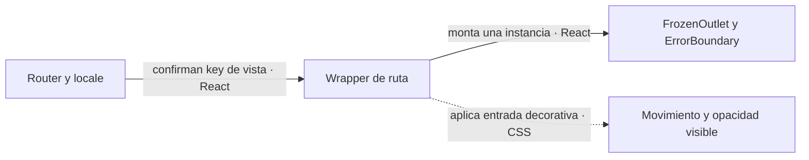

# ADR-0005 — Layouts explícitos (Authenticated/Guest) y módulos base maquetados

- **Estado:** Aceptada
- **Fecha:** 2026-08-12
- **Área:** app

## Problema

En la app original el "layout de invitado" estaba implícito: `GateDeAcceso` (un guard
de router) devolvía pantallas full-screen distintas según el estado de acceso, y el
único layout real (`ContenedorPrincipal`) envolvía todo lo demás. Al migrar había que
decidir cómo estructurar los cascarones antes de traer la primera vista, con dos
restricciones:

- Paridad visual con la app original (gradient hero, sidebar colapsable, navbar).
- Primero **maquetar** — nada de lógica de fetch (Supabase, licencia, notificaciones,
  créditos llegan en fases posteriores).

## Decisión

Los cascarones viven en **`src/layouts/`** (nueva carpeta de infraestructura, junto a
`router/` e `i18n/`), separados de los módulos de dominio:

- **`AuthenticatedLayout/`** — shell de la app con sesión: `Sidebar` (colapsable, port
  del original), `Navbar` (toggle de tema + selector de idioma), `ErrorBoundary` (port
  de LimiteDeError: si una vista explota, el sidebar sigue vivo) y `FrozenOutlet`
  (captura única de la vista por instancia de ruta; véase la enmienda del
  2026-10-08). Cada layout lleva sus `components/` y `types/` propios.
- **`GuestLayout/`** — full-screen con el gradient hero y doodles flotantes; hospeda
  las vistas de `auth` (login, acceso denegado).
- **Módulos base:** `auth` (views `Login`, `AccessDenied`), `home` (view `Home`, panel
  principal que durante el maquetado indexa las demás maquetas), `setup` (view
  `Splash`, standalone sin layout — su trabajo real es el bootstrap del sidecar, por
  eso vive en setup), y `PageNotFound` en `modules/common/views/` como catch-all `*`.
- **Regla de dependencias afinada** (documentada en CLAUDE.md): las rutas de un módulo
  (`constants.ts`) son su contrato público e importables desde otros módulos y
  layouts; componentes/hooks/api siguen siendo privados del módulo. `router/` y
  `layouts/` son infraestructura.
- El gate de acceso real (login → verificación → denegado) se implementará como
  composición en el router cuando llegue la fase de auth; los layouts no deciden
  autorización.

### Forma

```
router
├── AuthenticatedLayout ── / (Home)            ← con sesión
├── GuestLayout ────────── /login, /acceso-denegado
├── (sin layout) ───────── /splash             ← arranque
└── * ─────────────────── PageNotFound
```

Quedaron **fuera a propósito** del maquetado (dependen del sidecar/Supabase): campana
de notificaciones, banner de trial/plan del sidebar, OAuth real, verificación de
acceso, progreso real del splash.

## Alternativas consideradas

- **Layouts dentro de `modules/common/layout/`** — descartada: los layouts componen
  vistas de varios módulos y navegan entre ellos; como parte de `common` invertirían
  la regla de dependencias (common no importa de módulos). Como infraestructura
  top-level esa dependencia es legítima y explícita.
- **Replicar el patrón del origen (guard que devuelve pantallas)** — descartada: mezcla
  autorización con presentación; con dos layouts explícitos, el guard de la fase auth
  solo decidirá QUÉ rama del router se renderiza.
- **Un único módulo `inicio` placeholder (estado anterior)** — reemplazado: `home`
  ocupa su lugar con el shell real alrededor.

## Consecuencias

- ✅ Migrar una vista = elegir layout + colgarla del router; el shell ya está.
- ✅ Las vistas de invitado comparten fondo/animaciones sin duplicar el gradient.
- ⚠️ Los items del sidebar de secciones no migradas son maquetas deshabilitadas
  (tooltip «próximamente»); hay que habilitarlos módulo a módulo al migrar.
- ⚠️ El e-mail mostrado en `AccessDenied` y el progreso del splash son estáticos hasta
  la fase de auth/setup.
- 🔒 `src/layouts/` no contiene lógica de dominio ni llamadas de datos: solo cascarón,
  tema, idioma y navegación.

## Verificación de cumplimiento

- **Build/lint (corren hoy):** `pnpm format && pnpm lint && pnpm build` en verde.
- **Greps ejecutables:**
  - `grep -rln "fetch(" src/layouts src/modules/auth src/modules/home src/modules/setup`
    → vacío (maquetado sin red).
  - `grep -rn "supabase" src/` → vacío hasta la fase de auth.
  - Paths literales en `<Link to>`/rutas → solo constantes de `constants.ts`.
- **Cómo se vería una regresión:** un layout importando componentes internos de un
  módulo (rompe la regla de dependencias), o una vista montada fuera de su layout
  (login con sidebar, p. ej.).

## Referencias

- ADR-0003 (fundaciones), ADR-0004 (i18next).
- Origen de los ports: `02-vimo/cursor-video/app/src/compartido/layout/` y
  `caracteristicas/gestion-de-licencias/` del repo original.

## Enmienda 2026-10-08 — La navegación no espera animaciones

La QA nativa mostró ruta destino seleccionada en el sidebar mientras el main
quedaba invisible y el contenido/título anteriores permanecían montados. Se
reprodujo el mecanismo con el layout real y sus dependencias: retener solamente
`onfinish` de la salida de opacidad impide a `AnimatePresence mode="wait"`
liberar el outlet anterior. Entregar ese mismo callback permite montar el destino.
La razón de la demora concreta de WebKit sigue sin determinarse.

La presentación de rutas pasa a un `div` con la misma key de pathname/idioma.
React reemplaza la instancia anterior al confirmar la ruta; no hay salida que
retenga el montaje. Se conservan `FrozenOutlet`, `ErrorBoundary` y el scroller.
La captura sigue evitando montajes añadidos por cambios locales del shell.

La entrada es CSS decorativa de 220 ms, desplazamiento de 8 px y opacidad
0.96→1. El estado base es visible; no usa callbacks ni relleno backwards/both.
Con movimiento reducido se desactiva. Una animación detenida no oculta la vista
ni decide su ciclo de vida. La antigua salida/fundido desde cero queda retirada.



**Contrato:** un destino comprometido tiene una instancia montada; no depende de
`onExitComplete`, de rAF ni de eventos CSS. StrictMode puede repetir efectos en
la misma instancia de desarrollo. **Fallo:** si falla la animación, el contenido
sigue montado y visible; si falla el render, permanece el ErrorBoundary.
**Por qué:** una transición visual no puede impedir la navegación. No se modifica
el árbol de rutas, los loaders de acceso, la sesión ni el pipeline.

Alcance y evidencia: [fix de navegación](../../fixes/2026-10-08_nonblocking-route-navigation.md).
