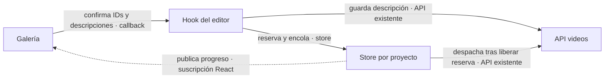
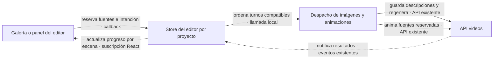

# ADR-0014 — Módulo Library: edición sobre las stages, regeneración selectiva y un solo escritor por proyecto

- **Estado:** Aceptada
- **Fecha:** 2026-08-25
- **Área:** pipeline / app
- **Completa a:** [ADR-0010](ADR-0010-pipeline-por-stages-y-migracion-por-modulos.md)
  (pasos 5 y 7, fusionados) · **Actualiza a:** [ADR-0009](ADR-0009-preferencias-nativas-y-carpeta-raiz.md)
  (carpeta `clips/`) y [ADR-0013](ADR-0013-modulo-create-runner-de-stages-y-binarios.md)
  (materializa el merge por id que difirió)

## Problema

La ADR-0010 dejó Library en dos pasos (lectura y acciones) y Create (paso 6) se
adelantó dejando el contrato preparado: `scenes.json` congelado con
`userPrompt`/`imageModel`/`imageQuality` reservados, `untilStage` en
`run-video-pipeline`, `explicitNewImage` en los lanes de imagen y el merge por
id designado para `pipeline/project/scenes-file.ts`. Faltaba decidir cómo la
biblioteca lista/edita proyectos sin repetir la infraestructura del origen
(broadcaster SSE con replay, locks por proyecto, env mutable) y sin romper los
guards de gasto que Create ya paga.

## Decisión

**Library se implementa completo en un paso (lectura + editor), como vistas del
módulo `videos`, con la edición montada sobre las MISMAS stages del runner:
rebanadas del registro con configuración por contexto, merge por id en la
persistencia de escenas, y un único escritor de jobs por proyecto en la UI.**

Materialización:

1. **Vistas del módulo `videos`** (Library, LibraryPlayer, LibraryProgress,
   LibraryEditor): comparten `api/`, `constants.ts` y tipos con Create — es el
   mismo dominio (proyectos de video). Claves i18n del grupo `library.*` en
   inglés (convención de `create.*`).
2. **Listado derivado del disco**: `list-video-projects` escanea la carpeta
   raíz; «es un proyecto» = carpeta con `project.json` válido con la forma
   nueva. `hasVideo`, `imageCount` y la miniatura (imagen de la escena de menor
   id) se derivan del filesystem al listar — jamás se persisten rutas
   absolutas. Entradas corruptas se saltan sin romper el listado (patrón de
   `music-history`). **Los proyectos del Vimo original no se listan** (ids con
   `_`/mayúsculas y metadata en español no pasan los guards): no es un bug, es
   formato viejo.
3. **`videoOutdated` explícito en `VideoProjectMetadata`** (campo aditivo; el
   formato congelado es `scenes.json`, no la metadata). `markVideoOutdated`
   solo marca si HAY un mp4 válido y **nunca lo borra** (paridad con el
   origen); lo limpian los jobs que completan un render. Descartado derivarlo
   por mtimes: el drag de tiempos no toca archivos comparables con el mp4.
   Sin «versiones anteriores» de render: re-render sobreescribe `<slug>.mp4`
   (decisión de producto).
4. **Regeneración selectiva = runner sobre `[scene-prompts, images]`** con
   `regenerateSceneIds` en el `CreateVideoContext`:
   - `imagesStage` no se saltea y pasa esos ids como `forceRegenerate` **y**
     `explicitNewImage` — el ÚNICO bypass de la cosecha de una tarea Evolink ya
     pagada, exclusivamente con pedido explícito del usuario. Las pasadas de
     recuperación de Create siguen cosechando `imageTask` intactas.
   - «Reescribir prompt» = borrar `imagePrompt` antes de correr: scene-prompts
     rellena SOLO lo que falta priorizando el `userPrompt` persistido.
   - El proveedor de imagen del payload es un **override transitorio** del job
     (clon de options); modelo/calidad por escena sí persisten
     (`update-scenes`).
   - El comando **no toca `metadata.state`**: es cirugía de editor — un job
     muerto no deja un `generating` huérfano. El resultado
     (`regenerated`/`failed`) se deriva comparando mtimes de las imágenes:
     el lane conserva el archivo viejo hasta que el nuevo sale OK.
5. **Merge por id en `pipeline/project/scenes-file.ts`** (lo que ADR-0013
   difirió): `mergeScenesById` re-lee el disco y reemplaza solo lo propio;
   `writeScenesOwned` es la escritura de las stages — sin `ownedIds` (pipeline
   completo) escribe entero como siempre; con ellos (regen) hace merge. Una
   edición del usuario durante una regen no se pisa.
6. **Concurrencia sin broadcaster**: el disco es la verdad; el `Channel` del
   invoke solo pinta el vivo; al rehidratar se **refetchea, no se re-reproduce**.
   - **Un pipeline completo/render a la vez en toda la app** (store
     `useCreateTask` compartido con Create; simplificación consciente frente al
     «uno por proyecto» del origen, reversible con un map de tasks).
   - **Regens coalescidas**: la cola de la UI junta escenas y lanza UN job de
     regen por proyecto; lo encolado durante el job sale en el siguiente lote.
     El paralelismo del origen se conserva DENTRO del job (semáforos de los
     lanes), pero en disco hay un solo escritor de regen.
   - Exclusión por proyecto en el store del editor (`useLibraryEditorTask`,
     sin localStorage): regen ⊻ render ⊻ export ⊻ audio.
   - **Huérfanos `generating`** (job muerto con la app; no hay proceso
     residente): se derivan EN LA UI como «interrumpido» con CTA Reanudar —
     `run-video-pipeline` corrige el disco al relanzar (cache-hit). Un comando
     de lectura jamás escribe estado.
7. **Render-only** (`render-video`): depura `render` de `completedStages` y
   corre `[renderStage]` — el cache por manifest de chunks re-renderiza solo lo
   cambiado. Un fallo NO marca el proyecto en error: el mp4 anterior queda
   intacto (mezcla a temporal + rename atómico) y `completedStages` ya cuenta
   la verdad.
8. **Narración**: `upload-narration` (Create) invalida words/scenes;
   `replace-narration` (Library) **preserva** las escenas — re-transcribe con
   el runner sobre `[transcription]` y **redistribuye los tiempos uniformes**
   sobre la duración nueva (imágenes y prompts intactos). Dos comandos a
   propósito.
9. **Música**: la generación IA **reusa los subcomandos del dominio music**
   (`generate-music`, `suggest-music-prompt`) — providers una sola vez;
   `set-project-music` solo recibe la URL ganadora (validación http(s) + cap
   50 MB), la vía YouTube (yt-dlp), un archivo local o el quitado.
   `bgmOffsetSeconds` entra a `VideoProjectOptions` y a la mezcla final
   (`-ss` como opción de input).
10. **Export de clips** a `clips/` (actualiza el layout de ADR-0009): un mp4
    mudo por escena vía `renderChunk` de UNA escena (mismo Ken Burns por índice
    global) + narración/música copiadas. Carpeta regenerable, se limpia en cada
    export; la abre la UI con el opener — el sidecar jamás spawnea `open`.
11. **`get-image-credits`**: saldos Fal/Evolink por separado (uno caído no
    tumba al otro); el billing de Fal exige key tipo Admin → código propio
    `fal_admin_key_required`.
12. **Reordenar escenas (retirado).** Existió `swap-scene-visuals` — drag &
    drop del timeline que intercambiaba lo visual entre dos tramos dejando
    narración, texto y tiempos en su lugar. Se retiró del sidecar y de la UI:
    no funcionaba de forma fiable y el editor no lo necesita. Si vuelve, la
    regla sigue siendo la misma: lo atado al audio jamás se mueve.

Rust no se tocó: los comandos genéricos `start_pipeline_job`/`cancel_pipeline_job`
cubrieron los 12 subcomandos nuevos.

13. **Un fallo de regeneración es visible y persistente por escena.** El
    carril de imagen emite `scene-image-failed` con `code` + `detail` (motivo
    técnico del proveedor) y lo espeja como `log` warn — el emitter vuelca los
    warn/error a stderr, que Rust registra como `sidecar stderr` en el log de
    la app. La UI guarda el motivo por escena (`sceneErrors`) hasta el
    próximo intento y lee `result.failed` del `job-completed` para el banner.
    En la stage `images`, un objetivo de regeneración cuenta como listo solo
    cuando ESTE job produjo su imagen nueva (la vieja queda en disco): así entra
    a las pasadas de recuperación como en el origen, pero el gate final no lo
    trata como hueco (su imagen anterior sigue siendo válida para el render).
    El borrador de la descripción sobrevive a los refetches y se persiste al
    salir de la textarea. Desde 2026-09-17 `rewritePrompt` ya no depende solo
    de ese borrador: guardar lo dejaba limpio y la descripción quedaba inerte.
    El sidecar reescribe también cuando `userPrompt` difiere de
    `appliedUserPrompt` (campo aditivo de `scenes.json`), ver el
    [informe](../fixes/2026-09-17-fix-editor-regenerate-user-prompt/editor-regenerate-user-prompt.md). Y
    «Re-exportar» (el botón de render del editor; hasta 2026-09-07 decía
    «Re-renderizar») nunca genera imágenes (solo `render`, paridad con el
    origen): la imagen nueva sale de «Regenerar imagen».

## Alternativas consideradas

- **Derivar «desactualizado» por mtimes** — descartada: el drag de tiempos no
  toca ningún archivo comparable con el mp4 y la mezcla de señales da falsos
  positivos/negativos. El flag explícito es lo que el origen validó.
- **Un lock en disco por proyecto** (como el broadcaster del origen) —
  descartada: con un único despachador en la UI (el store) y el merge por id,
  el lock solo agregaría estados huérfanos que alguien debería limpiar.
- **Normalizar los `generating` huérfanos desde `list-video-projects`** —
  descartada: un comando de lectura no debe escribir, y el sidecar (proceso por
  job) no puede saber si otro job sigue vivo.
- **Regens con N jobs paralelos por proyecto** (como el origen) — descartada:
  N procesos escribiendo `scenes.json` completo multiplican la ventana de
  carrera; la cola coalescida da la misma UX con un solo escritor.
- **Duplicar la generación de música en el dominio videos** — descartada: los
  providers viven UNA vez (ADR-0010); el editor consume los subcomandos de
  music y solo persiste el resultado elegido.

## Consecuencias

- ✅ El editor completo (regen, re-render, export, narración, música, mezcla,
  timeline) montado sobre las stages existentes: cero lógica de proveedores
  duplicada, guards de gasto intactos.
- ✅ La biblioteca funciona aunque la app se cierre a mitad de cualquier job:
  todo estado rehidratable desde disco.
- ✅ `convertFileSrc` con cache-buster por mtime provisto por el sidecar: la
  imagen regenerada se ve sin cambiar de ruta.
- ⚠️ Un solo pipeline completo a la vez en la app (el origen permitía uno por
  proyecto): guard con toast. Decisión reversible.
- ⚠️ Ventana residual de read-modify-write entre `update-scenes` y una regen en
  vuelo: aceptada y acotada (merge pegado al write, un solo job de regen).
- 🔒 `explicitNewImage` SOLO se llena con ids pedidos por el usuario; ninguna
  pasada automática lo usa.

## Verificación de cumplimiento

- Los guards de ADR-0010/0013 siguen vacíos: `grep -rn "process.env" pipeline/`,
  `console.log` fuera del emitter, `stage-*` emitido por stages, `spawn` fuera
  de `utils/ffmpeg.ts` y `providers/ytdlp/`, import runtime de `@pipeline` en
  `src/`.
- `grep -rn "explicitNewImage" pipeline/` → solo `lane.ts`, `images.ts` (y los
  lanes que lo consumen): ningún caller nuevo lo llena fuera de
  `regenerateSceneIds`.
- Harness (`pnpm pipeline:harness`, corrido en la implementación):
  `list-video-projects` salta corruptos/reservados/ids inválidos;
  `update-scenes` de una escena deja las demás byte-idénticas y marca
  `videoOutdated` (solo si cambian los tiempos, ver adenda 2026-09-11); regen sin claves falla limpio sin tocar mtimes ajenos;
  `render-video` real (ffmpeg empaquetado) sobreescribe el mp4 con chunks
  cache-hit y limpia `videoOutdated`; `render_missing_images` deja el mp4
  anterior intacto; `export-clips` deja `clips/` con un mp4 por escena +
  narración; `replace-narration` reemplaza el audio preservando `scenes.json`.
- `pnpm check:locales` — los tres catálogos declaran las mismas claves.
- **Cómo se vería una regresión:** una stage llenando `explicitNewImage` sin
  pedido del usuario; un comando de lectura escribiendo `project.json`; una
  regen persistiendo escenas fuera de `writeScenesOwned`/`mergeScenesById`; el
  export spawneando `open`; un `videoOutdated` que borra el mp4.

## Fuera de alcance

- **Versiones anteriores de render** (`video_anterior_*.mp4` del origen): no se
  portan; el flag de desactualizado cubre el aviso.
- **Logs por proyecto y «copiar runtime»**: el pipeline nuevo no escribe logs a
  disco; el diagnóstico viaja por eventos.
- **Migración de proyectos del Vimo original**: formato incompatible; sería un
  proyecto en sí y se decidió no arrastrar el pasado.
- **Paginación/búsqueda del listado**: el origen tampoco la tenía; se agrega si
  las bibliotecas reales lo piden.

## Adenda 2026-09-08 — el listado se parte en pestañas por formato

La grilla de la biblioteca pasa a tener dos pestañas: «Formato largo»
(proyectos 16:9 y los previos al selector de formato, que no traen
`videoFormat`) y «Shorts» (9:16). La tarjeta toma el aspecto del formato del
proyecto y la grilla de shorts suma una columna. Es puro frontend sobre el
mismo `list-video-projects`: el sidecar no cambia y `videoFormat` sigue siendo
opcional. La pestaña activa se recuerda en `localStorage`
(`LIBRARY_TAB_STORAGE_KEY`) y se fija al formato del último proyecto creado en
`useCreateTask.startCreation`, así la biblioteca abre donde está el video
recién hecho. Sin parámetro en la URL ni rutas nuevas: `VideosRoutes.library`
sigue siendo la única entrada. La navegación al terminar de generar sigue
yendo al editor (ADR-0016).

## Referencias

- ADR-0009 (layout de proyecto; gana `clips/`), ADR-0010 (orden de migración;
  este es el módulo final), ADR-0013 (contratos congelados que este módulo
  consume).
- Origen del port: `02-vimo/cursor-video/app/src/caracteristicas/biblioteca-de-videos/`
  y `app/servidor-local/rutas/proyectos.ts` (referencia de comportamiento,
  solo lectura).

## Adenda 2026-09-11 — `update-scenes` marca `videoOutdated` solo ante cambios que afectan el render

Hasta ahora `update-scenes` marcaba `videoOutdated` en cada guardado, y el
editor guarda al tocar el selector de proveedor/calidad, marcar personajes o
salir de la descripción: un proyecto en «Listo» pasaba a «Desactualizado» con
solo mirarlo. El comando ahora compara cada patch con la escena en disco y
marca solo si cambian `startSeconds`/`endSeconds` en valor (precisión de
milisegundos, la misma con que la UI acota fronteras y el manifest de chunks
fija la duración). Prompt, modelo, calidad y personajes solo afectan a la
próxima regeneración, y ese job ya marca por su cuenta cuando una imagen
cambia de verdad. Además, el pipeline completo con auto-render limpia el flag
al terminar, igual que `render-video`.

## Adenda 2026-09-17 — lotes directos desde galería

Por petición del usuario, la galería ejecuta regeneración y animación en su lugar
de revisión. Se retira la cola humana que navegaba entre escenas. El modal conserva
solo selección y descripciones; el store sigue siendo dueño de los trabajos.
Un input vacío reutiliza el prompt; uno no vacío guarda `userPrompt` y encola
`rewritePrompt: true`. La mutación recibe `projectId` como variable explícita,
incluida la invalidación, para no redirigir callbacks pendientes al cambiar ruta.

**Regla reemplazada por la adenda 2026-09-29 para regeneración desde galería.**
La galería guardaba todas las descripciones bajo una reserva local `savingScenes`:
se adquiere síncronamente antes del primer await de escritura, bloquea trabajos
competidores y se libera en finally. Las imágenes se encolan bajo esa reserva y
se despachan al liberarla. No se modifica la lease, el contrato ni los escritores
del sidecar. Los guardados previos del panel impiden iniciar esa reserva.

**Fallo y verificación:** guardar falla → no se genera y se conservan los inputs;
aceptar encolado → selección limpia, progreso independiente. Cerrar el modal no
cancela jobs. Las animaciones se planifican como una selección conjunta, incluidos
clips fusionados pendientes, y usan la concurrencia y recibos de ADR-0042. Validar
un lote mixto de prompts, doble clic, guardado lento, cambio de proyecto, saldo
insuficiente, fusión y cierre/reapertura; pasos y evidencia en
[el fix de galería directa](../../fixes/2026-09-17_direct-gallery-actions.md).

## Adenda 2026-09-29 — admitir trabajos disjuntos sin escritores simultáneos

Por petición del usuario se permite enviar nuevos lotes de imágenes o clips mientras
otros trabajan. Se mantiene el store existente por proyecto y los mismos comandos
del sidecar. La admisión reserva las fuentes y conserva una instantánea del prompt
y proveedor; el guardado se realiza al obtener turno, antes de regenerar. Las
ediciones exclusivas (deshacer, audio y exportación) siguen usando sus reservas.

**Contratos:** una fuente no admite dos trabajos superpuestos, incluidas las dos
imágenes de un clip fusionado y los recibos de envío incierto. Los clips conservan
sus carriles concurrentes y cuotas. Un lote de imágenes espera a los clips activos;
solicitudes más nuevas no lo adelantan indefinidamente. Solo el lote activo guarda
sus descripciones. Un identificador por solicitud impide que eventos o handles
atrasados se adjudiquen al lote siguiente.

**Fallo:** si guardar falla, no se llama al generador; se conserva la descripción
para reintentar. Cancelar durante ese guardado evita iniciar después el job.
Cerrar la galería o cambiar de ruta conserva los encargos en memoria; cerrar la
aplicación no ofrece persistencia de los trabajos todavía no enviados. Una tarea
con recibo pendiente o incierto mantiene sus fuentes bloqueadas hasta resolverse.

**Motivo y validación:** admitir trabajo no equivale a escribir simultáneamente.
Se elimina el bloqueo global de la galería sin alterar las leases, el contrato del
sidecar, la planificación de tiempos ni las cuotas. Ver
[el fix de selección y cola](../../fixes/2026-09-29_gallery-selection-and-queue.md).

## Adenda — selección y cola de regeneraciones, 2026-09-19

El gate de `imagesStage` y la omisión de prompts de Mi estilo consideran sólo
`regenerateSceneIds` en el editor; Create conserva su evaluación global. También
se acotan a esa selección el despacho pago y las pasadas de recuperación: una
regeneración no genera escenas vacías ajenas al pedido.

El store conserva un único escritor por proyecto. La UI permite selección
múltiple Flow y encolar otras escenas mientras trabaja. Captura el proveedor y
el borrador por solicitud; guarda esos borradores bajo la exclusión del job.
Durante una regeneración bloquea la edición de campos y fronteras del timeline,
pero permite elegir otras escenas para encolarlas. Esto reduce la ventana de
read-modify-write mencionada antes; no introduce un mutex global nuevo.

Cada operación tiene identidad propia para rechazar eventos/handles tardíos.
`scene-image-ready` limpia el error de esa escena; un fallo global posterior no
se le atribuye si su imagen ya se importó. Un fallo específico posterior sí se
conserva. El cierre refetchea el disco y el aviso amarillo sigue mostrando los
faltantes reales. Los detalles de UUID, reservas y recuperación Flow están en
[ADR-0052](ADR-0052-flow-como-motor-de-imagenes.md#regeneración-del-editor-por-selección--2026-09-19).

### Enmienda 2026-10-11: movimiento opcional al exportar clips

La UI confirma la exportación antes de iniciar `export-clips`. El payload admite
`imageMotion?: boolean`: omitido/true mantiene el Ken Burns existente; false
conserva el mismo encuadre fijo y reloj sin movimiento de cámara. Se valida antes
de limpiar la carpeta regenerable. No cambia el proyecto ni el render final.
Los videos ya animados y las transiciones mantienen su tratamiento anterior.
El movimiento está integrado en el MP4, no son keyframes de un editor externo.
Los tres idiomas, el foco y la exclusión de tareas conservan el contrato del editor.
Validación y límites en `fixes/2026-10-11_exportar-clips-con-movimiento-opcional.md`.
