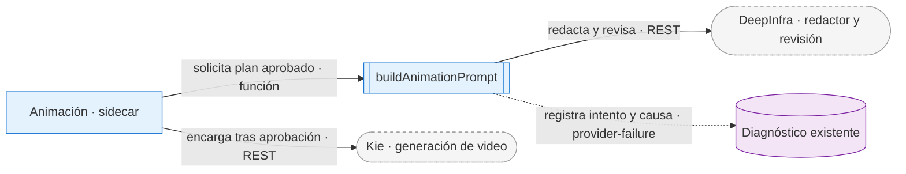
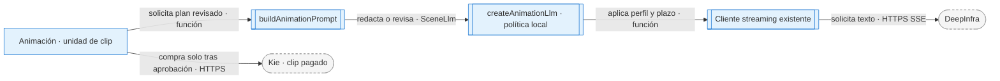

# ADR-0042 — Animación Kie por intervalos, recibos y respaldo automático

- **Estado:** Aceptada
- **Fecha:** 2026-09-14
- **Área:** pipeline | providers | app
- **Sustituye:** las reglas de duración, selección de proveedor, visión y recorte de ADR-0047 y ADR-0041.

## Decisión

> **Actualización vigente del 2026-09-29:** [ADR-0045](ADR-0045-prefijo-animado-por-parejas-y-fase-propia.md) sustituye el prefijo de imágenes de 6 s por fuentes de 3 s agrupadas en clips de 6 s, separa `animation` como séptima fase y limita el formulario nuevo al primer minuto. Las opciones de alcance del editor, sus reglas de selección y los recibos permanecen. Los párrafos históricos afectados se identifican debajo; no deben reimplementarse como política vigente.

**Histórico — seis fases e imágenes de 6 s, SUPERADO el 2026-09-29 por ADR-0045:**

El usuario autorizó explícitamente implementar su revisión del 2026-09-14. Se preservan invoke/Channel, el sidecar por job y las seis fases: la operación opcional de animación corre después de completar imágenes, dentro de esa fase, y también desde animate-scenes en el editor.

Revisión del 2026-09-14: al activar animación en el formulario, los primeros N minutos se cortan cada 6 s antes de generar imágenes y prompts. Un minuto completo crea diez escenas; dos minutos, veinte. El resto sigue los segundos elegidos en Mi estilo o la cantidad total de Catálogo, ajustada a escenas de 3–12 s. El plan puro de ventanas se comparte con las estimaciones y la vista previa de cortes. La pausa existente comunica animationMinutes y persiste el conteo sugerido; no añade preguntas.

Las escenas de ese prefijo guardan animationRequestedSeconds=6: incluso si el audio termina en un fragmento incompleto, el encargo es de 6 s y el archivo final se ajusta al intervalo real, sin alargar la narración. Si ya existen prompts, imágenes, tareas o clips, se conservan los cortes históricos. Reanudar no redistribuye trabajo pagado.

**Reglas del editor que se conservan:**

En el editor, las escenas existentes conservan sus tiempos: 4–12 se animan individualmente. Revisión autorizada del 2026-09-15: en shorts 9:16 cada escena se anima por separado, incluidas las de 3 s (encargo de 4 s ajustado a 3 s). En 16:9 se conserva la fusión de dos escenas contiguas de 3 s en 6 s aunque expresen lugares distintos. Una escena de 3 s sin pareja encarga 4 s y usa velocidad exacta 4/3 para ocupar su intervalo. Un fragmento menor de 3 s en el borde de un minuto o de un proyecto muy corto conserva el inicio del clip a velocidad normal y se recorta: no se acelera 20 veces un tramo de 0,2 s. Nunca compensa tiempo tomando segundos de la siguiente. Los bordes absolutos se cuantizan al reloj visual de 25 FPS, sin sumar redondeos por escena.

Se conserva la presentación del editor: panel y botón azul, icono de claqueta, spinner, barra de progreso y clips con borde azul y brillo de selección en el timeline. El switch activo del formulario usa el mismo color y responde al clic en todo su encabezado. La tarjeta compartida muestra la estimación a 18 px, la duración a generar y la cantidad de nuevos clips; se retiran de la UI la referencia de 6 s y la explicación sobre cobros.

Revisión autorizada del 2026-09-16: la interacción del 2026-09-14 que abría una ventana individual queda sustituida. «Animar clip», «Rehacer clip» y «Reanudar» ejecutan directamente desde el panel derecho, con estimación compacta, duración, saldo de Kie y actualización visibles antes del botón. Conservan bloqueo por saldo, falta de clave, operaciones incompatibles o demo, y el spinner y progreso durante la tarea. El recibo histórico mantiene título singular/plural, duración y cargo remoto, o costo desconocido. Al seleccionar una escena absorbida se muestra el recibo del clip que la cubre; rehacer presupone el grupo completo que el sidecar reemplaza de forma atómica.

«Animar el inicio del video» conserva su ventana Radix sin overlay, arrastrable por su encabezado dentro del viewport, incluso sobre el sidebar. Se cierra con X, Escape o clic exterior. El portal no cambia el tamaño del preview y cerrar no cancela una tarea.

El selector del editor admite minutos enteros entre 1 y floor(duración real / 60). En videos menores de un minuto se ofrece animar su duración completa, sin selector imposible. Un borrador vacío conserva la estimación de un minuto y se normaliza a 1 al salir; cero y valores fuera de rango se corrigen antes de presupuestar o enviar. La duración de creación todavía desconocida no se usa como límite ficticio. Se mantiene el contrato existente de minutos enteros y el corte del plan al final del video.

**Histórico — alcance del formulario y ausencia de fase propia, SUPERADO el 2026-09-29 por ADR-0045; la opción del editor se conserva:**

Revisión autorizada del 2026-09-15: «Animar todo el video» se ofrece en shorts 9:16, tanto al crear como en el editor, sin extender por ahora esa opción visible a 16:9. Crear persiste `animateWholeVideo`, mutuamente excluyente con un prefijo positivo; al conocer la duración del audio se reutiliza el cortador de 6 s y la confirmación existentes. No se añaden fases, comandos, IPC ni cambios Rust. El editor envía los ids del trabajo pendiente al comando `animate-scenes` existente, sin `force`. El límite del audio se aplica también al pedir minutos; ninguna solicitud nueva puede rebasarlo. Antes de medir audio propio, la estimación total se presenta como pendiente, nunca como cero créditos.

**Reglas de continuidad y recibos que se conservan:**

Ampliar del primer minuto a todo conserva cada clip listo y su recibo, en ambos formatos. Solo se generan intervalos faltantes, incluida la cola estática de una escena parcialmente animada. Un reemplazo pagado pendiente conserva ids válidos aunque el clip anterior todavía lo cubra.

Los prefijos por minutos pueden acabar dentro de una escena. Scene.animations contiene bloques activos con identidad y límites; animationPending contiene candidatos y recibos, sin retirar el anterior hasta validar el nuevo. animation histórico sigue siendo legible. Esto permite ampliar un prefijo sin pagar otra vez su parte existente. Cada versión tiene un MP4 propio, físicamente mudo y ajustado antes de ready; export-clips y preview leen los mismos intervalos.

La política interna es Kie, Grok Imagine Video 1.5 Preview, 480p y formato 16:9 o 9:16 del proyecto. Tras dos fallos remotos confirmados y reintentables del generador se usa Seedance 1.5 Pro. Autenticación, saldo, moderación, 429, fallos de consulta/descarga/procesamiento y envíos ambiguos no son fallos de modelo. No se ofrecen modelos ni PoYo en UI; los datos históricos no se borran.

El redactor recibe texto: guion, prompts estáticos, fragmentos temporales e identidad de personajes. La respuesta exige sujeto principal, acción observable, cámara, movimiento secundario opcional y continuidad por escena; desde el 2026-09-16 se usa DeepSeek V3.2 por defecto en el primer intento. La política inicial de repetir premium una sola vez quedó superada el 2026-09-22 por el rescate acotado de tres redactores descrito debajo; ningún candidato inválido autoriza el POST pagado. La selección es exclusiva del redactor de animación: la configuración global y los prompts estáticos conservan sus modelos. Se mantiene el dispatcher compartido: 429 con esperas limitadas y degradación a equilibrado ante timeout; la preferencia inicial por DeepSeek no es un pin que suprima esa recuperación existente. Se prioriza la acción del sujeto desde los primeros fotogramas y se subordina el ambiente a esa acción. La ventana utilizada debe contener el gesto esencial; se elimina la instrucción de micromovimiento seguido de reposo en clips cortos. El reparto se toma de `charactersPresent` y del prompt estático: la ficha de un personaje no obliga a introducirlo donde no aparece. Las personas presentes mantienen identidad y encuadre, permitiendo movimiento natural. Los clips y recibos previos no se reescriben al reanudar. No usa visión ni inventa un prompt de respaldo que autorice gasto. Las referencias se preparan en el formato del proyecto, especialmente porque Grok ignora aspect_ratio con una imagen. Los tiempos de transición pedidos al modelo son instrucciones, no garantías verificadas.

### Coherencia narrativa dentro del intervalo (2026-09-17)

El redactor recibe las palabras de `words.json` que coinciden con el intervalo de cada segmento. Sus marcas absolutas se trasladan al reloj del clip generado con la misma velocidad que usa la normalización; no se recortan ni reordenan las escenas persistidas. En intervalos con varias ideas, la acción debe repartir el foco según la voz y no prolongar el fragmento inicial durante todo el clip. Si la transcripción falta o es inválida, se conserva el texto local sin inventar precisión temporal; las palabras de duración cero al final del audio se omiten.

El prompt estático actual determina el inventario visual. El guion completo y las frases vecinas explican contexto, pero no autorizan participantes nuevos ni acciones fuera de su ventana. El prompt histórico del remake permanece guardado, pero no se envía al redactor: se indica solamente que es una nueva versión, evitando copiar errores anteriores. Cada segmento recibe solamente las identidades de personajes que le corresponden; una lista vacía no elimina a extras ya visibles. Un objeto pasivo puede seguir fijo mientras se anima el elemento narrativo existente. Se conserva el movimiento concreto y no se exige fabricar un agente oculto para mover un objeto.

Antes de autorizar una solicitud de video nueva, una segunda llamada textual revisa el candidato contra la descripción estática actual, identidades por segmento y narración local con tiempos. No recibe el guion global ni el prompt histórico. Un rechazo devuelve correcciones al siguiente redactor, nuevamente revisado. El límite inicial de dos redacciones y dos revisiones quedó superado por la política del 2026-09-22. Una respuesta de revisión inválida o un rechazo persistente produce `animation_prompt_failed`, conservando el clip anterior y sin comprar video. Se reutiliza el tier premium y su manejo existente de errores; no se añade estado público, subcomando o proveedor. La revisión evalúa contradicciones concretas de inventario, reparto, idea y tiempos; no exige que la descripción de una imagen inmóvil enumere cada movimiento o fuerza ambiental. Una deriva u ondulación natural no demuestra la existencia de un participante oculto. La revisión es probabilística, no una certificación visual.

La auditoría de `video-3.3.3` verificó clips de cinco segundos sin desplazamiento acumulado en timeline/render y sí una invención narrativa en el prompt del saco. [Causa, evidencias y límites](../../fixes/2026-09-17_animation-narrative-timing.md). No hay migración de los videos pagados ni garantía semántica por fotograma: una nueva redacción se usa al animar o rehacer; reanudar conserva el recibo original.

### Rescate del redactor y diagnóstico (2026-09-22)

> La selección de modelos, el transporte JSON no streaming y la recuperación después de una revisión agotada descritos aquí quedan sustituidos por la revisión del 2026-09-28. Se conservan las reglas de evidencia, reparto, cronología, recibos y fallo seguro.

La recuperación de contenido es exclusiva de `buildAnimationPrompt`: tres candidatos como máximo, con tiers `premium → economy → balanced` (defaults DeepSeek V3.2, Mistral Small 3.2 y Qwen3 235B). La preferencia inicial se mantiene y los otros dos modelos reutilizan configuración, clave y transporte existentes. El benchmark previo favorecía Mistral como respaldo de relación calidad/precio; la elección no demuestra superioridad universal. Se pide `json_object` también al redactor, hasta 2000 tokens por candidato, y se devuelve feedback concreto sobre JSON, campos, IDs, repetición o longitud. Un rechazo semántico adjunta el borrador fallido de este mismo encargo como `candidate_to_repair` junto al feedback; se corrigen sus problemas conservando lo válido. Nunca se reenvía el prompt histórico de un video pagado. No se modifica el dispatcher global ni el redactor de guiones/previews.

Una revisión válida que rechaza el candidato exige corregirlo: nunca se consulta otro revisor para conseguir un voto favorable sobre esa misma contradicción. Solo una revisión malformada o un fallo recuperable de transporte habilita otra revisión del mismo candidato, con tier `balanced`; la revisión empieza siempre en `premium`, incluso si el redactor fue otro. Máximo dos revisiones de 1000 tokens por candidato. El máximo es tres redacciones y seis revisiones, aparte del backoff/fallback de transporte existente. Autenticación, saldo, cancelación y cuota agotada se propagan sin reiniciar la cadena de tres redactores.

La revisión recibe `visual_references` separadas de `narrative_context`. Antes del veredicto aporta citas del candidato y de la descripción estática de la misma escena. El parser comprueba esas citas (normaliza únicamente Unicode, espacios y mayúsculas), cobertura de todas las escenas y ausencia de evidencias nulas al aprobar. Para rechazar basta evidencia comprobada en las escenas afectadas; no se descarta un rechazo fundamentado por omitir comprobaciones de escenas sanas. Un rechazo puede omitir citas secundarias defectuosas cuando cada issue conserva cita real y evidencia válida de su escena; una aprobación nunca admite esas citas. Cada rechazo también cita un fragmento existente del candidato: evita feedback sobre afirmaciones que el revisor imaginó. Se eliminaron ejemplos negativos literales que aparecieron falsamente en una revisión real. Esto comprueba procedencia textual, no implica que una cita justifique semánticamente cualquier acción.

El adaptador local de animación clasifica JSON HTTP inválido y cuerpos interrumpidos con códigos de transporte conocidos; los errores de programación desconocidos se propagan. No cambia el proveedor compartido.

Si la narración atraviesa un corte y menciona algo que no está en la imagen actual, se continúa una acción visible de esa imagen hasta una idea compatible. El pensamiento se expresa mediante gestos observables, sin proponer imágenes mentales ausentes. La revisión conserva prioridad del inventario; no añade un participante u objeto para representar literalmente una frase del plano anterior. Esta protección es textual y probabilística: no inspecciona imágenes ni corrige automáticamente un video ya pagado.

**Contratos:** se conserva el IPC y se usan eventos `provider-failure` existentes, con fase, tier solicitado, intento, escena, código y status real. Los eventos nuevos no incluyen guion, candidatos, correcciones del revisor ni cuerpos de errores LLM. El dispatcher compartido conserva su propio diagnóstico previo.

**Fallo:** agotado el rescate, permanece el modal de reintento y el clip/imagen previo. Un error de red/servicio final conserva su código LLM; un candidato nunca aprobado termina en `animation_prompt_failed`. No se compra video con un prompt de relleno. Los recibos conocidos omiten todo este proceso y se recuperan sin nueva redacción.

**Motivo:** se reprodujo JSON truncado repetido sin feedback y un 401 convertido erróneamente en fallo genérico del prompt. Los logs históricos solo guardaban el mensaje final y no permiten atribuir la causa exacta a cada ejecución anterior. El refuerzo conserva la revisión semántica y vuelve observable la clasificación de los fallos futuros.

### Redacción y revisión rápidas aisladas (2026-09-28)

La autorización del usuario del 2026-09-28 extiende los modelos evaluados al generador de prompts de video. `animation/llm.ts` implementa el mismo contrato `SceneLlm` mediante el cliente streaming existente. Solo `animation/generate.ts` cambia su factoría; no cambian `createSceneLlm`, los tiers globales, guiones, previews, fragmentación, audio, Rust ni fases del sidecar.

El mapa local es `premium = DeepSeek V4.1 Flash`, `economy = MiMo V2.6 Flash` con `reasoning_effort: none` y `balanced = Claude Haiku 4.5`. El redactor usa premium → economy → premium (V4.1 → MiMo → V4.1 con feedback) y la revisión premium → balanced. Haiku queda fuera de las redacciones normales de reparación, aunque puede escribir como rescate de transporte ante timeout; ese candidato también debe revisarse antes de comprar video. La revisión de un rechazo no se somete a votación; debe corregirse el candidato. Los modelos internos de movimiento no dependen de cuáles se ofrecen en el selector de imágenes.

La llamada usa los dos mensajes originales, respuesta streaming completa obligatoria y 2000 tokens de contenido del redactor o 1000 del revisor, sin margen adicional de razonamiento. El sistema pide JSON y el parser lo valida; no se envía `response_format` ni muestreo distinto al del cliente medido. Cada llamada tiene techo de 45 s, conserva el backoff ante 429 y el rescate de timeout del dispatcher existente, pero todos sus destinos son ahora modelos de esta política local. La cancelación previa corta antes de solicitar nada. Autenticación y saldo no cambian de modelo.

Si se agotan las dos revisiones por transporte o contrato inválido, se propaga ese fallo sin reescribir el candidato ya válido. Se reprodujo una redacción multiplicada a tres y su revisión a seis únicamente por caída del revisor; ahora ese caso hace una redacción y dos revisiones. Un rechazo semántico válido sí permite reparar el mismo clip con sus fuentes y feedback. No se regeneran otros clips ni se modifica el prompt de recibos pagados.

La revisión incluye audio explícito y marcas de tiempo fuera de la ventana global de cada segmento. Estas clases de defecto aparecieron en borradores reales: sonido pese al contrato mudo y segunda escena con reloj reiniciado en cero. No se promete detección perfecta. El revisor narrativo temporal del redactor de imágenes y este control de movimiento son componentes distintos; esta decisión no convierte el validador temporal de imágenes en una dependencia permanente.

**Contratos y fallos:** no hay cambios de IPC ni de reloj; la falta de un plan aprobado impide comprar un video nuevo. Conservar una imagen o clip anterior no se presenta como generación exitosa. Los tiempos observados son medidas de solicitudes individuales, no un SLA de menos de un minuto para una cantidad arbitraria de clips, la cola del proveedor o sus reintentos.

**Evidencia:** seis redacciones reales y cuatro revisiones adicionales sobre controles explícitos, total USD 0,0248572608. V4.1 Flash redactó en 7,53 y 13,28 s y revisó en 5,17 y 10,30 s; MiMo redactó en 14,84 y 30,88 s; Haiku redactó en 5,78 y 8,59 s. Ambos revisores aprobaron el control apoyado en la fuente y rechazaron el caso con actor añadido, conexión alterada, sonido y reloj inválido. Son medidas textuales con muestras pequeñas: no certifican fidelidad del MP4 ni equivalen a una ejecución completa escritor → revisor → Kie. [Causa, límites y validación](../../fixes/2026-09-28_animation-text-models-and-review-retries.md).

## Contrato de ejecución

Antes del POST se persiste un intento creating; después se conserva taskId y resultado remoto. Un cierre entre esos dos puntos queda ambiguo y no repite la compra automáticamente. Las consultas y la normalización reanudan el recibo. La cancelación conserva trabajo y se espera a todas las tareas antes de cerrar el job.

Revisión autorizada del 2026-09-16: sustituye el bloqueo de un único job individual. Los `animate-scenes` comparten la lease del proyecto; todos los otros mutadores conservan lease exclusiva. Cada grupo completo de escenas tiene exclusión propia y los checkpoints releen/actualizan escenas y metadata bajo una lease corta común. Un job no limpia estados de otro y los eventos tardíos se descartan por id de solicitud. El editor acepta múltiples selecciones: hasta diez jobs locales activos por proyecto y el resto en cola visible. La espera no muestra porcentaje ficticio; preparar, esperar cuota y generar son estados distintos. Cancelar retira la cola aún no enviada y solicita cancelar todos los jobs activos, conservando recibos incluso si el jobId llega tarde.

La [FAQ oficial Kie](https://kie.ai/), revalidada el 2026-09-16, declara veinte solicitudes nuevas cada diez segundos, hasta 120/min, sin máximo estricto de tareas activas. Diez es el límite local por recursos, no la cuota del proveedor. El ledger compartido por huella de clave reserva cada POST; otros clientes de la cuenta pueden producir 429. Un rechazo 429 confirmado espera al menos una ventana, respeta Retry-After y aplica backoff acotado sin consumir intentos de respaldo. No se guardan claves en esa coordinación.

Rehacer recupera las unidades del clip listo: mismos segundos solicitados, inicio/fin y referencias, incluso una fusión histórica de seis segundos en un short cuya política nueva genera imágenes individuales. El presupuesto usa ese mismo contrato. El prompt/recibo anteriores pasan al historial al publicar el reemplazo. Revisión del 2026-09-17: se sustituye el envío del prompt anterior al redactor por una indicación de remake sin ese contenido; la nueva acción se fundamenta en la imagen actual y la voz para no heredar participantes o causas inventados. Reanudar una tarea con recibo sigue usando su prompt intacto. La nueva redacción es una intención de mejora, no una garantía de calidad audiovisual.

La exclusión usa turnos propios PID/UUID recuperables al morir el proceso; no elimina el archivo de un nuevo dueño. La cuota reserva cada POST antes del envío. Un registro de cuota corrupto espera una ventana completa bajo exclusión antes de reiniciarse. Escenas y metadata usan archivos temporales únicos, escritura sincronizada y reemplazo por rename; un fallo no se presenta como guardado. Un clip se anuncia listo después de publicar su manifest. Cambiar tiempos con clips o candidatos asociados queda bloqueado.

Las consultas del editor migran oportunistamente clips históricos a MP4 mudo de 480p bajo la misma exclusión. Si hay un escritor ocupado, no migran ni exponen el original con audio. Los archivos y recibos históricos se conservan. Las tareas antiguas de PoYo no autorizan nuevas compras en ese proveedor.

Reanudar consulta tareas existentes y termina descargas pagadas antes de pedir saldo para nuevas unidades. Tras agotar los intentos de generación, el botón explícito del editor permite un presupuesto nuevo; reanudar automáticamente no lo reinicia. Una pausa por saldo mantiene la posición Grok/Seedance y los importes anteriores.

## Costes y consecuencias

Tarifas públicas verificadas el 2026-09-14: Grok480p 2,4 cr/s, Seedance480p sin audio 1,75 cr/s; crédito USD0,005. La FAQ oficial de Kie aclara que las generaciones fallidas no se cobran. La estimación muestra los nuevos segundos encargados × 2,4: 6 s ≈ 14,4 créditos; un minuto ≈ 144; dos minutos ≈ 288. Se retira la contingencia de 6,55 cr/s porque sumaba intentos fallidos como si fueran éxitos cobrados. El respaldo automático cuesta menos; el cargo conocido sigue viniendo del recibo remoto, sin inventar importes ni alterar recibos históricos. Imágenes y redactor tienen coste aparte.

Los fundidos viven dentro del intervalo asignado; no reducen su duración ni añaden una cola fija. La imagen de respaldo se conserva si falla una generación. No se promete exactitud semántica por fotograma ni se verifica visión: eso requiere revisar el resultado.

Revisión autorizada del 2026-09-15: los límites contiguos con un clip animado listo en cualquiera de los lados siempre llevan fundido. Entre dos imágenes estáticas el valor inicial es corte directo; el checkbox del editor habilita el fundido mediante `Scene.staticTransitionIn`, persistido por `update-scenes`. Los marcadores morados, preview, render y exportación de clips comparten la política pura. Se conserva Ken Burns y el reloj de 25 FPS. El fundido usa hasta 8 cuadros del bloque entrante, sin alterar sus límites. Esa revisión de transiciones no modificó el transporte, los subcomandos ni las fases; la separación posterior de animación está descrita en ADR-0045.

La inspección pausada muestra el bloque actual opaco; si el render vigente contiene un fundido en ese instante, se superpone el recurso editable sin desmontar el video. Fuera del fundido se conserva la pausa del render final. El campo `renderTransitionVersion` se publica al completar el render y el editor considera desactualizados los renders de una política anterior; no elimina sus archivos. La versión de caché de chunks también cambia. Causa reproducida, superficies protegidas y alcance en [la auditoría de selección y transiciones](../fixes/editor-selection-transitions.md).

## Verificación ejecutable

- `scripts/check-animation-provider.mjs`: contrato HTTP simulado, recibos, respaldo, ambigüedad y fallos de saldo/autenticación/cuota.
- `scripts/check-animation-service.mjs`: prefijos, recuperación y publicación de reemplazos atómicos.
- `scripts/check-animation-coordination.mjs`: procesos independientes, cancelación, muerte del escritor y cuota compartida.
- `scripts/check-animation-timing.mjs`: FFmpeg empaquetado, número real de cuadros, ausencia de audio, cortes, migración y transición entre chunks.
- `scripts/check-animation-frontend.mjs`: componentes y hooks reales en Chrome con servicios simulados.
- `scripts/check-editor-transitions.mjs`: matriz de cortes y fundidos con píxeles reales, límites de chunks, exportación y persistencia sin alterar recibos.
- `scripts/check-animation-packaged.mjs`: contrato NDJSON sobre el ejecutable SEA reconstruido.

Estas comprobaciones no consumen generaciones reales de Kie. La calidad del movimiento, la fidelidad del personaje y el cumplimiento visual de las marcas temporales requieren aceptación con clips reales. El esquema de Grok admite referencias múltiples, pero no garantiza anclas de primer/último fotograma.

## Fuentes

- [Grok schema](https://docs.kie.ai/market/grok-imagine/1-5-preview)
- [Seedance schema](https://docs.kie.ai/market/bytedance/seedance-1-5-pro)
- [Cuotas](https://docs.kie.ai/1973359m0)
- [Consulta de tareas](https://docs.kie.ai/market/common/get-task-detail)
- [Precios](https://kie.ai/pricing)
- [FAQ oficial: tareas fallidas sin cargo](https://kie.ai/)
