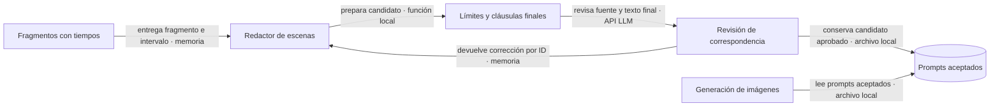

# ADR-0043 — Correspondencia temporal de imágenes y narración

- **Estado:** Aceptada
- **Fecha:** 2026-09-26
- **Actualizada:** 2026-09-29 — se aclaran carácter temporal y concurrencia vigente, sin cambiar código.
- **Área:** scene-prompts / revisión previa a imágenes
- **Relacionadas:** ADR-0019 (Mi estilo), ADR-0036 (Catálogo), ADR-0042 (animación).

## Problema

Video-1 conserva sus tiempos, pero imágenes 14–18 ilustran ideas de otros intervalos. IDs, cantidad y formato correctos no acreditan correspondencia narrativa. El contexto global permitía anticipar acontecimientos, y una sanitización posterior podía recortar el tema que se había revisado. La inspección real también encontró una casa con vista orbital después del regreso: se exige que todas las vistas/props sean compatibles con el destino actual, no solo su etiqueta.

## Decisión

La revisión LLM es una **medida temporal mientras se corrige la redacción de origen**, no una garantía permanente de coherencia. Añade coste y latencia en DeepInfra. Su retirada requiere comparar salidas originales de varios guiones; las comprobaciones locales de IDs y la recuperación selectiva deben mantenerse. Ver la guía de [revisión del PR](../handoff/2026-09-29-animation-dev-review.md).

Mantener cortador, voz, timeline y render: no se encontró deriva temporal en esos componentes. Cada escena real incorpora su intervalo y fragmento como autoridad. Vecinos solo completan pronombres/frases truncadas; no prestan acontecimientos. La descripción manual manda si el usuario la escribe; los silencios sostienen el contexto previo.

Ambos redactores revisan el texto después de los mismos límites y cláusulas que aplicará imágenes. La revisión usa DeepSeek V4 Pro en el cliente DeepInfra existente, a temperatura 0, en lotes de seis y hasta cuatro lotes simultáneos por revisión, con un límite compartido de 200 por señal/job. La documentación original indicaba dos; este texto refleja el código vigente sin modificarlo. No coordina otros procesos que compartan la cuenta. La fábrica de revisión clona la configuración y fija sus tiers al mismo modelo: no degrada a un juez más débil por timeout ni cambia el redactor elegido. Exige IDs únicos completos, evidencias numeradas por código y cuatro comprobaciones obligatorias: foco, eventos, lugar/estado y causalidad. Las citas se derivan del texto original; el modelo no las reescribe. Un rechazo válido vuelve al redactor con feedback; no se pide otra opinión para obtener aprobación. Incluso si otra entrada invalida el lote, se retienen los rechazos de entradas completas con ID único al reparar el formato; una entrada inválida o duplicada no alimenta esa memoria. Un resultado malformado admite hasta dos intentos de formato, además de las políticas de transporte existentes.

Mi estilo conserva sus lotes y escalera de rescate. Solo se reescriben IDs no aceptados; el texto final revisado queda congelado para persistencia y resultado, evitando recomposiciones de vestuario concurrentes. Previews sin audio no activan este contrato. Catálogo conserva su redactor, candados y tres intentos; añade revisión de su candidato final también en rescates por contenido. Cuando se pierde una foto de referencia, se revisa la variante exacta que añade identidad textual y vuelve a recortarse, antes de enviar el rescate. Un rechazo detiene esa compra; el prompt guardado mantiene su referencia original.

**Contrato:** la revisión nunca modifica intervalos, audio, IDs ni texto narrado. Las llamadas extra son texto en la cuenta DeepInfra existente; no añaden proveedor, clave, evento ni fase del pipeline.

**Fallo:** auth/saldo/cancelación se propagan. Un lote no verificable o escenas pendientes detienen la fase antes de nuevas imágenes con relleno; los prompts aceptados se conservan para reanudar. En concurrencia se esperan las tareas en vuelo antes de devolver el fallo.

**Por qué:** desplazar audio o alargar clips ocultaría el error de contenido y desalinearía el resto del proyecto.

## Límites

La comparación real V4 Pro acertó 11/12 casos: detectó los adelantamientos de tormentas/auroras/regreso y el lugar equivocado tras regresar a Tierra, pero aprobó una relación causal incorrecta en otro prompt (congestión atribuida a especias). Esta limitación queda abierta; no se oculta como prueba aprobada. Una revisión LLM sigue siendo probabilística. Citas válidas prueban procedencia, no verdad semántica; exige evaluación real de negativos/positivos y revisión audiovisual. Una imagen estática puede representar varios conceptos de un intervalo, pero no mostrar una secuencia interna exacta de acciones como un video. La cuantización del render conserva el tiempo acumulado dentro de su resolución de fotogramas.

No se reescriben automáticamente assets pagados de proyectos históricos. No se migra Catálogo a Mi estilo, no se cambia la generación de guiones ni las previews, ni se introducen modelos de visión.
