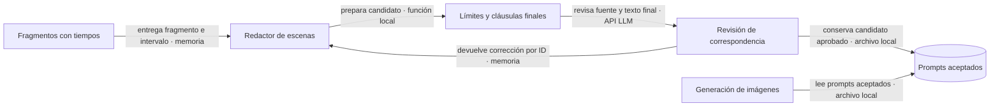
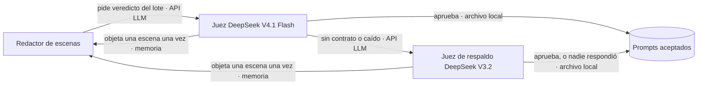

# ADR-0043 — Correspondencia temporal de imágenes y narración

- **Estado:** Aceptada; desde el 2026-10-04 la revisión LLM es asesora, con juez de respaldo, y nunca frena un video (ver «Revisión asesora con respaldo»)
- **Fecha:** 2026-09-26
- **Actualizada:** 2026-09-29 — se aclaran carácter temporal y concurrencia vigente, sin cambiar código. 2026-10-04 — se retira la revisión LLM y, esa misma noche, vuelve como asesora con respaldo.
- **Área:** scene-prompts / revisión previa a imágenes
- **Relacionadas:** ADR-0019 (Mi estilo), ADR-0036 (Catálogo), ADR-0042 (animación).

## Problema

Video-1 conserva sus tiempos, pero imágenes 14–18 ilustran ideas de otros intervalos. IDs, cantidad y formato correctos no acreditan correspondencia narrativa. El contexto global permitía anticipar acontecimientos, y una sanitización posterior podía recortar el tema que se había revisado. La inspección real también encontró una casa con vista orbital después del regreso: se exige que todas las vistas/props sean compatibles con el destino actual, no solo su etiqueta.

## Decisión

La revisión LLM es una **medida temporal mientras se corrige la redacción de origen**, no una garantía permanente de coherencia. Añade coste y latencia en DeepInfra. Su retirada requiere comparar salidas originales de varios guiones; las comprobaciones locales de IDs y la recuperación selectiva deben mantenerse. Ver la guía de [revisión del PR](../handoff/2026-09-29-animation-dev-review.md).

Mantener cortador, voz, timeline y render: no se encontró deriva temporal en esos componentes. Cada escena real incorpora su intervalo y fragmento como autoridad. Vecinos solo completan pronombres/frases truncadas; no prestan acontecimientos. La descripción manual manda si el usuario la escribe; los silencios sostienen el contexto previo.

Ambos redactores revisan el texto después de los mismos límites y cláusulas que aplicará imágenes. La revisión usa DeepSeek V4 Pro en el cliente DeepInfra existente, a temperatura 0, en lotes de seis y hasta cuatro lotes simultáneos por revisión, con un límite compartido de 200 por señal/job. La documentación original indicaba dos; este texto refleja el código vigente sin modificarlo. No coordina otros procesos que compartan la cuenta. La fábrica de revisión clona la configuración y fija sus tiers al mismo modelo: no degrada a un juez más débil por timeout ni cambia el redactor elegido. Exige IDs únicos completos, evidencias numeradas por código y cuatro comprobaciones obligatorias: foco, eventos, lugar/estado y causalidad. Las citas se derivan del texto original; el modelo no las reescribe. Un rechazo válido vuelve al redactor con feedback; no se pide otra opinión para obtener aprobación. Incluso si otra entrada invalida el lote, se retienen los rechazos de entradas completas con ID único al reparar el formato; una entrada inválida o duplicada no alimenta esa memoria. Un resultado malformado admite hasta dos intentos de formato, además de las políticas de transporte existentes.

Mi estilo conserva sus lotes y escalera de rescate. Solo se reescriben IDs no aceptados; el texto final revisado queda congelado para persistencia y resultado, evitando recomposiciones de vestuario concurrentes. Previews sin audio no activan este contrato. Catálogo conserva su redactor, candados y tres intentos; añade revisión de su candidato final también en rescates por contenido. Cuando se pierde una foto de referencia, se revisa la variante exacta que añade identidad textual y vuelve a recortarse, antes de enviar el rescate. Un rechazo detiene esa compra; el prompt guardado mantiene su referencia original.

**Contrato:** la revisión nunca modifica intervalos, audio, IDs ni texto narrado. Las llamadas extra son texto en la cuenta DeepInfra existente; no añaden proveedor, clave, evento ni fase del pipeline.

**Fallo:** auth/saldo/cancelación se propagan. Un lote no verificable o escenas pendientes detienen la fase antes de nuevas imágenes con relleno; los prompts aceptados se conservan para reanudar. En concurrencia se esperan las tareas en vuelo antes de devolver el fallo.

**Por qué:** desplazar audio o alargar clips ocultaría el error de contenido y desalinearía el resto del proyecto.

## Retirada de la revisión LLM (2026-10-04) — superada por «Revisión asesora con respaldo»

**Qué pasó.** El 2026-10-04, por la tarde, el modelo fijo del revisor (`deepseek-ai/DeepSeek-V4-Pro` en DeepInfra) empezó a devolver una copia de su entrada (`{"candidates": [...]}`) en vez de su veredicto (`{"scenes": [...]}`), con cualquier pedido: lotes de 6, de 2 y de 1 escena, con y sin modo JSON, y un pedido mínimo de 100 caracteres. Llegaba al tope de 3 000 tokens con el JSON cortado, el intento de reparación hacía lo mismo y cada lote terminaba en `scene_prompt_alignment_failed`. Como el contrato de **Fallo** de arriba detiene la fase cuando un lote no se puede verificar, ningún video pasaba de «Validando prompts», ni en el Catálogo ni en Mi estilo. Reintentar no servía (temperatura 0: la misma respuesta) y cambiar de modelo tampoco (el revisor no usa el modelo que elige el usuario). Además, cada escena rechazada contaba como un defecto del redactor, y tras cuatro rondas la app culpaba y bloqueaba una hora al modelo que escribe aunque DeepInfra hubiera respondido bien. DeepSeek V3.2, DeepSeek V4.1 Flash y Qwen3 235B respondían bien con el mismo pedido, pero cada uno juzgaba distinto las mismas dos escenas.

**Decisión del dueño.** Retirar la revisión con un segundo modelo, después de probar videos reales sin ella: se rehicieron sin revisión tres proyectos hechos con ella, con los dos redactores vigentes (DeepSeek V4.1 Flash y Claude Haiku 4.5; 50 escenas). Ninguna imagen mostró un momento de otro intervalo; la revisión, en cambio, había aprobado un adelanto (la primera escena de un video ya mostraba lo que narraba la segunda). La diferencia que sí apareció: con Claude Haiku 4.5 y un estilo con protagonista que fija el fondo, sin revisión el protagonista quedó en el mismo lugar en 9 y 12 de 15 escenas (con revisión, 3), mostrando el lugar narrado como maqueta o mapa. Ya se había medido el costo: con revisión, 19 prompts tardaban 89 s contra 30 s sin ella, y algunos rechazos eran discutibles (`fixes/2026-09-28_fast-scene-prompt-models.md`).

**Qué queda.** Cada escena sigue llegando al redactor con su fragmento, su intervalo y sus vecinos (`narrativeCandidateFor`), y siguen las comprobaciones locales de IDs. `reviewNarrativePrompts` no llama a ningún modelo y no objeta nada; ella y `createNarrativeReviewLlm` conservan su firma para que los carriles no cambien, y el contrato de **Fallo** ya no tiene a qué esperar. Lo que sigue cortando la fase son las escenas que el redactor no logra escribir tras sus rondas y el rescate con otro modelo, como antes. Si se quisiera volver a revisar, tendría que ser sin frenar el video (si el revisor no responde, el prompt pasa) y con un modelo de respaldo. Informe: `fixes/2026-10-04_narrative-reviewer-advisory.md`.

## Revisión asesora con respaldo (2026-10-04, segunda decisión)

**Pedido del dueño.** Ver si la revisión ayudaba en algo, cambiarle el modelo y, si ese modelo falla, usar otro que funcione. Reemplaza la retirada de arriba: la revisión vuelve, pero ya no puede frenar un video.

**Elección de los jueces.** Se pasaron a seis modelos de DeepInfra las mismas 14 escenas reales etiquetadas (3 errores conocidos de otro momento del relato y 8 escenas correctas, más 3 casos que resultaron inválidos), con la instrucción, los candidatos y el contrato de producción, en lotes de seis:

| Juez                | Errores atrapados | Escenas buenas rechazadas | Contrato            |
| ------------------- | ----------------- | ------------------------- | ------------------- |
| DeepSeek V4.1 Flash | 2 de 3            | 0 de 8                    | 3 de 3, 6 a 10 s    |
| DeepSeek V3.2       | 2 de 3            | 0 de 8                    | 3 de 3, 17 a 35 s   |
| DeepSeek V4 Pro     | 1 de 3            | 2 de 8                    | 3 de 3              |
| gpt-oss-120b        | 3 de 3            | 3 de 8                    | 3 de 3              |
| Qwen3 235B          | 0 de 3            | 1 de 8                    | 3 de 3, hasta 116 s |
| Claude Haiku 4.5    | —                 | —                         | 0 de 3              |

Los 3 casos inválidos eran una escena con descripción manual del usuario («el muñeco jugando fútbol») que el script de prueba armó sin esa descripción: con ella, el juez aprueba el fútbol, como corresponde a `user-request`.

**Decisión.**

- **Jueces en orden:** DeepSeek V4.1 Flash y, de respaldo, DeepSeek V3.2. El primero que responde con el contrato decide. Una respuesta sin contrato (como la copia de la entrada del 2026-10-04) o un fallo del proveedor, incluidos saldo y clave, pasa al siguiente. Cada juez tiene un minuto y medio por lote.
- **Corte por video:** un juez que falla dos veces seguidas en un video no se vuelve a llamar en ese video; una respuesta buena borra sus fallas (en un video de 126 escenas V4.1 Flash falló suelto 2 de 25 lotes) (el estado vive por la señal del job, así la fase de imágenes hereda los jueces caídos).
- **Nunca frena:** si ningún juez responde, el lote sigue sin revisión y el log lo dice. Solo la cancelación del job corta la revisión. Las objeciones completas que llegaron en una respuesta a medias se conservan.
- **Una objeción por escena y por video:** la escena objetada se reescribe una vez con la corrección y esa reescritura pasa sin volver a preguntar. Si la reescritura no sale (el redactor falla o no hay modelos), la escena se queda con el prompt objetado y recibe su imagen. En el Catálogo, una objeción en el último intento deja el prompt igual: el revisor nunca deja una escena sin prompt.
- **En lotes parejos y paralelos, después de escribir:** cada revisión parte sus escenas en lotes parejos de hasta seis (20 son 5+5+5+5: V4.1 Flash fallaba en lotes de dos) y manda hasta 12 a la vez. Mi estilo revisa así cada lote de su redactor. El Catálogo, que antes revisaba escena por escena ocupando el turno del redactor, ahora escribe todas las escenas, las revisa juntas en lotes paralelos y reescribe una vez, también en paralelo, las objetadas. La barra de avance cuenta una vez cada escena.
- **La objeción no es culpa del redactor:** en Mi estilo ya no cuenta para «el modelo está devolviendo errores».
- **Sin revisión en el rescate sin foto:** ahí no hay redactor que pueda corregir, así que el juez solo podía frenar la compra.

**Contrato:** la misma instrucción, evidencias numeradas y cuatro comprobaciones de arriba. Las llamadas son de la cuenta de DeepInfra del usuario: unos 0,08 USD por video de 200 escenas con V4.1 Flash, contra unos 0,50 con V4 Pro.

**Fallo:** reemplaza el contrato de **Fallo** de la decisión original. Un lote que ningún juez puede verificar sigue sin revisión; ninguna objeción deja una escena sin prompt ni compra. Lo que sigue cortando la fase son las escenas que el redactor no logra escribir.

**Medido con un video real** (ESTILO COMIC, 10 escenas, Mi estilo, V4.1 Flash, imágenes reales): dos corridas completas, el juez respondió siempre con el contrato. En la primera objetó una escena que ponía al personaje en un archivo y a la vez en una plaza, y la reescritura quedó en la plaza; en la segunda no objetó nada. Prompts en 24 a 35 s, contra 14 s sin revisión. **Con 126 escenas** (las 14 de ese video repetidas 9 veces, solo prompts): Mi estilo 36 s sin revisión y 53 s con ella; el Catálogo 267 s sin revisión, 487 s con la revisión escena por escena y 298 s con la revisión en lotes (la pasada del juez, 21 s). Guard: `scripts/test/check-narrative-review.mjs`. Informe: `fixes/2026-10-04_narrative-reviewer-advisory.md`.

## Límites

La comparación real V4 Pro acertó 11/12 casos: detectó los adelantamientos de tormentas/auroras/regreso y el lugar equivocado tras regresar a Tierra, pero aprobó una relación causal incorrecta en otro prompt (congestión atribuida a especias). Esta limitación queda abierta; no se oculta como prueba aprobada. Una revisión LLM sigue siendo probabilística. Citas válidas prueban procedencia, no verdad semántica; exige evaluación real de negativos/positivos y revisión audiovisual. Una imagen estática puede representar varios conceptos de un intervalo, pero no mostrar una secuencia interna exacta de acciones como un video. La cuantización del render conserva el tiempo acumulado dentro de su resolución de fotogramas.

No se reescriben automáticamente assets pagados de proyectos históricos. No se migra Catálogo a Mi estilo, no se cambia la generación de guiones ni las previews, ni se introducen modelos de visión.
