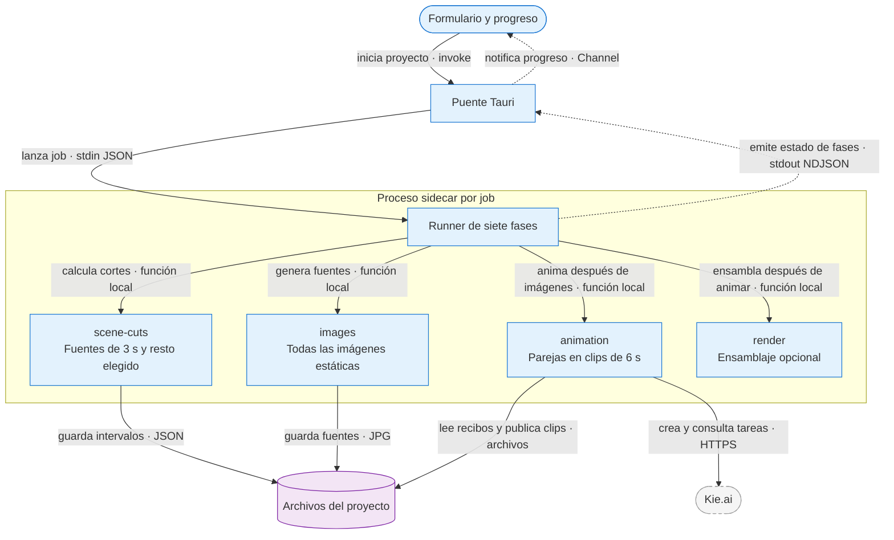

# ADR-0045 — Prefijo animado por parejas y fase propia

- **Estado:** Aceptada
- **Fecha:** 2026-09-29
- **Actualizada:** 2026-09-29 — exclusión de la última escena menor a 3 s, también en el editor.
- **Área:** app | pipeline
- **Sustituye parcialmente:** ADR-0042: fuentes de 6 s al crear, animación dentro de `images` y alcance configurable de animación en el formulario. El usuario autorizó expresamente la nueva fase y delimitó el editor como superficie que debe conservar su planificación.

## Problema

La pantalla permanecía en «Generando imágenes» después de terminar todas las imágenes porque el wrapper de esa fase también esperaba las animaciones. Además, una sola fuente por clip de 6 s reducía la variedad solicitada. Ofrecer minutos arbitrarios o todo el video en el formulario confundía la estimación con un tiempo todavía desconocido.

## Decisión

Crear primero las imágenes del prefijo cada 3 s y animarlas de dos en dos en una fase independiente, conservando los tiempos absolutos de la narración.

- El formulario ofrece solamente activar el primer minuto. El intervalo real es `[0, min(duración del audio, 60)]`. Minutos arbitrarios y «todo» se conservan en las superficies del editor que ya los admitían.
- `planPrefixSceneWindows` usa `ANIMATION_PREFIX_IMAGE_SECONDS = 3`. Veinte imágenes fuente cubren un minuto completo. La duración elegida por el usuario se aplica después de 60 s; si el audio no llega al minuto, no hay tramo estático posterior que configurar.
- La nueva fase `animation`, registrada entre `images` y `render`, activa `pairPrefixScenes` únicamente desde la creación automática. Agrupa 1+2, 3+4, etc., incluso en formato vertical. La pareja terminal solo admite dos fuentes completas de 3 s. **Sustituye la decisión inicial de esta fecha que permitía 3 s más la cola parcial del audio:** por petición del usuario, la última escena real menor a 3 s queda estática.
- Las fuentes del prefijo conservan `animationRequestedSeconds = 6`: un clip automático solicita 6 s al proveedor. La normalización vigente ajusta el archivo al intervalo real. Si sobra una única imagen de al menos 3 s, usa esa referencia; una cola final menor a 3 s no se encarga al proveedor ni se absorbe. No toma una escena después del minuto para completar una pareja.
- El editor no activa la opción de parejas del prefijo. Conserva sus reglas de parejas, escenas individuales y ampliación de rango, aplicando también la exclusión de la última escena real menor a 3 s. Un grupo histórico que incluya esa cola no se rehace parcialmente: primero debe deshacerse completo. Tampoco cambia su límite temporal ni se resta tiempo a la escena siguiente.

### Flujo

**Contratos:** el runner sigue siendo el único emisor de inicio y cierre de fases. `images` termina antes de `animation`; `animation` termina antes del ensamblaje. No se agrega un comando IPC ni se modifica Rust: el puente reenvía el `StageId` tipado existente con el valor nuevo. Los eventos por clip se anuncian desde la redacción para mostrar carga, pero `scene-animation-ready` se emite solo después de publicar el manifiesto guardado.

**Fallo:** una imagen faltante impide entrar en animación. Un clip fallido conserva sus imágenes y recibos; `animation_incomplete` impide continuar al ensamblaje en ese intento. Cancelar conserva los recibos y los avances válidos. Reanudar cosecha tareas ya enviadas y descargas pendientes antes de comprar trabajo nuevo; no reinicia el presupuesto de un intento remoto agotado sin la acción explícita existente.

**Por qué:** mostrar animación como fase propia distingue el trabajo realmente pendiente y permite revisar los clips terminados durante la generación. Dos fuentes por clip aportan la variedad solicitada sin mover la narración.

## Compatibilidad y reanudación

Los cortes históricos de 6 s con su marcador se conservan incluso si el proyecto se pausó antes de redactar prompts. Los proyectos con imágenes, prompts, tareas o clips también conservan los intervalos guardados. No se redistribuyen activos pagados ni se migran proyectos silenciosamente.

`hasAnimationWork` consulta los clips válidos y los candidatos pendientes. Una fase marcada en metadata no autoriza saltar un intervalo incompleto; un clip listo con archivo válido sí impide volver a comprarlo. Las opciones históricas `animationMinutes` y `animateWholeVideo` siguen siendo legibles para reanudar proyectos anteriores, aunque los nuevos envíos del formulario normalizan su alcance a un minuto.

El reloj sigue siendo el existente de 25 FPS: se cuantizan los bordes absolutos. Una cola inferior a un fotograma no crea una duración extra por escena. La calidad semántica y los instantes que el proveedor representa siguen requiriendo revisar el video obtenido.

## Alternativas consideradas

- **Una imagen cada 6 s:** rechazada por la preferencia explícita de variedad; se conserva solo para proyectos históricos.
- **Cambiar el planificador global del editor:** rechazado para no alterar el flujo ya aceptado. La nueva política es opt-in del pipeline.
- **Seguir animando dentro de imágenes:** rechazado porque ocultaba el trabajo pendiente y confundía la finalización de esa fase.
- **Extender un clip más allá del audio o tomar segundos del siguiente:** rechazado porque desplaza la correspondencia con la voz.

## Consecuencias

Un minuto nuevo requiere veinte imágenes fuente en lugar de diez, con su costo y generación correspondientes, pero sigue produciendo diez clips solicitados de 6 s. La estimación de animación cuenta los segundos solicitados; la de imágenes cuenta las fuentes. La cola final menor a 3 s cuesta cero créditos de animación. Una última imagen de exactamente 3 s sigue siendo elegible y puede solicitar un clip completo que se ajusta a su intervalo.

El registro incorpora siete fases; sin animación automática, `animation` se saltea. Con auto-render apagado, la creación termina después de animar y abre el editor sin ensamblar. La demo conserva sus fases simuladas existentes y no invoca proveedores.

## Verificación de cumplimiento

- `pnpm exec tsc -p tsconfig.pipeline.json --noEmit` y `pnpm format`, `pnpm lint`, `pnpm build` verifican los contratos de pipeline y UI.
- Comprobaciones locales del 2026-09-29, fuera del repositorio: 98 casos de cobertura, parejas, fin parcial, igualdad del preview con el cortador, conservación de todas las palabras, caché y reanudación; 384 comparaciones del planificador del editor contra la versión previa. No son pruebas oficiales ni llaman a proveedores pagados.
- Validación manual pendiente de aceptación: crear proyectos de 30, 55,3, 60 y 72 s; en el de 72 s elegir 4 s después del minuto; comprobar pares, fase azul, reproducción de clips y ausencia de desplazamiento de la voz. Reabrir un proyecto anterior de fuentes de 6 s y verificar que sus cortes no cambian.
- Señales de regresión: diez imágenes nuevas en un minuto completo, animación ejecutándose dentro de `images`, escena posterior al minuto absorbida, recompra de un clip listo o cambio de límites al reanudar.

## Referencias

- [ADR-0042](ADR-0042-animacion-kie-por-intervalos-y-recibos.md): recibos, normalización, concurrencia y respaldo.
- [ADR-0043](ADR-0043-correspondencia-temporal-de-prompts.md): fragmentos temporales y narración.
- [Arquitectura](../ARCHITECTURE.md): runner, contrato y fases vigentes.

## Rectificación: cola final estática

La omisión es deliberada y no se comunica como fallo/reintento. Se determina por
el final real de todas las escenas, no por el último elemento seleccionado ni por
un recorte de rango. No altera cortes, narración ni la política de escenas cortas
intermedias. Estimaciones y contadores usan el mismo plan que el sidecar.

Los clips ya pagados no se borran al actualizar. Rehacer un grupo antiguo que
incluye cola corta requiere deshacerlo antes; un recibo pendiente con esa cola se
conserva sin ejecutarse ni provocar una nueva compra de su primera imagen. Detalle
y comprobaciones: [fix de cola estática](../../fixes/2026-09-29_short-final-scene-stays-static.md).
