# ADR-0046 — Recuperación visible y deshacer animaciones

- **Estado:** Aceptada por pedido del usuario.
- **Fecha:** 2026-09-29
- **Rama:** feat/animation-scenes-dev-20260922
- **Área:** editor, creación y sidecar de video.
- **Complementa:** ADR-0042 y ADR-0045. No modifica intervalos, planificación, reloj del editor ni el transporte Rust.

## Problema

Regenerar una fuente estática de un clip listo dejaba dos representaciones distintas de la misma escena. El usuario necesita retirar primero el clip y recuperar sus imágenes. Además, una revisión textual inválida podía fallar antes de Kie sin un reintento visible, y retomar un pipeline con tres tareas remotas fallidas no abría un nuevo presupuesto de intentos.

## Decisión

Agregar `undo-scene-animation` al mapa existente de videos. Recibe `{projectId, sceneId}` y devuelve `{restored:number[]}`. La operación obtiene la exclusión de escritura existente: no compite con render, regeneración, audio ni animación. No agrega invocaciones Rust.

- Se retiran todos los bloques activos que referencian la escena seleccionada; una pareja se deshace completa. Sus recibos y los candidatos terminales afectados pasan a `animationHistory` dentro de la misma escritura atómica de `scenes.json`.
- Se conservan imágenes, prompts, archivos MP4 pagados, audio y tiempos originales. Los consumidores leen bloques activos, nunca el historial. Los aliases históricos se normalizan para evitar que una escena absorbida siga oculta.
- Una tarea ambigua, pendiente o pagada todavía recuperable bloquea deshacer su intervalo. Una fuente ausente conserva el clip y explica el bloqueo. Se invalida el MP4 antes de publicar el nuevo manifiesto: una interrupción no puede dejar un render viejo marcado como vigente.
- La UI oculta regeneración de imágenes cubiertas por clips listos. El sidecar también la rechaza, incluso si la petición llega desde una UI vieja. Una selección mixta no regenera silenciosamente solo parte del lote.
- Deshacer no devuelve créditos ni cancela trabajo remoto. Tras restaurar imágenes se puede regenerarlas y volver a animar por el flujo existente.
- Las fuentes restauradas pierden solamente su encargo automático de 6 s (`animationRequestedSeconds`); el historial conserva los segundos pagados. Así el editor recupera sus reglas normales de pareja o ajuste de velocidad. Al reanudar explícitamente el pipeline automático, su fase repone ese encargo dentro del alcance solicitado y emite las escenas actualizadas, sin cambiar cortes ni recomprar clips listos.

## Flujo

```mermaid
flowchart LR
    user(["Usuario"]):::externo
    ui["Panel o galería"]:::propio
    hook["Mutación del editor"]:::propio
    api["API de videos"]:::propio
    rust["Puente Tauri existente"]:::propio
    command["undo-scene-animation<br/>Exclusión de escritura"]:::propio
    files[("scenes.json y project.json")]:::datos
    user -->|"deshace clip · UI"| ui
    ui -->|"reserva edición · callback"| hook
    hook -->|"solicita restauración · método"| api
    api -->|"inicia job · invoke"| rust
    rust -->|"ejecuta operación · stdin JSON"| command
    command -->|"archiva y restaura fuentes · archivos"| files
    command -.->|"confirma escenas restauradas · NDJSON"| rust
    rust -.->|"resuelve mutación · Channel"| hook
    hook -->|"refresca proyecto · Query"| api
    classDef externo fill:#f5f5f5,stroke:#9e9e9e,stroke-dasharray:4
    classDef propio fill:#e3f2fd,stroke:#1976d2
    classDef datos fill:#f3e5f5,stroke:#7b1fa2
```

**Contrato:** doble invocación sobre un intervalo ya estático devuelve lista vacía y no duplica historial. La reserva dura hasta terminar el refetch; la UI usa datos confirmados, sin ocultar optimistamente clips que podrían no haberse deshecho.

**Fallo:** no hay comunicación con proveedores para deshacer. Fallos de escritura conservan los archivos originales; la invalidación anticipada del render puede producir un aviso conservador, no un falso render vigente. La tarea remota pendiente debe recuperarse por el flujo existente.

**Por qué:** guardar manifiesto e historial juntos evita tratar dos renames como una transacción. Retirar solo referencias activas permite regenerar fuentes sin borrar activos pagados.

## Recuperación y progreso

El evento existente `scene-animation-progress` admite `status: retrying`, `attempt`, `maxAttempts` y `retryPhase`. La UI conserva el reloj original y muestra un solo estado de carga. `scenes-planned` añade el campo opcional `animationEndSeconds` para que las tarjetas respeten el límite automático real, incluso si una imagen heredada cruza el minuto o el final decimal del audio. Es un dato de presentación: no cambia el intervalo de la escena.

La revisión narrativa de imágenes mantiene grupos de hasta seis y sus reglas; ejecuta hasta cuatro grupos por lote y comparte un techo de 200 revisiones por job. Así un proyecto grande conserva el paralelismo de sus lotes sin multiplicar cuatro llamadas por cada uno de los 200 redactores simultáneos. No coordina otras aplicaciones ni cuentas compartidas. Auth, saldo, cancelación y rechazos conservan su comportamiento; se mantienen el revisor temporal y la persistencia de resultados aceptados.

La secuencia de video es Grok y Seedance para fallos remotos confirmados (hasta el 2026-10-05 era Grok, Grok y Seedance; ver la sección del 2026-10-05 de la ADR-0042). Los errores de cuenta, moderación y envíos inciertos no son permiso para recomprar. La revisión textual tiene tres oportunidades sobre el mismo candidato, con corrección de formato/citas y un redactor alternativo; un rechazo semántico no se somete a votación para conseguir aprobación. Reanudar desde la pausa abre intentos nuevos solo para recibos inequívocamente fallidos; los clips listos permanecen intactos. Al agotar la recuperación, `animation_incomplete` ofrece el checkpoint o continuar en el editor.

## Límites deliberados

- No se garantiza que un proveedor siempre genere un video ni coherencia semántica perfecta.
- No existe botón de recuperar un clip archivado: se conserva para trazabilidad, no se publica automáticamente.
- Reanudar expresamente un pipeline completo con prefijo automático puede volver a animar intervalos retirados. Abrir el editor o exportar no ejecuta ese pipeline ni resucita el historial.
- No se modifica fragmentación, presets, generación de guiones/previews ni la reparación de reproducción de ADR-0045.

## Validación

Ver `fixes/2026-09-29_animation-recovery-and-undo.md`: verificaciones de persistencia, cancelación, exclusión y UI con fixtures locales. Los scripts y capturas quedan fuera del repositorio.
