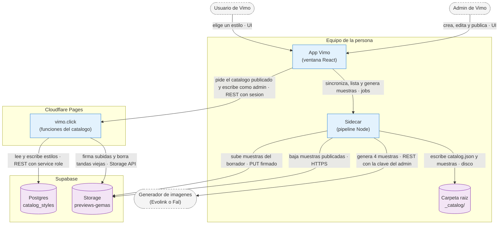
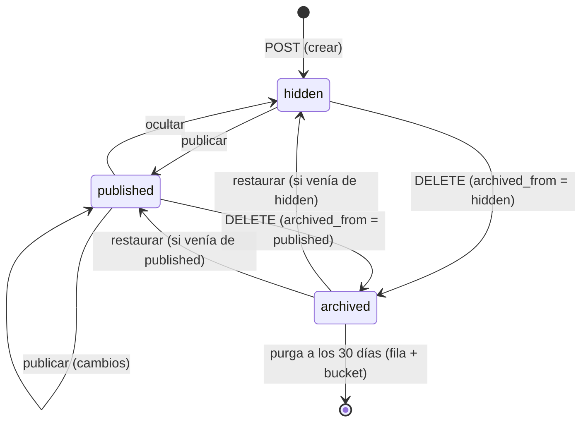

# ADR-0049 — El catálogo vive en el servidor y lo administra el admin desde la app

- **Estado:** Propuesta (2026-10-06), implementada ese mismo día en `feat/catalogo-remoto` (app y
  sidecar) y en `feat/catalogo-remoto` de `vimo-landing` (servidor), con la tabla, el bucket y la
  semilla ya aplicados en Supabase; pasa a Aceptada con la QA del dueño sobre el servidor desplegado
  ([implementation-e3.md](../handoff/2026-09-30-catalog-on-custom-style-lane/implementation-e3.md)).
  Implementa la Entrega 3 del catálogo sobre el carril de Mi
  estilo ([plan-e3.md](../handoff/2026-09-30-catalog-on-custom-style-lane/plan-e3.md), diseño
  [design.md](../handoff/2026-09-30-catalog-on-custom-style-lane/design.md) §9), detrás del
  interruptor `features.remoteCatalog`.
- **Fecha:** 2026-10-06
- **Área:** pipeline / app / servidor (`vimo-landing`) / Supabase
- **Relacionada con:** [ADR-0039](ADR-0039-catalogo-sobre-el-carril-de-mi-estilo.md) (el
  catálogo sobre el carril de Mi estilo), [ADR-0048](ADR-0048-gemas-por-secciones-y-agente-reconstructor.md)
  (las gemas por secciones y el agente que ordena una gema pegada), [ADR-0010](ADR-0010-pipeline-por-stages-y-migracion-por-modulos.md)
  (nada en `pipeline/` lee el entorno) y [ADR-0001](ADR-0001-separacion-interfaz-y-pipeline.md)
  (la interfaz habla con el exterior solo desde `api/`).

## Problema

Desde la Entrega 2 las 38 gemas del catálogo viven dentro de la app
(`pipeline/prompts/catalog-gems/`) y sus muestras en `public/style-references/`. Cambiar una
sección, una etiqueta o el nombre de un estilo, o sumar uno nuevo, exige un commit y una versión
nueva de la app. El dueño pidió (2026-10-03 y 2026-10-04) editar y **añadir** gemas desde la app
con su cuenta de admin, y el 2026-10-06 que un estilo creado así «se muestre a los usuarios que
haya en Vimo» sin esperar un release.

Restricciones:

- La app no tiene credenciales de escritura: el service role de Supabase existe solo en
  `vimo-landing`. Un admin es un correo en la tabla `admins` de vimo.click.
- Sin red, Crear tiene que seguir funcionando con un catálogo: el sidecar no puede depender de la
  nube para listar estilos.
- Las muestras del catálogo las genera Vimo con las claves del admin, en calidad baja; nunca se
  toman de terceros.
- Con el interruptor apagado nada cambia: la pestaña, la copia y el payload de un proyecto son los
  de la Entrega 2, byte por byte.
- Toda pieza que cambie el contrato del sidecar se acuerda antes y se registra acá.

## Decisión

El catálogo pasa a una tabla de Supabase que solo toca `vimo-landing`. Cada estilo tiene un
**borrador** y, si se publicó, una **copia publicada**; los usuarios ven solo lo publicado. El
admin crea, edita, genera muestras, publica, oculta y elimina estilos desde la pestaña Catálogo de
la app. La app le pide a vimo.click el catálogo publicado y el sidecar lo deja en
`<carpeta raíz>/_catalog/` con sus muestras; sin red sirve el último sincronizado y, si nunca
sincronizó, las 38 gemas empaquetadas.

### Supabase

- Tabla `public.catalog_styles`: `id` (texto, el id del estilo: `^[a-z0-9][a-z0-9-]{0,39}$` sin
  el prefijo `st-`, o uno de los 5 heredados), `position`, `status` (`hidden` | `published` |
  `archived`), `draft` y `published` (jsonb con un `CatalogStyleContent`), `published_version`,
  `published_at`, `samples_revision` (la última tanda reservada en el bucket), `revision` (sube
  en cada escritura: con ella dos admins no se pisan), `updated_at`, `updated_by` y, de un
  archivado, `archived_at` y `archived_from` (el estado al que vuelve si se restaura). RLS activo
  y sin políticas: solo el service role, desde `vimo-landing`.
- Bucket `previews-gemas` (nombre elegido por el dueño el 2026-10-06), público de lectura, JPEG
  de hasta 4 MiB. Rutas `<id>/s<revision>/sample-<n>.jpg` (n = 1..4). **Una tanda nunca se
  reescribe:** regenerar las muestras abre la tanda siguiente. Así la caché local es segura y
  publicar no copia nada en el bucket.
- La semilla: las 38 gemas de hoy, publicadas, con `samples: { revision: 0, count: 4 }`: sus
  muestras siguen siendo las que trae la app (ningún usuario baja 20 MB; P1 del plan).

### El contenido de un estilo

`draft` y `published` guardan un `CatalogStyleContent` (`pipeline/types/catalog.ts`): nombre en
tres idiomas, etiquetas, secciones, versión de plantilla, modos permitidos, `sampleMode`
(`generic` | `none`: las muestras no dependen del personaje de un admin), filtro de color y la
tanda de muestras. Los mismos límites en los tres lados: cada sección hasta 12 000 caracteres y
30 000 en total, `character` hasta el tope de la identidad tejida, inicio fijo hasta 600 y final
fijo hasta 1 000 (el de un estilo clonado con IA lleva su ficha de estilo, ADR-0050),
nombre hasta 80, hasta 5 etiquetas de 24 caracteres, 4 muestras JPEG de hasta 4 MiB. «Dinamismo»
y «Personaje fijo» están si y solo si existen las secciones `dynamism` y `character`.

### Endpoints de `vimo-landing`

Con `Authorization: Bearer <access_token>`, JSON, errores `{ code }` (como el agente
reconstructor), guardados por `exigirAcceso` más el interruptor `remoteCatalog` y, los de admin,
`esAdmin`:

| Método y ruta                            | Quién   | Hace                                                                                 |
| ---------------------------------------- | ------- | ------------------------------------------------------------------------------------ |
| `GET /api/catalogo?conocida=<version>`   | usuario | Lo publicado, por posición e id; `sinCambios` si la versión coincide                 |
| `GET /api/admin/catalogo`                | admin   | Todos los estilos con borrador, publicado y estado                                   |
| `POST /api/admin/catalogo`               | admin   | Crea un estilo oculto con su borrador                                                |
| `PATCH /api/admin/catalogo/:id`          | admin   | Guarda el borrador o la posición si `revision` coincide                              |
| `POST /api/admin/catalogo/:id/muestras`  | admin   | Reserva la tanda siguiente y firma una subida por archivo                            |
| `POST /api/admin/catalogo/:id/publicar`  | admin   | Exige nombre en tres idiomas, estilo visual y 4 muestras; publica en una escritura   |
| `POST /api/admin/catalogo/:id/ocultar`   | admin   | `status = 'hidden'`; lo publicado queda guardado                                     |
| `DELETE /api/admin/catalogo/:id`         | admin   | Archiva: `status = 'archived'` 30 días, con lo publicado y las muestras intactos     |
| `POST /api/admin/catalogo/:id/restaurar` | admin   | Vuelve un archivado al estado en que estaba (`archived_from`) si `revision` coincide |
| `POST /api/admin/catalogo/traducir`      | admin   | Completa inglés y portugués del nombre a partir del español (P8)                     |

La versión del catálogo es un hash de (id, versión publicada, posición) de los publicados: la
app manda la que conoce y el servidor responde «sin cambios» sin repetir las gemas.

**Eliminar es archivar (pedido del dueño, 2026-10-06).** Un archivado deja de estar publicado
(sale del manifiesto y las apps lo borran de su caché al sincronizar) y no se edita: guardar,
reservar muestras, publicar u ocultar responden `409 archivado`. Pasados **30 días**
(`DIAS_DE_ARCHIVO`), el servidor lo purga: borra la fila y todo `<id>/` del bucket. La purga es
perezosa, de a 5 estilos, después de responder `GET /api/catalogo`, `GET /api/admin/catalogo` y
el `DELETE` (Pages no tiene cron, y `pg_cron` no puede borrar los objetos del bucket por la API
de Storage); un día de más no cambia nada que vea un usuario.

### Sidecar

Subcomandos nuevos y cambiados (`pipeline/types/catalog.ts`):

| Subcomando                     | Qué hace                                                                                                                                                                                                  |
| ------------------------------ | --------------------------------------------------------------------------------------------------------------------------------------------------------------------------------------------------------- |
| `catalog-styles-list`          | Con `remote: true` y un `_catalog/catalog.json` válido, el catálogo sincronizado con sus muestras; si no, las 38 empaquetadas y `version: null`.                                                          |
| `catalog-styles-sync`          | Valida todo el manifiesto antes de tocar el disco; baja las muestras que faltan (JPEG, hasta 4 MiB, solo desde `samplesOrigin`); escribe `catalog.json` al final y de forma atómica; borra tandas viejas. |
| `generate-style-samples`       | Con `catalogDraft`, genera las 4 muestras del borrador en `_catalog/_drafts/<id>/` con el marco y el modo `sampleMode`.                                                                                   |
| `catalog-style-samples-upload` | Sube cada `_catalog/_drafts/<id>/<file>` con `PUT` a su URL firmada, solo si es de `uploadOrigin`.                                                                                                        |
| `catalog-style-copy`           | Con `remote: true` en el payload busca la gema en el catálogo sincronizado y, si no está, en el empaquetado; con muestras sincronizadas las copia del disco. Sin `remote`, solo el empaquetado.           |
| `generate-character-preview`   | Con `remote: true`, el retrato de una gema del catálogo usa sus secciones sincronizadas; sin `remote`, las empaquetadas.                                                                                  |

La app manda `remote` (los dos interruptores encendidos) en la lista, la copia y el retrato: con el
interruptor apagado el sidecar no mira la caché aunque haya sincronizado antes, así nada cambia.

Carpeta `_catalog/` (reservada, como `_styles/`): `catalog.json` (`{ version, syncedAt, entries }`
sin rutas absolutas), `<id>/s<revision>/sample-<n>.jpg` y `_drafts/<id>/`. Códigos de fallo
nuevos: `catalog_sync_failed` y `catalog_upload_failed`. El sidecar no lee el entorno: los
orígenes permitidos de descarga y de subida le llegan en el payload (ADR-0010).

### App

- `features.remoteCatalog` (`VIMO_FLAG_REMOTE_CATALOG`: `off`, `admins`, `all`), válido solo junto
  con `newCatalog`. Primero solo para admins; a todos con el visto bueno del dueño.
- Al montarse la pestaña Catálogo con el interruptor encendido: lista → manifiesto con la versión
  conocida → `catalog-styles-sync` si cambió → lista. Sin spinner que bloquee y sin mostrar un
  fallo como error: sigue lo que había.
- El admin ve todos los estilos con su estado: «Borrador», «Oculto» o «Cambios sin publicar» como
  distintivo grande en el centro de la tarjeta, en gris oscuro con blanco, sobre las muestras
  apagadas (lo que los usuarios no ven tal cual se nota de lejos); un menú con Editar, Generar
  muestras, Publicar, Ocultar y Archivar gema, la tarjeta «Crear estilo» y
  un modal propio armado con las piezas del modal de Mi estilo («Pegá tu gema» con el agente,
  secciones, avisos, carrusel). Puede usar un borrador en un video propio para probarlo antes de
  publicar. «Guardar borrador» se enciende solo cuando algo cambió respecto de lo guardado (se
  compara el contenido normalizado y la posición, no una marca de «tocado»), y al guardar o
  publicar el modal se cierra y vuelve al catálogo, donde la tarjeta ya muestra el estado.
  «Las muestras salen con» ofrece Genérico, Personaje del estilo y Sin personaje: las
  dos primeras son el mismo modo del carril (con la sección de personaje de la gema, el genérico
  usa ese personaje fijo, en los videos y en las muestras), y solo se pueden elegir las permitidas;
  apagar un modo permitido mueve las muestras al otro, y el último de Genérico/Sin personaje no se
  apaga (las muestras lo necesitan).
- Cada acción del admin avisa con un toast de la app (flota abajo, se desliza para descartar), no
  con un cartel al pie de la galería: con 38 tarjetas no se veía.
- «Archivar gema» (el eliminar del catálogo): el estilo pasa al filtro «Archivados» de la pestaña (pastillas «Catálogo · N»
  y «Archivados · N», solo para el admin), con el distintivo «Se elimina en N días» y un menú con
  solo Ver y Restaurar. Restaurar lo devuelve al catálogo tal como estaba y cancela la purga. En
  Archivados no se crea, no se elige para un video ni se copia a Mi estilo.

## Alternativas descartadas

- **Editar una copia local en Mi estilo y «publicarla».** El borrador quedaría en una sola máquina
  y dos admins no verían lo mismo. El diseño (§9) lo dejó afuera.
- **Subir al bucket las muestras de las 38 gemas de hoy.** 152 archivos y unos 20 MB por usuario
  la primera vez, para no cambiar nada que la persona vea. La revisión 0 las deja en la app.
- **La guarda `verificarAdmin` del panel web** para los endpoints de admin. No revisa revocaciones
  ni plan y responde un 404 con otra forma: la app entiende `{ code }` de `exigirAcceso`.
- **Una fecha como candado de concurrencia.** PostgREST no puede poner `now()` en una condición y
  las fechas las escribe el código; un número entero (`revision`) es más simple de comparar.
- **Arrastrar y soltar para ordenar.** El diseño pide un número de posición; con 40 estilos
  alcanza y no suma dependencias.

## Modos de falla

- **Sin red o vimo.click caído:** la app usa el último catálogo sincronizado; si nunca sincronizó,
  las 38 gemas empaquetadas. Un error del manifiesto no se muestra como error.
- **La sincronización se corta a mitad:** `catalog.json` se escribe al final y de forma atómica,
  así que sigue el catálogo anterior y la corrida siguiente completa lo que falta.
- **Publicar con muestras a medio subir:** el servidor comprueba que la tanda tenga sus archivos
  antes de la única escritura que publica; si falta uno responde `faltan-muestras` y no cambia nada.
- **Dos admins sobre el mismo estilo:** la escritura condicionada a `revision` responde
  `borrador-cambio` y el modal ofrece recargar sin perder lo escrito.
- **Alguien que no es admin, o un admin con el interruptor apagado:** 403 sin efectos.
- **Un estilo que se oculta o se elimina mientras alguien lo tiene elegido en Crear:** el envío
  no manda una gema fantasma; los proyectos ya creados no cambian.
- **Un admin elimina por error:** el estilo está en Archivados 30 días con lo publicado y sus
  muestras; restaurarlo lo devuelve igual. Vencido el plazo, la purga es definitiva.
- **La purga falla en un estilo (bucket caído):** queda en el log y sigue con el siguiente; la fila
  ya borrada no vuelve y las muestras sueltas se borran en la pasada siguiente (nadie las usa).
- **Algo sale mal en producción:** `VIMO_FLAG_REMOTE_CATALOG=off` y todos vuelven al catálogo
  empaquetado, sin release.

## Consecuencias

- Un estilo nuevo o corregido llega a todos los usuarios sin versión nueva de la app, siempre que
  el interruptor esté en `all`.
- `vimo-landing` usa Supabase Storage por primera vez (URLs firmadas de subida, listar y borrar).
- La app y el sidecar siguen trayendo las 38 gemas y sus muestras como respaldo sin red; sacarlas
  se decide con el retiro del carril viejo.
- Las muestras de un estilo las paga el admin con sus claves (4 imágenes en calidad baja, unos 2
  centavos por estilo). Traducir el nombre cuesta fracciones de centavo por uso.
- El SQL de la tabla y del bucket lo ejecuta Claude con la sesión del CLI de Supabase del dueño
  (pedido del 2026-10-06, que reemplaza para esta entrega la decisión G1 del diseño); el texto
  queda en `SETUP_CATALOGO_REMOTO.md` de `vimo-landing` con su vuelta atrás.

## Verificación

- Guards del sidecar (`scripts/test/check-catalog-*.mjs`) y de la app
  (`scripts/test/check-app-catalog-*.mjs`): la lista sin y con caché, la sincronización con un
  servidor HTTP local (lo que falta, lo que se corta, lo que no es JPEG, lo que viene de otro
  origen), las muestras de un borrador, la copia y el retrato con gemas sincronizadas, cuándo se
  sincroniza y qué pasa cuando un estilo elegido desaparece.
- Tests de `vimo-landing` (`tests/functions/catalogo*.test.ts`): cada endpoint con sus códigos,
  publicar con muestras a medio subir, el conflicto entre dos admins, el interruptor apagado.
- Los guards de la Entrega 2 siguen fijando que con el interruptor apagado nada cambia.

## Fuera de alcance

«Publicar en el catálogo» desde Mi estilo, un panel web para editar el catálogo, historial de
versiones (la papelera de 30 días sí está: es el archivado), buscador o categorías en la pestaña,
y sacar de la app las gemas empaquetadas.
