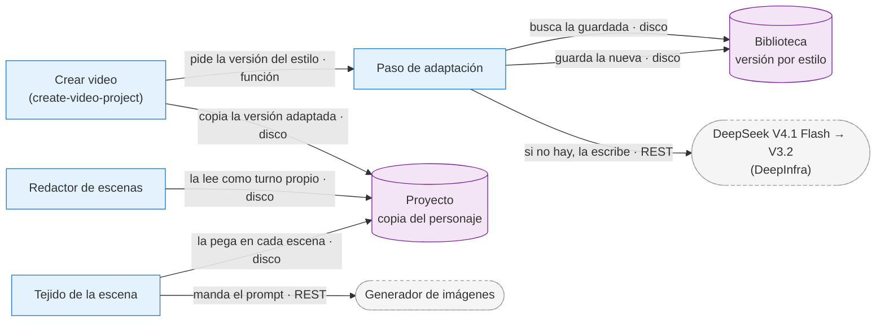

# ADR-0051 — Adaptar el personaje del usuario al lenguaje del estilo

- **Estado:** Propuesta (2026-10-06). No se implementa hasta que se mergeen los PR del catálogo nuevo
  y del creador de estilo con IA, y hasta que el dueño la apruebe.
- **Fecha:** 2026-10-06
- **Área:** pipeline (carril de Mi estilo) / app (biblioteca de personajes)
- **Relacionada con:** [ADR-0019](ADR-0019-carril-verbatim-y-segundos-por-escena.md) (el tejido
  `[subject]` y la descripción pegada al final), [ADR-0048](ADR-0048-gemas-por-secciones-y-agente-reconstructor.md)
  (la sección `character` y los cuatro modos de personaje),
  [ADR-0020](ADR-0020-selector-de-modelo-y-personaje-de-la-gema.md) (el personaje diseñado con la
  gema), [ADR-0021](ADR-0021-previews-de-personaje-con-estilos-propios.md) (el retrato por estilo) y
  [ADR-0039](ADR-0039-catalogo-sobre-el-carril-de-mi-estilo.md) (la etiqueta «Personaje fijo»).

## Problema

En la QA del 2026-10-05 el dueño hizo dos videos con 2D Mono, un estilo del catálogo con personaje
fijo (un gorila dibujado «en MS Paint, muy mal dibujado»). Uno usaba el gorila del estilo y el otro a
Lina, un personaje de su biblioteca, sin foto. Usaron la misma app, el mismo guion, redactor y
generador, con tres minutos de diferencia. El video de Lina salió como una ilustración prolija: ella
con detalles, fondos con tierra, piedras y luz entre las hojas. No era una regresión: los dos prompts
se armaron como dice el diseño actual. La diferencia la pone el personaje, por tres motivos:

1. **El look del estilo no viaja solo.** En 2D Mono lo esencial («lazy MS Paint, very poorly drawn,
   very basic shapes, thin crude black linework») está en `visualStyle`, que lee solo el redactor, y
   en la descripción del gorila (`character`), escrita en el idioma del estilo. Al generador le llegan
   la escena, la descripción del personaje y el final fijo (`promptEnd`), y ese final no lo dice.
2. **El redactor imita la descripción que recibe.** En el modo genérico recibe la sección
   `character` como si fuera su propio retrato; con «Mi personaje», la descripción del usuario entra
   igual, como turno propio (`resolveCharacter`, modo `text`). Con el gorila escribió «simple doodle
   forest floor made of green scribbles» en las 9 escenas. Con la ficha realista de Lina escribió
   «wet earth», «dappled light», «earthy ground».
3. **Las descripciones de la biblioteca son neutras a propósito.** El diseñador de personajes con la
   gema (`style-character-designer.ts`) dice que la estética del estilo NO va en la descripción, para
   que un personaje sirva en cualquier estilo. Por eso el camino que recomienda la etiqueta amarilla
   «Personaje fijo» (usar el personaje del estilo o uno propio en el estilo) pierde el look cuando el
   personaje propio tiene una descripción detallada.

### Evidencia (2026-10-05)

Con Evolink en calidad baja, las etapas reales y scripts fuera del repo:

| Qué se probó                                                                  | Resultado                                                                                                                                                                                                                                                        |
| ----------------------------------------------------------------------------- | ---------------------------------------------------------------------------------------------------------------------------------------------------------------------------------------------------------------------------------------------------------------- |
| Un `promptEnd` más fuerte (3 imágenes)                                        | Lina sale apenas más plana                                                                                                                                                                                                                                       |
| La descripción de Lina reescrita a mano en el idioma de MS Paint (2 imágenes) | Ella sale simple; los fondos siguen detallados (el redactor ya los había escrito)                                                                                                                                                                                |
| El paso automático de esta propuesta, en el video de 8 escenas                | Lina sale con la cara del estilo (óvalo sin nariz, ojos de punto, boca de línea, colores planos) y fondos de garabato. Adaptación 2,2 s, prompts 9 s, imágenes 28 s, 0 avisos                                                                                    |
| El mismo paso en un video de 126 escenas (prompts y 6 imágenes por versión)   | 0 escenas sin prompt, 0 de respaldo, 0 avisos, 20 s en las dos versiones. Fondos con vocabulario de garabato: 60 de 126 con la original y 126 de 126 con la adaptada. Largo máximo del prompt: 1 873 y 2 074 caracteres. Los lugares complejos siguen detallados |

## Decisión propuesta

Un paso nuevo reescribe la descripción del personaje del usuario (modo `text`) en el lenguaje del
estilo, **una sola vez por personaje y estilo**, y la guarda. El proyecto copia esa versión al
crearse. Como el redactor recibe la descripción como turno propio, ese único paso cambia a la vez
cómo se dibuja el personaje y el vocabulario de los fondos.



**Contratos y fallo:**

- **Si el paso falla**, el video sigue con la descripción original; nunca se frena (probado con una
  clave inválida). Un error de clave, de saldo o una cancelación cortan sin pedir respaldo, como en el
  retrato con estilo propio (enmienda del 2026-10-04 de la ADR-0021).
- **Modelo:** DeepSeek V4.1 Flash y DeepSeek V3.2 de respaldo, 30 s cada uno, respuesta JSON de 600
  caracteres como máximo (el tope del tejido es 700, `MAX_WOVEN_IDENTITY_CHARS`).
- **Por qué esta forma:** es el mismo mecanismo que ya hace funcionar al personaje fijo del estilo,
  aplicado al personaje del usuario. No agrega costo por escena.

**Entrada:** `visualStyle`, la sección `character` del estilo (solo como modelo de vocabulario y de
nivel de detalle), `promptEnd`, el nombre y la descripción.

**Salida:** abre con un rol corto en palabras del estilo y el nombre («A crudely drawn cartoon woman,
Lina, …»), así el tejido nombra al sujeto con ese rol, como al gorila.

**Dónde vive:** junto al retrato por estilo de la biblioteca, con un hash de la descripción y de las
secciones del estilo. Si cambia cualquiera de los dos, se vuelve a escribir. Un proyecto ya creado no
cambia, y el editor regenera con la copia del proyecto.

El prompt del prototipo, para retomarlo:

```text
You adapt a character description to an art style, for an image generator.
The style text tells you how that style draws things. Rewrite the character description so the
image generator draws the SAME character with THAT technique.

Rules:
- Keep every identity trait of the character: hair (color, length, hairstyle), face shape, skin
  tone, glasses, every clothing item with its color, accessories and build. Do not add identity
  traits and do not drop any.
- Change only HOW those traits are drawn: use the style's own technique words and its level of
  detail. If the style is crude, flat or minimal, turn each detail into the simplest shape that style
  would use. If the style is detailed or realistic, keep the details.
- If the style text includes an example character, use it ONLY as a model of vocabulary and level of
  detail. Never copy its species, body, colors, clothes or any other trait into this character.
- Begin with a short role made of the style's technique words and what the character is, then a
  comma and the character's name. Keep the part before the first comma at most 6 words.
- No scene, background, pose, action, camera, lighting or text in the image, and no closing style
  sentence.
- English, one paragraph, between 250 and 600 characters.
Return JSON: {"description": "..."}
```

### Cuidados obligatorios (casos borde medidos)

1. **Contextura y edad son identidad.** Con 2D Mono, «muscular» se volvió «no muscle details» en el
   Hombre Musculoso y en Manuel, y a Manuel se le borraron las arrugas. La regla tiene que conservar
   la contextura, la altura y la edad, y simplificar solo cómo se dibujan.
2. **La identidad le gana al estilo.** Un estilo clonado con IA puso «pure white face» junto a
   «light brown skin». El color de piel y los colores de la ropa del usuario no se cambian.
3. **No inventar.** Con «Formato-comic», que no describe a nadie, inventó un espía de traje. Una
   descripción sin rasgos físicos no se adapta.
4. **Una versión por personaje y estilo.** Cada corrida escribe una versión un poco distinta (salió
   «woman» en una y «scientist» en otra). Se guarda una y se reusa en todos los videos y en el editor.
5. **Estilos realistas o fotográficos: no adaptar.** Solo agrega jerga de fotografía. El criterio
   está por decidir (etiqueta del estilo o palabras de su `visualStyle`).
6. **No descartar por un rol largo.** 2 de 12 respuestas de V4.1 Flash se rechazaron por un rol de
   más de 6 palabras, y V3.2 tardó 10-11 s. Conviene aceptarlas: E47 ya nombra al personaje por su
   nombre cuando el rol no sirve.
7. **Los extras no se adaptan.** En una escena, los chicos de fondo salieron más prolijos que Lina.
   Queda por decidir si la regla de extras de cada gema toma el vocabulario del estilo.

Funcionó bien en lo medido:

- Una descripción corta en español («amarillo, cuadrado y con ojos saltones») salió traducida y sin
  inventar.
- En Claymation y 2D Stickman, Lina conservó su identidad.

## Alternativas consideradas

- **Dejarlo como está.** Es correcto según el diseño actual y es lo vigente mientras esta ADR sea
  Propuesta. Su costo: los estilos muy marcados con personaje fijo pierden el look con un personaje
  propio de descripción detallada.
- **Un `promptEnd` más fuerte en 2D Mono y en las otras gemas con personaje fijo.** Se midió: el
  efecto es chico y no cambia los fondos que escribe el redactor. Igual vale como mejora de datos.
- **Pasar `visualStyle` a cada prompt de imagen.** Compite con el cuerpo de 2 106 caracteres del
  prompt final, `visualStyle` puede tener hasta 12 000, y suele nombrar al personaje propio del
  estilo («Gorilla rendered as…»).
- **Pedirle al usuario que describa a su personaje en el idioma del estilo.** Le pasa el trabajo a
  la persona, y un personaje sirve en muchos estilos.
- **Que «Crear personaje con mi estilo» escriba la estética en la descripción.** Rompe el uso del
  mismo personaje en otros estilos y va contra el diseño de la ADR-0020.

## Consecuencias

- ✅ El camino que recomienda «Personaje fijo» (el personaje propio en el estilo) conserva el look.
- ✅ Un solo paso arregla las dos causas, sin costo por escena: una llamada de 1 a 3 s, por personaje
  y estilo, de fracciones de centavo.
- ⚠️ Cambia el principio de «la descripción tal cual»: lo que viaja es la versión adaptada; la
  original queda en la biblioteca. La persona tendría que poder verla (por ejemplo en el modal del
  personaje, junto al retrato de ese estilo).
- ⚠️ Riesgo de identidad: lo cubren los cuidados 1 a 3, y se mide estilo por estilo.
- ⚠️ Las escenas nombran al sujeto con el rol («the crudely drawn cartoon woman») y no con el nombre;
  el nombre sigue en la descripción. No cambia la imagen.

## Verificación de cumplimiento (al implementarla)

- **Guards:**
  - el paso: JSON, largo, rol, respaldo, sin rasgos → no adapta, realista → no adapta, falla → la
    original;
  - el hash que invalida la versión guardada;
  - que la creación y el editor usen la copia del proyecto;
  - que un proyecto viejo no cambie.
- **Medición visual antes de aceptarla:** 2D Mono, otro estilo fijo (2D Stickman o 2D Bola) y un
  estilo clonado con IA, con Lina, el Hombre Musculoso y Manuel, 8 escenas cada uno, en Evolink
  calidad baja (unos 10 créditos), más una corrida de solo prompts de 126 escenas.

## Fuera de alcance

- Los personajes con foto (modo `reference`): la foto manda.
- El personaje fijo del propio estilo: ya está escrito en su idioma.
- El catálogo viejo (estilos sin secciones), que se retira.

## Referencias

- Log del vault del 2026-10-05 (22:50 y 23:18): diagnóstico, pruebas, casos borde y costos.
- Etiqueta «Personaje fijo» en amarillo: enmienda del 2026-10-05 de la ADR-0039.
