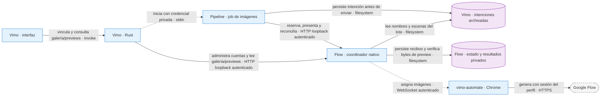
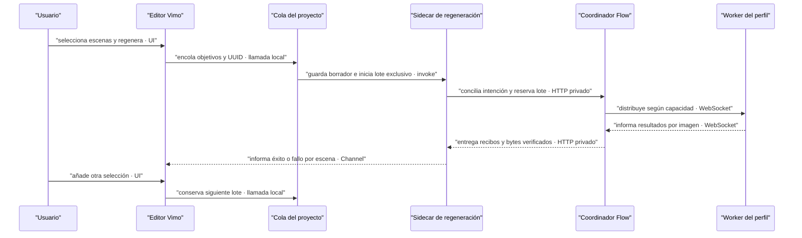
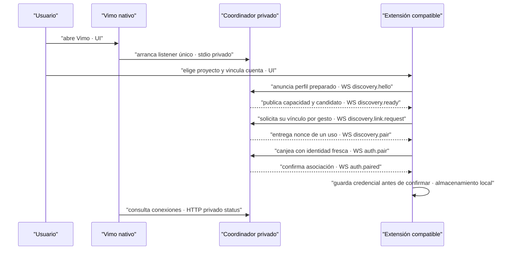
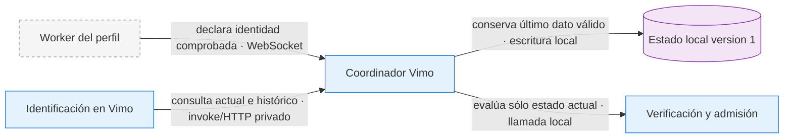
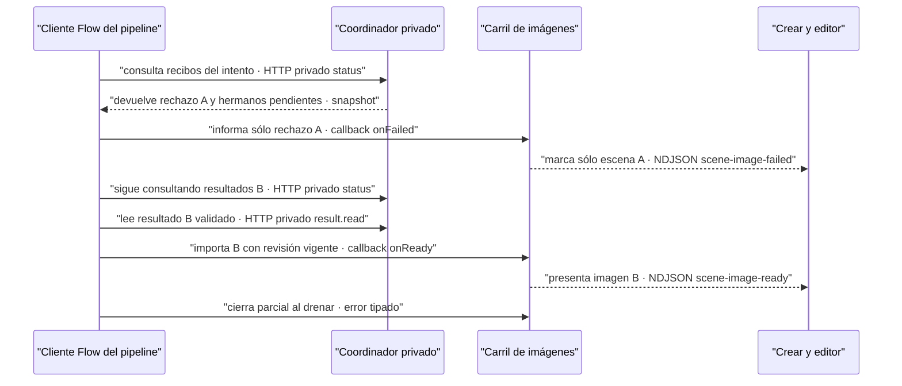
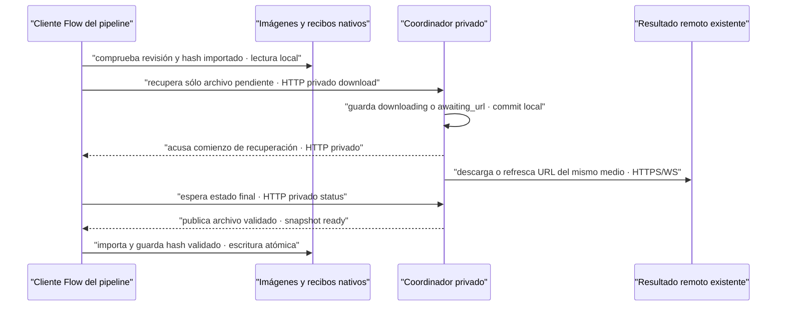
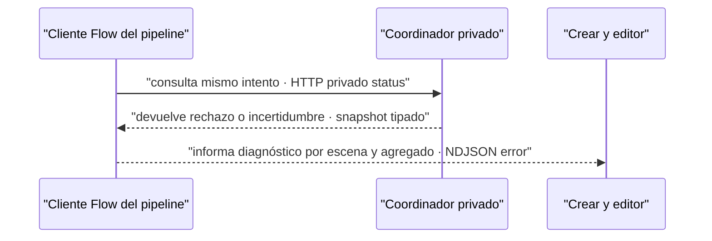
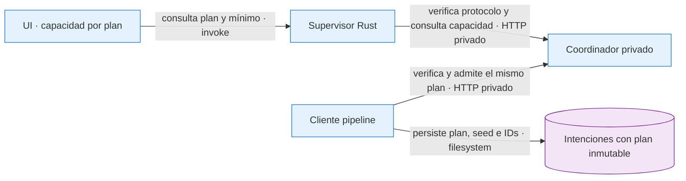

# ADR-0052 — Flow como motor de imágenes con coordinador nativo

- **Estado:** Aceptada para implementación local; pendiente aceptación con extensión distribuible.
- **Fecha:** 2026-09-17
- **Último alcance:** 2026-10-07 — contrato opcional Flow Tools; selección y vendor pendientes. El alcance de recuperación de 2026-09-21 se conserva.
- **Rama:** `feat/extension-vimo-automater`

## Contexto

El pedido inicial del 2026-09-17 conserva Catálogo, Mi estilo, personajes, guion,
voces, prompts, edición y render. Sólo cambia el motor de imágenes: GPT Image 2 por
Fal/Evolink o Nano Banana 2 Lite mediante la extensión propia vimo-automate.
La selección también se aplica a previews y regeneración en el editor. El
ajuste de escenificación solicitado el 2026-09-19 se documenta por separado abajo.

## Decisión

La SPA conserva componente → hook → api → invoke. Rust administra un proceso
persistente `vimo-pipeline flow-service`, construido en el mismo SEA, con una
copia explícita y trazable del coordinador 0.2.7. No importa carpetas externas,
no utiliza el Node del sistema y no requiere servidor de desarrollo.

Es una excepción acotada a ADR-0007/0010: existe HTTP **privado entre procesos
nativos** para compartir el coordinador entre jobs efímeros. No se restaura el
servidor HTTP de la SPA. El listener usa 127.0.0.1, puerto aleatorio, token
aleatorio de 256 bits por ejecución, Host exacto, rechazo de Origin, sin CORS,
POST JSON con tamaño máximo y comparación de autenticación en tiempo constante.
La credencial se transmite exclusivamente por stdin/stdout privados entre Rust
y sus procesos; nunca por argv, eventos de UI, almacenamiento web ni logs.

**Contratos:** intención durable antes de submit; reserva total y tres identidades
listas; identidad estable por imagen; archivos canónicos publicados después de
verificar hash, decodificar y convertir a JPEG. El motor Flow conserva los
prompts recibidos; la consigna de Fase 2 añadida el 2026-09-19 es una decisión
posterior e independiente de la selección de motor.
**Fallo:** déficit impide toda admisión; pérdidas de respuesta se concilian con
los mismos IDs; un resultado incierto requiere revisión. Recuperar una descarga
no encarga otra imagen. Una preview inválida falla sin modificar trabajos; un
recibo de galería ilegible no impide recuperar otros resultados. Puerto ocupado
detiene Flow sin afectar Fal/Evolink.
**Por qué:** compartir el coordinador preserva reservas, credenciales, pausas y
recibos entre previews, proyectos y reaperturas de Vimo.

## Vinculación y confianza

`discovery.link` entrega automáticamente el token de 30 segundos directamente
al worker. El origen debe figurar en la allowlist nativa o haber sido emparejado
previamente. La allowlist nativa fija `chrome-extension://bjpjjnjiikhccbjlkgmfpfhenbdpikbm`,
derivado independientemente de la clave pública SPKI del paquete local 0.2.8.
No se confía en un origen por anunciarse. La recarga y aceptación del paquete
distribuible se verifica por separado. Existe un código manual de cinco minutos,
visible sólo bajo acción explícita y conservado únicamente en memoria de UI.
No confundir este código con la credencial persistente o la sesión de Google.

El coordinador conserva verificadores de credenciales y datos bajo el directorio
privado de aplicación. La extensión conserva su credencial en almacenamiento de
contextos confiables. Vimo no recibe cookies ni tokens de Google. Un proceso
malicioso que ya ejecute con permisos del usuario queda fuera de esta frontera.

## UI y límites

- Extensión es una sección visible del sidebar: descubrimiento, vincular,
  revocar, estado real de cuenta/proyecto, uso local y pausa global.
- Conectada y lista son estados distintos. Se aceptan políticas locales de 400
  o 500 envíos por ventana móvil de 24 h, no cuotas garantizadas por Google.
  Cada worker conserva su límite declarado: un perfil de 400 no recibe 100
  envíos adicionales por actualizar Vimo. Sólo snapshots coherentes aportan
  capacidad; se descuentan pendientes, reservas y posiciones del historial.
- Lite usa 16:9 o 9:16, sin selector de calidad paga ni descuento de créditos
  Fal/Evolink. Guion, voz y demás servicios conservan sus costos habituales.
- Crear/abrir/vincular proyectos y reanudar individualmente una cuenta se hacen
  en el panel hasta disponer de un relay nativo autorizado y versionado.
- No se incorpora silenciosamente trabajo de la rama de animaciones: esta base
  se revisa por sus tipos y archivos efectivos; destinos compartidos se resuelven
  cuando estén presentes en el contrato del proyecto.
- El paquete nativo y la extensión mantienen repositorios separados. Actualizar
  el coordinador exige revisar contrato, procedencia y pruebas del artefacto.

## Galería y previews locales — 2026-09-19

`gallery.list` añade una lectura de presentación sobre los recibos existentes,
separada del polling de conexión. El servicio toma los lotes visibles del
coordinador y busca únicamente sus archivos `<batchId>.json` dentro de
`vimo-intents/<sha256(scope)>/`. Comprueba versión, identidad del lote y hash del
scope; no usa `current.json` como historial ni enumera lotes eliminados. Rechaza
archivos o carpetas enlazados y recibos mayores de 32 MiB. Un recibo ausente o
inválido se omite y la UI conserva fecha y cantidad; el ID técnico queda en detalles.

La respuesta sólo proyecta `batchId`, tipo, nombre y pares `imageJobId/sourceKey`.
El nombre de video deriva del último componente del scope, tanto con separadores
Windows como macOS; no abre el directorio del proyecto. El renderer no recibe
el scope completo, destinos, rutas de referencias ni credenciales. `sourceKey`
conserva la escena original: regenerar la escena 3 puede ser el primer prompt de
un nuevo lote sin convertirse por ello en la escena 1.

`preview.read` se autoriza por `imageJobId`, nunca por una ruta elegida en la UI.
Sólo lee un trabajo `ready`, no eliminado, cuyo archivo canónico regular pasa
la comprobación de ubicación, formato, tamaño y SHA-256 contra su recibo.
Devuelve MIME, bytes en base64 y hash, con un máximo de 12 MiB de imagen
(16 MiB codificada). El renderer valida ese contrato antes de mostrarla. Una
lectura fallida no descarga ni genera: volver a leer y recuperar una descarga
son acciones distintas. La importación privada del pipeline conserva su contrato
separado `result.read`, hasta 25 MiB.

Los lotes son plegables y muestran ocho trabajos por página. Sólo se montan las
previews listas de la página abierta; la caché inactiva se libera tras un minuto.
Cada trabajo permite inspeccionar el prompt real que ya publica `status`, junto
con su escena, estado y acciones de recuperación elegibles. Esta galería no
introduce llamadas a Google ni expone tokens persistentes o de sesión a la UI.

## Consigna de escenificación — 2026-09-19

La integración inicial del 2026-09-17 conservaba intacto el redactor. Tras el
pedido explícito del usuario del 2026-09-19 se añade una consigna al mensaje de
usuario de Fase 2 de Mi estilo. La gema mantiene sus bytes y precedencia; no se
reescribe el estilo. La consigna distingue el lote de fragmentos de una única
escena narrativa, usa el guion y fragmentos vecinos y pide representar el hecho,
acción o lugar narrado, respetando una localización global cuando el usuario o
su estilo la fijan expresamente.

El cambio rige futuras escrituras de prompts con cualquier motor de imágenes.
No añade llamadas de LLM, correcciones por regex ni regeneración automática;
los prompts e imágenes existentes permanecen intactos. La auditoría encontró
15 peticiones/resultados distintos e importados correctamente, pero los 14
prompts originales repetían el mismo estudio antes de llegar a Flow. Las
comprobaciones de mensajes y transporte no certifican obediencia semántica de
un modelo real.

La primera prueba real posterior de diez escenas mantuvo el estudio en los
diez prompts, aunque el SEA activo contenía la consigna de usuario. Se ensayó
además una adenda declarada al system de Fase 2 en otra copia aislada. Ese
segundo ensayo ejecutó **sólo prompts**, con dos llamadas reales a DeepInfra,
sin imágenes nuevas ni Catálogo. Los hashes de solicitudes confirmaron que la
gema y la adenda viajaban correctamente; diez de diez prompts volvieron al
mismo estudio. La adenda se descartó y su código se revirtió; no amplía el
contrato vigente ni acredita una corrección semántica. La consigna original de
usuario permanece. La repetición de escenificación **no quedó resuelta**.
Los trabajos Flow ya presentados y sus prompts no se modificaron durante este
ensayo. Véase el [experimento descartado](../../fixes/2026-09-19_custom-style-scene-continuity.md).

Detalle de evidencia y límites: [auditoría de prompts](../handoff/2026-09-19-flow-audit/prompts-audit.md).

## Validación

Se requieren format, lint, build, compilación Rust, sidecar SEA real, controles
negativos de autenticación y protocolo, y proveedor simulado con JPEG/PNG/WebP
válidos. El ID público está verificado; la aceptación del paquete de extensión
con cuentas reales se informa por separado; no se atribuye al código integrado el benchmark previo de la extensión.

Referencias: [procedencia y adaptaciones del coordinador](../../pipeline/providers/flow/vendor/README.md),
[cripto Node](https://nodejs.org/api/crypto.html#cryptotimingsafeequala-b),
[WebSocket ws](https://github.com/websockets/ws/blob/master/doc/ws.md).

## Recuperación y consentimiento

La vista Extensión ofrece recuperación de descarga, cancelación y eliminación
local elegible. La cancelación de un lote cierra la reserva y consulta después
los trabajos admitidos para cancelarlos también. La eliminación exige el estado
`localDeletable` del coordinador y confirmación explícita.

El reintento RPC13 exige la firma completa del error, el mismo intento observado,
un UUID estable de consentimiento y aceptación del riesgo de duplicado. No se
ofrece para otros estados inciertos. Un lote cancelado sólo puede iniciar una
nueva intención después de una acción explícita y de verificar que sus trabajos restantes
son terminales seguros; el editor usa el clic Regenerar según la adenda siguiente,
mientras los demás flujos conservan su confirmación; el mismo UUID reproduce la misma intención, incluso tras
completarla. `flow_review_required` nunca habilita ese reinicio.

La fase Flow no reescribe un snapshot antiguo de `scenes.json`. El importador
vuelve a comprobar revisión, formato y referencias antes de publicar el JPEG y
conserva la imagen anterior si falla. Un lock con recuperación serializada protege
la intención frente a procesos concurrentes. Crear y editor comparten el scope
por proyecto: cambiar de pantalla o de selección no oculta trabajos inciertos.
Un reinicio parcial sólo autoriza los destinos elegidos.

[Prompt de coordinación con la extensión](../handoff/2026-09-17-flow-extension/prompt-extension.md).

Resultados controlados y pasos: [informe de validación](../../fixes/2026-09-17_flow-image-engine.md).

## Regeneración del editor por selección — 2026-09-19

El botón «Regenerar con Flow» es la acción explícita para pedir una imagen nueva;
no requiere un segundo diálogo «Autorizar generación». El contrato aditivo
`flowRegenerationRequestId` sólo pertenece a `regenerate-scene-images` y no cambia
el protocolo de la extensión ni el permiso especial de `retry.generate`.
Un UUID ya reconocido recupera su intención; uno nuevo sólo reemplaza el lote
previo después de comprobar que sus trabajos son terminales seguros. Un intento
activo o incierto con la misma revisión se recupera con sus IDs originales;
una revisión distinta queda bloqueada para revisión. Los aliases se conservan
antes del envío y un UUID histórico de un lote reemplazado no inicia otro POST.

La selección múltiple Flow produce un solo comando y una reserva del tamaño
completo. Las escenas añadidas mientras trabaja se guardan en la cola del editor
para lotes posteriores; no se amplían reservas existentes. Proveedor, descripción
y UUID se capturan por solicitud. El guardado del borrador ocurre dentro del
turno exclusivo del job, antes de generar. Se conserva un único escritor por
proyecto; el paralelismo de las imágenes dentro de cada lote pertenece al bridge
y a los workers. El usuario confirmó conservar los límites actuales: cadencia
normal variable de 2–6 s por perfil y hasta 3 imágenes activas por cuenta normal,
reducidas a 1 en modo serial/revisión; Vimo no fuerza una cadencia de 3 s.

**Contratos:** un lote activo por proyecto, selección inmutable, evento ligado a
su operación, UUID durable y ningún reinicio de intentos inciertos.
**Fallo:** los errores se atribuyen únicamente a las escenas solicitadas; una
imagen importada no hereda el fallo de otra. Guardado fallido impide el envío.
Los callbacks tardíos no cierran ni cambian el lote siguiente. El aviso amarillo
sigue derivándose de imágenes realmente faltantes en el proyecto.
**Por qué:** permitir varias imágenes en un lote y nuevas solicitudes en cola sin
perder cambios en `scenes.json`, duplicar POST ni convertir una descarga pendiente
en una nueva generación. La cola de UI sigue siendo transitoria; cerrar la app
pierde solicitudes que todavía no llegaron a un job durable.

## Vincular desde la extensión con un solo gesto — 2026-09-20

El usuario pidió completar la asociación al elegir el proyecto y pulsar
«Vincular cuenta» en la extensión, teniendo Vimo abierto. Esto reemplaza la
selección final obligatoria en Vimo para versiones que implementen el contrato
aditivo. Los anuncios de presencia siguen sin conceder autorización.

Rust arranca el mismo coordinador en segundo plano al abrir Vimo, sin esperar
que la interfaz consulte Flow. La exclusión mutua impide crear dos hijos; el
cierre bloquea arranques tardíos y recoge el proceso incluso si todavía espera
su handshake. Un fallo de arranque conserva el almacén y permite reintentar
mediante un comando normal. No hay puertos ni directorios alternativos.

El coordinador habilita explícitamente `allowExtensionLinkRequests` y anuncia
`discovery.ready.capabilities.extensionLinkRequest:true`. Sólo entonces una
extensión compatible puede convertir un gesto reciente del usuario en
`discovery.link.request`, con UUID v4, su `discoveryId`, `installationId` e
identidad recién verificada. Se validan el socket propio, el origen permitido,
la instalación, la cuenta coincidente y las condiciones habituales de admisión.
La respuesta `discovery.linking` acredita únicamente el inicio del canje;
`auth.paired` debe guardarse antes de presentar la cuenta como vinculada.

**Contratos:** el token sólo circula entre el coordinador nativo y el worker,
nunca por React, URL, portapapeles o logs. Nonce de 30 segundos, un uso, ligado
a socket/origen/instalación/cuenta. Repetir la misma solicitud vigente devuelve
el mismo acuse, sin crear otro nonce. El ledger de solicitudes vive en memoria
del proceso, está acotado y rechaza al saturarse; no promete protección durable
tras reiniciar. La extensión debe mantener la intención sólo en memoria,
caducarla a los 30 segundos y descartarla al perder socket, cerrar panel o
cambiar proyecto/identidad. Cambiar de proyecto invalida el socket antes de
anunciar otro, porque el contrato de discovery no transporta su ID.

**Fallo:** una versión sin capability conserva el botón Vincular de Vimo, sin
copiar códigos; no inventa mensajes ni crea intenciones al refrescar. Un vínculo
anterior se conserva y sólo transiciona mediante la acción deliberada y los
guards de trabajo de la extensión. No se rotan credenciales tras rechazo.
Cuenta duplicada, origen ajeno, candidato vencido o cambio de identidad rechazan
el canje. La cuenta se reserva al autenticar para evitar duplicados antes del
primer snapshot del worker.

**Por qué:** el gesto del usuario ya está en el panel; repetirlo en otra ventana
no aporta consentimiento adicional. El código manual queda en opciones
avanzadas, cerrado y sin solicitar secretos por defecto. Vincular no envía
trabajos, no reanuda pausas ni ejecuta `connection.test`.

**Actualización del límite de entrega · 2026-09-20:** Vimo implementa el receptor;
la fuente externa 0.2.13 (`929dfcc`) ya implementa el emisor del
[traspaso específico](../handoff/2026-09-20-flow-auto-link/prompt-extension.md).
Reemplaza el diagnóstico previo de 0.2.12; no acredita qué paquete ejecuta cada
perfil ni aceptación con Google real. La observación anterior a seleccionar
proyecto requiere el arreglo del worker descrito en la adenda siguiente.

## Identidad visual y proyecto observado — 2026-09-20

El usuario pidió correos identificables incluso cuando una verificación temporal
falla, y que abrir un proyecto inequívoco permita elegir Vincular desde Vimo sin
seleccionarlo de nuevo en la extensión. Son dos responsabilidades distintas.

El coordinador de Vimo conserva `lastVerifiedIdentity` como metadata opcional,
normalizada, en `status` y eventos de conexión. Se alimenta al canjear, antes de
reiniciar la identidad actual al reanudar, y con cada estado verificado. Al arrancar
migra desde una identidad anterior válida sin cambiar versión 1 ni inventar correos.
La nueva identidad histórica y el reset de la actual se guardan antes del ACK de
canje: revincular A→B y reiniciar no restaura A antes del primer heartbeat de B.
`safeIdentity` exige string hexadecimal real; la coerción de arrays no verifica IDs.

La UI comparte `FlowAccountIdentity`: email actual, máscara actual, o último email/
máscara verificados rotulados como históricos con verificación actual pendiente.
Sin evidencia hay referencia corta y aviso de cuenta por identificar. El proyecto
presenta su alias y referencia separados; no se usa el alias para identificar una
cuenta. El refresco detecta también cambios exclusivamente históricos.

**Contratos:** el histórico sólo sirve para presentación; `verified:true` dentro de
él describe una comprobación pasada. No participa en `canLink`, conflictos,
autenticación, presupuesto, reservas, scheduler o generación. No contiene secretos
de autenticación y no se añade a logs/telemetría; los correos sólo se muestran en
la UI solicitada. Se conservan pausas, consumo y propietario de trabajos.
**Fallo:** la identidad actual no verificada sigue impidiendo capacidad aunque el
nombre histórico siga visible. Si el email se perdió antes de capturarlo no puede
reconstruirse desde su hash; se necesita una comprobación fresca de la extensión.
**Por qué:** un fallo de preparación no debe borrar el nombre conocido ni convertir
un alias genérico en identidad. Se conserva la separación entre vínculo y capacidad.

En la fuente externa 0.2.13, `discoveryContext` corta si no existe binding: no consulta
la pestaña nueva aunque esté abierta. Además la navegación conserva un documentId
antiguo; volver a seleccionar ejecuta un probe del documento actual y recupera el
correo. Doce comprobaciones sobre módulos originales con dependencias ficticias
comprueban ambos mecanismos, sin llamadas Google. El adaptador obtiene identidad
por lectura DOM restringida contrastada con Chrome; `UpteDb` lista proyectos y no
es un RPC de identidad.

La extensión necesita observar un candidato efímero sin persistir selección ni
armar intenciones. Un proyecto único y verificado puede anunciar `hasFlowTab:true`
con identidad fresca. El clic nativo entrega nonce; el worker revalida exactamente
ese contexto antes de confirmar binding y canjear. Dos proyectos ambiguos requieren
selección. Se mantiene el wire existente y el gesto del panel 0.2.13; la propuesta
no está implementada en Vimo porque corresponde al worker externo. Guards de
navegación/documento y trabajos pendientes siguen vigentes. Contrato, secuencia,
fallos y aceptación en el
[handoff de identidad/discovery](../handoff/2026-09-20-flow-identity-discovery/prompt-extension.md).

El scheduler existente limita por perfil: hasta 3 activos normales,1 en revisión,
0 si pausado/no preparado/sin saldo. Más cuentas elegibles amplían concurrencia;
no se cambia cadencia ni se garantiza crecimiento lineal de velocidad. El
presupuesto sigue siendo500 por perfil/24 h móviles, conservando el historial.

## Aislamiento de fallos y drenaje del lote — 2026-09-21

Un fallo confirmado pertenece a una solicitud, no a todas las escenas pendientes.
El cliente informa `onFailed(request, code)` y continúa observando e importando los
hermanos, incluidas páginas aún no admitidas del mismo intento durable. Conserva
IDs, semillas, prompts, reserva y correspondencia del recibo. No vuelve a enviar
una solicitud admitida porque su estado sea `failed` o `unknown`.

**Contratos:** el fallo agregado se entrega después de recoger los hermanos. Un
rechazo o fallo de importación no marca el lote como completo. La importación
mantiene sus comprobaciones de hash, bytes, revisión y destino. Una descarga fallida
se recupera de forma acotada dentro de la misma ejecución, según la adenda siguiente;
no se convierte en otra generación. El informe
por escena se deduplica y puede reabrirse si el worker recupera su estado.

**Fallo:** transporte interrumpido, recibo inválido o cancelación cierran el
observador sin inventar fallos de las escenas hermanas. Las observadas que siguen
pendientes se presentan como `awaiting_sync`, sin rojo ni spinner activo. Si hay
fallos y una pausa global impide avanzar la cola, primero se recogen las operaciones
en vuelo y después se conserva lo pendiente para recuperación. Sólo un lote
completamente terminal seguro ofrece reinicio; `unknown` o pendientes lo impiden.
Una pausa sin fallos mantiene la espera normal. El estado transitorio del editor
no se agrega al esquema de escenas persistidas.

**Por qué:** que el observador cierre no implica que el proveedor haya cancelado
sus trabajos. Recuperar conserva recibos e importa resultados; no autoriza repetir
una operación incierta. La UI ofrece «Recuperar lote de Flow» y acceso a Extensión
para errores recuperables, usando el callback existente y sin otro token. Se
conservan los controles de reemplazo explícito y las pausas/cadencia/concurrencia.
La extensión no necesita un cambio de protocolo para esta corrección.

Evidencia, alcance y validación en el [informe del fix](../../fixes/2026-09-21_flow-fallos-por-escena.md).

## Recuperación continua e importaciones comprobadas — 2026-09-21

Complementa el aislamiento de fallos: reobservar todo un lote no significa
regenerar sus imágenes, pero el cliente anterior volvía a leerlas e importarlas,
mostrando `started` por cada recibo ready. El importador ahora devuelve el hash
del JPEG que acaba de decodificar y publicar atómicamente. El recibo nativo puede
guardar `importedHash` junto con `imported`, sin cambiar su versión ni transmitir
ese campo al worker.

`restoreImported` comprueba destino, revisión actual y hash del archivo local.
Si coinciden, conserva la imagen lista sin `result.read`, decodificación, escritura
ni progreso de generación. Los recibos antiguos sin hash se validan por la ruta
normal una vez; los archivos desaparecidos se recuperan del mismo resultado.
Una imagen distinta nunca se sobrescribe por saltarse la revisión. El editor
mantiene su regeneración explícita: un nuevo gesto seguro sigue pidiendo otro
resultado y nace con otro recibo, sin reutilizar esta prueba de importación.

**Contratos:** `download` confirma inicio, no finalización. El bridge persiste
el estado en curso antes del I/O; la recuperación por `media.refresh` se deduplica
por recibo/socket con plazo acotado y libera su espera ante respuesta, cierre o
vencimiento. Conserva el medio y sólo descarta una URL ya rechazada. El cliente
puede recuperar hasta tres veces la descarga del mismo resultado, con espera
creciente, mientras recoge las imágenes hermanas.

**Fallo:** las lecturas de estado/resultado y la descarga toleran tres cortes de
transporte adicionales con espera de 1,5/3/4,5 segundos. Un ACK perdido de submit
obliga a consultar los IDs durables antes de otra página; se permiten hasta tres
conciliaciones de ese tipo por observación. Errores de contrato, identidad o
recepción incierta no se convierten en éxito ni se reenvían como otra generación.
El límite agotado conserva recibos y un diagnóstico real, sin bucle ilimitado.

**Por qué:** una descarga lenta no debe parecer fallida al siguiente sondeo ni
pedir varios clics. Crear preserva miniaturas comprobadas frente a eventos de
progreso repetidos; los errores concretos y la rehidratación nueva desde disco
siguen teniendo prioridad. No cambia el mínimo de cuentas, el presupuesto de
500/24 h, las pausas, la cadencia ni la concurrencia del proveedor.

Informe: [reintento continuo sin regenerar imágenes listas](../../fixes/2026-09-21_flow-reintento-continuo.md).

## Rechazo de cuenta y resultado incierto — 2026-10-07

Adenda de diagnóstico, sin cambiar el protocolo de la extensión, permisos de
reenvío, reserva ni drenado del lote. El rechazo real `ACTIVITY_BLOCKED` no debe
convertirse en una afirmación de que existe una imagen ni en una invitación a
reiniciar la generación. Se incorporan dos códigos de error del sidecar a la UI:

- `flow_account_review_required`: solicitud `failed`, sin `result`, código
  `ACTIVITY_BLOCKED` y `submission:rejected`, sin `operationSubmission` ambiguo o
  aceptado. También comprende el upload inequívocamente rechazado, con
  `phase:upload`, `submission:not-sent` y `operationSubmission:rejected`.
- `flow_submission_unknown`: solicitud terminal sin resultado, con estado
  `unknown` o `submission`/`operationSubmission:unknown`. Tiene precedencia en
  un registro contradictorio y en el resumen de un lote mixto.
- El resto conserva la clasificación anterior. Un resultado existente conserva
  su recuperación de descarga; un código RPC numérico por sí solo no demuestra
  rechazo de cuenta. `flow_review_required` pasa a describir registro y trabajo
  pendientes, sin afirmar recibo de imagen.

**Contrato:** la clasificación es diagnóstica; `safeTerminal`, `canRestart`,
IDs, revisión, importación y pausa permanecen iguales. No reenvía una solicitud
admitida. La UI del pipeline conserva la acción explícita de recuperar el mismo lote y la
revisión en Extensión. El rechazo terminal no entra al conjunto de recuperación
del editor/previews: Regenerar sigue requiriendo capacidad y expresa una intención
nueva, mientras el resultado incierto conserva su recuperación. Para `ACTIVITY_BLOCKED` ya no ofrece el botón de nueva
intención de `flow_restart_required`, incluso si todo el lote es terminal seguro.
Los códigos genéricos de cancelación/eliminación conservan su comportamiento.

**Fallo:** un rechazo no borra hermanos ni prueba que el resto del lote carece
de imágenes. La incertidumbre se muestra primero; una pausa con pendientes no
convierte un rechazo confirmado en incertidumbre. No se altera el plazo de
confirmación de pausa: ACK y confirmación de las cuentas siguen siendo distintos.

**Por qué:** un registro durable del intento no equivale a un medio de Google.
La UI debe expresar la evidencia que existe, sin prometer otra generación.
Validación y límites en
[el informe del fix](../../fixes/2026-10-07_flow-submission-rejection.md).

## Adenda 2026-10-07 — Plan optativo Flow Tools

Acordado explícitamente con la sesión dueña de extensión: un nuevo ejecutor se
captura por intención, sin sustituir RPC de lotes existentes. Plan Tools v1 con
Tool fijo, seed del proveedor (null durable) y hash de seis elementos; RPC
conserva sus cinco elementos. Se exige capability global del coordinador antes
de consultar capacidad/reservar/enviar, más capacidad específica del plan. No
basta el anuncio aislado de un worker. Supervisión nativa/cliente/servicio validan
el contrato sin transportar secretos a React.

**Contratos:** lectura global de compatibilidad y capacidad por plan antes de
admisión, correlación de recibos por IDs/hash/plan, RPC bytecompatible. **Fallo:**
versión ausente o recibo incompatible bloquean la nueva admisión/importación;
recuperar un medio existente no necesita disponibilidad para generar. No hay
fallback, cambio de cuenta o reanudación automática. **Motivo:** otro ejecutor no
debe alterar la identidad de trabajos ni perder recursos ya importados.

La etapa e797 preparó el contrato sin selector/vendor. El port posterior del
2026-10-07 incorpora selectivamente el coordinador adc0420 y selección por nueva
intención en Crear/editor/previews. Sigue sin instalación ni aceptación nativa
o Google. Mantiene mínimo cinco, 500/24h, pausas, cadencia/concurrencia y
protecciones de editor. La recuperación interna `flowRecoverOnly` deriva el
plan del recibo tras remonte y falla si no encuentra la intención; no crea otra.
Procedencia, pruebas y plan QA en el
[port selectivo](../handoff/2026-10-07-flow-tools-contract/selective-port.md);
[contrato previo](../handoff/2026-10-07-flow-tools-contract/integration.md).
