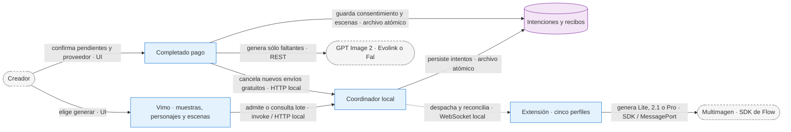

# ADR-0054: recuperación de Multimagen y completado pago explícito

> **Enmienda 2026-10-13:** [ADR-0055](ADR-0055-regeneracion-concurrente-por-escena.md) reemplaza sólo la exclusión de regeneraciones de imágenes y el ámbito de nuevas peticiones individuales del editor. Permite trabajos de escenas distintas en paralelo con leases nativos; los recibos previos y las demás exclusiones se conservan. El texto previo queda como antecedente.

- Fecha: 2026-10-12.
- Estado: implementado localmente; aceptación de proveedor/GUI pendiente.
- Rama: `feat/flow-export-motion`.

## Contexto

El creador necesita continuar una generación sin perder escenas cuando una cuenta deja de responder. Un límite artificial de 500 no representa disponibilidad del proveedor. Los recibos gratuitos pueden llegar después de una sustitución o de elegir la vía paga; conservarlos no autoriza sobrescribir otra imagen.

## Decisión y flujo

### Contratos

- La política nueva no impone cuota diaria. Uso auditado, cola acotada, concurrencia/cadencia, identidad y límites reales de Google permanecen. Versiones antiguas mantienen el cupo declarado.
- Un rechazo explícito de modelo/cuota permite Lite → 2.1 → Pro. Timeout/red/medio inválido conserva incertidumbre; nunca implica por sí solo ausencia de generación. Guarda modelo efectivo y resumen de los subintentos.
- Nuevos jobs persisten hasta cuatro sustituciones, cinco propietarios distintos. Jobs anteriores sin `maxReplacements` conservan dos. Ninguna sustitución cambia intención, prompt, referencias o hash lógico. Recibos inciertos mantienen reserva; 120 segundos de reconciliación antes de sustituir, primer recibo válido persistido gana.
- Si todos los perfiles admitidos agotan modelos, se conserva lo listo y se sale de la espera. Tres horas es una sugerencia de reconsulta, no un reset conocido del proveedor.
- La confirmación paga persiste UUID, proveedor, lote gratuito y IDs de escenas faltantes. Antes recoge resultados gratuitos listos y valida destino/revisión/personajes. Usa `operation.lock`; tras persistir consentimiento el importador no publica otros recibos de ese lote. Permanecen en la galería del coordinador.
- Confirma cancelación de nuevos envíos gratuitos antes de activar GPT Image 2. La ruta paga existente conserva referencias/estilo/calidad predeterminada; imágenes existentes no se vuelven a generar. Un reinicio conserva el consentimiento y no amplía su lista de escenas. No hay migración masiva de proyectos a otro proveedor.
- Muestras y personajes conservan sus rutas Tools existentes. La UI del pipeline muestra total, listas, en curso y pendientes dentro del desplegable y retira la pausa global de esa pantalla. Otros controles explícitos de cancelación/administración permanecen.

### Fallo

Fallo de persistencia o de cancelación impide iniciar cobros. Sin API key no se modifica el proyecto. Identidad, CAPTCHA y restricciones de cuenta requieren la resolución correspondiente; no se eluden. Un recibo tardío se conserva aunque ya exista sustituto. El SDK no ofrece idempotencia remota: puede existir una imagen remota adicional después de reconciliar un intento incierto. Un fallo visual en el panel de resultados no invalida el recibo.

### Por qué

Separar el consentimiento pago del intento gratuito evita cobros implícitos y sobrescrituras. La recuperación sigue una intención durable, no depende de mantener la pantalla abierta. Eliminar un límite local no equivale a inventar capacidad de Google. Se usa el SDK ya observado y los proveedores GPT Image 2 existentes, sin nuevo servicio ni secretos.

## Consecuencias y validación

Debe actualizarse la extensión a 0.2.32 y la app con su coordinador. Las capturas anteriores pertenecen a 0.2.31. Pruebas locales de modelos, cinco propietarios, importación y consentimiento no sustituyen aceptación con cuentas reales. La herramienta de control de computadora está inaccesible en esta sesión. Evidencia y procedimiento en `fixes/2026-10-12_multimagen-libre-y-completado-pago.md`.
