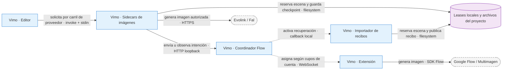

# ADR-0055 — Regeneración concurrente por escena

- **Estado:** Aceptada
- **Fecha:** 2026-10-13
- **Rama:** `feat/flow-export-motion`
- **Actualiza parcialmente:** [ADR-0014](ADR-0014-modulo-library-edicion-sobre-stages.md), exclusión de regeneración, y [ADR-0054](ADR-0054-recuperacion-multimagen-y-completado-pago.md), alcance de nuevas intenciones del editor.

## Contexto

El editor admitía clics de escenas distintas pero los procesaba en un solo job por proyecto. Una petición paga esperaba detrás de Flow. Además `pending` incluía el tiempo de guardar/redactar, por lo que «En cola» no distinguía preparación de espera. El usuario pide regenerar varias escenas con cualquier proveedor sin perder imágenes, recibos o borradores.

## Decisión

La decisión inicial de limitar todos los trabajos locales a cinco queda superada por la enmienda del 2026-10-13: Flow no tiene un tope artificial en el editor; sus cupos remotos los administra el coordinador por cuenta. Los jobs pagos conservan cinco carriles locales independientes. Un pago esperando cupo no bloquea un pedido Flow posterior, pero ningún pedido adelanta una animación admitida antes.

Cada escena tiene un propietario y un proveedor fijado al admitir el clic. Cada evento debe coincidir con solicitud y escena. Una escena ocupada rechaza otra petición, aunque cambie el proveedor. La selección múltiple permite imágenes existentes; cada petición Flow nueva es de una escena. Un trabajo admitido muestra preparación hasta que el proveedor empieza, y la cola remota informa su espera real.

### Contratos

- El preflight Tools solicita `autoRecoveryVersion: 1`, igual que su reserva. En el contrato moderno el mínimo se refiere a `configuredProfiles`; el coordinador autoriza mediante `canPrepare` y distribuye sólo entre cuentas disponibles. `readyProfiles` sigue describiendo disponibilidad instantánea, sin volver a exigir cinco cuentas libres en la UI. Pausas globales siguen bloqueando; informes legacy sin el campo nuevo conservan el mínimo de cinco disponibles.
- El lease compartido del proyecto tiene grupo `images`; no comparte con animación. Render, exportación, edición de tiempos, audio, borrado y pipeline completo conservan exclusión nativa. La reserva de escenas utiliza IDs ordenados para evitar dos trabajos del mismo destino.
- Se serializa la preparación global de biblia/protagonista; las generaciones posteriores trabajan en paralelo. La biblia usa primero el guion original. El mutex corto de `scenes.json` cubre toda la lectura, mezcla por IDs y publicación atómica. Metadata tiene su propio mutex, evitando locks reentrantes con animación y snapshots viejos de opciones.
- Descripción, calidad y personajes viajan en el payload de la regeneración y se guardan dentro de su reserva. Los borradores locales sobreviven al refetch causado por otra escena y no se transfieren entre proyectos.
- Las nuevas peticiones individuales Flow usan `scene:<id>:<raíz>`. El ámbito es estable: un replay recupera el mismo UUID durable sin reenviar. Crear y recibos previos mantienen `scenes:<raíz>`; no se migran ni se borran. Un histórico pendiente solapado conserva prioridad. Reanudar el pipeline global comprueba que no exista intención individual pendiente del mismo destino.
- El importador valida scope, raíz, escena, revisión y destino. Adquiere también el lease de proyecto/escena antes de verificar hash y publicar. Así una publicación paga no puede quedar entre la comprobación de hash y el rename de un recibo gratuito tardío. La barrera de completado pago sigue comparando el `batchId` exacto.
- La barrera de animaciones respeta orden de admisión. Saltar un job pago sin cupo sólo está permitido dentro del tramo de imágenes anterior a esa barrera. Cancelar borra pendientes de ambos proveedores y conserva las reservas de trabajos ya enviados hasta su cierre.
- El proveedor capturado de un pedido no cambia al mover el selector. «En cola» de Flow no contamina el estado de una petición paga. Cancelar conserva ownership hasta el evento terminal y cancela también handles recibidos después del clic.

### Fallo

Una escena ocupada se rechaza antes del envío; el importador la deja pendiente para la siguiente pasada. Un recibo de otro contenido o una imagen posterior no se sobrescribe. Una intención histórica incierta sigue recuperable: el cambio de scope no autoriza otro cargo. Las imágenes existentes se conservan ante error del proveedor o falta de clave. La cola no elimina límites ni latencia reales del proveedor.

### Por qué

Compartir únicamente lectura/operaciones remotas de escenas disjuntas elimina la espera de un proveedor detrás de otro sin introducir varios escritores de un mismo archivo. Mantener ámbitos históricos evita que una actualización se interprete como una autorización nueva.

## Validación

Fuente nativa y protocolo del artefacto se ejercitan por separado: 6 escenarios del store, 3 de borradores, 12 de comandos nativos/importador y 23 regresiones existentes de personajes. El SEA se prueba con dos procesos Flow en paralelo, tercero pago sin clave, exclusión de destinos, FFmpeg empaquetado, replay sin nuevo envío y conservación de metadata. Éxito pago con GPT Image 2 se valida en fuente con HTTP simulado; el artefacto no llama a proveedores pagos reales. Evidencia fuera de Git: `Documents/Vimo-Flow-QA/2026-10-13/editor-generation/`.

### Enmienda de cupos del 2026-10-13

El store real, con frontera API simulada, pasa 13 escenarios: veinte Flow concurrentes, veinte Flow junto a cinco jobs pagos, progreso por propietario, reanudación de pagos en espera, rechazo del mismo destino, orden con animaciones y cancelación de handles tardíos. No hay llamadas externas. Detalle y reproducción en [el fix del límite local](../../fixes/2026-10-13_regeneraciones-flow-sin-tope-local.md).

La enmienda de [capacidad con perfiles en espera](../../fixes/2026-10-13_capacidad-flow-con-perfiles-en-espera.md) valida 11 escenarios adicionales en helpers/hooks/API de producción con transporte simulado.
