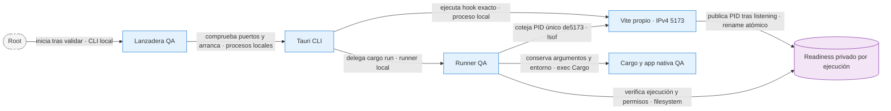
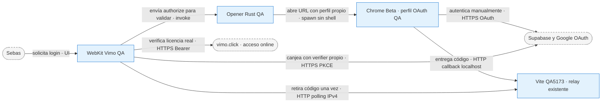

# ADR-0059 — Copia local para aceptación nativa de Flow

> Referencia de la preparación QA del 2026-10-07, con su configuración aislada.
> No define la identidad, los puertos, los límites ni el navegador del producto.
> Los pendientes y versiones que siguen pertenecen a ese ensayo; la aceptación
> del candidato actual debe repetirse sobre su artefacto y registrarse por separado.
> El contrato de producto está en [ADR-0058](ADR-0058-flow-como-motor-de-imagenes.md).

- **Rama:** `chore/flow-native-qa-20261006`, sólo QA local; no publicar.
- **Base de producto:** `d4169747d9206ff63c4f8f339ed2dc92c875b254`.
- **Alcance:** preparar Tauri completo. Root valida e inicia; Sebas hace login manual. Esta sesión no abre app, navegador, listeners, login, generaciones ni pagos.

## Decisión vigente

Clon independiente `/Users/sebas/Documents/Vimo-Flow-QA/2026-10-06/app`. Pipeline, editor, dispatcher y vendor permanecen en d4169747. La preparación de Chrome for Testing y el callback de bundle de los commits 97529c8/2dd6e7e quedaron superados el 2026-10-07 por el rechazo de login comunicado por Sebas. No insistir ni ocultar automatización.

La única ruta vigente es **Tauri dev 5173 + Google Chrome Beta oficial + perfil OAuth QA nuevo**. Root proporcionó `/Users/sebas/Applications/Google Chrome Beta.app`; el opener usa su ejecutable interior `Contents/MacOS/Google Chrome Beta`, sin fallback. La ruta queda configurada. Antes del primer arranque, Root debe terminar de validar la instalación: la observación del2026-10-07 vio versión156.0.8078.12 y firma deep/strict fallida en el framework, durante su preparación. No se modifica ni se abre el bundle desde esta sesión. No usar el bundle histórico para este ensayo.

| Recurso                         | Valor QA                                                                                                                |
| ------------------------------- | ----------------------------------------------------------------------------------------------------------------------- |
| Identifier y service de llavero | `click.vimo.flowqa20261006`                                                                                             |
| App data/settings/API metadata  | `~/Library/Application Support/click.vimo.flowqa20261006/`                                                              |
| Bridge/recibos                  | subcarpeta `flow` del app data QA                                                                                       |
| Proyectos por defecto Rust/UI   | `~/Documents/Vimo-Flow-QA-Projects`                                                                                     |
| WebKit UUID de 16 bytes         | `c779ff28-66b5-4e0a-b127-cd16d3e7faf2`, macOS 14+                                                                       |
| WebSocket extensión             | `127.0.0.1:43137`, explícito desde Rust                                                                                 |
| HTTP privado nativo             | efímero y autenticado, contrato existente                                                                               |
| UI Vite                         | `http://127.0.0.1:5173`                                                                                                 |
| Callback OAuth exacto           | `http://localhost:5173/auth/desktop-callback`                                                                           |
| Perfil OAuth exclusivo          | `/Users/sebas/Documents/Vimo-Flow-QA/2026-10-06/browser-auth-beta`                                                      |
| Navegador OAuth                 | Google Chrome Beta en `/Users/sebas/Applications/Google Chrome Beta.app`; revisión final de instalación a cargo de Root |
| Configuración pública           | sólo las dos `VITE_SUPABASE_*` existentes en `.env` QA ignorado                                                         |

No se enumeran ni migran claves operativas: todas las entradas keyring, incluidas legacy, se construyen con service QA. No copiar sesiones/cookies/API privadas. Updater y uploader automático deshabilitados sólo en QA; logs locales conservados. Los selectores de archivos siguen pudiendo acceder a otras carpetas: mantener los datos del ensayo en QA.

## Arranque con propietario de puerto comprobado

El hook es exactamente `pnpm run dev --host 127.0.0.1 --port 5173 --strictPort`. Vite y `devUrl` usan IPv4; el callback conserva localhost porque es la URL ya autorizada. No registrar esquemas QA ni cambiar allowlists remotas.

Root usará la lanzadera persistente externa `../start-native-qa.py`, después de confirmar Beta y estos guards. Comprueba5173 y43137 libres sin matar procesos. Crea una carpeta privada por ejecución en `../launches`, pasa `VIMO_QA_RUN_ID` y `VIMO_QA_RUN_DIRECTORY` sólo al proceso y ejecuta Tauri con `--runner ../qa-cargo-runner.py`. No definir esas variables manualmente ni reutilizar una carpeta previa.

**Contratos:** Tauri CLI 2.11.4 inicia el hook asincrónicamente y sólo prueba conexión TCP a devUrl antes del runner. Por eso strictPort solo no acredita que el puerto pertenezca a este arranque. El runner exige ID/carpeta privados coincidentes y que el único listener 5173 sea el PID que publicó Vite después del bind. El ID no es credencial. Se preservan cwd, argumentos, entorno, stdio y salida de Cargo. Scripts operativos locales fuera del repo; no son tests de producto.

**Fallo:** puerto ocupado, marker ausente/inválido, PID ajeno, error de inspección o timeout de 30 s abortan sin iniciar Cargo/app. No cambiar de puerto ni cerrar procesos ajenos. La comprobación es previa a Cargo, no una promesa de disponibilidad durante toda la compilación ni una defensa contra otro proceso malicioso del mismo usuario. Root comprobará también el arranque real; no se ejercitó aquí.

**Motivo:** evitar que Tauri abra accidentalmente una UI ajena mientras Vite está fallando por 5173 ocupado. No desactivar la espera del dev server ni hacer síncrono un hook que nunca termina.

## Login manual real

**Contratos:** `open_qa_auth_url` exige `tauri::is_dev()`, authorize del proyecto público, provider Google único, redirect_to exacto único y challenge S256. No acepta callback elegido libremente por el renderer ni deep link, incluso en release. Sólo el clic Login abre Beta. No CDP durante login, flags para ocultar automatización, cookies copiadas ni bypass de autenticación/licencia. Perfil de OAuth separado de los cinco perfiles Flow.

**Fallo:** Beta ausente/sin ruta o perfil symlink impiden abrir; no usar navegador predeterminado. La página de retorno no confirma acceso: debe terminar el canje y el veredicto online. El relay dev heredado tiene un código en memoria, sin correlación de intento ni autenticación de otros procesos locales; un solo login por vez. Reiniciar Vite pierde el retorno, otro cliente local puede consumirlo/reemplazarlo. PKCE conserva el verifier en WebKit QA, pero no evita esa interferencia. No registrar códigos/tokens. El modo offline heredado no es aceptación real.

**Motivo:** usar un navegador oficial y el callback ya autorizado sin trasladar estado operativo ni modificar Supabase. La aceptación Google sólo puede acreditarse después del login real del usuario.

## Aislamiento macOS y extensión

El UUID se asigna a `context.config_mut().app.windows[0]` antes de `build(context)`: esta versión de tauri-utils genera Vec incompatible con array16 cuando viene de JSON. Ambos configs Tauri requieren macOS 14; el override macOS anterior de 11 anulaba el mínimo. No quitar el aislamiento para compilar.

ROOT administra extensión 0.2.15 y perfiles nuevos con discoveryPort 43137 antes de primera presencia; pairing conserva ese puerto. No tocar perfiles o repos de extensión desde esta sesión ni arrancar bridge aparte. Consumo de 500/24 h móviles, cadencia y concurrencia actuales (máximo 3 por cuenta) intactos. No regenerar resultados existentes por la preparación QA.

## Video y aceptación pendiente

Leer la entrega persistente `../300-SCENES-PREFLIGHT.md`. Catálogo heredado Realista / count 300 / sin animación y confirmación es la ruta exacta; newCatalog:true usa gema/count0 y no hay selector UI heredado. No falsear flags o licencia. La confirmación muestra cantidad/duración/palabras, aún sin scenes.json; continuar no ofrece otra pausa antes de pedidos. No suplirla con un harness oculto.

DeepInfra/Deepgram y TTS elegido se configuran manualmente en llavero QA y sus consumos deben acordarse antes de Generar. Autorizar 300 imágenes Flow no amplía otros pagos. Root inicia la app cuando confirme guards e integridad de Beta; Sebas autentica. Sólo entonces se aceptan Crear/Editor/Rust/SEA, cinco vínculos y 300 imágenes con orden/importación/referencias/pausa/recuperación reales.
