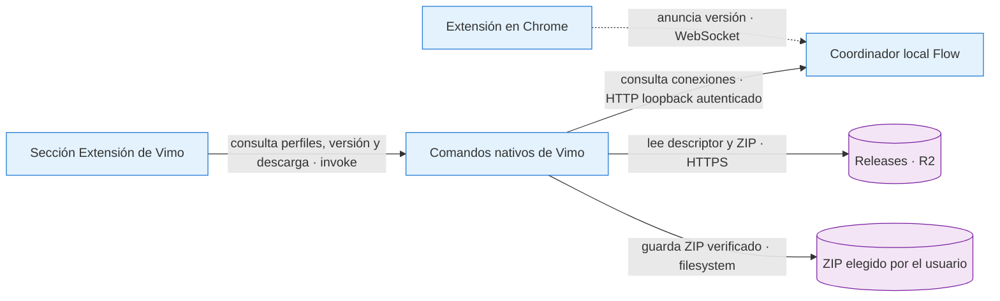

# ADR-0060 — Distribución versionada de la extensión desde Vimo

- **Estado:** Servicio de distribución publicado; consumidor de Vimo implementado localmente, sin publicación de la app
- **Fecha:** 2026-10-15
- **Área:** Extensión y distribución
- **Relacionadas:** ADR-0027 (actualizador de la app), ADR-0058 (motor Flow)

## Decisión

Usar el dominio público existente de releases en Cloudflare R2 para guardar ZIPs inmutables de la extensión y un descriptor `extensions/latest.json` con versión, fecha, novedades es/en/pt, URL, SHA-256 y tamaño. El descriptor se publica al final, después de verificar el ZIP versionado. No requiere redeploy de la landing ni una actualización de Vimo para anunciar otra extensión.

La sección Extensión comprueba el descriptor al entrar y al pulsar Buscar actualizaciones. Muestra las novedades y ofrece descargar el ZIP mediante el diálogo nativo Guardar. La extensión se carga o recarga manualmente en Chrome. Descargar no equivale a instalar.

**Contratos:** el descriptor tiene esquema1 y una URL HTTPS exacta en `releases.vimo.click/extensions/v<VERSION>/vimo-automate-<VERSION>.zip`. El transporte no sigue redirects, limita tiempos y bytes y verifica SHA-256/tamaño antes de guardar. El destino lo elige el diálogo nativo, no el webview. Un temporal único en la misma carpeta se sustituye atómicamente al terminar. Una sola descarga nativa puede estar activa. El descriptor mutable usa `Cache-Control: no-store`; los ZIPs versionados pueden usar caché inmutable.

**Fallos:** un descriptor ausente, inválido o inaccesible muestra un estado recuperable y permite comprobar de nuevo; no interrumpe las cuentas ni los trabajos Flow. La caché antigua no dispara el aviso. Cancelar Guardar devuelve `null` y no descarga el ZIP. Una descarga cortada, sobredimensionada o con hash incorrecto no sustituye el destino. Fallar al recordar localmente una descarga ya guardada no la convierte en un fallo de descarga.

**Por qué:** reutiliza un alojamiento ya existente bajo dominio propio, mantiene versiones independientes de app y extensión y evita incluir credenciales de almacenamiento en el cliente. El actualizador de la aplicación y su manifiesto anterior no cambian.

## Versión instalada

Desde extensión0.2.37, `chrome.runtime.getManifest().version` viaja como metadato `extensionVersion` en `session.status` y `discovery.hello`. El coordinador acepta el formato numérico de Chrome, limpia el dato al reconectar/reiniciar y expone `null` para versiones antiguas o anuncios inválidos. La UI compara componentes numéricos, no strings.

Sólo perfiles conectados y no revocados con información válida permiten afirmar una versión instalada. Una mezcla con algún perfil antiguo anuncia actualización pendiente. Si no se conoce la instalación, el recibo local recuerda únicamente qué ZIP se descargó y la UI explica que todavía debe cargarse en Chrome. No se cambia la identidad fija de la extensión, sus permisos, el protocolo de ejecución ni la admisión de generaciones.

## Publicación

El repo `EXTENSION-RPC-FLOW` genera `artifacts/vimo-automate-<VERSION>.zip` y `.release.json` mediante `scripts/package-extension.js`, leyendo notas de `releases/<VERSION>.json`. El descriptor deriva el hash y tamaño del ZIP final. El empaquetado es local y no sube archivos.

Tras aprobación explícita: subir primero el ZIP a la ruta versionada, comprobar sus bytes públicos, publicar el descriptor al final y verificar la consulta desde Vimo. Nunca sustituir una versión ya publicada. La fecha del descriptor se fija a la publicación real. Registrar esa publicación en el histórico y vault; hasta entonces no anotar como disponible a usuarios.

## Validación

Pruebas Rust separadas en `extension_release/tests/` cubren contrato, transporte HTTP real aislado, cuerpo cortado, límites, redirecciones, checksum, escritura atómica y concurrencia. Las comprobaciones temporales de UI cubren actualización, versiones desconocidas/mixtas, recibos, cancelación, errores, caché y reentrada. No invocan proveedores ni tocan proyectos reales. El resultado de la validación remota del endpoint de producción se registra en la sección de publicación al final de esta ADR.

## Publicación del servicio — 2026-10-15

A las **10:36:38 America/Bogota**, con aprobación explícita del owner, se publicaron sólo el ZIP de extensión **0.2.37** y el descriptor público. Bucket: `vimo-releases`; endpoint fijo `https://releases.vimo.click/extensions/latest.json`; ZIP `https://releases.vimo.click/extensions/v0.2.37/vimo-automate-0.2.37.zip`.

El ZIP se subió a las 10:22:30; el descriptor se publicó a las 10:36:38, después de validar el enlace canónico y el contenido del ZIP.

Artefacto: 166827 bytes, SHA-256 `46dd9531e9fe4ca36e0071d8e390829c259a89eec124ab42162aa8c64878eaa1`. Estructura instalable: `Vimo-Extension/manifest.json`; una única raíz Vimo-Extension, 21 archivos idénticos a fuentes y carpeta entregada, versión 0.2.37, identidad y permisos conservados. Verificación remota: Descriptor y ZIP canónicos sin query: HTTP 200, versión, tamaño y SHA-256 coincidentes; descriptor con no-store y ZIP inmutable. Descarga/guardado nativos contrastados con el mismo artefacto público; auditoría independiente adicional: 46/46 controles.

Prueba de descarga en la app real: Descarga real verificada a las 11:06:08 en `/Users/sebas/Documents/Vimo-builds/Vimo-0.11.0-extension-descarga-20261015.app`: entrar en Extensión, aviso 0.2.37, diálogo Guardar y estado «ZIP guardado; falta cargarlo en Chrome»; 166827 bytes y SHA-256 coinciden. No se instaló ni recargó Chrome. Esta prueba usó la app local anterior de descarga; la app final con instrucciones de carpeta se identifica por separado.

Esto sustituye el estado de publicación pendiente del servicio. El código y la app de Vimo que consumen este descriptor siguen siendo locales; no hubo push de código, release de escritorio ni instalación automática. El usuario elige dónde guardar el ZIP y dónde conservar la carpeta descomprimida. Se recomienda `Documentos/Vimo/Extensiones/Vimo-Extension`, sin crear esa ruta automáticamente.
