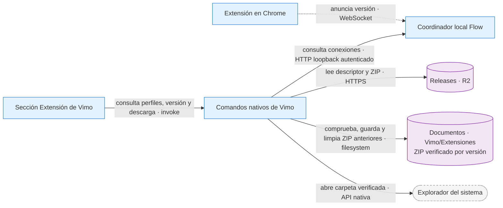

# ADR-0060 — Distribución versionada de la extensión desde Vimo

- **Estado:** Servicio de distribución publicado; consumidor de Vimo implementado localmente, sin publicación de la app
- **Fecha:** 2026-10-15
- **Área:** Extensión y distribución
- **Relacionadas:** ADR-0027 (actualizador de la app), ADR-0058 (motor Flow)

## Decisión

Usar el dominio público existente de releases en Cloudflare R2 para guardar ZIPs inmutables de la extensión y un descriptor `extensions/latest.json` con versión, fecha, novedades es/en/pt, URL, SHA-256 y tamaño. El descriptor se publica al final, después de verificar el ZIP versionado. No requiere redeploy de la landing ni una actualización de Vimo para anunciar otra extensión.

La sección Extensión comprueba el descriptor al entrar y al pulsar Buscar actualizaciones. Muestra las novedades y guarda el ZIP automáticamente en la carpeta `Vimo/Extensiones` dentro de Documentos, sin diálogo Guardar. La ubicación de Documentos se obtiene del sistema mediante `app.path().document_dir()`: Known Folder actual en Windows (incluida redirección/OneDrive), carpeta Documents de macOS y XDG_DOCUMENTS_DIR de Linux. Si el sistema no proporciona esa carpeta, se devuelve un error traducido; no se inventa una ruta bajo HOME ni se utiliza Descargas. La extensión se carga o recarga manualmente en Chrome. Descargar no equivale a instalar.

**Contratos:** el descriptor tiene esquema 1 y una URL HTTPS exacta en `releases.vimo.click/extensions/v<VERSION>/vimo-automate-<VERSION>.zip`. El transporte no sigue redirects, limita tiempos y bytes y verifica SHA-256/tamaño antes de guardar. El destino lo resuelve exclusivamente Rust, sin recibir rutas del webview. Se crea `Vimo/Extensiones` si hace falta y se conserva el nombre de archivo versionado. Un ZIP existente sólo se reutiliza si coinciden tamaño y SHA-256; un archivo distinto, un enlace simbólico o una colisión no se sobrescriben. Se prueban hasta veinte nombres reconocibles (base y sufijos numerados), usando un temporal único y persistencia sin sobrescritura. Sólo después de guardar o reutilizar el ZIP actual verificado se eliminan ZIPs de versiones numéricamente anteriores, dentro de esa misma carpeta y sin recorrer subdirectorios. La selección exige nombres generados por Vimo: `vimo-automate-<VERSION>.zip` o su sufijo ` (1)` a ` (19)`. Se conservan la versión actual y las futuras, archivos con otros nombres, enlaces y directorios, incluida la carpeta instalada `Vimo-Extension`. Los componentes numéricos se comparan con ceros a la derecha, como las versiones de Chrome; por ejemplo, `0.2.37` y `0.2.37.0` son equivalentes. La comprobación y la apertura de carpeta nunca limpian archivos. `download_extension_release` devuelve `{ path, cleanupIncomplete }`: una limpieza incompleta no invalida el ZIP nuevo ya guardado. Las redirecciones legítimas de Documentos se respetan; el ZIP debe ser un archivo regular. Una sola descarga nativa puede estar activa. El descriptor mutable usa `Cache-Control: no-store`; los ZIPs versionados pueden usar caché inmutable.

**Fallos:** un descriptor ausente, inválido o inaccesible muestra un estado recuperable y permite comprobar de nuevo; no interrumpe las cuentas ni los trabajos Flow. La caché antigua no dispara el aviso. Una carpeta Documentos no disponible, falta de permisos o un bloqueo de escritura muestra un error y permite reintentar. Una descarga cortada, sobredimensionada o con hash incorrecto no produce un ZIP final ni altera archivos existentes. Fallar al recordar localmente una descarga ya guardada no la convierte en un fallo de descarga. Si Windows mantiene un ZIP anterior bloqueado o falla su eliminación por permisos, la descarga actual conserva su éxito y la UI muestra un aviso breve de limpieza incompleta; el archivo antiguo que no pudo borrarse se conserva. Nunca se eliminan versiones anteriores antes de verificar que existe el ZIP actual válido.

**Por qué:** reutiliza un alojamiento ya existente bajo dominio propio, mantiene versiones independientes de app y extensión y evita incluir credenciales de almacenamiento en el cliente. El actualizador de la aplicación y su manifiesto anterior no cambian.

## Versión instalada

Desde extensión 0.2.37, `chrome.runtime.getManifest().version` viaja como metadato `extensionVersion` en `session.status` y `discovery.hello`. El coordinador acepta el formato numérico de Chrome, limpia el dato al reconectar/reiniciar y expone `null` para versiones antiguas o anuncios inválidos. La UI compara componentes numéricos, no strings.

Sólo perfiles conectados y no revocados con información válida permiten afirmar una versión instalada. Una mezcla con algún perfil antiguo anuncia actualización pendiente. Si no se conoce la instalación, el botón muestra «Extensión descargada» e inactivo sólo cuando el comando `find_extension_download` confirma un ZIP válido para la versión y hash publicados en Documentos. Un recibo histórico por sí solo no bloquea la descarga. «Ya está instalada» requiere versiones válidas y actuales en todos los perfiles conectados; los perfiles desconocidos o antiguos no acreditan ese estado. Una versión nueva habilita «Descargar extensión» junto a su número de versión. Se vuelve a comprobar el archivo al entrar, al recuperar el foco y al buscar actualizaciones; si fue borrado o dañado, la descarga vuelve a estar disponible. La confirmación de guardado muestra «Extensión guardada» y «Abrir carpeta», sin exponer una ruta larga. Si `cleanupIncomplete` es verdadero, se añade un aviso breve sin habilitar una segunda descarga ni afirmar que el ZIP nuevo falló. El comando `open_extension_download_folder` comprueba de nuevo el ZIP y abre únicamente su directorio mediante el opener nativo; no recibe rutas del frontend. Buscar actualizaciones revalida explícitamente descriptor y archivo, y, si no existe un ZIP válido, consulta los perfiles actuales: si la última versión ya está descargada o instalada informa «Ya tienes la última versión» sin abrir el modal. Las consultas y acciones nativas usan `networkMode: always`: el transporte Rust comunica los errores y no se encolan órdenes por un evento offline del webview. El lector compartido `useFlowStatus` también consulta el coordinador local sin depender de ese evento. Un ZIP verificado permite confirmarlo sin esperar al coordinador y aunque los perfiles estén desconectados; un error de comprobación no se anuncia como éxito. No se cambia la identidad fija de la extensión, sus permisos, el protocolo de ejecución ni la admisión de generaciones.

## Publicación

El repo `EXTENSION-RPC-FLOW` genera `artifacts/vimo-automate-<VERSION>.zip` y `.release.json` mediante `scripts/package-extension.js`, leyendo notas de `releases/<VERSION>.json`. El descriptor deriva el hash y tamaño del ZIP final. El empaquetado es local y no sube archivos.

Tras aprobación explícita: subir primero el ZIP a la ruta versionada, comprobar sus bytes públicos, publicar el descriptor al final y verificar la consulta desde Vimo. Nunca sustituir una versión ya publicada. La fecha del descriptor se fija a la publicación real. Registrar esa publicación en el histórico y vault; hasta entonces no anotar como disponible a usuarios.

## Validación

Pruebas Rust separadas en `extension_release/tests/` cubren contrato, transporte HTTP real aislado, cuerpo cortado, límites, redirecciones, checksum, escritura atómica y concurrencia. Las comprobaciones temporales de UI cubren actualización, versiones desconocidas/mixtas, recibos, cierre del aviso durante la descarga, errores, caché y reentrada. No invocan proveedores ni tocan proyectos reales. El resultado de la validación remota del endpoint de producción se registra en la sección de publicación al final de esta ADR. Las pruebas de limpieza verifican eliminación selectiva después del guardado, conservación de versiones iguales o superiores, archivos ajenos, enlaces y carpetas, ausencia de borrado en consultas y éxito de descarga aunque no se pueda eliminar un ZIP anterior.

Validación local de limpieza del 2026-10-15: 128 tests Rust en macOS y 221 comprobaciones de interfaz en Chrome y otras 221 en WKWebView. Un ensayo con el ZIP público real verificó borrado selectivo y conservación de archivos en carpetas temporales. Windows/Linux tienen pruebas preparadas; todavía no se ejecutaron en esos sistemas. Este cambio sigue local, sin publicación de la app.

## Publicación del servicio — 2026-10-15

A las **10:36:38 America/Bogota**, con aprobación explícita del owner, se publicaron sólo el ZIP de extensión **0.2.37** y el descriptor público. Bucket: `vimo-releases`; endpoint fijo `https://releases.vimo.click/extensions/latest.json`; ZIP `https://releases.vimo.click/extensions/v0.2.37/vimo-automate-0.2.37.zip`.

El ZIP se subió a las 10:22:30; el descriptor se publicó a las 10:36:38, después de validar el enlace canónico y el contenido del ZIP.

Artefacto: 166827 bytes, SHA-256 `46dd9531e9fe4ca36e0071d8e390829c259a89eec124ab42162aa8c64878eaa1`. Estructura instalable: `Vimo-Extension/manifest.json`; una única raíz Vimo-Extension, 21 archivos idénticos a fuentes y carpeta entregada, versión 0.2.37, identidad y permisos conservados. Verificación remota: Descriptor y ZIP canónicos sin query: HTTP 200, versión, tamaño y SHA-256 coincidentes; descriptor con no-store y ZIP inmutable. Descarga/guardado nativos contrastados con el mismo artefacto público; auditoría independiente adicional: 46/46 controles.

Prueba de descarga en la app real: Descarga real verificada a las 11:06:08 en `/Users/sebas/Documents/Vimo-builds/Vimo-0.11.0-extension-descarga-20261015.app`: entrar en Extensión, aviso 0.2.37, diálogo Guardar y estado «ZIP guardado; falta cargarlo en Chrome»; 166827 bytes y SHA-256 coinciden. No se instaló ni recargó Chrome. Esta prueba usó la app local anterior de descarga; la app final con instrucciones de carpeta se identifica por separado.

Esto sustituye el estado de publicación pendiente del servicio. El código y la app de Vimo que consumen este descriptor siguen siendo locales; no hubo push de código, release de escritorio ni instalación automática. La app utilizada en aquella prueba abría el diálogo Guardar. La implementación local vigente descrita arriba guarda automáticamente en Documentos; esa modificación aún no se publicó. La extracción y carga en Chrome continúan siendo manuales.
