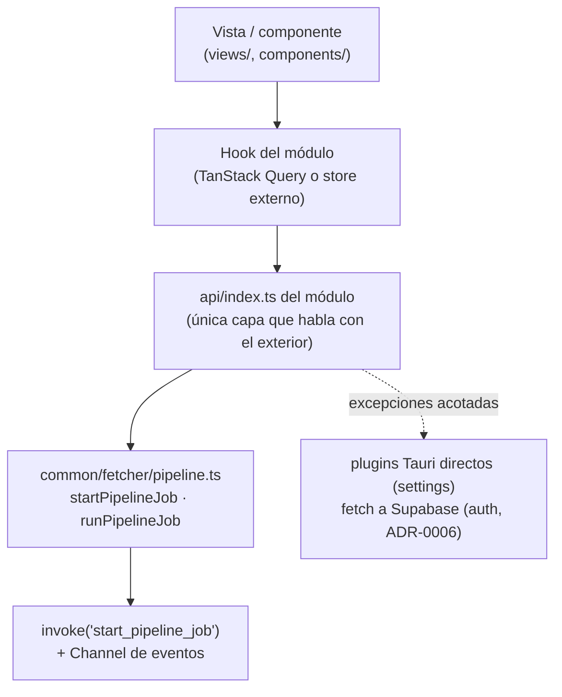
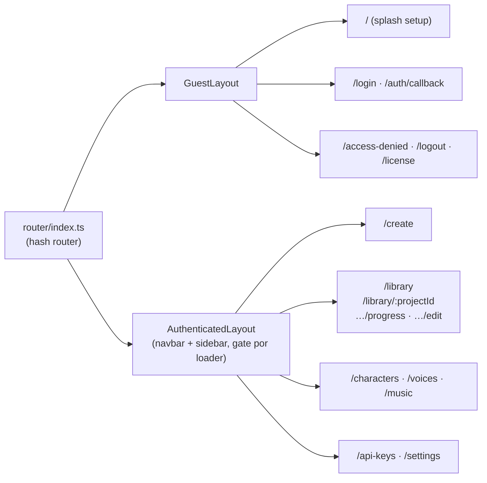
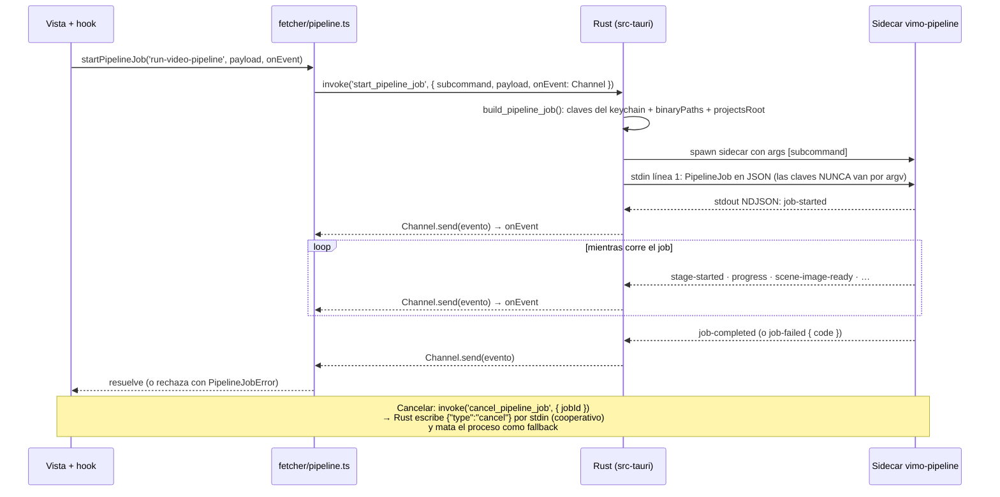
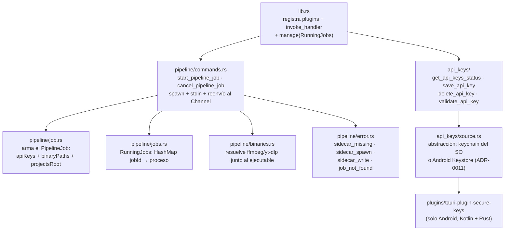
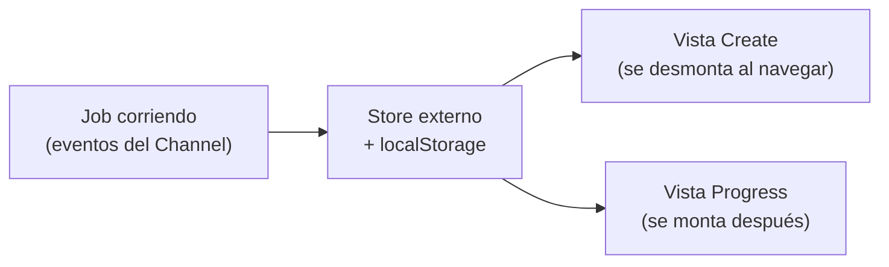

# La interfaz y la capa nativa

Diagramas de `src/` (el webview React) y `src-tauri/` (el lado Rust), y del
puente entre los dos. La vista general del sistema está en el
[README de esta carpeta](README.md); las entrañas del sidecar, en
[PIPELINE.md](PIPELINE.md).

---

## 1. Estructura de `src/`

El código de producto se organiza **por módulo de dominio**, no por tipo de
archivo (regla de [CLAUDE.md](../../CLAUDE.md)): no existen `src/components/`
ni `src/hooks/` globales.

```
src/
├── main.tsx                  punto de entrada: monta <App/>
├── App.tsx                   providers: Query → Suspense → Theme → Router
├── router/index.ts           árbol de rutas (hash router)
├── i18n/index.ts             configuración de i18next (es/en/pt)
├── assets/                   CSS global, fuentes, imágenes
├── layouts/
│   ├── AuthenticatedLayout/  navbar + sidebar + outlet + error boundary
│   └── GuestLayout/          full-screen para login / acceso denegado
└── modules/
    ├── common/               lo transversal: fetcher, UI reutilizable, brand
    ├── videos/               Create + Library (el módulo grande)
    ├── voices/               generación de voces TTS
    ├── music/                música con IA
    ├── characters/           biblioteca de personajes
    ├── api-keys/             gestión de claves de proveedores
    ├── settings/             preferencias y carpeta raíz de proyectos
    ├── auth/                 login OAuth y verificación de acceso
    ├── setup/                splash inicial
    └── costs/                catálogo de costos (fuera de la navegación)
```

Cada módulo repite la misma estructura interna:

```
<módulo>/
├── api/index.ts     ÚNICA capa que toca invoke / plugins de Tauri
├── hooks/           TanStack Query + stores externos
├── components/      componentes del módulo
├── views/<Vista>/   una carpeta por vista, cargada lazy
├── types/           contratos con nombre, por dominio
└── constants.ts     rutas, claves de query, límites
```

## 2. La cadena de capas (no se saltea eslabones)



Un componente jamás llama a `invoke`, al fetcher ni a `fetch` directamente:
componente → hook → `api/` → fetcher, siempre.

## 3. Rutas y layouts



Las rutas se declaran como constantes en el `constants.ts` de cada módulo;
nunca hay paths literales en `<Link>` o `navigate()`.

## 4. El puente con el sidecar: dos primitivas

Todo el tráfico UI ↔ pipeline pasa por un solo archivo,
`src/modules/common/fetcher/pipeline.ts`, que expone dos modos de consumo:

| Primitiva                                        | Resuelve cuando…   | Para qué                                           |
| ------------------------------------------------ | ------------------ | -------------------------------------------------- |
| `startPipelineJob(subcommand, payload, onEvent)` | el job **arranca** | jobs largos con progreso; devuelve `{jobId, stop}` |
| `runPipelineJob<T>(subcommand, payload)`         | el job **termina** | request/response; devuelve el `result` tipado      |

`runPipelineJob` está construida sobre `startPipelineJob`. Los errores llegan
como `PipelineJobError { code, message }`, donde `code` es la clave i18n
estable. Detalle importante: el `Channel` se crea **antes** del `invoke`, así
los eventos tempranos quedan encolados y no se pierden.

## 5. Secuencia completa de un job



## 6. El lado Rust (`src-tauri/`)



Los seis comandos `invoke` registrados:

| Comando               | Archivo                              | Qué hace                              |
| --------------------- | ------------------------------------ | ------------------------------------- |
| `start_pipeline_job`  | `src-tauri/src/pipeline/commands.rs` | spawn del sidecar + puente de eventos |
| `cancel_pipeline_job` | `src-tauri/src/pipeline/commands.rs` | cancelación cooperativa por stdin     |
| `get_api_keys_status` | `src-tauri/src/api_keys/commands.rs` | qué proveedores tienen clave          |
| `save_api_key`        | `src-tauri/src/api_keys/commands.rs` | guarda en el keychain                 |
| `delete_api_key`      | `src-tauri/src/api_keys/commands.rs` | borra del keychain                    |
| `validate_api_key`    | `src-tauri/src/api_keys/commands.rs` | prueba la clave contra el proveedor   |

Notas de seguridad: no hay capability `shell` en
`src-tauri/capabilities/default.json` — el webview no puede spawnear nada,
solo Rust. Las claves API viajan únicamente por stdin del sidecar, nunca por
argv (argv es visible en el listado de procesos).

## 7. Subcomandos que consume cada módulo

El equivalente a "endpoints" son los subcomandos del sidecar. Los que consume
cada `api/index.ts` (`*` = streaming con `startPipelineJob`; el resto,
`runPipelineJob`):

| Módulo       | Subcomandos                                                                                                                                                                                                                                                                                                                                                                                                                                            |
| ------------ | ------------------------------------------------------------------------------------------------------------------------------------------------------------------------------------------------------------------------------------------------------------------------------------------------------------------------------------------------------------------------------------------------------------------------------------------------------ |
| `videos`     | `create-video-project`, `upload-narration`, `run-video-pipeline`\*, `confirm-scenes`, `probe-tts`, `video-project-status`, `list-video-projects`, `delete-video-projects`, `video-project-detail`, `update-scenes`, `regenerate-scene-images`\*, `render-video`\*, `export-clips`\*, `replace-narration`\*, `set-project-music`, `update-audio-mix`, `get-image-credits`, `generate-music`\*, `suggest-music-prompt`, `list-voices`, `characters-list` |
| `voices`     | `list-voices`, `generate-voice`\*, `get-voice-credits`, `voice-history-list`, `voice-history-delete`                                                                                                                                                                                                                                                                                                                                                   |
| `music`      | `generate-music`\*, `suggest-music-prompt`, `choose-music`, `get-music-credits`, `music-history-list`, `music-history-delete`                                                                                                                                                                                                                                                                                                                          |
| `characters` | `characters-list`, `character-create`, `character-update`, `character-delete`, `suggest-character-profile`, `generate-character-preview`\*                                                                                                                                                                                                                                                                                                             |

(El módulo `videos` reutiliza subcomandos de otros dominios — `list-voices`,
`generate-music`, `characters-list` — porque el formulario de Create elige voz,
música y personajes.)

## 8. Tareas largas: estado fuera de React

Los flujos de generación (`useCreateTask`, `useVoiceTask`, `useMusicTask` en
los `hooks/` de sus módulos) guardan el estado de la tarea en un **store fuera
de React** (`useSyncExternalStore` + `localStorage`):



La razón: el layout desmonta la vista al navegar (por ejemplo, de `/create` a
`/library/:id/progress`), pero el job sigue corriendo — el estado no puede
vivir en el componente. Estos hooks también implementan auto-retry con una
lista de códigos de error reintentables.

## 9. El contrato de eventos

Los 18 tipos de evento que el sidecar emite por NDJSON (definidos en
`pipeline/runner/events.ts`; `src/` los consume solo con `import type`):

| Evento                        | Cuándo                                                    |
| ----------------------------- | --------------------------------------------------------- |
| `job-started`                 | el sidecar arrancó y leyó el job                          |
| `stage-started`               | empieza una fase (solo lo emite el runner)                |
| `stage-skipped`               | la fase se saltea por cache-hit (su artefacto ya existe)  |
| `stage-completed`             | terminó una fase                                          |
| `progress`                    | progreso genérico (`percent`, `message`, `detail`)        |
| `log`                         | mensaje `info` / `warn` / `error`                         |
| `scenes-planned`              | las escenas quedaron definidas (tras los cortes)          |
| `scene-prompt-ready`          | una escena ya tiene su prompt de imagen (incremental)     |
| `scene-image-started`         | empieza la generación de una imagen                       |
| `scene-image-ready`           | imagen lista (ruta absoluta; la UI usa `convertFileSrc`)  |
| `scene-image-failed`          | imagen fallida (`code` estable para i18n)                 |
| `scene-image-progress`        | avance de una imagen (solo Evolink lo informa)            |
| `voice-progress`              | avance de la síntesis de voz                              |
| `bgm-progress`                | avance de la música de fondo con IA                       |
| `render-progress`             | avance del render (`phase`: chunks / concat / final)      |
| `awaiting-scene-confirmation` | pausa de confirmación: el job cierra LIMPIO tras esto     |
| `job-completed`               | fin exitoso, con el `result`                              |
| `job-failed`                  | fin con error (`code` estable; `cancelled` = cancelación) |
