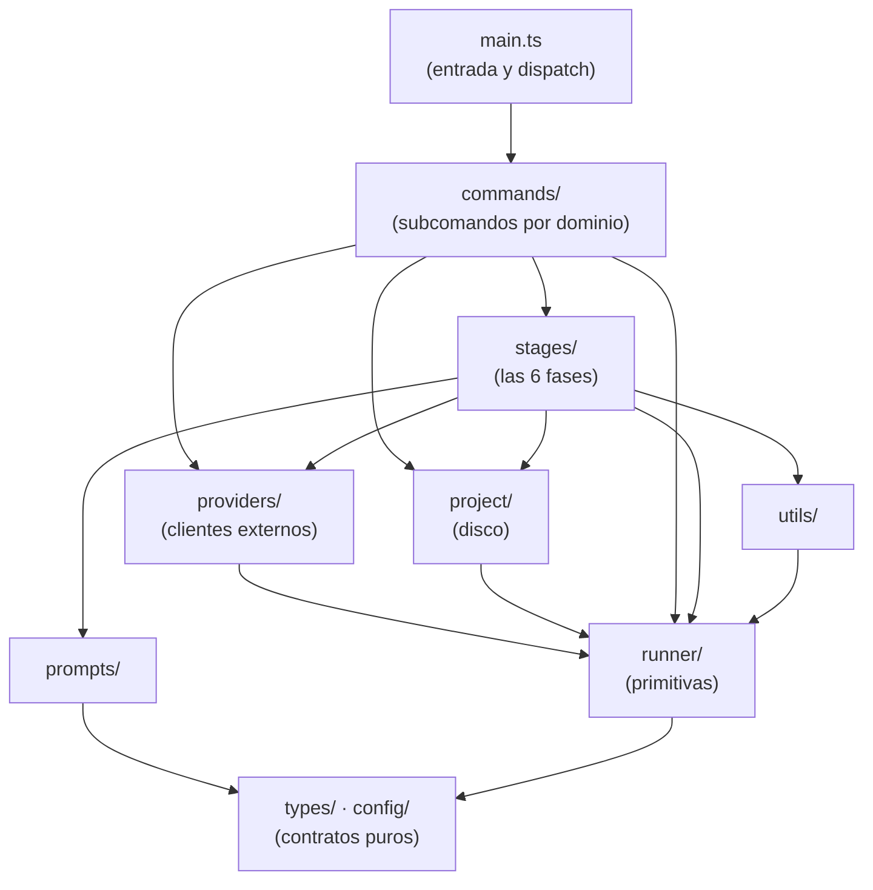
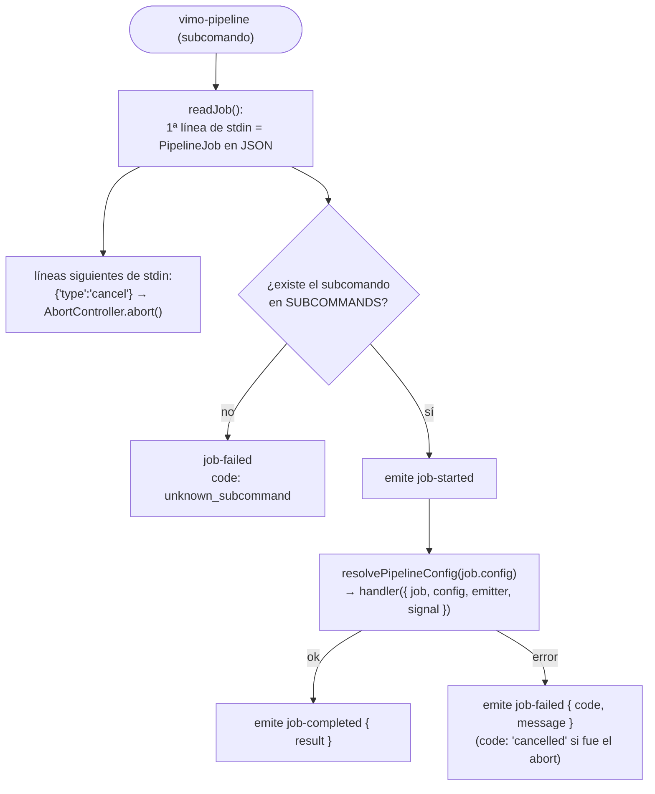
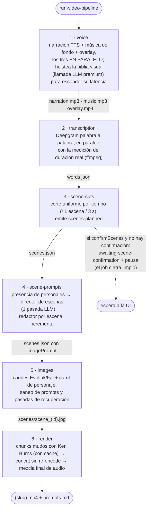
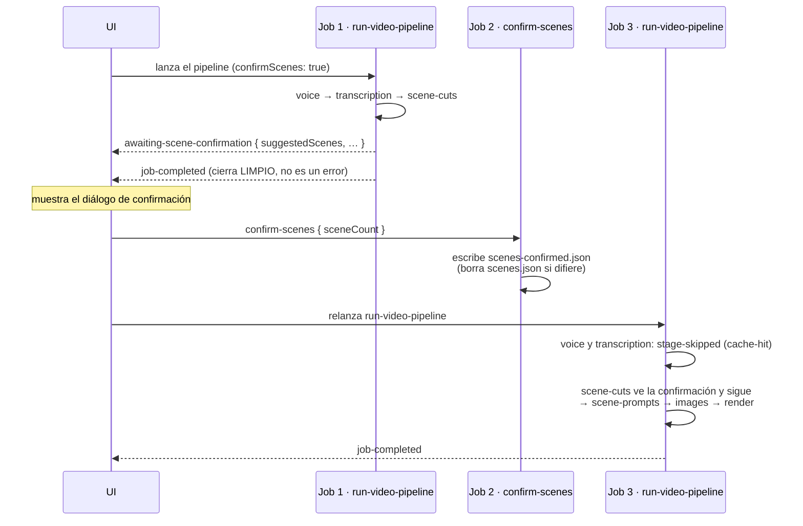
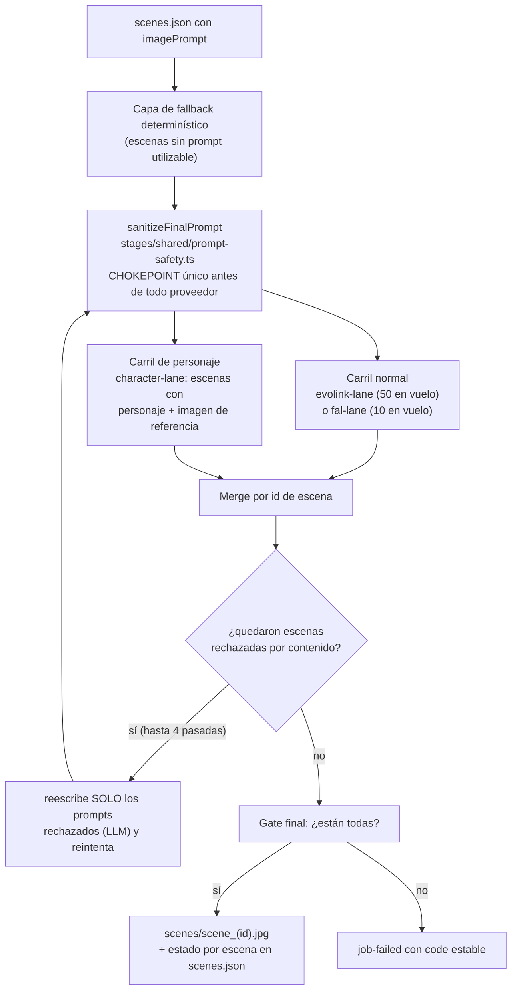
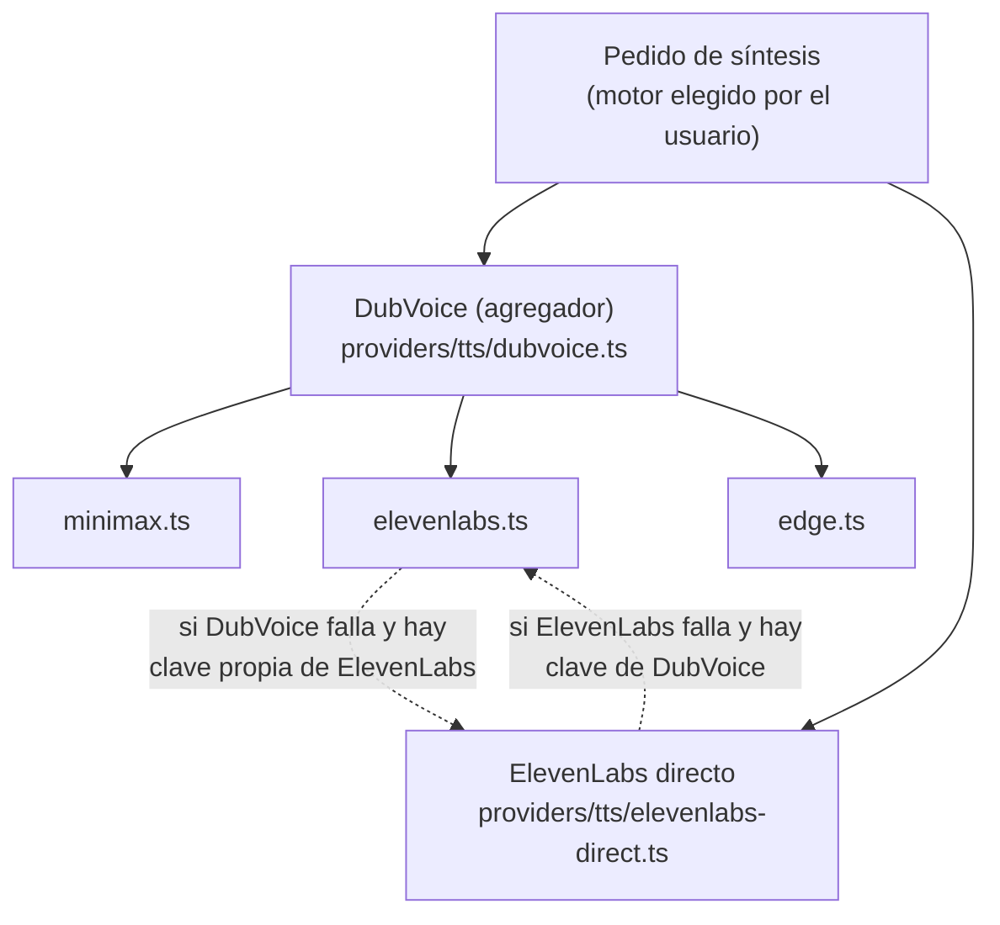

# El pipeline por dentro

Mapa detallado de `pipeline/`: el sidecar de generación (ADR-0010). Es un
paquete TypeScript puro (141 archivos, sin dependencias de UI) que se empaqueta
como binario Node SEA y que Rust lanza **una vez por job**: lee el job por
stdin, emite eventos NDJSON por stdout y muere. Cómo llega un job hasta acá
está dibujado en [FRONTEND.md](FRONTEND.md).

---

## 1. Árbol de carpetas

```
pipeline/
├── main.ts                        entrada del sidecar (1)
├── runner/                        primitivas: job, stage, emitter, eventos (9)
├── commands/                      subcomandos, un dominio por carpeta (43)
│   ├── videos/                    los 17 subcomandos de video (20)
│   ├── characters/                biblioteca de personajes (8)
│   ├── music/                     música IA + historial (8)
│   └── voices/                    TTS + historial (7)
├── stages/                        las 6 fases del video (32)
│   ├── registry.ts                CREATE_VIDEO_STAGES: el orden ES la secuencia
│   ├── context.ts                 CreateVideoContext (paths, metadata, opciones)
│   ├── voice/                     fase 1: narración + BGM + overlay (4)
│   ├── transcription/             fase 2: timestamps palabra a palabra (1)
│   ├── scene-cuts/                fase 3: cortes + pausa de confirmación (1)
│   ├── scene-prompts/             fase 4: director + redactor de prompts (7)
│   ├── images/                    fase 5: carriles de generación de imagen (6)
│   ├── render/                    fase 6: chunks, concat y mezcla final (8)
│   └── shared/                    LLM, biblia visual, saneo de prompts (3)
├── providers/                     clientes de servicios externos (16)
│   ├── llm/                       DeepInfra + reintentos y degradación (2)
│   ├── transcription/             Deepgram (1)
│   ├── image/                     Fal, Evolink, descarga (3)
│   ├── music/                     Evolink/Suno (1)
│   ├── tts/                       DubVoice + Minimax/ElevenLabs/Edge (8)
│   └── ytdlp/                     descargas de YouTube (1)
├── project/                       layout en disco de un proyecto (4)
├── types/                         contratos compartidos con src/ (10)
├── prompts/                       plantillas de prompts para los LLM (10)
├── utils/                         ffmpeg, concurrencia, duraciones, … (13)
└── config/                        PipelineConfig, ApiKeys, BinaryPaths (3)
```

(Entre paréntesis, la cantidad de archivos `.ts` de cada carpeta.)

## 2. Las capas: quién puede importar de quién

Las dependencias entre carpetas forman capas nítidas. Las flechas significan
"importa de" (el grosor real está en los conteos de la tabla):



| Carpeta      | Importa de (nº de imports)                                                                  |
| ------------ | ------------------------------------------------------------------------------------------- |
| `commands/`  | runner (80), types (44), project (34), providers (20), stages (13), utils (12), prompts (6) |
| `stages/`    | utils (38), types (34), runner (23), prompts (23), project (22), providers (14), config (1) |
| `providers/` | types (16), runner (12), utils (4), config (2)                                              |
| `project/`   | types (3), runner (3), utils (2), providers (1)                                             |
| `runner/`    | types (4), config (4)                                                                       |

Regla práctica: `types/` y `config/` no dependen de nada (son contratos puros,
varios browser-safe para que `src/` los importe con `import type`); `runner/`
solo de ellos; y nadie importa "hacia arriba".

## 3. La entrada: `main.ts`

`vimo-pipeline <subcomando>` — el subcomando llega por `argv[2]`, el job por
stdin:



`SUBCOMMANDS` se compone esparciendo los cuatro mapas de dominio
(`commands/*/subcommands.ts`) más un `ping` de prueba de contrato. El
`PipelineJob` que llega por stdin (armado por Rust) trae:

```
{ jobId, projectDir?, projectsRoot?, config?, apiKeys, binaryPaths, payload? }
```

No existe **ninguna** lectura de `process.env` en todo `pipeline/`: todo entra
por el job (decisión de ADR-0010).

## 4. `runner/` — las primitivas (ADR-0010/0012)

| Archivo         | Responsabilidad                                                                                                     |
| --------------- | ------------------------------------------------------------------------------------------------------------------- |
| `job.ts`        | el contrato `PipelineJob` + `CancelMessage`                                                                         |
| `context.ts`    | `PipelineContext = { job, config, emitter, signal }`                                                                |
| `emitter.ts`    | `createEmitter(jobId)` — **única escritura a stdout** de todo el pipeline                                           |
| `events.ts`     | los 18 tipos de evento NDJSON (el contrato de salida, tabla en [FRONTEND.md](FRONTEND.md#9-el-contrato-de-eventos)) |
| `stage.ts`      | contrato `Stage`: `id`, `skip?()`, `run()`; `StagePause { pause: true }`                                            |
| `stage-id.ts`   | `STAGE_IDS` as const — separado para que `src/` lo importe sin APIs de Node                                         |
| `run-stages.ts` | el runner declarativo: recorre stages en orden; único emisor de `stage-*`                                           |
| `failure.ts`    | `PipelineFailure { code, message }` — `code` es la clave i18n                                                       |
| `subcommand.ts` | `SubcommandHandler = (ctx) => Promise<unknown>`                                                                     |

## 5. `commands/` — un dominio = una carpeta

Cada carpeta exporta su mapa en `subcommands.ts`; `main.ts` los mezcla. Los 34
subcomandos:

| Dominio       | Subcomandos                                                                                                                                                                                                                                                                                                                                                    | Datos en disco                         |
| ------------- | -------------------------------------------------------------------------------------------------------------------------------------------------------------------------------------------------------------------------------------------------------------------------------------------------------------------------------------------------------------- | -------------------------------------- |
| `videos/`     | `create-video-project`, `upload-narration`, `run-video-pipeline`, `video-project-status`, `confirm-scenes`, `probe-tts`, `list-video-projects`, `delete-video-projects`, `video-project-detail`, `update-scenes`, `regenerate-scene-images`, `render-video`, `update-audio-mix`, `replace-narration`, `set-project-music`, `export-clips`, `get-image-credits` | `<projectsRoot>/<slug>/`               |
| `characters/` | `characters-list`, `character-create`, `character-update`, `character-delete`, `suggest-character-profile`, `generate-character-preview`                                                                                                                                                                                                                       | `<projectsRoot>/characters/<id>/`      |
| `music/`      | `suggest-music-prompt`, `generate-music`, `choose-music`, `get-music-credits`, `music-history-list`, `music-history-delete`                                                                                                                                                                                                                                    | `<projectsRoot>/_history/music/<id>/`  |
| `voices/`     | `list-voices`, `generate-voice`, `get-voice-credits`, `voice-history-list`, `voice-history-delete`, `add-library-voice`                                                                                                                                                                                                                                        | `<projectsRoot>/_history/voices/<id>/` |

## 6. Las 6 stages del video (el corazón)

`stages/registry.ts` define `CREATE_VIDEO_STAGES`; **el orden del array ES la
secuencia del video**. `run-video-pipeline` construye un `CreateVideoContext`
(paths del proyecto, metadata mutable, opciones, biblia visual hoisteada) y se
lo pasa a `runStages()`:



Cada stage declara un `skip()` que mira si su artefacto ya existe (cache-hit →
evento `stage-skipped`). Eso es lo que permite reanudar, regenerar por partes y
el ciclo de pausa. Detalles por fase:

| #   | Stage           | Archivo orquestador                     | Notas                                                                                                                             |
| --- | --------------- | --------------------------------------- | --------------------------------------------------------------------------------------------------------------------------------- |
| 1   | `voice`         | `stages/voice/voice.ts`                 | narración esencial; BGM y overlay opcionales (si fallan: `log warn` y el video sigue)                                             |
| 2   | `transcription` | `stages/transcription/transcription.ts` | capa los timestamps a la duración real del audio                                                                                  |
| 3   | `scene-cuts`    | `stages/scene-cuts/scene-cuts.ts`       | el único punto de pausa (`StagePause`)                                                                                            |
| 4   | `scene-prompts` | `stages/scene-prompts/scene-prompts.ts` | acá se cobra (`await`) la biblia visual hoisteada en la fase 1; persiste incrementalmente y emite `scene-prompt-ready` por escena |
| 5   | `images`        | `stages/images/images.ts`               | ver §8                                                                                                                            |
| 6   | `render`        | `stages/render/render.ts`               | progreso 0–45 % chunks · 45–50 % concat · 50–100 % mezcla; se filtra del run si `autoRender: false` (ADR-0016)                    |

## 7. El ciclo de pausa (confirmación de escenas, ADR-0013)

La pausa **no** es un job esperando: el proceso muere limpio y la UI relanza.
Las fases ya hechas se saltean por cache-hit:



## 8. La fase de imágenes por dentro

`stages/images/images.ts` despacha a **carriles** (contrato `ImageLane` en
`lane.ts`, registro en `lanes.ts`):



Cada imagen emite `scene-image-started` / `scene-image-ready` /
`scene-image-failed` (y `scene-image-progress` si el proveedor informa
avance). La concurrencia por carril vive en `utils/concurrency.ts`.

## 9. La cascada de TTS

La narración (`stages/voice/narration.ts`) y el módulo de voces usan el
registro `TTS_PROVIDERS` de `providers/tts/registry.ts`. Cada motor declara su
vendor y su clave (`apiKeyOf`) y, por id, sus carriles de respaldo
(`fallbackProviderIds`); el registro los resuelve, así ningún motor importa a otro
(ADR-0024):



El saldo es del **vendor**, no del motor: `providers/tts/vendors.ts` (créditos de
DubVoice o cuota de caracteres de ElevenLabs).

## 10. Reuso de stages fuera del pipeline completo (ADR-0014)

La edición en Library no duplica lógica: re-ejecuta stages sobre el mismo
proyecto, apoyándose en los `skip()`:

| Subcomando                | Qué re-ejecuta                                                   |
| ------------------------- | ---------------------------------------------------------------- |
| `regenerate-scene-images` | `runStages([scenePrompts, images])` con `ctx.regenerateSceneIds` |
| `render-video`            | `runStages([render])` tras quitar `render` de `completedStages`  |
| `replace-narration`       | `synthesizeNarration()` directo + re-transcripción               |
| `export-clips`            | `renderSceneClips()` de `stages/render/scene-clips.ts`           |

## 11. Servicios externos: quién llama a qué

| Servicio                  | Cliente en `providers/`                                                   | Consumido desde                                                                                                                  |
| ------------------------- | ------------------------------------------------------------------------- | -------------------------------------------------------------------------------------------------------------------------------- |
| DeepInfra (LLM, 3 tiers)  | `llm/deepinfra.ts` + `llm/generate.ts` (reintentos y degradación de tier) | `stages/shared/llm.ts`, sugerencias de música y de perfil de personaje                                                           |
| Deepgram (transcripción)  | `transcription/deepgram.ts`                                               | `stages/transcription/`                                                                                                          |
| Fal (imágenes)            | `image/fal.ts`                                                            | `stages/images/fal-lane.ts`, `character-lane.ts`, créditos                                                                       |
| Evolink (imágenes + Suno) | `image/evolink.ts`, `music/evolink.ts`                                    | `stages/images/evolink-lane.ts`, `character-lane.ts`, `stages/voice/background-music.ts`, `commands/music/`                      |
| DubVoice (agregador TTS)  | `tts/dubvoice.ts` + `minimax/elevenlabs/edge.ts`                          | `stages/voice/narration.ts`, `commands/voices/`, `probe-tts`                                                                     |
| ElevenLabs directo        | `tts/elevenlabs-direct.ts` (+ `tts/vendors.ts` para la cuota)             | `stages/voice/narration.ts`, `commands/voices/` (incl. `add-library-voice`), `probe-tts`; fallback mutuo con `tts/elevenlabs.ts` |
| ffmpeg (binario)          | `utils/ffmpeg.ts` — **único spawn**                                       | transcription, render, narración, upload/replace de audio, duraciones                                                            |
| yt-dlp (binario)          | `ytdlp/download.ts`                                                       | música de fondo por URL, overlay, `set-project-music`                                                                            |

## 12. Layout en disco de un proyecto

Definido en `project/paths.ts` (con guard anti path-traversal y carpetas
reservadas). Cada archivo lo produce una fase concreta:

```
<projectsRoot>/                        (elegida en Settings, ADR-0009)
├── characters/                        biblioteca global (RESERVADA)
├── _history/                          historiales de music/ y voices/ (RESERVADA)
└── <slug>/                            un proyecto de video
    ├── project.json                   metadata + estado + completedStages
    ├── script.txt                     el guion
    ├── narration.mp3                  ← voice
    ├── music.mp3                      ← voice
    ├── overlay.mp4                    ← voice
    ├── visual-context.txt             la biblia visual (shared/visual-bible)
    ├── words.json                     ← transcription
    ├── scenes.json                    ← scene-cuts / scene-prompts / images
    ├── scenes-confirmed.json          ← confirm-scenes
    ├── scenes/scene_<id>.jpg          ← images
    ├── characters/reference_N.jpg     referencias del carril de personaje
    ├── cache/chunks/                  chunk_NNN.mp4 + manifest (caché del render)
    ├── clips/clip_NN.mp4              ← export-clips
    ├── prompts.md                     ← render (export de prompts)
    └── <slug>.mp4                     ← render (el video final)
```

Estados del proyecto (`project.json`):
`draft → generating → awaiting-confirmation → generating → completed`, con
`paused` (cancelación, retomable) y `error` (+ `errorCode` i18n) como desvíos.

## 13. Los tres registros declarativos (cómo se extiende)

El patrón de extensión del pipeline: **agregar un X = un archivo + una línea**
en su registro. La receta completa está en la §4 de
[ARCHITECTURE.md](../ARCHITECTURE.md).

| Registro                    | Qué registra        | Agregar uno nuevo                                                       |
| --------------------------- | ------------------- | ----------------------------------------------------------------------- |
| `stages/registry.ts`        | las fases del video | un archivo en `stages/` + una línea al array (el orden es la secuencia) |
| `stages/images/lanes.ts`    | carriles de imagen  | un archivo que implemente `ImageLane` + una línea                       |
| `providers/tts/registry.ts` | proveedores de TTS  | un archivo que implemente `TtsProvider` + una línea                     |

## 14. Invariantes

Puntos únicos por los que pasa todo — si vas a tocar uno, es a propósito:

- `runner/emitter.ts` es la **única** escritura a stdout de todo el pipeline
  (stdout es el protocolo; un `console.log` suelto lo corrompe).
- `utils/ffmpeg.ts` es el **único** lugar que spawnea ffmpeg.
- `stages/shared/prompt-safety.ts` (`sanitizeFinalPrompt`) es el **único**
  chokepoint antes de cualquier proveedor de imagen.
- `runner/run-stages.ts` es el **único** emisor de eventos `stage-*`.
- Cero `process.env`: claves, rutas de binarios y configuración entran solo
  por el `PipelineJob` de stdin (ADR-0010, ADR-0011).

## 15. Configuración y tipos

**`config/`** — lo que Rust inyecta o resuelve:

| Archivo              | Contrato                                                                                                                           |
| -------------------- | ---------------------------------------------------------------------------------------------------------------------------------- |
| `pipeline-config.ts` | `PipelineConfig`: base URL del LLM, timeout, y el modelo de cada tier (`economy` / `balanced` / `premium`)                         |
| `api-keys.ts`        | `ApiKeys`: hasta 6 proveedores (`deepinfra`, `fal`, `evolink`, `dubvoice`, `elevenlabs`, `deepgram`), inyectadas desde el keychain |
| `binary-paths.ts`    | `BinaryPaths { ffmpeg?, ytDlp? }`: rutas absolutas resueltas por Rust                                                              |

**`types/`** — los contratos compartidos (varios browser-safe, para que `src/`
los use con `import type`):

| Archivo             | Contenido clave                                                                                 |
| ------------------- | ----------------------------------------------------------------------------------------------- |
| `video-project.ts`  | el más grande: metadata, opciones, estados, y el payload/result de los 17 subcomandos de videos |
| `scenes.ts`         | `Scene` (formato congelado de `scenes.json`), tratamientos, direcciones                         |
| `video-format.ts`   | `16:9` / `9:16` y sus tamaños de frame (browser-safe)                                           |
| `voices.ts`         | proveedores de voz, settings, historial                                                         |
| `music.ts`          | parámetros y resultados de música, historial                                                    |
| `characters.ts`     | estilos de personaje y contratos de sus subcomandos                                             |
| `image-provider.ts` | `fal` / `evolink` y el modelo de imagen (browser-safe)                                          |
| `images.ts`         | shapes crudos de los proveedores de imagen (usa `Buffer`, solo Node)                            |
| `llm.ts`            | tiers, requests y responses del LLM                                                             |
| `json.ts`           | `JsonValue` / `JsonObject`                                                                      |
