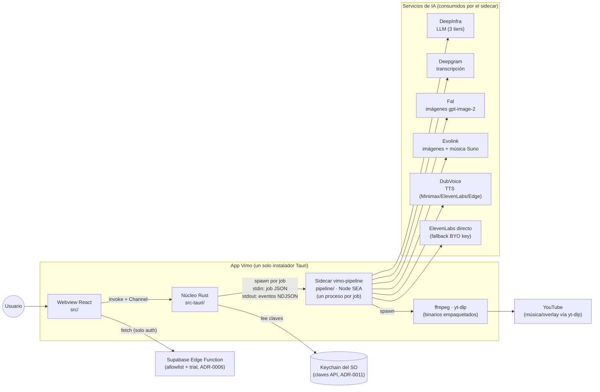
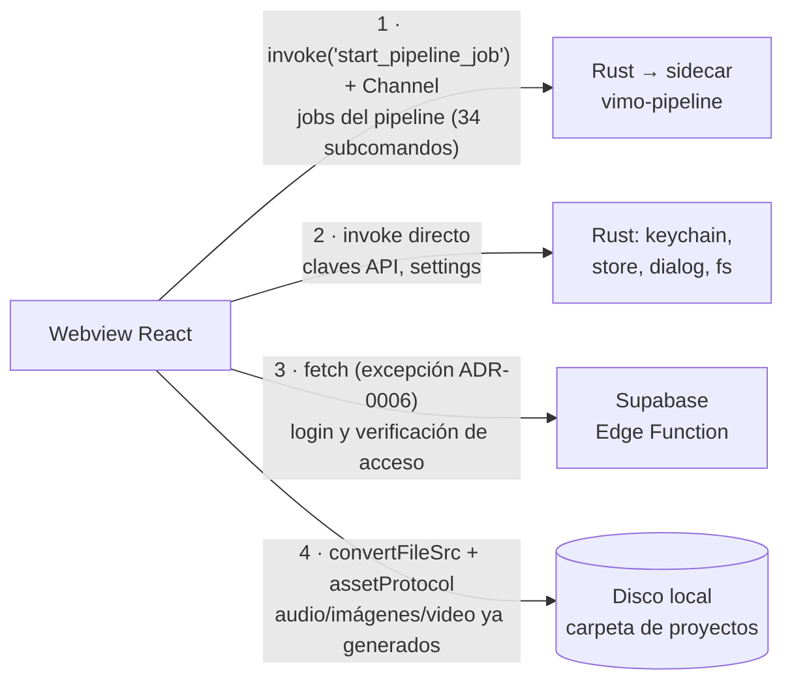
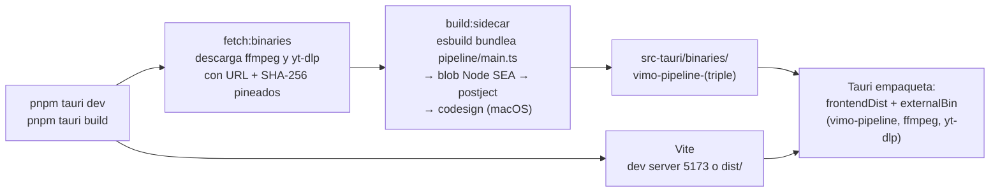

# Mapa visual de Vimo

Diagramas de cómo está constituido el proyecto: qué es cada parte, cómo se
comunican entre sí y qué produce cada una. Complementan a
[ARCHITECTURE.md](../ARCHITECTURE.md) (la referencia en prosa): acá está la
misma forma del sistema, pero dibujada.

| Documento                  | Qué muestra                                                       |
| -------------------------- | ----------------------------------------------------------------- |
| Este README                | Vista general: procesos, canales de comunicación, build           |
| [FRONTEND.md](FRONTEND.md) | La interfaz (`src/`) y la capa nativa (`src-tauri/`)              |
| [PIPELINE.md](PIPELINE.md) | El pipeline por dentro: carpetas, capas, stages, providers, disco |

Orden de lectura sugerido: este README primero, después el documento de la
parte que vayas a tocar. Los diagramas usan Mermaid (GitHub y el preview de
VS Code los renderizan solos); los árboles de directorios van en bloques de
texto plano.

---

## 1. Vista de contexto: los tres procesos y el mundo exterior

Vimo es una app de escritorio Tauri compuesta por **tres procesos**: el webview
con la interfaz React, el núcleo Rust, y el sidecar `vimo-pipeline` (un binario
Node SEA que Rust lanza **una vez por job** y muere al terminar). No hay
servidor HTTP local: ADR-0007 lo eliminó.



En palabras:

1. La UI nunca habla con internet ni con el disco por su cuenta (la única
   excepción es la Edge Function de auth, ADR-0006). Todo lo demás pasa por
   `invoke()` hacia Rust.
2. Rust arma el job: le inyecta las claves API leídas del keychain, las rutas
   de los binarios y la carpeta raíz de proyectos, y lanza el sidecar.
3. El sidecar hace el trabajo pesado (LLM, TTS, imágenes, render con ffmpeg) y
   reporta progreso como líneas NDJSON que Rust reenvía a la UI por el
   `Channel` del invoke.

## 2. Estructura de nivel superior

```
vimo-portable/
├── src/           la interfaz React: módulos por dominio, router, i18n, layouts
├── pipeline/      el sidecar de generación: runner, stages, providers, comandos
├── src-tauri/     el lado Rust: comandos invoke, spawn del sidecar, keychain
├── scripts/       build del sidecar, descarga de binarios, harness de pruebas
├── public/        favicon, catálogos i18n (es/en/pt), referencias de estilo
└── docs/          arquitectura, contribución, ADRs y estos diagramas
```

## 3. Los cuatro canales de comunicación de la UI

Cada tipo de dato viaja por un canal distinto — y solo por ese:



El detalle del canal 1 (las dos primitivas `startPipelineJob` /
`runPipelineJob`, el contrato de eventos, la secuencia completa) está en
[FRONTEND.md](FRONTEND.md).

## 4. Cómo se construye y se corre

`pnpm tauri dev` y `pnpm tauri build` encadenan todo solos (via
`beforeDevCommand` / `beforeBuildCommand` en `src-tauri/tauri.conf.json`):



Dev y producción usan el **mismo** binario de sidecar: una app lanzada desde
Finder no hereda el PATH, así que no se puede depender de un Node instalado.

Para probar el sidecar sin levantar la app hay dos atajos:

- `pnpm pipeline <subcomando>` — crudo, el job JSON se escribe por stdin a
  mano.
- `pnpm pipeline:harness <subcomando> [--payload '<json>']` — el harness arma
  el job por vos. El contrato completo está documentado en el
  [README raíz](../../README.md).

## 5. Qué ADR gobierna cada parte

Antes de cambiar un patrón, revisá su ADR (regla de [CLAUDE.md](../../CLAUDE.md)):

| Parte del sistema                      | ADR                                                                               |
| -------------------------------------- | --------------------------------------------------------------------------------- |
| Auth con OAuth doble flujo y deep link | [ADR-0006](../adr/ADR-0006-autenticacion-doble-flujo-oauth-y-gate-por-loaders.md) |
| `invoke` en lugar de servidor local    | [ADR-0007](../adr/ADR-0007-invoke-reemplaza-al-servidor-local.md)                 |
| Carpeta raíz única de proyectos        | [ADR-0009](../adr/ADR-0009-preferencias-nativas-y-carpeta-raiz.md)                |
| Pipeline como sidecar por stages       | [ADR-0010](../adr/ADR-0010-pipeline-por-stages-y-migracion-por-modulos.md)        |
| Claves API en el keychain              | [ADR-0011](../adr/ADR-0011-claves-api-en-keychain-con-fuente-abstracta.md)        |
| Primitivas del runner                  | [ADR-0012](../adr/ADR-0012-primitivas-del-runner-y-contratos-cerrados.md)         |
| Create: runner de stages y binarios    | [ADR-0013](../adr/ADR-0013-modulo-create-runner-de-stages-y-binarios.md)          |
| Library: edición sobre stages          | [ADR-0014](../adr/ADR-0014-modulo-library-edicion-sobre-stages.md)                |
| Fal solo con gpt-image-2               | [ADR-0015](../adr/ADR-0015-fal-solo-gpt-image-2.md)                               |
| Rediseño de vimo_dev por ramas         | [ADR-0016](../adr/ADR-0016-adopcion-del-rediseno-de-vimo-dev-por-ramas.md)        |
