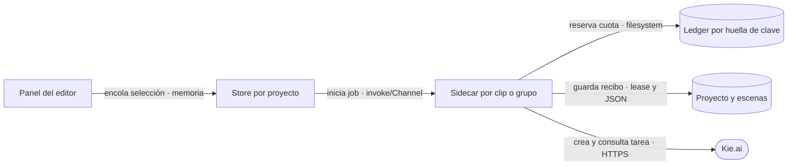

# Cola de clips individuales y conservación al rehacer

Fecha: 2026-09-16. Rama: `feat/animation-scenes`.

## Problemas corregidos

El store del editor rechazaba toda segunda animación por `isProjectBusy`, y el panel heredaba ese bloqueo global. Abrir otro sidecar sin cambiar la protección también fallaba: la lease exclusiva duraba toda la generación. El botón ahora admite selecciones independientes con una cola y cada proceso conserva sus propios eventos.

Al rehacer, se volvían a planificar imágenes según la política actual. Una fusión histórica de 3+3 en un short se convertía en dos encargos de cuatro segundos. Ahora se recupera la unidad original: seis segundos solicitados, dos referencias, mismo intervalo; se escribe un nuevo prompt a partir del guion, los prompts estáticos y el prompt anterior.

## Límites y comportamiento

- La [FAQ oficial Kie](https://kie.ai/) indica 20 solicitudes nuevas por 10 segundos y ningún máximo estricto de tareas activas. Consulta: 2026-09-16.
- La app mantiene diez carriles locales por proyecto para contener recursos. Cincuenta selecciones se aceptan: diez se procesan y cuarenta esperan; se libera un carril al terminar una. Cada POST reserva cuota por huella de clave compartida entre procesos.
- El panel muestra «En cola», «Preparando animación» o «Esperando cupo de Kie». Solo se muestra porcentaje cuando se está generando. Los spinners y contornos azules permanecen.
- Un 429 confirmado espera y conserva el mismo modelo/prompt. Fallos ambiguos no se repiten; una tarea aceptada se recupera por taskId.
- Los grupos se reservan completos para impedir dos compras superpuestas. Render, cortes, imágenes y audio siguen excluidos mientras hay animaciones.
- Los manifiestos se releen y fusionan bajo lease corta, sin perder los clips de otros procesos. Persistir un recibo recibido se completa incluso si el usuario cancela.
- Cancelar descarta solicitudes en cola aún no enviadas y cancela cada job activo. La cola transitoria sobrevive a navegar por la app; cerrar la app elimina selecciones aún no enviadas, sin costo Kie. Los recibos ya persistidos se pueden reanudar.
- El prompt anterior y el clip listo se conservan hasta publicar el reemplazo. El historial conserva ese prompt; no se garantiza que todo video nuevo resulte visualmente mejor.

## Flujo



El transporte por stdin/NDJSON y las seis fases no cambian. Los jobs de animación usan lease compartida de proyecto, exclusiva de su grupo y exclusiva breve de escritura. Los demás mutadores mantienen la lease exclusiva del proyecto. La API remota no garantiza idempotencia: un envío sin respuesta conserva su marca ambigua, nunca otro POST automático.

## Verificación

Comprobaciones aprobadas sobre esta revisión:

- Formato, lint, build, tipos del pipeline y 1.283 claves es/en/pt.
- 143 comprobaciones Chrome: cola de cincuenta, doble clic, estados independientes, espera por cuota, cancelación, selección de escenas 4/5, estilo azul y diálogo flotante.
- 22 comprobaciones del servicio, incluidas cancelación después del POST, conservación del taskId y rehacer fusiones de seis segundos.
- 13 comprobaciones de coordinación entre procesos; cincuenta reservas abarcaron 20.464 ms sin exceder veinte en ninguna ventana móvil de diez segundos.
- 39 contratos de proveedor y 36 comprobaciones de tiempo/render con FFmpeg real.
- 30 comprobaciones con el SEA y FFmpeg de la aplicación macOS construida. Dos sidecars descargaron simultáneamente desde un servidor local, conservaron ambos recibos y clips mudos de 75 cuadros, y bloquearon cambios ajenos al proyecto mientras estaban activos.

Los proveedores remotos son simulados en estas comprobaciones. No se compraron animaciones ni redacciones reales, ni se evaluó aquí la calidad visual de un nuevo prompt producido por DeepSeek.

SHA-256 del sidecar empaquetado: `0d976308424eb1fc231d3cf339d618a51cae3a3975084241e7358ca6dd923086`.

Compilar y abrir la copia correcta:

```sh
cd "/Users/sebas/Documents/VIMO-TAURI/.claude/worktrees/feat+vimo-character-modal-improvements"
PATH="/Users/sebas/node-v22.23.2-darwin-arm64/bin:$PATH" pnpm tauri build --bundles app
open src-tauri/target/release/bundle/macos/Vimo.app
```

Cerrar la instancia anterior antes de abrir la nueva app. Se conserva entrega local, sin push, PR, release ni notarización.

## Alcance protegido

No se modifican `useLibraryEditor.ts`, `useEditorPlayback.ts`, `sceneAt.ts`, `timelineBlocks.ts`, `ClipPreviewVideo.tsx`, fórmulas Ken Burns, política de fundidos, duración/cortes del proyecto ni exportadores. La vista solo cambia la autorización de la acción de animar y entrega el grupo que ya muestra el presupuesto.
