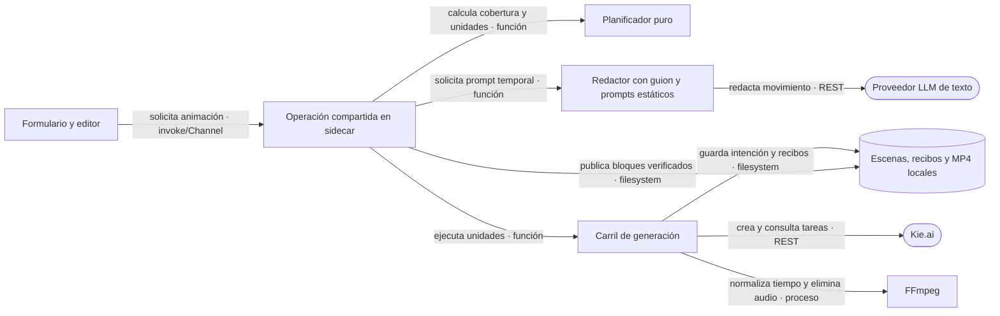

# Animación de escenas con Kie.ai — implementación y aceptación

Fecha: 2026-09-14. Rama local: `feat/animation-scenes`.
Contrato vigente: [ADR-0042](../adr/ADR-0042-animacion-kie-por-intervalos-y-recibos.md).

## Resultado

Formulario y editor comparten una operación de animación basada en las imágenes existentes y el reloj de la narración. Crear primero genera imágenes base, luego anima el prefijo solicitado dentro de la fase de imágenes. Se conservan las seis fases, invoke/Channel y el sidecar por job; no se agregan servicios ni cambios Rust.

La UI ofrece activar animación y elegir uno o varios minutos enteros. Ese tramo se divide en escenas de 6 s; después se usa la duración o cantidad elegida para las escenas estáticas. El editor mantiene el panel azul, el botón «Animar clip», el indicador de carga y los clips con contorno, brillo e icono de claqueta. La estimación de créditos se presenta a 18 px dentro de ventanas flotantes que mantienen el tamaño del preview; el switch activo tiene el mismo azul y su encabezado completo responde al clic. Los bloques resultantes son videos reales, con duración, reproducción muda y exportación MP4 para un editor externo. PoYo deja de aparecer en Claves API y enlaces de compra, conservando datos históricos.

## Reglas temporales

| Caso                                 | Encargo y resultado                                                                                   |
| ------------------------------------ | ----------------------------------------------------------------------------------------------------- |
| Crear animando uno o varios minutos  | Diez escenas de 6 s por minuto seleccionado; el resto respeta el ajuste normal                        |
| El audio acaba dentro del prefijo    | Se encargan 6 s para el último clip y se ajusta al final real del audio, sin mover otras escenas      |
| Dos escenas contiguas de 3 s         | Un clip de 6 s con dos referencias y prompt que describe ambas ideas en orden, aunque cambie el lugar |
| Una escena de 3 s sin pareja         | Se encargan 4 s y el archivo se ajusta a 4/3 para ocupar exactamente 3 s                              |
| Escena de 4–12 s                     | Una referencia, duración entera admitida por el proveedor y ajuste al intervalo real                  |
| Prefijo termina dentro de una escena | Se anima solo hasta su límite; la cola conserva la imagen estática                                    |
| Fragmento de borde menor de 3 s      | Se conserva el comienzo del video a velocidad normal y se recorta; no se acelera excesivamente        |
| Ampliar de uno a dos minutos         | Se reutilizan los bloques anteriores y se encargan únicamente intervalos sin cubrir                   |
| Escena histórica mayor de 12 s       | Se rechaza su animación; no se divide ni modifica trabajo pagado silenciosamente                      |

Los límites absolutos se cuantizan a 25 FPS; no se acumulan redondeos escena por escena. Los fundidos de 8 cuadros se componen sin reducir duración ni añadir una cola fija. El movimiento Ken Burns permanece en las imágenes estáticas. La narración y música finales se conservan; todas las pistas de audio del clip generado se eliminan físicamente.

## Ejecución y recuperación



**Contratos:** un escritor por proyecto, máximo local de 10 clips simultáneos y 20 creaciones por cada 10 s para la misma clave entre sidecars. Se persiste la intención antes de comprar y el taskId al recibirlo. La publicación del bloque ocurre después de guardar metadata y manifest.

**Fallo:** un POST ambiguo conserva su recibo y bloquea nuevas compras automáticas. Poll, descarga o procesamiento fallidos retoman la tarea pagada. Cancelar conserva checkpoints y espera el cierre de las operaciones. Una regeneración conserva el clip anterior hasta poder publicar todo el reemplazo. Saldo agotado conserva historial y modelo; las descargas pagadas pueden recuperarse sin saldo para nuevos encargos.

**Por qué:** evitar compras duplicadas y cambios de tiempo al reanudar, ampliar el prefijo o repetir una edición. Tras agotar fallos confirmados, la acción explícita de reintentar en el editor abre un nuevo presupuesto; reanudar automáticamente no lo hace.

## Modelos, prompts y costes

Elección interna: Grok Imagine Video 1.5 Preview, después Seedance 1.5 Pro si Grok presenta dos fallos confirmados de generación. Autenticación, saldo, política, cuota, consulta y procesamiento local no cuentan como fallos de modelo. Ambos se encargan a 480p según el formato 16:9 o 9:16 del proyecto.

El redactor usa texto, sin visión: guion, fragmentos, prompts de las imágenes, identidad escrita y referencias a sus tiempos. Exige estructura completa y hasta 4.000 caracteres en el prompt final, movimiento de cámara y sujeto, continuidad e identidad. Si no logra un prompt válido, no envía un texto genérico a un generador de pago.

Tarifas verificadas el 2026-09-14: Grok 2,4 cr/s; Seedance sin audio 1,75 cr/s; crédito USD 0,005. La estimación usa nuevos segundos encargados × 2,4: 6 s = 14,4 cr; un minuto = 144 cr; dos minutos = 288 cr. Se eliminó la contingencia anterior: la [FAQ oficial de Kie](https://kie.ai/) declara que no se cobran las generaciones fallidas. La tarjeta distingue segundos encargados y cantidad de clips, sin mostrar precio de referencia ni explicaciones sobre cobros. El cargo histórico se presenta fuera de la ventana y la estimación del próximo encargo dentro. Si la duración del audio todavía es desconocida, el cálculo de creación sigue siendo provisional. Imágenes y redacción tienen sus costes aparte; un cargo remoto ausente queda desconocido.

Fuentes: [Grok](https://docs.kie.ai/market/grok-imagine/1-5-preview), [Seedance](https://docs.kie.ai/market/bytedance/seedance-1-5-pro), [cuotas](https://docs.kie.ai/1973359m0), [recibos](https://docs.kie.ai/market/common/get-task-detail), [precios](https://kie.ai/pricing).

## Revisión de ventanas y claridad de créditos

La revisión de UX del 2026-09-14 separa el resultado anterior del siguiente encargo. El panel exterior muestra «Clip de la escena 1», «Duración: 4 s» y «Costo: 21 créditos» cuando así consta en su recibo. «Rehacer clip» abre una ventana con la estimación actual de 9,6 créditos y los 4 s a generar. Con varias escenas se usa el plural y una lista legible; la ausencia de cargo remoto se indica como costo no disponible.

«Animar el inicio del video» usa la misma ventana, desplazable por el encabezado dentro de toda el área visible, incluido el sidebar. La X, Escape y el clic exterior la cierran. No se reduce el preview, abrir una estimación no inicia una compra y cerrar mantiene el indicador de una tarea en curso. Radix gestiona foco y cierre; el movimiento añade listeners del gesto con limpieza al finalizar o desmontar, sin capturar el puntero sobre los controles.

Un video de 2 min limita el campo a 2. En duraciones fraccionarias se usan minutos completos; por debajo de 1 min se ofrece animar el video hasta su final y se oculta el selector. El campo admite borrado temporal, vuelve a 1 al salir y mantiene un presupuesto válido mientras se escribe. Los límites se aplican antes de cotizar y enviar, conservando el contrato del sidecar.

Formato, lint y build web pasaron. Los 1.272 textos de es/en/pt están alineados. La regresión ampliada pasó 87 comprobaciones con componentes y hooks reales en Chrome: importe compacto, resumen singular/plural, límite y borrador de minutos, disparo protegido, recuperación pagada, arrastre con eventos de navegador, X/exterior/Escape, foco, tamaño estable del preview y ajuste a una ventana pequeña. Las capturas y recibos usados son fixtures; no se hicieron generaciones pagadas.

Evidencia de esta ejecución: `vimo-animation-frontend-HrAbN9/verification.json`, en la carpeta temporal del sistema. La nueva `Vimo.app` macOS ARM64 compiló con Node 22 y `pnpm tauri build --bundles app`. El SHA256 del SEA incluido coincide con el ya comprobado en la revisión anterior (`ad81c5aa3f792fe863f59a68951d425ab6431ccd00eba72166261d3d53de797a`); esta revisión no modifica su código.

Informe visual de esta revisión en el vault: `Proyectos/VIMO-TAURI/Reportes/2026-09-14-animation-dialogs/animation-implementation.pdf`. Son dos páginas verificadas sin recortes de contenido ni recursos remotos; el HTML también cabe en 390 px. Para abrir el PDF con un visor, sin tratarlo como texto:

```bash
open -a Preview "/Users/sebas/Documents/Obsidian Vault/Proyectos/VIMO-TAURI/Reportes/2026-09-14-animation-dialogs/animation-implementation.pdf"
```

## Verificación anterior: actualización de escenas de 6 s y UI

La revisión pasó formato, lint, build web y tipos independientes del pipeline. Los tres catálogos tienen 1.264 claves alineadas. Se ejecutaron 126 controles específicos: 34 de cortes/FFmpeg, 60 de componentes/hooks en Chrome, 10 de recuperación del servicio y 22 sobre el SEA y FFmpeg incluidos dentro de la nueva Vimo.app.

La comprobación CSS confirma que switch y botón usan exactamente rgb(38,178,242), y que el panel y timeline conservan borde, claqueta, brillo e indicador de carga. Las capturas se hicieron con datos simulados, sin usar claves ni consumir generaciones.

El build local macOS ARM64 terminó con Node 22 y `pnpm tauri build --bundles app`. El smoke del bundle verifica, entre otros casos, veinte escenas de 6 s para los primeros dos minutos y el resto en escenas de 3 o 12 s. Se conserva el formato vertical y la ausencia de audio en los clips exportados.

SHA256 del SEA incluido en la app de esta revisión:
`ad81c5aa3f792fe863f59a68951d425ab6431ccd00eba72166261d3d53de797a`.

Informe visual actualizado en el vault: `Proyectos/VIMO-TAURI/Reportes/2026-09-14-animation-followup/animation-implementation.pdf`.

## Verificación de la entrega base, anterior al ajuste de escenas de 6 s

| Comprobación                                             | Resultado                         |
| -------------------------------------------------------- | --------------------------------- |
| Formato, lint y build web                                | Aprobados                         |
| Tipos independientes del pipeline                        | Aprobados                         |
| Catálogos es/en/pt                                       | 1.255 claves alineadas            |
| Proveedor y recibos con HTTP simulado                    | 27 controles                      |
| Operación compartida y recuperación                      | 10 controles                      |
| Coordinación con procesos independientes                 | 9 controles                       |
| Tiempo, cortes y migración con FFmpeg empaquetado        | 22 controles                      |
| Componentes/hooks reales en Chrome y servicios simulados | 51 controles                      |
| Ejecutable SEA reconstruido, stdin/NDJSON real           | 20 controles                      |
| Compilación nativa macOS ARM64 y DMG                     | Aprobada; checksum interno válido |

Total: 139 controles específicos. El smoke SEA exportó dos MP4 mudos de 75 cuadros y renderizó 6 s/150 cuadros en vertical conservando narración. Los mismos 20 controles también pasaron usando SEA y FFmpeg extraídos del DMG montado en solo lectura. No se añadió un framework de pruebas.

SHA256 del SEA probado:
`aa5760e1a54a3205c62f2ef5ff55b83f6417c759acfc0abc5c5a2d2c9d320a9e`.

SHA256 del DMG generado:
`d44ef2fe518fe9e9f8a5ec34de5aa1670599f7861228cb9e68162bbb2f090494`.

No se hicieron generaciones pagadas de Kie. La calidad narrativa, facciones y precisión visual de las marcas temporales requieren aceptación con clips reales; Grok no garantiza anclas inicial/final en su esquema. Windows, UI nativa WebKit y una importación manual en CapCut no se probaron en esta sesión.

**Alcance local confirmado por el dueño:** la compilación y las comprobaciones de código/SEA cierran esta entrega. La firma de distribución y la notarización se prepararán para una versión distribuible; no son requisitos para incorporar cambios a `dev`. Como observación del artefacto, SEA y FFmpeg pasan la verificación de firma individual, mientras `codesign --verify --deep --strict` sobre `Vimo.app` detecta recursos sin sellar. Tauri omitió firmar el bundle al no indicarse una identidad. El sello ad-hoc local opcional `APPLE_SIGNING_IDENTITY=-` está documentado por [Tauri](https://v2.tauri.app/distribute/sign/macos/#ad-hoc-signing); no usa certificado Developer ID ni equivale a notarización. La verificación completa de firma del paquete queda pendiente y no se usa para bloquear esta validación local.

## Reproducir y compilar

En macOS ARM, usar Node 22 para el empaquetado SEA y ejecutar desde el worktree que contiene esta rama. Compilar desde el checkout principal en dev no incluye estos cambios:

```bash
cd "/Users/sebas/Documents/VIMO-TAURI/.claude/worktrees/feat+vimo-character-modal-improvements"
export PATH="$HOME/node-v22.23.2-darwin-arm64/bin:$PATH"
pnpm format
pnpm lint
pnpm build
pnpm exec tsc -p tsconfig.pipeline.json --noEmit
pnpm check:locales
pnpm tauri build --bundles app
node scripts/check-animation-provider.mjs src-tauri/binaries/ffmpeg-aarch64-apple-darwin
node scripts/check-animation-service.mjs
node scripts/check-animation-coordination.mjs
node scripts/check-animation-timing.mjs
node scripts/check-animation-frontend.mjs
node scripts/check-animation-packaged.mjs
```

Salida local: `src-tauri/target/release/bundle/macos/Vimo.app`.
Compilar no reemplaza automáticamente `/Applications/Vimo.app`. El ejecutable instalado revisado no contenía la nueva integración Kie. Para probar el resultado, cerrar primero la instancia anterior y abrir el bundle exacto:

```bash
open "/Users/sebas/Documents/VIMO-TAURI/.claude/worktrees/feat+vimo-character-modal-improvements/src-tauri/target/release/bundle/macos/Vimo.app"
```

Las comprobaciones usan proyectos temporales y servicios simulados; no leen claves reales. Chrome y el montaje necesario para empaquetar el DMG necesitan permisos del sistema cuando se ejecutan dentro de un sandbox.

Si se necesita sellar también el bundle para una comprobación local de firma, se puede usar `APPLE_SIGNING_IDENTITY=- pnpm tauri build` en un entorno sin credenciales de certificado o notarización Apple. Ese paso opcional no se ejecutó en esta sesión.

Para aceptación manual: crear en ambos formatos con escenas de 3 y 12 s, animar un prefijo, ampliar su duración y comprobar los cortes con narración; animar una escena individual, cancelar/reanudar una tarea y revisar que se conserva el clip anterior; exportar los MP4 e importarlos en el editor de destino. Las generaciones reales de esos pasos consumen el saldo mostrado.
