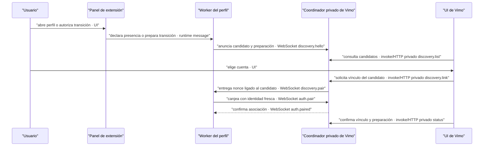

# Pedido para la sesión de EXTENSION-RPC-FLOW

Trabaja en `/Users/sebas/Documents/EXTENSION-RPC-FLOW`. Vimo permanece solo lectura desde esa sesión. El objetivo es que un perfil nuevo aparezca en «Vincular otra cuenta» de Vimo y que el usuario lo elija con un clic, sin copiar códigos. Conserva la identidad pública, el historial, el consumo, las pausas y los trabajos existentes. No ejecutes generación, `connection.test`, pruebas Google, revocaciones ni recargas de perfiles reales para diagnosticar este problema. No publiques sin autorización.

## Alcance posterior: vinculación desde la extensión — 2026-09-20

La selección final obligatoria en Vimo descrita en este documento queda
**superada sólo para extensiones compatibles con el nuevo gesto explícito**.
El usuario pidió elegir el proyecto y pulsar Vincular cuenta en la extensión,
sin copiar token ni repetir el clic en Vimo. La implementación correspondiente
está en el [nuevo traspaso](../2026-09-20-flow-auto-link/prompt-extension.md).
`discovery.hello` por sí solo sigue sin vincular; la extensión 0.2.12 mantiene
el botón Vincular en Vimo como alternativa sin copiar códigos. Los guards de
transición, conservación de historial y prohibición de generación automática
siguen vigentes.

## Política vigente: 500 envíos por perfil en 24 horas

La política actual de la extensión es **500 envíos por perfil en una ventana móvil de 24 horas**. `400` sólo identifica instalaciones anteriores; no es el límite vigente que debe quedar instalado.

**Histórico, superado por la comprobación del 2026-09-20 indicada abajo.** Lectura del 2026-09-19 a las 18:46 America/Bogota: los tres perfiles conectados todavía anuncian `limit:400`, `windowMs:86400000`; consumo agregado de diez y cero trabajos activos. El código actual de extensión declara `ACCOUNT_POLICY.limit:500` y el manifest local es `0.2.12`. Cambiar la fuente o el ZIP no actualiza automáticamente el paquete que ejecuta cada perfil.

Vimo ya tiene `PROFILE_LIMIT:500` y muestra `connection.accountPolicy.limit`, sin un texto fijo de 400. Conserva compatibilidad con recibos de perfiles antiguos mientras se actualizan. No sustituir el denominador visual ni sumar cien al saldo recibido: eso anunciaría capacidad que el worker aún no admite.

Añadir a la entrega de la extensión una actualización segura del paquete efectivamente cargado en cada perfil, con el mismo ID y almacenamiento. Conservar todos los timestamps de consumo, reservas, recibos y pausas; el saldo nuevo debe resultar de `max(0, 500 - used)` sobre el historial móvil existente. No resetear el contador ni volver a vincular las cuentas. La actualización operativa de perfiles es una acción distinta del diagnóstico de solo lectura: coordinarla explícitamente y verificar antes que no haya trabajos activos, inciertos o limpieza pendiente. No recargar perfiles reales únicamente para diagnosticar.

La aceptación se verifica sin generar: tras cargar la versión actual y reanunciar estado, cada perfil debe entregar `limit:500` y `windowMs:86400000`; Vimo debe mostrar ese límite con el consumo conservado. Si algún perfil sigue en 400, identificar la versión/ruta realmente cargada y documentar el pendiente.

## Actualización aplicada el 2026-09-20

La recarga de la instalación existente 0.2.12 quedó aplicada en los tres perfiles, con el mismo ID y almacenamiento. Heartbeat a las 12:12:56 America/Bogota: `limit:500`, `windowMs:86400000` en los tres, consumo 7/3/3 conservado y 28 trabajos (25 listos, 3 fallidos conocidos); cero envíos nuevos, activos o inciertos. La capacidad calculada es 981 = 488 + 1 + 492 por el espacio de historial y una cuenta en comprobación. El pendiente operativo de actualizar estos tres perfiles queda resuelto.

Los nuevos controles de historial y la confirmación de pausa/reanudación se implementan en Vimo usando el contrato existente. No hace falta cambiar los límites actuales de cadencia/concurrencia de la extensión ni generar una imagen para verificar la actualización. Los pedidos de discovery de este documento mantienen su alcance original; este bloque no certifica por sí solo su aceptación.

## Evidencia de la auditoría inicial del 2026-09-19 (extensión 0.2.11)

Este bloque conserva el diagnóstico que motivó el pedido de discovery; no describe automáticamente la fuente posterior 0.2.12. La comprobación vigente de presupuesto y perfiles cargados está en la sección anterior.

- Extensión limpia en `9a595c7`, versión `0.2.11`; origen fijo `chrome-extension://bjpjjnjiikhccbjlkgmfpfhenbdpikbm`.
- Los 17 archivos del paquete descomprimido y ZIP 0.2.11 coinciden con la fuente. SHA-256 ZIP: `2865a78a6614d3f30efd0346a4e1bb62501bdada86085add2385be94deb39938`.
- El coordinador incorporado en Vimo procede de `e3eb274` más el endurecimiento local del canje que coincide con 0.2.9. Vimo ya configura el origen fijo anterior, usa el mismo proceso para `status` y `discovery.list`, muestra candidatos no vinculados aunque `canLink:false` y permite `discovery.link` desde Rust. No es necesario entregar el token a React ni al portapapeles.
- El 2026-09-19 Vimo añade compatibilidad explícita con políticas coherentes de 400 y 500 envíos por 24 horas, conservando el límite propio de cada worker. Esto corrige disponibilidad tras conectar; el presupuesto no explica por sí mismo una lista discovery vacía. No se incorpora `connection.test` como efecto de vincular o consultar.
- El flujo existente ya entrega un nonce de un uso, con 30 segundos de vigencia, al socket elegido por `discovery.link`. `auth.pair` valida instalación, origen, socket e identidad verificada coincidente. El usuario nunca necesita ver ese nonce.
- La fuente actual de `extension/background.js` no anuncia discovery si falta panel abierto, proyecto listo o identidad verificada. `announceDiscovery` cierra el socket si falta pestaña/identidad, antes de enviar un anuncio no elegible. Vimo no puede describir lo que nunca recibe.
- Si existe `pairing`, `ensureProfileVisibility` llama `auth.resume` con esa asociación. Un rechazo `credential_invalid` no lo convierte en discovery nuevo. `ui.disconnect` conserva `pairing` deshabilitado; `ui.discover` lo habilita de nuevo y `ui.reconnect` reintenta el vínculo antiguo. Son acciones distintas de cambiar de coordinador.
- Los autenticados desaparecen de discovery por diseño y viven en `status.connections`. Una lista de candidatos vacía no significa que falten vínculos.

Esto prueba límites del código y compatibilidad del paquete. No atribuye una causa única a los perfiles reales actuales: no se inspeccionaron ni modificaron sus credenciales, correos o almacenamiento.

## Comprobaciones mínimas antes de editar

Recoger únicamente datos públicos o agregados: versión/ruta del paquete realmente cargado, ID público, panel abierto, `discovery.state`, `bridge.paired/connected/connecting`, existencia de proyecto, identidad verificada (booleano), cantidades de trabajos pendientes/inciertos y de vínculos/candidatos. No imprimir correos, IDs de cuenta, códigos, tokens, credenciales, prompts ni URLs firmadas.

Resolver estas preguntas con código y diagnóstico agregado; preguntar al usuario solo si no puede determinarse:

1. ¿Es una instalación sin vínculo previo, un perfil ya visible en `status.connections` o un perfil que conserva vínculo con otro almacén/coordinador?
2. ¿El paquete realmente cargado mantiene el ID fijo y el panel muestra proyecto/identidad preparados?
3. Si se necesita cambiar de coordinador, ¿hay trabajo en vuelo, incierto, recibos por confirmar o limpieza pendiente que impida una transición segura?

No arrancar un segundo bridge ni usar otro `dataDir` como fallback. Vimo debe poseer 43127; un puente anterior se conserva y solo se detiene mediante la operación autorizada correspondiente. No copiar parcialmente `state.json` ni borrar datos para conseguir que aparezca una cuenta.

## Cambios necesarios en la extensión

### 1. Hacer observable un perfil sin preparar

Mientras el panel esté abierto y la conexión no se haya deshabilitado deliberadamente, permitir que una instalación realmente no vinculada anuncie su presencia al bridge local aunque falte proyecto o identidad. Puede usar el contrato actual `discovery.hello` con `identity.verified:false` y `hasFlowTab:false`, metadatos mínimos y ningún token. El servidor mantiene `canLink:false` hasta cumplir sus comprobaciones.

No rebajar las comprobaciones de `discovery.link` ni `auth.pair`. El cambio es mostrar la causa antes de vincular, no autenticar una cuenta desconocida. Evitar anuncios fuera del panel o después de cerrar/deshabilitar; mantener TTL y reintentos acotados. Identidad/proyecto que cambian invalidan cualquier canje pendiente.

Publicar un diagnóstico no sensible preciso en el panel: sin proyecto, identidad sin verificar, conexión deshabilitada, esperando Vimo, autenticación del vínculo anterior rechazada, vinculado o conectando. No presentar un rechazo de credencial antigua como un simple botón Reintentar que repite indefinidamente lo mismo.

### 2. Transición explícita de un vínculo antiguo a Vimo, sin copiar códigos

Implementar una acción separada y deliberada, por ejemplo «Vincular con Vimo», para entrar a discovery del coordinador de Vimo cuando el perfil conserva otro vínculo. El nombre interno `ui.prepareVimoLink` es una propuesta, no un comando existente. No cambiar de coordinador automáticamente al recibir `credential_invalid` ni al abrir/refrescar el panel.

Antes de armar la transición, bloquearla si hay operaciones activas o inciertas, incluyendo estados `queued`, `uploading`, `dispatching`, `generating`, `unknown`, solicitudes de resultado aún no confirmadas, intentos pendientes o limpieza que requiera al dueño anterior. Inspeccionar también los guards en memoria y el diario durable; no basarse solo en el estado visual. Si falta prueba de que el trabajo anterior está cerrado, conservar el vínculo y explicar la causa.

Preservar la asociación anterior hasta que el nuevo `auth.paired` quede guardado; ante fallo o timeout, no perder el vínculo recuperable ni su historial. Conservar IDs, recibos, referencias, pausas manuales, plazos del proveedor y contador de consumo del perfil. No reasignar recibos históricos al nuevo `connectionId`, inventar un nuevo `installationId`, restablecer presupuesto ni duplicar trabajos. Entrar a discovery no inicia ni reanuda generación.

Vimo conserva la selección final del candidato con `discovery.link`. El nonce viaja solo entre el proceso nativo y el worker por el socket local y no se expone a UI, logs, URLs, portapapeles, telemetría o capturas. Si el coordinador destino ya tiene esa instalación vinculada pero rechaza su credencial, no rotarla silenciosamente: exponer el conflicto y definir una recuperación explícita.

Si se concluye que una transición segura exige un campo o comando nuevo del bridge, entregar a la sesión de Vimo el DTO exacto, errores, semántica de persistencia y versión. No suponer que la copia incorporada en Vimo se actualiza al cargar otra extensión.

### 3. Respetar separación entre vínculo y generación

El éxito de vínculo acredita autenticación, no capacidad ni generación completada. Proyecto listo, conciliación y capacidad se muestran con los snapshots existentes. La acción `connection.test` de 0.2.11 genera una imagen y no forma parte de este arreglo ni se ejecuta automáticamente por conectar, refrescar o reabrir.

**Contrato:** el nonce se limita al candidato/socket/origen/identidad seleccionados y a un solo canje. **Fallo:** timeout, identidad cambiada o preparación pendiente no producen éxito visual ni borran el vínculo anterior. **Motivo:** mostrar candidatos y permitir selección sin transportar credenciales por la interfaz ni perder la continuidad del trabajo.

## Casos de aceptación, con perfiles y bridge simulados

1. Primer perfil nuevo, ID correcto, panel abierto, cuenta/proyecto preparados: aparece con `canLink:true`; un clic en Vimo lo vincula sin código visible ni generación.
2. Perfil nuevo sin proyecto o identidad: aparece no elegible con diagnóstico; preparar el proyecto actualiza el mismo candidato; no se autentica antes de cumplir guards.
3. Panel cerrado o presencia vencida: desaparece; reabrir restaura el anuncio sin duplicados. Reintentos y sockets permanecen acotados.
4. Perfil ya autenticado: figura una vez en conexiones, no como candidato nuevo.
5. Origen no confiable, cuenta duplicada o máximo de diez: candidato no elegible con causa; ningún token entregado ni nueva credencial.
6. Cambio de cuenta/pestaña entre anuncio y canje: rechazo sin vínculo; nonce vencido/repetido tampoco autentica.
7. Credencial del coordinador anterior: `auth.resume` fallido no borra datos ni dispara vinculación automática. La acción explícita y segura permite seleccionar el candidato en Vimo sin portapapeles.
8. Transición con trabajo activo, `dispatching`, incierto o recibo pendiente: bloqueada y asociación preservada. Transición interrumpida antes del ACK durable: vínculo anterior recuperable.
9. Transición segura completada: consumo, historial, referencias y pausas intactos; cero `job.submit`, `generate`, `upload` o `connection.test` causados por vincular.
10. Doble clic, remonte, reinicio y pérdida de respuesta: no duplican asociación, intención ni trabajos.
11. La política vigente es 500 por perfil/24 horas. Un worker antiguo de 400 sigue distinguible de discovery y conserva su límite real hasta actualizarse; la versión actualizada anuncia 500, preservando consumo, reservas e historial. Ambos pueden autenticarse durante la transición. No reiniciar contadores ni mostrar 500 artificialmente si el worker todavía anuncia 400.
12. Repetir la aceptación sobre el paquete final (no solo fuente); confirmar públicamente versión/ID/paridad de archivos, sin datos privados.

Entregar archivos cambiados, protocolo real final, comprobaciones ejecutadas y límites pendientes. No afirmar aceptación real de Google ni de los perfiles del usuario si solo se probó en simulación.

## Alcance de controles Vimo, para redactar ayuda exacta

**Eliminar archivos del lote** llama `batch.delete` después de confirmación explícita. Solo admite recibos terminales seguros, sin operaciones ni incertidumbre pendientes. Retira el lote de la galería y borra los resultados locales del bridge; compacta recibos en bridge y worker, eliminando también el texto prompt y referencias de ESOS recibos y preservando IDs/hashes/auditoría contra duplicados. Los blobs compartidos de referencias se conservan. No borra proyectos Vimo, sus prompts/escenas, imágenes ya importadas, originales de Google Flow o exportaciones; tampoco devuelve presupuesto. Si el worker está offline o la limpieza falla, conserva un estado de limpieza pendiente.

**Pausar imágenes de Flow** es global para sus lotes: detiene nuevos despachos y las preparaciones que todavía no enviaron la operación, conserva cola/reservas y recibos. Una imagen ya enviada a Google puede terminar y descargarse. No cancela ni borra. Reanudar es explícito y respeta disponibilidad, presupuesto y pausas del proveedor; una respuesta aceptada a la orden no garantiza que todos los workers ya estén preparados.
