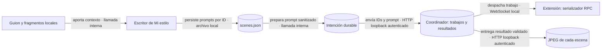

# Auditoría: similitud visual de imágenes enviadas a Flow

> **Actualización tras prueba real del 2026-09-19:** la consigna de escenificación no resolvió el problema. Diez prompts nuevos mantuvieron el estudio; Flow produjo siete imágenes y rechazó tres. La integridad del transporte sí se verificó. Ver [resultado de diez escenas](live-ten-scenes.md).

- **Fecha:** 2026-09-19.
- **Rama:** `feat/extension-vimo-automater`.
- **Alcance:** lectura del proyecto local `video-3-2`, sus intenciones durables y el coordinador nativo de Vimo. No se alteraron proyectos, imágenes, trabajos, conexiones ni credenciales. No se llamó a Google ni al proveedor de prompts.

## Resultado

La repetición observada es **de escenificación**, no una duplicación exacta de archivos o un reenvío del mismo prompt. Los 14 prompts originales describen al mismo personaje en el mismo estudio, aunque la narración pasa a ciudades y calles de la civilización del Indo. Los datos permiten localizar el problema antes del envío a Flow.

El proyecto usa «Mi estilo», estilo `ESTILO COMIC`, personaje genérico y modelo de prompts `openai/gpt-oss-120b-Turbo`. La gema pide conservar el fondo «durante la misma escena». Sus 14 resultados extendieron esa continuidad local a todo el lote: repiten literalmente `The scene is set in an old study room with parchment walls, wooden desk and candlelight.`

La técnica de acuarela sepia y papel envejecido sí es una característica global solicitada. Eso no implica que todas las escenas narradas deban ocurrir en una habitación con escritorio. La ficha recurrente también incluye libreta y bolígrafo; se mantiene por ser parte del diseño del usuario, sin borrar accesorios por regex.

## Evidencia cuantitativa

La lectura encontró dos lotes, creados el 2026-09-18: uno de 14 imágenes y una regeneración posterior de la escena 3. Los 15 trabajos están `ready`.

| Comprobación                                                           | Resultado                                                                                                   |
| ---------------------------------------------------------------------- | ----------------------------------------------------------------------------------------------------------- |
| Prompts, semillas, identificadores de medio y hashes SHA-256 distintos | 15 de 15 en cada categoría                                                                                  |
| Intención durable frente al trabajo del coordinador                    | 15 de 15 coinciden en prompt, índice, modelo, formato, semilla, IDs y `requestHash`                         |
| Archivo del coordinador frente a su SHA-256 registrado                 | 15 de 15 válidos                                                                                            |
| Destinos actuales del editor frente a resultados recibidos             | 14 de 14 iguales byte a byte: 13 del lote original y la regeneración de la escena 3                         |
| Prompt persistido de cada escena frente a la petición vigente          | 14 de 14 son prefijo exacto; únicamente se agregaron las mismas cláusulas de sanitización de 894 caracteres |
| Referencias de imagen adjuntas                                         | 0 en los 15 trabajos                                                                                        |
| Prompts del lote original que repiten exactamente el estudio           | 14 de 14                                                                                                    |
| Serializador RPC de la extensión con esos 15 prompts y semillas        | 15 de 15 preservados, comprobación pura sin transporte                                                      |

La diferencia de sanitización restringe texto visible y personas incidentales. No introduce el estudio ni sustituye el tema. La imagen original de la escena 3 sigue siendo un resultado válido del coordinador; su destino se reemplazó por la regeneración explícita posterior, no por un cruce de IDs.

Se inspeccionaron visualmente los JPEG actuales de las escenas 1 y 12. Ambos muestran al detective con libreta junto a un escritorio en un estudio; la escena 12 añade elementos referentes a Harappa/Mohenjo-Daro, pero conserva la misma escenificación general. Las imágenes tienen contenidos y bytes distintos. No se añadieron capturas al repositorio.

### Ejemplos representativos

| Escena | Narración persistida                                    | Prompt escrito antes de Flow                                                                                                                          |
| ------ | ------------------------------------------------------- | ----------------------------------------------------------------------------------------------------------------------------------------------------- |
| 12     | «en el valle del indo surgieron ciudades como harapa y» | Comienza con el personaje descubriendo Harappa y Mohenjo-Daro, pero ubica la escena en el mismo estudio con paredes de pergamino, escritorio y velas. |
| 13     | «mohen yodaro con calles ordenadas drenaje»             | Comienza con el personaje observando calles ordenadas y drenaje avanzado, pero vuelve a situarlo en ese estudio.                                      |

Los cortes temporales dejan frases incompletas. El escritor ya recibe el guion completo en cada lote, además de la lista con sus IDs; no falta el contexto. La consigna anterior no explicitaba la diferencia entre un lote de cortes y una única escena narrativa. La interpretación semántica que produjo estos prompts se infiere de los textos persistidos, no de razonamiento interno del modelo.

## Recorrido auditado



**Contratos:** el transporte conserva el prompt y su identidad de trabajo; la importación verifica el recibo, hash, destino y revisión. **Fallo:** un resultado ambiguo no autoriza otra generación. **Límite de evidencia:** los recibos demuestran las correspondencias locales; el chequeo RPC usa el serializador actual de la extensión y no reconstruye una captura de la petición histórica a Google.

## Corrección acotada

`pipeline/prompts/verbatim-messages.ts` añade una consigna al mensaje de **usuario** de Fase 2. La gema y las reglas de estilo conservan sus bytes y precedencia. La consigna:

- Distingue un lote de fragmentos de una única escena o localización.
- Usa el guion y los fragmentos vecinos para completar frases cortadas.
- Conserva fondos dentro de la continuidad local y representa el lugar, objeto, proceso o acción cuando cambia lo narrado.
- Respeta una localización global si el estilo o usuario la fijan expresamente; en ese caso varía acciones y elementos focales dentro de ella.
- Distingue textura/paleta de estilo del decorado físico y pide algo más que alternar ángulos o repetir al narrador pensando sobre cada tema.

No añade llamadas de LLM, revisión automática con otro modelo, heurísticas que reescriban escenas, ni reintentos del generador de imágenes. Aplica a futuras escrituras de prompts de Mi estilo, independientemente del motor de imágenes. Los prompts y JPEG existentes no se regeneran por instalar este cambio.

## Validación reproducible

Comprobaciones de código:

```sh
pnpm exec tsc -p tsconfig.pipeline.json --noEmit
pnpm exec eslint pipeline/prompts/verbatim-messages.ts
pnpm exec prettier --check pipeline/prompts/verbatim-messages.ts
```

Se ejecutaron tres herramientas temporales, fuera del repositorio:

- Auditoría de lectura: compara campos de cada intención con `flow/state.json`, recalcula SHA-256 de cada resultado y del destino, verifica las 14 correspondencias vigentes y cuenta fondos repetidos. Resultado: las cifras de la tabla anterior.
- Prueba del escritor real con cliente simulado: **10 comprobaciones** de mensaje, contexto completo, IDs, modos genérico/texto/referencia/sin personaje, pedido manual y ausencia de llamadas adicionales. La red se bloquea en la prueba.
- Serialización RPC pura: construye 15 cuerpos con prompts y semillas guardados y verifica igualdad exacta en los campos de envío. No abre Chrome ni transmite solicitudes.

Estas comprobaciones prueban el armado y transporte de las instrucciones; **no certifican** que un modelo real vaya a obedecerlas ni cuantifican una mejora visual. Validar esa calidad exige una generación nueva autorizada y revisar sus resultados. En esta auditoría no se regeneró contenido del usuario.

## Referencia para presentar lotes en Vimo

Las intenciones viven en `flow/vimo-intents/<sha256(scope)>/current.json` y `<batchId>.json`. Para este proyecto, el scope es `scenes:<directorio-del-proyecto>`; cada petición lleva `key` con el ID de escena y `destination` con su archivo final. El nombre visible está en `project.json` → `name`; el estilo, en `options.customStyle.name`. Los IDs de lote son identidad técnica, no un título útil para la persona. Los archivos de intención no contienen credenciales del servicio.
