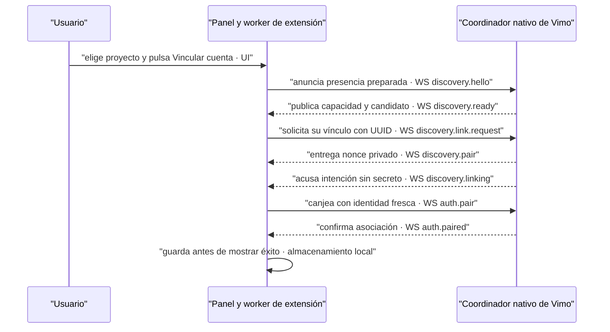

# Pedido para la sesión de EXTENSION-RPC-FLOW

> **Entrega contrastada · 2026-09-21:** paquete 0.2.13 y receptor de Vimo
> compatibles; 17 archivos fuente/carpeta/ZIP coincidentes y 13 comprobaciones
> contra el sidecar firmado actual. Este pedido ya está implementado; no copiar
> el bridge externo ni volver a agregar el protocolo. Ver la
> [revisión de aceptación](review-extension-0.2.13.md) y su límite de validación
> simulada. El pedido posterior de identidad/discovery sigue separado.

> **Actualización de alcance · 2026-09-20:** la fuente externa 0.2.13 (`929dfcc`)
> ya implementa `ui.linkAccount` y el gesto de vinculación de este documento.
> La observación de cuenta/proyecto antes de seleccionar y la renovación del
> documento después de navegar se detallan en el
> [nuevo pedido de identidad y discovery](../2026-09-20-flow-identity-discovery/prompt-extension.md).
> Este contrato sigue vigente; el diagnóstico0.2.12 inferior es histórico.
> La revisión de fuente no acredita el paquete cargado ni aceptación real por perfil.

Trabaja en `/Users/sebas/Documents/EXTENSION-RPC-FLOW`; Vimo es sólo lectura
para esa sesión. Implementa y empaqueta el lado extensión del flujo siguiente:
**Vimo abierto → el usuario elige su proyecto y pulsa Vincular cuenta en la
extensión → la cuenta queda vinculada sin copiar token ni dar otro clic en Vimo.**
No publiques. Conserva el ID público actual, instalación, credenciales válidas,
consumo de 500 envíos/24 h móviles, reservas, historial, recibos y pausas. No
cambies cadencia ni concurrencia: el usuario eligió conservar las actuales.

## Causa comprobada y parte ya implementada en Vimo

La versión 0.2.12 revisada hace `ui.bind` → guarda binding → anuncia
`discovery.hello`. Ese anuncio no solicita autenticación. «Vincular proyecto»
y «Proyecto vinculado» sólo acreditan proyecto seleccionado. «Vincular con Vimo»
prepara la transición desde otro dueño, pero también termina pidiendo elegir la
cuenta en Vimo. No afirmar «cuenta conectada» por ninguno de esos pasos.

Vimo ahora arranca su coordinador al abrir la app, en segundo plano y sobre el
mismo puerto 43127 y almacén; no requiere visitar Extensión. Tiene receptor
opt-in para la solicitud explícita descrita abajo. El botón Vincular de Vimo
sigue disponible como compatibilidad sin copiar códigos. El código manual es
una alternativa avanzada, cerrada inicialmente; no es requisito del flujo normal.

No arrancar otro bridge, usar otro `dataDir`, borrar estado ni copiar
credenciales para forzar la aparición de una cuenta. Vimo no incorpora por arte
de magia los cambios del bridge de este repositorio: conserva su copia vendorizada.

## Contrato exacto del coordinador de Vimo

Transporte: WebSocket local existente, socket de discovery **sin autenticar**,
origin permitido `chrome-extension://bjpjjnjiikhccbjlkgmfpfhenbdpikbm`.
Sin nuevo endpoint HTTP, URL con token, permiso Chrome, variable o secreto.

1. Después de `discovery.hello`, Vimo devuelve su `discovery.ready` habitual con
   `discoveryId`, `expiresAt` y un campo aditivo:

   ```json
   { "capabilities": { "extensionLinkRequest": true } }
   ```

   La ausencia de `capabilities.extensionLinkRequest === true` significa versión
   no compatible. No enviarlo a ciegas ni inferirlo de la versión del manifest.
   Vimo no promete aquí `canLink`/`reason`; son campos que pueden existir en otras
   versiones del coordinador. No confundir `expiresAt` de presencia con el plazo
   de la intención del usuario o del nonce.

2. Sólo un gesto explícito reciente puede enviar este frame:

   ```json
   {
     "type": "discovery.link.request",
     "requestId": "UUID v4 creado con crypto.randomUUID() para este gesto",
     "discoveryId": "ID devuelto al MISMO socket",
     "installationId": "ID existente de esta instalación",
     "identity": "objeto safeIdentity real recién verificado, no un string"
   }
   ```

   Los strings de ejemplo describen valores, no son un frame de prueba válido.
   `identity` debe ser el mismo objeto verificado usado por `auth.pair`, con
   `verified:true` y `accountKey` coincidente con el anuncio vigente. Sólo se
   admiten las cinco claves superiores indicadas; no agregar binding, token,
   URL, proyecto o credencial al frame. IDs son strings y requestId es UUID v4.

3. El bridge reutiliza las comprobaciones de `discovery.link` y entrega
   `discovery.pair { token, port }` por ese socket. Después envía un acuse público:

   ```json
   {
     "type": "discovery.linking",
     "requestId": "el UUID enviado",
     "discoveryId": "el candidato elegido"
   }
   ```

   **La extensión debe estar lista para recibir `discovery.pair` antes del
   acuse `discovery.linking`.** El acuse no prueba autenticación y no contiene
   secreto. Consumir el nonce con el `auth.pair` actual y una nueva verificación
   de identidad. No tocar el nonce en el panel ni imprimirlo.

4. Guardar duraderamente `auth.paired` y su credencial antes de confirmar éxito.
   El proyecto y la cuenta autenticada se muestran por separado de capacidad y
   conciliación. No usar `connection.test`, generar, subir referencias, reanudar
   cola ni cambiar pausas como efecto de vincular.

### Idempotencia y fallos

- Un nonce dura 30 segundos y sólo vale para socket, origen, instalación e
  identidad seleccionados. Repetir el mismo UUID mientras ese nonce sigue
  vigente sólo devuelve el acuse; no genera otro token ni prolonga su vigencia.
- Un segundo clic mientras conecta conserva la misma intención/UUID y el botón
  queda deshabilitado. No crear UUID nuevo por timeout o render del panel.
- El ledger de Vimo conserva hasta 128 UUID por instalación y 12.800 en total
  durante el proceso. No expulsa IDs para admitir más: falla cerrado. No es
  durable tras reiniciar. La extensión debe descartar intenciones transitorias
  al perder el socket y jamás restaurarlas al arrancar.
- Cambio de cuenta/identidad o preparación invalida el canje, incluso A→B→A.
  Discovery no transporta projectId: al cambiar proyecto/binding, cerrar el
  socket anterior y descartar intención antes de anunciar el nuevo contexto.
- `protocol.error {requestId,error:{code}}` comunica el fallo y el bridge cierra
  el socket sin autenticar. Mostrar causa; no reiniciar automáticamente el gesto.

| Código                                                 | Acción del panel                                                                                        |
| ------------------------------------------------------ | ------------------------------------------------------------------------------------------------------- |
| `discovery_link_request_disabled`                      | Incompatible: ofrecer elegir la cuenta en Vimo, sin copiar código.                                      |
| `discovery_link_request_invalid`                       | Error de contrato: no reintentar en bucle.                                                              |
| `discovery_link_request_mismatch`                      | Cambió socket, instalación o identidad: descartar gesto, volver a verificar.                            |
| `discovery_link_request_expired` / `discovery_expired` | Descartar intención; pedir un nuevo clic explícito.                                                     |
| `discovery_link_request_limit`                         | Detener intentos y explicar límite de solicitudes de vinculación de la sesión; no es cuota de imágenes. |
| `discovery_origin_untrusted`                           | Revisar paquete/ID; no caer automáticamente a un código manual.                                         |
| `discovery_not_ready`                                  | Preparar proyecto e identidad; no mostrar éxito.                                                        |
| `discovery_already_linked` / `account_already_linked`  | Mostrar conflicto o vínculo existente; no rotar credencial.                                             |
| `connection_limit_reached`                             | Informar máximo de diez cuentas; conservar estado.                                                      |
| `pairing_invalid`                                      | Canje rechazado; conservar asociación recuperable y pedir revisión/gesto nuevo.                         |

## Cambios concretos del worker y panel

- El botón de primera vinculación debe llamarse «Vincular cuenta» (o equivalente
  claro) y permitir elegir/confirmar el proyecto en el mismo recorrido.
- Armar una intención **en memoria**, con UUID y plazo máximo de 30 segundos,
  únicamente desde ese gesto. Tras validar proyecto/identidad y recibir la
  capability, mandar una vez `discovery.link.request`. Si Vimo aún no responde,
  mostrar «Esperando Vimo» dentro del plazo; agotarlo no rearma el gesto.
- Abrir, refrescar, recibir heartbeat, actualizar alias, restaurar binding o
  lanzar `ui.discover` de mera presencia NO crean una intención de vínculo.
  La entrada que represente el nuevo gesto debe ser inequívoca. `ui.bind` usado
  internamente o para guardar alias no autoriza por sí solo.
- Cerrar panel, cambiar proyecto/cuenta, revocar el gesto, perder socket o
  reiniciar worker invalida intención y challenge. Evitar que un resultado
  asíncrono tardío de identidad arme el vínculo de otra selección. Al caducar
  o cancelar el gesto, cerrar también ese socket y descartar su challenge: no
  basta borrar el UUID mientras queda un canje tardío en vuelo.
- Con credencial válida existente, reusar `auth.resume`; no reemparejar.
  Un `credential_invalid` no autoriza migración ni rota credenciales.
- Con asociación a otro coordinador, conservar la transición deliberada de
  0.2.12 y sus guards de operaciones en memoria/diario: queued, uploading,
  dispatching, generating, unknown, resultados/recibos por confirmar,
  reintentos y limpieza pendiente. Esa acción explícita puede armar el gesto
  nuevo sólo después de probar que la transición es segura. Mantener vínculo
  anterior hasta guardar el nuevo ACK durable; no reasignar recibos históricos.
- Conservar `discovery.pair` por selección explícita en Vimo aunque no exista
  intención iniciada en el panel. No exigir el UUID nuevo a todos los canjes:
  rompería la ruta compatible. Distinguir el socket/contexto vigente de uno
  invalidado por cancelación, sin revivir un token de un socket anterior.
- En coordinador sin capability, explicar «Selecciona esta cuenta en Extensión
  de Vimo para completar el vínculo»; ese clic entrega el token por debajo.
  No obligar a copiar un token que el contrato antiguo ya intercambia por WS.
- Presentar estados reales: proyecto seleccionado, esperando Vimo, vinculando,
  cuenta vinculada, conflicto/requiere actualización. «Proyecto seleccionado»
  o `discovery.linking` no equivalen a «Cuenta vinculada».

## Flujo y comprobaciones de aceptación



**Contrato:** consentimiento por gesto y nonce de un uso; la presencia no autoriza.
**Fallo:** un ACK de inicio no confirma asociación; la pérdida de socket obliga a
un gesto nuevo y mantiene la asociación recuperable. **Motivo:** eliminar el
segundo clic entre ventanas sin entregar credenciales al renderer ni perder historial.

Probar con perfiles/bridge simulados primero, luego sobre el paquete final:

1. Vimo abierto en cualquier pantalla; instalación nueva y proyecto preparado:
   un solo gesto autentica sin copiar código, clic en Vimo ni generación.
2. Abrir/refrescar panel sin gesto sólo anuncia; sin capability sólo ofrece ruta
   compatible por Vimo. No se rotan credenciales ya válidas.
3. Doble clic conserva UUID y una asociación; nonce vencido/reutilizado y socket
   ajeno no vinculan. Cambio A→B→A de cuenta/proyecto invalida resultados tardíos.
4. Panel cerrado, timeout o reinicio no restablecen una intención olvidada.
5. Cuenta duplicada, origen ajeno, máximo de diez o autenticación rechazada
   producen diagnóstico y cero credenciales nuevas.
6. Vínculo antiguo con trabajo activo/incierto o limpieza pendiente bloquea
   transición; una transición fallida conserva credencial e historial anteriores.
7. Éxito se muestra sólo después de guardar `auth.paired`; vínculo no reanuda
   pausas ni dispara ningún job, upload, generation o `connection.test`.
8. Presupuesto 500/24 h, consumo, pausas, historial y cadencia existentes intactos.
9. Confirmar versión/ID/paridad fuente/carpeta/ZIP, sin revelar tokens, correos,
   IDs privados, prompts ni URLs firmadas en el informe.

No recargar ni revocar perfiles reales para diagnosticar. Entregar archivos,
versión del paquete, contrato final, pruebas y límites. Si la aceptación fue
simulada, decirlo expresamente; no afirmar una nueva vinculación real de Google.
