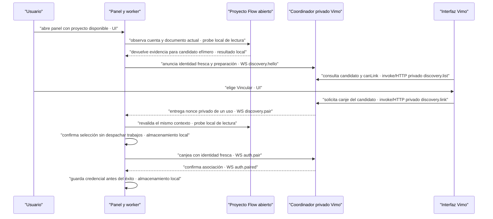

# Pedido para la sesión de EXTENSION-RPC-FLOW

> **Actualización 2026-09-21:** la extensión entregó este arreglo en 0.2.14,
> commit `6ac9d03`. Se verificó compatibilidad con el receptor y la UI actuales
> de Vimo y se corrigió su ayuda en los tres idiomas. Véase la
> [revisión de aceptación 0.2.14](review-extension-0.2.14.md).
> El diagnóstico y las líneas de 0.2.13 que siguen se conservan como contexto
> histórico; ya no describen automáticamente el paquete nuevo. La validación
> es aislada, no acredita la versión cargada ni vínculos reales de cada perfil.

Trabaja en `/Users/sebas/Documents/EXTENSION-RPC-FLOW`; Vimo permanece sólo lectura
para esa sesión. Corrige y empaqueta la identificación de cuenta/proyecto y su
preparación para discovery. El usuario abre un proyecto nuevo y el panel de la
extensión: Vimo debe poder mostrar el correo comprobado y, si el destino es
inequívoco y está preparado, habilitar **Vincular** sin exigir seleccionar de nuevo
ese mismo proyecto. El clic en Vimo intercambia el token por debajo. Abrir el panel
por sí solo NO autentica. Conserva también el clic único «Vincular cuenta» desde
la extensión implementado en 0.2.13.

Este pedido complementa el [contrato de vinculación de un gesto](../2026-09-20-flow-auto-link/prompt-extension.md).
No vuelvas a implementar ese protocolo desde cero ni rebajes sus guards. No
publiques. ID público esperado: `bjpjjnjiikhccbjlkgmfpfhenbdpikbm`.

## Evidencia y límites de esta auditoría

- Fuente externa limpia revisada: commit `929dfcc`, manifest `0.2.13`. Las líneas
  siguientes se refieren a esa revisión; confirma HEAD y cambios de otras sesiones
  antes de editar. Esta sesión no modificó la extensión.
- Se realizaron 12 comprobaciones sobre módulos originales de la extensión, compilados
  con exports de auditoría: Chrome/DOM/IndexedDB ficticios; `fetch` y
  `grecaptcha.execute` prohibidos. Se comprobó el retorno temprano sin binding, el
  documento antiguo y la recuperación de identidad al seleccionar otra vez.
  **No es una captura RPC de Google ni aceptación de los perfiles del usuario.**
- En una lectura agregada del almacén de Vimo había cuatro conexiones con correo
  e identidad verificada presentes; tres aliases eran genéricos. Ese snapshot no
  reproduce la captura anterior ni prueba la causa de cada perfil real. No se
  publican correos, IDs privados, prompts, credenciales ni URLs firmadas.
- Durante la revisión el usuario inició un video real en Vimo. No se reinició la
  app ni se modificaron vínculos, pausas o perfiles. Antes de cualquier intervención
  operativa comprueba si sigue habiendo trabajo activo o incierto. Las pruebas
  de este pedido deben empezar en fixtures aislados, sin puerto 43127 ni datos reales.
- Vimo no puede obtener un correo desde el hash ni identificar otros perfiles de
  Chrome por su cuenta. Un alias es un nombre de proyecto/perfil, no evidencia de
  cuenta. No inventar un email ni marcar `verified:true` con datos históricos.

## Causas y líneas exactas

1. **Perfil nuevo anunciado sin cuenta ni proyecto pese a tener un proyecto abierto.** `extension/background.js:1374` corta `discoveryContext()` cuando no existe `settings.binding.projectId`. La consulta de pestañas sólo ocurre después y busca el tab y proyecto ya guardados (`1377–1380`). `announceDiscovery:1400–1401` envía entonces `identity.verified:false`, `hasFlowTab:false`, alias `Perfil Flow`. El bridge y Vimo deshabilitan Vincular correctamente; no se debe eliminar ese guard de seguridad.
2. **Preselección visual no es preparación real.** `panel.js:849–867` lista pestañas y elige visualmente la única existente; no verifica ni guarda binding. La acción explícita `1602–1613` usa `ui.linkAccount` o `ui.bind`. `ui.tabs` (`background.js:1546`) sólo devuelve URLs/títulos/projectId, no identidad verificada ni documentId.
3. **Documento antiguo después de recarga/navegación.** `execute:411–413` usa `binding.documentId` al inyectar MAIN. `tabs.onUpdated:1650–1651` invalida identidad/preparación, pero conserva el documentId anterior. `ui.panelPresence:1521–1524` vuelve a comprobar ese binding, que ya puede apuntar a un documento inexistente o un proyecto distinto. El heartbeat (`974–979`) sólo vuelve a enviar el snapshot y no hace una comprobación de Flow. `bindTab:453–455` sí comprueba el tab actual sin fijar el documentId viejo y lo renueva en `479–484`; esto explica por qué Revisar/Cambiar proyecto puede recuperar el correo.
4. **Identidad de autorización y etiqueta visual comparten un único estado.** `checkedBinding:425–427` reemplaza siempre `settings.identity`, incluso con `verifyIdentity(null)` ante fallo del probe. También se limpia en arranque (`81`), navegación/cierre de pestaña (`1651/1655`) y cambio de sesión Chrome (`1664`). `sessionStatus:345` transmite ese objeto. `bridge/server.js:788` lo normaliza con `safeIdentity`; `bridge/profiles.js:22–31` elimina correo cuando verified no es true. Es correcto invalidar autorización; el problema de UX es perder también la etiqueta de la cuenta.
5. **El alias no identifica una cuenta.** `panel.js:767` usa `Mi cuenta de Flow` por defecto. `panel.js:509` muestra correo validado o alias. Cambiar proyecto no descubre un correo distinto por un RPC de proyecto: vuelve a ejecutar la comprobación de identidad y por eso el correo puede reaparecer.

## Qué hace realmente el adaptador RPC actual

- No hay RPC de cuenta/identidad definido en `extension/flow/schema.js:6`.
- `flow/page.js:503–508` obtiene el correo de botones de cuenta del DOM. El extractor (`70–85`) sólo acepta `https://accounts.google.com/SignOutOptions`, role button, un correo inequívoco por aria-label y un único correo entre los botones válidos.
- `identity.js:16–34` compara ese correo con `chrome.identity.getProfileUserInfo({accountStatus:'ANY'})`, deriva el accountKey y devuelve el correo como metadata local. No pide OAuth.
- `identity`, `probe` y `projectSession` retornan en `page.js:532–540` antes de cualquier RPC, fetch o ejecución de reCAPTCHA. Leer booleans de sesión/SDK no acuña un token.
- `probe.ready` mezcla proyecto, sesión RPC reconocida, SDK reCAPTCHA y correo; `identity` permite verificar identidad separadamente. No confundir existencia de una cuenta con capacidad de generación.
- `listProjects` usa `UpteDb`, devuelve la lista de proyectos de la cuenta y no determina cuál es el documento abierto. `projectContext:1419` toma `tabs[0]` si no encuentra binding: NO copiar ese fallback para una selección automática de destino.
- Si se solicita identidad por RPC real, investigar y verificar un endpoint de lectura con esquema explícito primero. No inventar un RPC ni usar generación, subida, creación de proyecto, `connection.test` o token reCAPTCHA para identificar una cuenta. La ruta DOM restringida actual es evidencia de código, no prueba de que exista un RPC de identidad.

## Implementación solicitada a la sesión de extensión

Mantener ID estable, credenciales, instalación, consumo 500/24 h, historial, recibos, referencias, pausas, holds, cadencia y concurrencia. No modificar Vimo ni sus fuentes. No publicar ni recargar perfiles reales como diagnóstico.

### Separar observación de selección persistente

Crear un resolvedor de observación, de sólo lectura, que no requiera binding previo. Su resultado interno propuesto (no es un contrato existente) debe distinguir:

- cuenta observada/verificada y origen de esa evidencia;
- estado de proyecto `unique`, `ambiguous`, `missing`, `loading` o `stale`;
- candidato efímero `{tabId, documentId, projectId, accountKey, revision, observedAt}`;
- preparación actual para operar y causa segura cuando no pueda comprobarse.

La observación no debe persistir un nuevo binding, llamar pump, armar intención UUID, acuñar nonce, reanudar pausas ni ejecutar RPC mutador. No reemplazar automáticamente un binding existente por otro proyecto.

Resolver sin ambigüedad: conservar primero un binding vigente; si no hay binding, usar un único proyecto/tab elegible comprobado. Si se pretende usar la pestaña que originó la apertura del panel, transportar ese contexto explícito y comprobarlo; no adivinarlo por `tabs[0]` ni por el orden de una lista. Con dos proyectos posibles, pedir selección dentro de la extensión. La lista de proyectos RPC no elimina esa ambigüedad. No es obligatorio escanear todas las pestañas cuando un contexto explícito ya determina la correcta.

La comprobación debe ser pura respecto a `settings`: obtener resultado y sólo después del await verificar la misma revisión, tab, documento, cuenta y proyecto. Una respuesta tardía no puede publicar identidad de un contexto anterior. Evitar que un sondeo fallido de otro candidato sobrescriba la identidad del binding vigente.

### Discovery listo sin selección manual previa cuando es inequívoco

Puede mantenerse el wire actual: publicar en `discovery.hello` identidad fresca y `hasFlowTab:true` sólo cuando existe el candidato inequívoco vigente. Esto habilita el botón de Vimo sin retirar guard alguno. Sin candidato comprobado, publicar presencia no elegible con causa explícita; nunca simular identidad verificada.

El candidato observado sigue siendo efímero. La selección persistente ocurre con el gesto explícito: clic Vincular cuenta en la extensión o el canje recibido por selección del usuario en Vimo. Antes de `auth.pair`, validar otra vez el MISMO candidato, comprobar guards de trabajos/propiedad, y confirmar el binding sin bombear cola. No volver a resolver un destino distinto después de recibir el nonce. Mantener compatibilidad con el nonce de selección nativa que no trae requestId de extensión.

Cualquier navegación, carga de documento, cierre de pestaña/panel, cambio de cuenta/proyecto, cancelación o vencimiento invalida el candidato y cierra el socket de discovery/challenge afectado. A→B→A no restaura el nonce o gesto previo. Conservar el protocolo 0.2.13: capability, intención efímera de 30 s, UUID por gesto, cinco campos, nonce antes del ACK, persistencia durable de auth.paired y no auto-vincular por mera presencia.

### Revalidación tras recarga y etiqueta de cuenta

Al completarse una carga del MISMO proyecto, volver a observar el documento actual con un fence propio. Renovar documentId/preparación sólo si coinciden identidad/proyecto/revisión y no contradice operaciones/recibos pendientes. Si cambió el proyecto, observar la cuenta no autoriza mover trabajos ni su binding histórico. Revalidar no reanuda colas, no libera holds y no prueba generación.

No conservar `identity.verified:true` cuando no hay evidencia fresca. Cuando sólo falta el SDK/sesión para generar pero la identidad se verificó, separar ambos estados. Los fallos deben preservar su causa original: TAB_INTERRUPTED/PROJECT_CHANGED no equivalen automáticamente a cuenta no iniciada.

### Parte implementada en Vimo: identidad actual e histórica separadas

Vimo añade al resumen de conexión de `status`, `connection.ready` y
`connection.status` el campo opcional:

```ts
lastVerifiedIdentity?: FlowIdentity | null
```

El coordinador lo deriva de identidades válidas de `auth.pair`, de la identidad
anterior a `auth.resume` y de cada `session.status` verificado. Normaliza el campo
al arrancar y migra desde una identidad anterior válida sin cambiar `state.version:1`.
El canje guarda la identidad actual vacía junto al histórico nuevo antes del ACK:
revincular A→B y reiniciar antes del primer heartbeat no restaura el nombre de A.
No se necesita un nuevo campo del worker para alimentar esta metadata. La copia
vendorizada de Vimo no se actualiza al editar el bridge externo.

`FlowIdentity` conserva su esquema actual; para este dato histórico debe ser una
identidad normalizada con `verified:true`, `accountKey` string hexadecimal de 64,
`maskedEmail` válido y `email` opcional validado, o `null`. No se incorporan campos
arbitrarios. Vimo comprueba el tipo string antes de la regex; un array JSON no vale.
**Ese verified describe la evidencia histórica, nunca la sesión actual.**

La UI prioriza correo fresco, luego máscara fresca. Si la identidad actual no está
verificada, muestra el histórico con «Última cuenta verificada · verificación
actual pendiente». Sin evidencia disponible muestra «Cuenta de Flow por identificar»
con referencia corta. Nunca sustituye el correo por «Mi cuenta de Flow». El estado
«Conectada con Vimo» describe el vínculo; disponibilidad y verificación van separados.
`lastVerifiedIdentity` jamás participa en canLink, conflictos, autenticación,
reservas, presupuesto, scheduler o generación.

La extensión puede aplicar la misma separación en su panel con metadata local,
pero no debe reenviar el histórico como `identity.verified:true`. Un correo perdido
antes de esta mejora sólo se recupera con verificación fresca; no se deduce del hash.

### Promoción del candidato y guards que también necesitan adaptación

No basta editar `discoveryContext`. En 0.2.13 `sendAccountLinkRequest` (`1177–1200`)
exige `intent.binding`, `settings.binding.ready` e igualdad de cinco campos; el
canje nativo (`860–869`) y `authenticationIsCurrent` (`1203–1209`) también fijan
`settings.binding`. Adapta las dos entradas de consentimiento para promover el
MISMO candidato, con sus fences y guards, antes de autenticarse. La entrada real
del panel es `ui.linkAccount`, no un comando inventado.

El nonce recibido por el clic nativo NO debe llamar `beginAccountLink`: eso armaría
otro UUID/request detrás de un canje ya autorizado. Tampoco debe exigir intención
UUID a todos los `discovery.pair`; rompería la ruta nativa compatible. Revalida el
contexto antes del envío y antes de aceptar/guardar el ACK. Incluye el candidato
efímero en `tabs.onUpdated/onRemoved`: hoy esos listeners siguen únicamente binding,
validatingTab o selección de UI. Define rollback de la selección nueva si el canje
falla; conserva siempre la credencial anterior hasta persistir el ACK nuevo.

### Proyecto reconocible y diagnóstico

- Mantén separados correo de cuenta, nombre real/alias de proyecto, verificación y
  disponibilidad. No mostrar «Mi cuenta de Flow» como si fuera el correo.
- La UI de Vimo ya distingue el alias del proyecto y una referencia corta; no puede
  inventar el título de Google. Si usas el RPC de lectura `UpteDb` para el título,
  aplica el parser actual y el registro cuyo `projectId` coincide exactamente.
  Hoy el parser extrae `{projectId:record[0],title:record[1][0]}`. No tomar el primero
  ni sobrescribir un alias personalizado silenciosamente.
- Presenta causas específicas: sin proyecto, proyectos ambiguos, documento cambiado,
  cuenta no detectada, discrepancia Chrome/Flow, proyecto no preparado, esperando
  Vimo, vinculado pero verificación pendiente. El vínculo válido no desaparece por
  un fallo de probe y un proyecto seleccionado no demuestra autenticación.
- Diagnóstico agregado permitido: versión/ID público, presencia de binding y
  candidate, coincidencia de documento/proyecto (booleanos), `identity.verified`,
  `hasEmail`, origen de evidencia, canLink/reason, estado de socket, cantidad de
  trabajos activos/inciertos/pendientes y modo de scheduling. Los correos se muestran
  en la UI solicitada por el usuario, no en logs, capturas de pruebas o informes.

## Secuencia propuesta de observación y clic nativo



**Contrato:** presencia no autoriza; el clic nativo sí. Nonce de 30 s ligado a
socket/origen/instalación/cuenta, sin paso por React/URL/portapapeles/logs.
**Fallo:** ambigüedad o contexto cambiado conservan el bloqueo; no se elige otra
pestaña después de recibir el nonce ni se pierde una asociación recuperable.
**Motivo:** detectar un proyecto abierto inequívoco evita una selección repetida
sin mezclar identidad, autorización o generación.

## Paralelismo: conservar arquitectura actual

La política vigente es 500 envíos por perfil en 24 h móviles, con los timestamps,
reservas e historial conservados. Un perfil normal aporta hasta 3 imágenes activas;
un perfil en revisión/modo serial aporta 1. Las cuentas pausadas, no verificadas,
no preparadas, duplicadas o sin saldo no añaden capacidad disponible. Se mantienen
los tiempos actuales del worker: base de 2–6 s, 3–7 s al drenar tanda y modo de
cadencia lenta (`captchaSlowdown`) de 20–40 s cuando corresponde. Este flag no
prueba que Google muestre un desafío interactivo. La recuperación de disponibilidad
conserva sus plazos propios de 120/240/480 s y cualquier hold mayor del proveedor.
No acortar ni confundir esas esperas para parecer más rápido.

El scheduler de Vimo no tiene un tope global de 3 imágenes. Una prueba aislada con
workers ficticios verificó 3 perfiles normales → 9 activos; un cuarto en revisión → 10;
el cuarto normal → 12. Es un chequeo del reparto, no un benchmark de Google ni una
promesa de velocidad lineal. Mantén propietario de intentos ya enviados/inciertos
al añadir cuentas; sólo trabajos nunca enviados pueden redistribuirse. El mínimo
vigente de 3 cuentas distintas disponibles para preparar lotes tampoco cambia.

## Aceptación exigida sin gastos de generación

1. Instalación sin binding + un proyecto abierto válido: observación descubre cuenta/proyecto, Vimo recibe candidato elegible y muestra correo fresco; no se vincula hasta un clic explícito.
2. Vimo hace Vincular sobre ese candidato: no se exige otra selección manual; el worker revalida exactamente la misma cuenta/proyecto antes de persistir binding y canjear.
3. Clic único desde extensión conserva comportamiento 0.2.13 y no exige segundo clic en Vimo.
4. Dos proyectos ambiguos, página inicial sin proyecto, pestaña descartada/cargando o Chrome/Flow con cuentas distintas: motivo preciso y cero vínculo falso.
5. Recarga del mismo proyecto: no queda atrapado consultando documentId viejo; recupera identidad sólo con observación fresca. Ningún envío/hold/pausa cambia.
6. Otro proyecto con trabajos/recibos pendientes: no reasigna destino ni adopta silenciosamente una nueva cuenta; conserva documentos/recibos de cada trabajo.
7. Identity probe A lento, navegación a B, respuesta tardía A: no publica A; tampoco A→B→A revive challenge o intención.
8. Error temporal/ausencia de cuenta: no muestra verified true; correo histórico, si se añade, queda claramente separado y nunca habilita canje/capacidad.
9. Alias «Mi cuenta de Flow» no sustituye correo disponible ni se usa como identidad. Error de probe, proyecto y cuenta se distinguen.
10. `probe/identity/projectSession` no llaman fetch/RPC/grecaptcha.execute, getAuthToken, createProject, upload, generation ni connection.test. ListProjects read-only, si se usa, permanece separado y con parser verificado.
11. Recibido nonce por clic en Vimo, no se crea `ui.linkAccount`/UUID adicional; se conserva el mismo candidato a través de ambos ACKs. Cambio de documento o cierre invalida canje y respuesta tardía. Timeout no rearma gesto.
12. Perfil ya autenticado no reaparece como candidato ni rota su credencial. Desconectar/rechazo de credencial conserva historial y exige transición deliberada segura si cambia de coordinador.
13. Con 3 perfiles normales hay hasta 9 activos; añadir un cuarto normal permite hasta 12 respetando cada reloj y hold. En revisión aporta 1; pausado/no preparado aporta 0. No duplicar trabajos al sumar cuentas ni reiniciar presupuesto.
14. Los mismos checks en el paquete final con identidad/versión/paridad fuente/carpeta/ZIP; fixtures sintéticos, sin credenciales ni correos reales en reporte. Diferenciar esta evidencia de una aceptación real posterior autorizada.

## Entrega requerida

Entrega archivos y commit, versión final, ID público, correspondencia entre fuente,
carpeta descomprimida y ZIP, contrato realmente implementado, comprobaciones y
pendientes. No tocar producción ni recargar perfiles reales como diagnóstico.
Si hace falta capturar una respuesta RPC de lectura real, diferencia la captura
sanitizada de la prueba ficticia y evita cualquier generación, subida, creación de
proyecto, `connection.test` o token reCAPTCHA. No exponer payloads privados.

Explica por separado lo probado en fuente, paquete y aplicación real. La fuente
0.2.13 auditada no prueba qué paquete ejecuta cada perfil. Una actualización operativa
conserva ID/almacenamiento y se coordina después de comprobar que no hay trabajos
activos, inciertos, recibos ni limpieza pendientes. No arrancar otro puente, cambiar
`dataDir`, copiar parcialmente `state.json`, borrar almacenamiento, volver a vincular
por defecto o fingir límite 500 si el worker cargado sigue anunciando 400.

Si propones un campo o comando nuevo que el wire actual no permite, entrega a
Vimo DTO exacto, errores, persistencia y compatibilidad antes de afirmar que está
integrado. Este documento propone detectar/promover el candidato en el worker;
no afirma que ese arreglo ya esté implementado ni validado con Google real.
