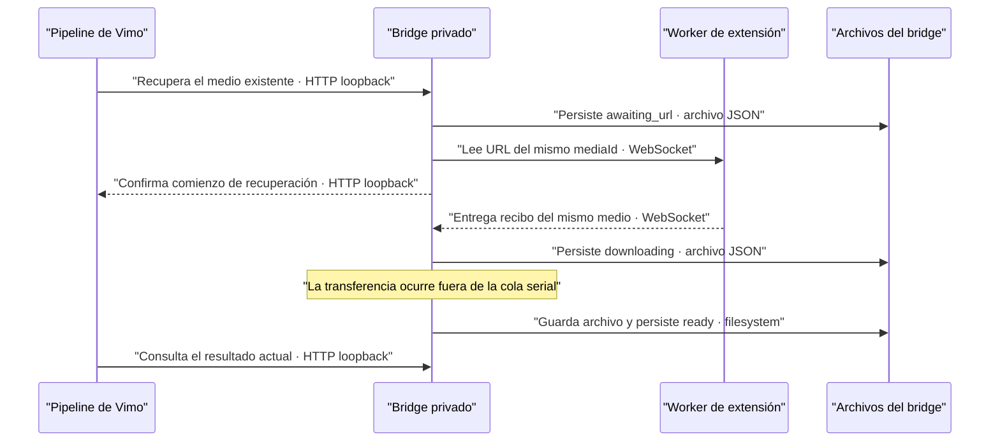

# Recuperación de descargas: coordinación con la extensión

- **Fecha:** 2026-09-21.
- **Rama:** `feat/extension-vimo-automater`.
- **Alcance:** parche local de `pipeline/providers/flow/vendor/bridge/server.js`.
  No se modificó el repositorio externo ni se ejecutaron generaciones reales.

## Causa verificada

`startDownload` iniciaba una recuperación desde `download_failed` sin cambiar
ese estado. Un observador podía terminar en el siguiente sondeo aunque el
archivo siguiera descargándose. `download` tampoco publicaba una espera al
solicitar `media.refresh`; varios clics podían repetir la lectura.

La revisión de la extensión 0.2.13 mostró además que
`background.js/refreshMediaOperation` puede guardar `recoveryError` y retornar
sin enviar `job.error`. Un mapa de solicitudes en vuelo sin vencimiento deja
ese medio esperando indefinidamente aunque el socket permanezca conectado.

## Corrección incorporada en Vimo

**Contrato:** antes del acuse del comando queda persistido `downloading` o
`awaiting_url`. El acuse no significa imagen lista. Inicio y publicación final
usan la cola serial; el I/O no la bloquea. La transferencia conserva el medio,
intento y hash originales. No crea una imagen ni reescribe su prompt.

**Fallo:** `media.refresh` en vuelo se deduplica por `imageJobId` y socket.
Una URL ausente o rechazada no se reutiliza mientras llega su reemplazo. Una
respuesta explícita `job.result` sin URL termina en
`download_failed/image_url_missing`; un `jobs.snapshot` sin URL sólo reconcilia
el recibo anterior y conserva una lectura vigente. Un error, desconexión o
vencimiento libera la lectura. Cinco minutos sin respuesta producen
`download_failed/media_refresh_timeout` cuando el comando o heartbeat siguiente
comprueba el plazo. No hay reenvío automático dentro de este vencimiento.

**Motivo:** el mismo clic debe poder observar el trabajo que inició. Un error
posterior real de transferencia sigue terminando en `download_failed`. Un error
tardío del worker no convierte en fallida una transferencia local todavía
activa; esa transferencia conserva autoridad para publicar su resultado final.

## Coordinación solicitada para upstream

Conservar estas transiciones al sincronizar el coordinador. En el worker sería
útil publicar `job.error` con el intento y medio vigentes cuando termina una
lectura `mediaDetail` fallida; ese error corresponde a recuperar un resultado
confirmado, no a una generación desconocida. Vimo ya admite el worker 0.2.13
mediante el vencimiento de la lectura, sin requerir un nuevo frame o DTO.

No cambiar para este ajuste `generation.retry`, `requestHash`, `mediaId`,
`attemptId`, referencias, políticas de cuenta, pausas ni presupuestos. No se
habilita regeneración automática para `accepted` o `unknown`. El contrato
restringido de reintento RPC13 conserva su consentimiento y sus comprobaciones.

## Validación reproducible

Fixture temporal, no versionado:
`node /private/tmp/vimo-flow-download-progress-20260921.mjs`.
Usa `createBridge` original con directorios propios en `/private/tmp`, puerto
loopback efímero distinto de 43127, sockets WebSocket reales y downloader
controlado que escribe una imagen PNG válida. Cuenta transferencias y compara
estado público, estado durable y hash del archivo final. No consulta Google,
Chrome ni datos de usuarios.

Doce escenarios: descarga lenta durante más de un sondeo; espera asíncrona de
URL; URL rechazada sin reutilización; fallo de lectura con recuperación posterior;
desconexión y socket nuevo; arranque desde `downloading`; error tardío del worker;
fallo real del downloader sin evento `ready`; arranque desde `awaiting_url`;
snapshot previo sin duplicar lectura; respuesta explícita sin URL; y worker
silencioso que vence sin ninguna generación. El último caso adelanta únicamente
`Date.now` en el proceso de prueba, para comprobar el plazo sin esperar cinco
minutos reales.

La auditoría independiente reprodujo antes y confirmó después la respuesta
sin URL con `/private/tmp/vimo-flow-null-refresh-review-20260921.mjs`.
El fallo inicial de estado y el uso prematuro de la URL rechazada también
fallaron antes de sus respectivas correcciones.

## Pruebas manuales y límites

No se ejecutó QA manual sobre la app, cuentas, proyectos o perfiles reales.
El artefacto nativo final y su validación pertenecen al informe conjunto de Vimo.
La espera de URL está acotada por proceso; después de reiniciar, una nueva
recuperación consulta el mismo medio persistido. Un resultado tardío válido
sigue siendo importable. El plazo no cancela una generación ni prueba que el
proveedor haya fallado al crear una imagen.
