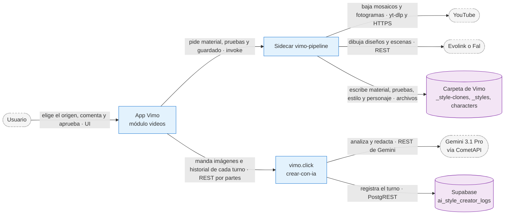
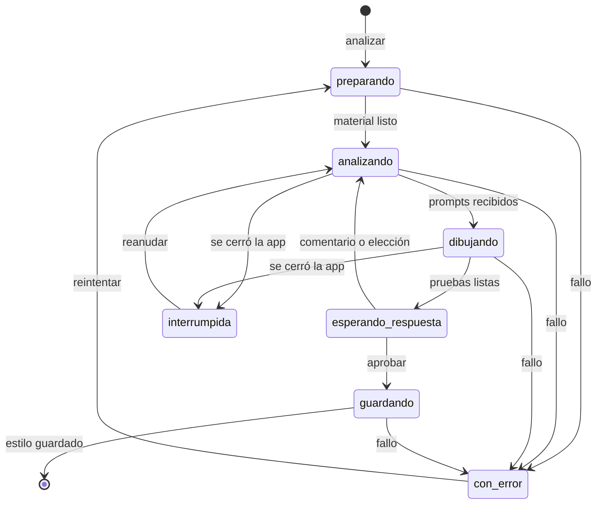

# Creador de estilo con IA: clonar un estilo visual desde un video o desde imágenes

- **Fecha:** 2026-10-03
- **Ramas:** `feat/creador-estilo-ia-sobre-catalogo` (VIMO-TAURI, creada sobre la punta de
  `feat/catalogo-estilos`) · `feat/creador-estilo-ia` (`vimo-landing`). La primera versión de este
  documento quedó en `feat/creador-estilo-visual-ia` (`a60e7f31`), que sale de `dev` y no tiene el
  catálogo.
- **Estado:** diseño acordado con el dueño en conversación (del 2026-09-30 al 2026-10-03), parte por
  parte. Servidor desplegado en vimo.click el 2026-10-03, encendido solo para admins. Sidecar y app
  implementados y probados; el recorrido del modal está verificado en un navegador con el sidecar y
  el servidor simulados. Falta la prueba del dueño en la app con el servidor real.
- **ADR:** [ADR-0050](../../adr/ADR-0050-creador-de-estilo-con-ia.md).
- **Relacionadas:** ADR-0006, ADR-0018, ADR-0019, ADR-0020, ADR-0021 (con su enmienda del 2026-10-02),
  ADR-0033, ADR-0038 y ADR-0048 (gemas por secciones, de la rama `feat/catalogo-estilos`).

Este documento es el contrato que comparten los planes de implementación. Si un plan necesita algo que
lo contradice, se cambia primero este documento, con el dueño.

---

## 1. Qué se quiere lograr

Una card «Crear estilo con IA» en Mi estilo. El usuario pega el link de un video de YouTube o sube
hasta 10 imágenes, y Vimo le devuelve un estilo propio que reproduce esa estética, validado con
imágenes de prueba antes de guardarse.

Es el Creador de Gemas de Imperio Pro (viani.pro) llevado a Vimo. El análisis es el mismo: el mismo
modelo (Gemini 3.1 Pro) y el mismo instructivo, que ellos pulieron contra 11 canales reales. Lo que
cambia es la salida: en vez de una gema de chat, el estilo se guarda en las secciones de Vimo.

Cómo funciona el original, con sus proveedores, costos y lecciones: nota
«Investigacion - Flujo de estilos de Viani» del vault (proyecto EXTRAER-STYLE-IA) y la carpeta de
referencia `/Users/sebas/Documents/crear-estilo-ia/` (fuera del repo, no se commitea).

### Criterios de éxito

1. Con los mismos videos, el dueño juzga que la clonación de Vimo se ve igual o mejor que la de
   Imperio Pro.
2. El recorrido completo funciona sin quedarse mirando el modal: la clonación sigue en segundo plano
   y avisa cuando necesita una respuesta.
3. Si YouTube no entrega el storyboard, la clonación sigue con los fotogramas públicos, sin error ni
   aviso.
4. Un estilo clonado se usa en Crear como cualquier estilo de Mi estilo, y su personaje (si se
   replicó) queda en la biblioteca de personajes.
5. Cada turno del modelo deja su fila en Supabase, con éxito o con error.

---

## 2. Decisiones

| ID  | Decisión                                                                                                                                                                                                                                                       | Origen                 |
| --- | -------------------------------------------------------------------------------------------------------------------------------------------------------------------------------------------------------------------------------------------------------------- | ---------------------- |
| A1  | Card «Crear estilo con IA» en Mi estilo, al lado de «Crear estilo» y con su misma forma.                                                                                                                                                                       | Dueño                  |
| A2  | Dos orígenes: un link de YouTube o hasta 10 imágenes. Un badge recomienda 10: con más imágenes la IA mide mejor.                                                                                                                                               | Dueño                  |
| A3  | El resultado es un estilo normal de Mi estilo, con las gemas por secciones de la ADR-0048.                                                                                                                                                                     | Recomendación aceptada |
| B1  | El agente vive en vimo.click y usa Gemini 3.1 Pro por CometAPI, el modelo de Imperio Pro. Lo paga Vimo. Por ahora con la clave de FLUJO-VIANI.                                                                                                                 | Dueño                  |
| B2  | Camino 1: el instructivo de Imperio Pro con el análisis intacto y la salida en las secciones de Vimo.                                                                                                                                                          | Dueño                  |
| B3  | Todas las secciones del estilo clonado se escriben en inglés. El usuario puede editarlas en cualquier idioma.                                                                                                                                                  | Recomendación aceptada |
| B4  | Sin tope diario de clonaciones, como Imperio Pro. Queda una variable en vimo.click para encender uno sin sacar versión.                                                                                                                                        | Dueño                  |
| C1  | Ritual completo de Imperio Pro: diseños del personaje, elegir, escenas de prueba, comentarios en cada paso y aprobar.                                                                                                                                          | Dueño                  |
| C2  | Una pregunta de sí o no: «¿Replicamos el personaje del video?». Sí: 3 diseños (el 1 fiel al original). No: el estilo queda en «Personaje genérico».                                                                                                            | Dueño                  |
| C3  | Tras elegir el diseño, el usuario decide cómo viaja: «Identidad de prompt» (texto, gasta menos) o «Con foto» (la imagen del diseño como referencia). En los dos casos se crea el personaje en su biblioteca y el estilo lo trae por defecto en «Mi personaje». | Dueño                  |
| C4  | Las escenas de prueba se dibujan de la forma elegida en C3, para que el usuario vea lo que va a obtener.                                                                                                                                                       | Dueño                  |
| C5  | 4 escenas de prueba (las 4 muestras del estilo) y 3 diseños de personaje.                                                                                                                                                                                      | Dueño                  |
| C6  | Comparación «Original / Clonación»: cada prueba al lado de la imagen que recrea, con las dos etiquetas y un visor a pantalla completa con divisor.                                                                                                             | Dueño                  |
| D1  | El material de un video es el de Imperio Pro: mosaicos del storyboard (hasta 10), fotogramas sueltos y el título. La variante con cuadros a 1080p se prueba después, contra esta.                                                                              | Dueño                  |
| D2  | Sin storyboard, la clonación sigue con los fotogramas públicos y no avisa «menos preciso».                                                                                                                                                                     | Dueño                  |
| E1  | La clonación sigue aunque se cierre el modal. Cuando necesita una respuesta se detiene y lo dice en su card («Respondé para continuar»). Hasta 3 a la vez.                                                                                                     | Dueño                  |
| F1  | Un personaje de identidad de prompt viaja siempre como texto, tenga o no retrato del estilo; solo uno con foto viaja como imagen (enmienda del 2026-10-02 a la ADR-0021, rama `fix/prompt-identity-travels-as-text`).                                          | Dueño                  |
| G1  | Se activa con un interruptor propio (`features.aiStyleCreator`), primero solo para admins.                                                                                                                                                                     | Recomendación aceptada |
| G2  | La rama de `vimo-landing` se elimina cuando deje de usarse.                                                                                                                                                                                                    | Dueño                  |

---

## 3. El recorrido

1. **La card.** «Crear estilo con IA», con un ícono de destello y la línea «Desde un video de YouTube
   o tus imágenes». Solo aparece con `features.aiStyleCreator`.
2. **Origen.** Dos pestañas.
   - Video de YouTube: un campo para el link, validado antes de dejar analizar.
   - Imágenes: elegir o arrastrar hasta 10 (JPG, PNG o WEBP), con miniaturas, una cruz para quitar
     cada una y un contador. Junto al título, el badge «Recomendado: 10 imágenes».
   - Debajo, la pregunta del personaje (C2) y una línea de costos: el análisis lo cubre Vimo; las
     pruebas se pagan con el Fal o el Evolink del usuario, con su saldo a la vista.
3. **Analizando.** Pasos visibles: «Bajando el material», «La IA está estudiando el estilo»,
   «Dibujando las pruebas». Se puede cancelar.
4. **Personaje** (solo si respondió que sí). Arriba, la imagen del original donde mejor se ve el
   personaje. Debajo, los 3 diseños: «1 · Réplica fiel», «2 · Variante», «3 · Variante». Una caja
   «¿Qué ajustamos?» rehace los 3. Al elegir uno aparece la elección de C3 y el botón «Probar
   escenas».
5. **Escenas de prueba.** El nombre del estilo, editable (en un video sale de su título, ver §6), y
   la descripción que propuso la IA. Las 4 parejas «Original / Clonación». Una caja de comentario
   rehace las pruebas y conserva el personaje. «Aprobar y guardar». La cabecera del modal es solo el
   nombre del estilo, y la caja «¿Qué ajustamos?» con el botón de aprobar quedan pegados al borde de
   abajo: se ven sin desplazarse (pedido del dueño, 2026-10-04).
6. **Guardar.** El estilo aparece en la grilla con las 4 clonaciones como muestras. Si el modal está
   abierto queda «En uso»; si no, un aviso ofrece «Usar en este video».

Cerrar el modal no descarta nada: la clonación sigue (sección 8).

---

## 4. Arquitectura

### 4.1 Piezas

- **App (`src/modules/videos`).** La card, el modal y un administrador de sesiones que vive fuera del
  modal. Es la única pieza que habla con el servidor, con la sesión del usuario (`vimoServerFetch` de
  `common`, de la rama del catálogo).
- **Sidecar (`pipeline/commands/styles`).** Junta el material, dibuja las pruebas con las claves del
  usuario y guarda el estilo y el personaje. No habla con vimo.click.
- **Servidor (`vimo-landing`).** Un turno por pedido, sin estado entre turnos. Nunca va a YouTube.
- **Supabase.** Una tabla de registro, sin imágenes.

### 4.2 Un turno

1. La app le pide al sidecar el material (una vez por sesión) y lo lee de disco.
2. Manda al servidor la acción, el material y el historial.
3. El servidor responde por partes: latidos mientras Gemini trabaja y, al final, el resultado.
4. La app le pide al sidecar que dibuje los prompts que llegaron.
5. Muestra el resultado o se detiene a esperar la respuesta del usuario.

**Fallo:** cada paso deja su resultado en disco o en la sesión antes de pasar al siguiente. Un turno
que falla se repite sin perder los anteriores.

### 4.3 Contrato del servidor

`POST https://vimo.click/api/estilos/crear-con-ia`. El contrato completo (pedido, respuestas, topes,
códigos, tiempos y variables) está en `SETUP_CREADOR_ESTILO_IA.md` de `vimo-landing`, rama
`feat/creador-estilo-ia`. Lo esencial:

| `accion`            | Devuelve                                                                           |
| ------------------- | ---------------------------------------------------------------------------------- |
| `analizar`          | `nombre`, `descripcion`, `fase` y `disenos` (3) con `personajeEn`, o `escenas` (4) |
| `ajustar-personaje` | `disenos` (3)                                                                      |
| `elegir-personaje`  | `identidad: { nombre, descripcion }` y `escenas` (4) con la etiqueta `[subject]`   |
| `ajustar-escenas`   | `escenas` (4)                                                                      |
| `aprobar`           | `templateVersion` y `sections`                                                     |

- Cada escena es `{ prompt, origen }`. `origen` dice qué imagen del material recrea: una celda de un
  mosaico, un fotograma, una imagen del usuario o `nueva` (ninguna en concreto).
- La respuesta llega por partes (NDJSON): `inicio`, `latido` cada 10 s y `resultado` o `error`.
- Toda respuesta con resultado trae `turnos`: la app los suma a su historial para el turno siguiente.
- Códigos de error: `sin-token`, `token-invalido`, `sin-acceso`, `pedido-invalido`,
  `material-invalido`, `funcion-desactivada`, `cupo-agotado`, `error-interno`, `modelo-fallo`,
  `modelo-timeout` y `contenido-bloqueado`.

### 4.4 Subcomandos nuevos del sidecar

Todos en `pipeline/commands/styles/`, con «style» en el nombre para que el diagnóstico los agrupe
(ADR-0038). El contrato exacto está en `pipeline/types/style-clone.ts`; este es el reparto:

| Subcomando            | Qué hace                                                                                                                                                                                                   | Modo               |
| --------------------- | ---------------------------------------------------------------------------------------------------------------------------------------------------------------------------------------------------------- | ------------------ |
| `style-clone-prepare` | Junta el material en la carpeta de la sesión: de un video, mosaicos, fotogramas, miniatura y título; de imágenes, las valida y las achica. Devuelve la lista con su tipo, su cuadrícula y sus tiempos.     | Con progreso       |
| `style-clone-draw`    | Dibuja una ronda (3 diseños o 4 escenas) con el proveedor elegido y deja también el «Original» de cada escena. Con personaje, teje la identidad como texto o adjunta la imagen del diseño como referencia. | Con progreso       |
| `style-clone-save`    | Guarda el estilo con sus secciones y sus 4 muestras, crea el personaje en la biblioteca y borra la carpeta de la sesión.                                                                                   | Pedido y respuesta |
| `style-clone-discard` | Borra la carpeta de una sesión.                                                                                                                                                                            | Pedido y respuesta |

- La carpeta de trabajo es `<carpeta raíz>/_style-clones/<sesión>/`. `_style-clones` se suma a
  `RESERVED_ROOT_DIRECTORIES`. Está dentro de la carpeta raíz porque el protocolo de assets de la app
  solo muestra archivos de ahí.
- Rust no se toca: `start_pipeline_job` es genérico.

---

## 5. El material

### 5.1 Video de YouTube

Lo junta el sidecar, en la computadora del usuario. En orden:

1. **Storyboard con yt-dlp.** `yt-dlp -J` con los clientes por defecto. Si YouTube responde el bloqueo
   de bot («Sign in to confirm you’re not a bot»), se repite con
   `--extractor-args "youtube:player_client=mweb"`. El formato `sb0` trae mosaicos de 3×3 con celdas
   de 320×180. Se bajan hasta 10, repartidos por todo el video.
2. **Fotogramas públicos, siempre.** `i.ytimg.com/vi/<id>/maxres1.jpg`, `maxres2.jpg` y `maxres3.jpg`
   (1280×720). Si no existen, `sd1..3` o `hq1..3`. Y la miniatura (`maxresdefault.jpg` o
   `hqdefault.jpg`).
3. **Título** por oEmbed.

- Sin storyboard, el análisis sigue con los fotogramas y la miniatura, sin aviso (D2). Es lo que le
  pasó a Imperio Pro en la prueba del dueño del 2026-09-17, y el resultado le gustó.
- Con menos de 2 imágenes la clonación no arranca: el video es privado, no existe o no tiene
  miniaturas.
- Medido el 2026-10-03: la página del video y los clientes por defecto de yt-dlp estaban bloqueados en
  la Mac del dueño; `mweb` respondió con 13 mosaicos para un video de 19 minutos. No se leen cookies
  del navegador.
- La miniatura va etiquetada como tal: sirve para ver el trazo, pero su texto y su composición son de
  portada y nunca es el original de una escena.
- **Queda para después (D1):** bajar el video y armar los mosaicos con cuadros más grandes, y
  comparar el resultado contra este material.

### 5.2 Imágenes del usuario

- Hasta 10, JPG, PNG o WEBP. Llegan al sidecar como rutas (diálogo nativo o arrastre; en Tauri el
  arrastre entrega rutas por `onDragDropEvent`).
- El sidecar valida cada una por sus bytes y las achica para el modelo (lado mayor de 1 536 px, JPEG).
  Una imagen inválida se marca en su miniatura y no deja analizar hasta quitarla.
- Las imágenes del usuario no se copian al estilo: solo viven en la carpeta de la sesión.

### 5.3 El «Original» de cada prueba

- De un fotograma o de una imagen del usuario: ese mismo archivo.
- De una celda de un mosaico: el sidecar recorta la celda (320×180). **Pendiente:** calcular el
  segundo de la celda (el material ya guarda `startSeconds` y `secondsPerCell` de cada mosaico) y
  bajar ese instante del video con yt-dlp para mostrar un cuadro nítido; si no se puede, queda el
  recorte.
- De una escena `nueva`: no hay original; la tarjeta muestra solo la clonación.

---

## 6. El cerebro

Vive en `vimo-landing/functions/_lib/creador-estilo/`. El instructivo (`maestro.ts`) es el prompt
maestro de Imperio Pro con estos cambios, y ninguno más:

1. Siempre 4 escenas de prueba.
2. Cada escena dice qué imagen recrea (`ORIGEN: …`) y cada diseño lleva su etiqueta.
3. El material puede ser un video o imágenes sueltas, y cada imagen llega con su etiqueta.
4. Al confirmar el personaje, el modelo entrega su identidad en el formato de Vimo: qué es, sus
   rasgos y una oración final «Outfit:», en inglés y con hasta 700 caracteres.
5. Al aprobar, en vez de una Instrucción de Sistema de chat devuelve las secciones de Vimo.
6. Tres afinados que salieron de mirar las imágenes de las corridas reales: la ficha dice el color de
   relleno de la piel y la proporción entre la cabeza y el cuerpo, y cada prompt de prueba cierra con
   la prohibición de texto no pedido.

### 6.1 Las secciones de un estilo clonado

Todas en inglés.

| Sección       | Qué lleva                                                                                                                                                                                           |
| ------------- | --------------------------------------------------------------------------------------------------------------------------------------------------------------------------------------------------- |
| `visualStyle` | La ficha de estilo completa y, después, la variedad del canal: los mundos de color entre los que rota, el reparto de fondos lisos y escenarios, los tipos de escena y cómo las monta.               |
| `promptEnd`   | `Style: <la ficha completa>` y nada más, hasta 900 caracteres. Vimo la pega por código al final de cada prompt de imagen, así que describe una sola imagen: sin la variedad del canal (2026-10-04). |
| `rules`       | Los candados de Imperio Pro adaptados a lo que midió: contexto, extras, fondo y mundos de color, frecuencia de texto, expresiones y fidelidad de estilo.                                            |
| `dynamism`    | Solo si el canal alterna tipos de escena: qué tipo le toca a cada contenido y cuándo aparece el protagonista.                                                                                       |
| `camera`      | La variedad de planos.                                                                                                                                                                              |

- `character` queda vacía: el personaje clonado entra como personaje de la biblioteca, así
  «Personaje genérico» siempre significa diseñarlo desde el guion.
- Lo que Vimo ya impone por código no se repite: un prompt por fragmento, el formato, el inglés de
  los prompts, el contenido sensible y el protagonista.
- **`promptEnd` admite hasta 1 000 caracteres** (`PROMPT_END_CHAR_LIMIT` y `gemTemplate.ts`; antes
  600). Es el mecanismo de fidelidad de Imperio Pro: la ficha, igual en cada imagen.
- **Corrección del 2026-10-03 (medido al implementar):** esta spec decía 1 800 y que el prompt
  entraba «dentro del tope de 3 000». No es así. La plataforma pega siempre dos cláusulas (texto en
  imagen y anonimato) y al cuerpo del prompt le quedan **2 106 caracteres**
  (`FINAL_PROMPT_BODY_BUDGET`) para la escena, la identidad (hasta 700) y el cierre. Si no entra, se
  recorta primero la escena, hasta un piso de 300, y después el cierre. Las fichas de las corridas
  reales midieron entre 818 y 1 590: con 1 590 la escena quedaba en 300 caracteres y la ficha igual
  se cortaba.
- **Hecho en el servidor** (`vimo-landing` `b44b623`): el instructivo pide una ficha de hasta 850
  caracteres, el cierre fijo es solo «Style: » más esa ficha (hasta 900) y las escenas de prueba usan
  la misma ficha y el espacio de una escena en producción, así lo que el usuario aprueba es lo que
  después sale en sus videos. Corrida real: cierre de 839 caracteres y el estilo intacto.
- Evolink cobra el texto del prompt aparte: una imagen con un prompt largo cuesta más que el precio
  de lista.

### 6.2 Lo que mostraron las corridas reales (2026-10-03)

Tres clonaciones del video de referencia del dueño (`tBBhUn0D0I0`), con 10 mosaicos, 3 fotogramas y
la miniatura:

- 8 turnos sin reintentos, reclamos ni correcciones. De 24 a 76 s cada uno.
- Gemini razona en silencio: el primer byte tarda de 20 a 69 s. Por eso el servidor responde por
  partes con latidos.
- Las 7 celdas de mosaico que nombró como original eran la escena que decía recrear.
- Con los mosaicos midió que el canal sí usa texto en pantalla (diagramas con rótulos). Imperio Pro,
  con 4 fotogramas, había concluido que no.
- Costo a precio de lista: unos 10 centavos de dólar por turno.

Las corridas, sus imágenes y cómo repetirlas: `/Users/sebas/Documents/crear-estilo-ia/pruebas/`
(`LEEME.md`). Son locales: usan claves reales y no se commitean.

---

### Lo que cambió tras la primera clonación hecha desde la app (2026-10-04)

- **La ficha describe una sola imagen.** Las 4 escenas de esa clonación salieron como collages de
  paneles: la ficha, que se pega al final de cada prompt, contaba la variedad del video entero
  («Rotates between: … laboratories, … offices… Composition includes floating diagrams, visual
  metaphors, split screens.») y el generador dibujó todo junto. Ahora la ficha solo dice lo que es
  verdad en todos los fotogramas; la variedad va en una línea aparte del análisis («VARIEDAD DEL
  CANAL:») y, en el estilo final, en `visualStyle` y `rules`. Si igual se cuela, el servidor la
  reclama una vez. Informe: `fixes/2026-10-04_style-clone-collage-scenes.md`.
- **El nombre del estilo sale del título del video.** Con «POV: Eres el COCINERO del Cartel» el
  estilo se llama «Cocinero del Cartel», no «Pizarra Criminal». Lo pide el instructivo y, si el
  modelo no lo hace, el servidor arma el nombre con las palabras del título. Con imágenes sueltas
  sigue siendo un nombre que describe el estilo.
- En `vimo-landing`: `0ece251`, `44d625c` y `98e3f47` (rama `fix/creador-estilo-analizador`).

### Fidelidad a la escena original (2026-10-04)

Pedido del dueño después de ver las primeras pruebas: la clonación es fiel a su original. Informe:
`fixes/2026-10-04_style-clone-scene-fidelity.md`.

- **Sin personas en el original, sin personas en la clonación.** La ficha describía el cuerpo de las
  personas como un hecho de la imagen y el generador sumaba monigotes a un diagrama o a un objeto.
  El bloque de anatomía de la ficha va ahora en condicional («People, only when the scene names
  them, have this anatomy: …»); si llega sin esa condición, el servidor la reclama una vez.
- **La misma composición.** Un fotograma de una sola escena sale como una sola imagen. Un fotograma
  que ya es una pantalla dividida o un collage en el video se recrea con esa misma división,
  escrita dentro de la escena. El modelo ya no esquiva esos fotogramas al elegir.
- **La misma cantidad de personas**, cada una con lo que se le ve (pelo, ropa, accesorios).
- **Si el usuario pide otro tipo de escena** en «¿Qué ajustamos?», el modelo busca otro fotograma
  que ya sea así: no le quita ni le pone nada al que tenía.
- **Un prompt en varios párrafos ya no se parte.** Si el modelo separa la escena, el estilo y la
  oración del texto con líneas en blanco, el servidor lo sigue leyendo como un solo prompt.
- En el estilo final, `rules` divide el cuadro solo para el tipo de contenido en que el canal lo
  hace.

## 7. Las pruebas de imágenes

- Las dibuja `style-clone-draw` con el proveedor de imágenes del usuario (Evolink o Fal), en calidad
  baja y 16:9, como las muestras de Mi estilo.
- **Diseños del personaje:** los 3 prompts tal cual llegan.
- **Escenas sin personaje:** los 4 prompts tal cual llegan.
- **Escenas con personaje, identidad de prompt:** se teje la identidad en lugar de `[subject]` con las
  funciones de las muestras (`weaveSampleIdentity`).
- **Escenas con personaje, con foto:** la imagen del diseño elegido viaja como referencia
  (`pointSampleToReference`), como en el carril de personaje del video.
- Una imagen que falla no tumba la ronda: su tarjeta ofrece «Reintentar». Un rechazo por contenido
  se reintenta una vez con el prompt suavizado, como en el video.
- Antes de cada ronda la app compara el costo estimado con el saldo, como en las muestras de hoy.

---

## 8. Sesiones en segundo plano

- **El administrador de sesiones** vive fuera del modal (un store del módulo `videos`), como la tarea
  de Crear y la adaptación de gemas en segundo plano de la rama del catálogo. Guarda cada sesión en
  `localStorage` (`vimo:styleClone:sessions:v1`): origen, respuesta del personaje, material, historial,
  paso, pruebas y elecciones. Las imágenes viven en disco, en la carpeta de la sesión.
- **Hasta 3 sesiones a la vez** (E1). Con 3 en curso, la card «Crear estilo con IA» avisa que hay que
  esperar.
- **Cada sesión tiene su card** al principio de la grilla, con la primera imagen del origen y una
  etiqueta: «Preparando», «Analizando», «Dibujando pruebas», «Respondé para continuar», «Guardando»,
  «Error · Reintentar» o «Se interrumpió · Reanudar». Tocarla abre el modal en su paso. Su menú ofrece
  «Descartar». «Respondé para continuar» va más grande que las demás y con borde: es la que tiene que
  encontrar quien cerró el modal sin aprobar (pedido del dueño, 2026-10-04).
- **Cuando necesita una respuesta** (elegir el diseño, cómo viaja el personaje, aprobar o comentar) se
  detiene, cambia la etiqueta y muestra un aviso con «Responder».
- **Si se cierra la app**, al volver las sesiones que estaban trabajando quedan en «Se interrumpió ·
  Reanudar». Reanudar repite solo el paso que estaba corriendo: el material, los turnos ya
  respondidos y las imágenes ya dibujadas se conservan.
- **Al terminar:** con el modal abierto, el estilo queda «En uso». Sin el modal, no se cambia el
  estilo del video que el usuario está armando; un aviso ofrece «Usar en este video».

---

## 9. Qué se guarda

- **El estilo**, en `_styles/<id>/`, como cualquier estilo de plantilla: `sections`, `templateVersion`,
  las 4 clonaciones como muestras, el bloque de personaje y un `origin` nuevo
  `{ kind: 'ai-clone', source: 'youtube' | 'images', videoUrl? }`, que el sidecar lee del material de
  la sesión (no del webview).
  - Sin replicar personaje: `character: { mode: 'generic' }`.
  - Replicando: `character: { mode: 'own', defaultCharacterId }`.
- **El personaje**, en `characters/<id>/`, con el nombre que propone la IA (editable) y la identidad en
  inglés.
  - «Con foto»: la imagen del diseño es su `photoFile`. Aparece en «Con foto» y viaja como referencia
    en todos los estilos (ADR-0033).
  - «Identidad de prompt»: la imagen del diseño se guarda como su preview del estilo nuevo. Se ve en
    su tarjeta de «Sin foto» y no viaja: por la enmienda del 2026-10-02 a la ADR-0021, un personaje de
    identidad de prompt viaja siempre como texto.
- **En el servidor:** una fila por turno en `ai_style_creator_logs`, 60 días, con el comentario del
  usuario y el texto del modelo. Sin imágenes.
- La carpeta de la sesión se borra al guardar o al descartar.

---

## 10. Errores

| Caso                                                | Qué pasa                                                                                             |
| --------------------------------------------------- | ---------------------------------------------------------------------------------------------------- |
| Link inválido, video privado, borrado o restringido | La card dice el motivo (códigos de yt-dlp ya traducidos) y el modal vuelve al paso de origen.        |
| YouTube bloquea la red como bot                     | Se repite con el cliente `mweb`; si tampoco, sigue con los fotogramas públicos, sin aviso.           |
| Una imagen del usuario inválida                     | Se marca su miniatura; no deja analizar hasta quitarla.                                              |
| Sin red, o el servidor o el modelo fallan           | La sesión queda en «Error · Reintentar». Reintentar repite solo ese turno.                           |
| El modelo no responde a tiempo                      | Igual que el anterior (`modelo-timeout`, a los 285 s).                                               |
| El modelo bloquea el contenido                      | Mensaje propio (`contenido-bloqueado`): ese video o esas imágenes no se pueden clonar.               |
| La función está apagada para la cuenta              | La card no aparece. Si el servidor responde `funcion-desactivada`, la sesión lo dice y no reintenta. |
| Una imagen de prueba falla                          | Su tarjeta ofrece «Reintentar»; la ronda sigue.                                                      |
| No alcanza el saldo de Fal o Evolink                | La sesión se pausa en «Sin saldo · Recargá y continuá», con el saldo y el enlace de recarga.         |
| Se cierra la app a mitad de un turno                | «Se interrumpió · Reanudar» (sección 8).                                                             |

---

## 11. Interruptor, privacidad y salida

- `VIMO_FLAG_AI_STYLE_CREATOR` en vimo.click (`off`, `admins` o `all`), que `verificar-acceso` devuelve
  en `features.aiStyleCreator`. Arranca en `admins`. La app lo lee con `useAccessFeature`.
- Antes de pasarlo a `all`, la política de privacidad de vimo.click tiene que decir que las imágenes
  elegidas por el usuario viajan a vimo.click y al proveedor de IA con la clave de Vimo, que no se
  guardan, y que el comentario y la respuesta de la IA quedan 60 días.
- Volver atrás: el interruptor en `off` y redesplegar.

---

## 12. Costos

| Quién paga              | Qué                                           | Costo medido o estimado                     |
| ----------------------- | --------------------------------------------- | ------------------------------------------- |
| Vimo (CometAPI)         | Cada turno de Gemini 3.1 Pro                  | Unos 10 centavos de dólar (precio de lista) |
| Vimo                    | Clonación sin personaje: 2 turnos             | Unos 19 centavos                            |
| Vimo                    | Clonación con personaje: 3 turnos             | Unos 30 centavos                            |
| Vimo                    | Cada comentario                               | Otros 10 centavos                           |
| Usuario (Fal o Evolink) | 3 diseños y 4 escenas por ronda, calidad baja | Unos 0,4 centavos por imagen                |

- No hay tope diario (B4). La válvula es `CREADOR_ESTILO_CUPO_DIARIO` o el interruptor.
- El costo por turno es el doble del que midió Imperio Pro (4,8 centavos con 7 imágenes) porque acá
  viajan 14.
- Posible costo fijo: el plan pago de Workers (5 USD al mes) si el CPU del plan gratis no alcanza para
  pedidos con megas de imágenes. Se mide en el primer despliegue.

---

## 13. Pruebas y QA

- **`vimo-landing`** (vitest, con Supabase y Gemini simulados): hecho. 108 tests nuevos sobre la
  lectura de respuestas, los mensajes, el cliente de Gemini, la validación del pedido, la conducción
  del turno, el registro y el endpoint de punta a punta.
- **Sidecar** (`scripts/test/`, `node --test`, con HTTP y yt-dlp simulados): qué mosaicos se eligen,
  el reintento con `mweb`, el plan sin storyboard, la validación y el achicado de imágenes, el segundo
  de una celda, el tejido de la identidad en las pruebas, el guardado del estilo y del personaje en
  sus dos formas, y el descarte.
- **App:** guards de la lógica de la sesión (transiciones, tope de 3, reanudación) y del límite de 10
  imágenes; `pnpm format`, `lint`, `build` y `check:locales` en cada commit; prueba manual del
  recorrido completo.
- **Aceptación contra Imperio Pro:** los mismos videos por los dos sistemas (el del 2026-09-17, del
  que ya hay resultados de Imperio Pro, y 2 o 3 más) y 2 juegos de imágenes. El dueño compara y
  decide. El presupuesto se fija antes de correrla.

---

## 14. Dependencias y orden de trabajo

Lo que este trabajo necesita y hoy vive en otras ramas locales, sin integrar a `dev`:

| Qué                                                                                                        | Dónde                                                        |
| ---------------------------------------------------------------------------------------------------------- | ------------------------------------------------------------ |
| Gemas por secciones, el marco, el guardado con secciones y el inicio y final fijos con el idioma del guion | `feat/catalogo-estilos` (ADR-0048), 66 commits locales       |
| `vimoServerFetch`, `useAccessFeature` y `features` en el acceso                                            | `feat/catalogo-estilos`                                      |
| La adaptación en segundo plano con su card (el patrón del administrador de sesiones)                       | `feat/catalogo-estilos`                                      |
| Un personaje de identidad de prompt viaja siempre como texto                                               | `fix/prompt-identity-travels-as-text` (`d1532716`)           |
| `tauri dev` y `tauri build` con el Node de Homebrew, y el login en desarrollo                              | `feat/catalogo-estilos` (`c8057db4`, `211502c3`, `2c0f496a`) |

`origin/dev` avanzó con el PR #92, que choca con la rama del catálogo en dos archivos; la rama del fix
choca con la del catálogo en `CharacterSection.tsx`. El orden de integración lo decide el dueño.

**Estado al 2026-10-03:** la app y el sidecar están en `feat/creador-estilo-ia-sobre-catalogo`,
creada sobre la punta de `feat/catalogo-estilos` (`afd204b5`). El fix de personajes se sumó a esa
rama con un cherry-pick aprobado por el dueño (el único choque, en `CharacterSection.tsx`, quedó
resuelto).

Orden propuesto:

1. **Servidor** (hecho, sin desplegar): rama `feat/creador-estilo-ia` de `vimo-landing`.
2. **Desplegar el servidor** (hecho el 2026-10-03, con la aprobación del dueño): SQL, variables,
   push, PR #13 y merge a `main`. Falta medir el CPU de la Function con un análisis real.
3. **Sidecar** (hecho): los cuatro subcomandos. No dependen de la app; sí del guardado con secciones.
4. **App** (hecho): la card, el modal, el administrador de sesiones y la comparación. Quedan para
   después arrastrar imágenes al modal y un aviso fuera de la pestaña Mi estilo.
5. **Aceptación contra Imperio Pro** y, con el visto bueno, el interruptor en `all`.

Los pasos 3 y 4 van sobre la rama del catálogo, en `feat/creador-estilo-ia-sobre-catalogo`.

---

## 15. Documentación que viaja con el código

- **ADR-0050** (creador de estilo con IA): escrita con la entrega del sidecar.
- **Nota del 2026-10-03 en la ADR-0048:** el tope de `promptEnd` (1 000) y el `origin` nuevo.
- **`fixes/2026-10-03_ytdlp-bot-block-apostrophe.md`:** el bloqueo de bot de YouTube no se reconocía.
- **`docs/ARCHITECTURE.md`:** la frontera del sistema (otra llamada a vimo.click), la sección 4 (los
  subcomandos) y la tabla de estado.
- **`vimo-landing`:** `SETUP_CREADOR_ESTILO_IA.md` (hecho).
- **Vault:** APIs, variables, costos y esquema de Supabase (hecho el 2026-10-03, marcados «sin
  desplegar»); el log de sesiones en cada cambio.

---

## 16. Fuera de alcance

- Editar con IA un estilo ya clonado (el «modo edición» de Imperio Pro). El estilo se edita con el
  modal de Mi estilo.
- Clonar el canal entero («Replicar Canal» de Imperio Pro).
- Cuadros a 1080p para el análisis (D1): se prueba después.
- Firmar el historial que guarda la app para que no se pueda alterar entre turnos.
- Un tope diario encendido por defecto.
- Leer las cookies del navegador para saltar el bloqueo de YouTube.

---

## 17. Preguntas abiertas

1. **Orden de integración** de `feat/catalogo-estilos`, esta rama y `dev`.
2. ~~Despliegue del servidor~~: hecho el 2026-10-03.
3. ~~El registro guarda el texto de la IA y el comentario del usuario~~: el dueño dijo que sí, 60 días
   (2026-10-03).
4. **Presupuesto de la aceptación** contra Imperio Pro y qué videos e imágenes se usan.
5. **Plan de Workers:** si el CPU del plan gratis no alcanza, pagar 5 USD al mes o empalmar las
   imágenes sin parsearlas. Medido el 2026-10-04 en la primera clonación real: 26 ms de CPU con 14
   imágenes (1,94 millones de caracteres en base64) y el plan gratis lo dejó pasar. Falta medir con
   diez imágenes propias.
6. ~~Sumar el fix de personajes a la rama~~: hecho el 2026-10-03.
