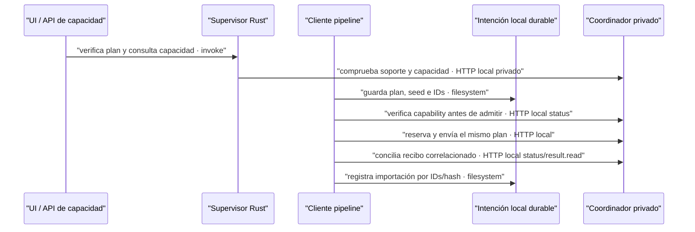

# Etapa histórica e797 — contrato previo al port selectivo

- **Fecha:** 2026-10-07.
- **Rama:** `feat/flow-tools-contract-20261007`.
- **Base del bloque:** `84b8a93ed764c1c11c0e2df38cae7d84cf049a85`.
- **Checkout:** `/Users/sebas/Documents/Vimo-Flow-QA/2026-10-07-multimagen-worktree`.
- **Contrato recibido:** `/private/tmp/vimo-flow-tools-contract-for-ui.md`.
- **Helper de extensión contrastado:** `extension/execution-plan.js`, SHA256
  `4b2bfb1c371a8a72fdcf6f4ade6da4e7115869130baaaee557cf1836cd6e95be`.

> Estado de activación superado el 2026-10-07 por [port selectivo y selección](selective-port.md). El contrato técnico de esta etapa se conserva; las frases sobre vendor/selector pendientes describen sólo e797.

La fuente incorpora DTO, validación, capacidad y transporte de un plan opcional.
El commit final de extensión y su coordinador todavía están pendientes. **No se
modifica el vendor ni se activa un selector.** Esta copia parte de producto y no
contiene el aislamiento nativo de la QA canónica: no abrirla como app QA. No se
reconstruyen SEA, wrapper o app; tampoco se toca el lote real de 323 escenas.

## Contrato exacto

```json
{
  "version": 1,
  "kind": "flow-tools",
  "toolId": "e42285e2-1038-4e24-adc1-ed30c690ab29",
  "seedMode": "provider"
}
```

`undefined` conserva RPC. `null`, otro Tool, versiones/tipos incorrectos o campos
extra no se convierten en RPC. Tools conserva `seed:null` en intención durable y
wire; no llama al generador aleatorio RPC. La API de entrada puede omitir seed
Tools, pero una semilla numérica es inválida. RPC mantiene semilla numérica y su
hash de cinco elementos. En el helper equivalente se conserva el orden de claves
canónico; no se importa código ejecutable del repo externo ni Node en React.

| Superficie                                                                | Contrato                                                                             |
| ------------------------------------------------------------------------- | ------------------------------------------------------------------------------------ |
| `bridge.status.capabilities.flowTools`                                    | `version:1`, Tool exacto, `seedSupported:false`, `requestHashVersion:1`; sin `ready` |
| `status.connections[].flowTools` / `capacity.status.profiles[].flowTools` | Capability del perfil con `ready:boolean`, opcional/null durante transición          |
| `capacity.check`, `batch.prepare`                                         | Plan opcional en el comando                                                          |
| `submit {jobs}`                                                           | Plan en cada trabajo; nunca en la raíz; página uniforme                              |
| `batch.prepared`                                                          | Plan en `batch.executionPlan`; correlación con batchId                               |
| `jobs.accepted`, snapshots/resultados                                     | Plan del recibo correlacionado con IDs/hash de la intención                          |
| Retry/borrado/recuperación                                                | IDs existentes y plan durable; ninguna preferencia actual reemplaza el plan          |

Antes de capacidad, reserva o submit Tools se lee la capability global. Rust usa
el mismo endpoint/cliente/token entre status y capacity; el cliente pipeline y el
servicio privado aplican también el guard. Ausencia o incompatibilidad devuelve
`flow_tools_coordinator_upgrade_required`, con cero admisiones Tools en el vendor
viejo. Los errores de transporte siguen siendo errores, no ausencia probada de
capability. Recuperar un medio ya confirmado no requiere readiness para generar.

La capability global sólo prueba protocolo. La capacidad específica del plan
mantiene mínimo combinado de cinco perfiles y los guards de identidad, proyecto,
pausa, conciliación, consumo, reservas e historial. Rust conserva sólo los doce códigos nuevos conocidos al cruzar al webview;
texto desconocido sigue sanitizado como `flow_unavailable`. RPC no añade consultas de
compatibilidad ni cambia su clave de caché; Tools tiene clave adicional por plan.
Refresh/verify conservan los resultados compartidos y las fences existentes.

## Hashes e intención durable

RPC: `SHA256(JSON.stringify([prompt,model,aspectRatio,seed,refs]))`;
`refs` es `references.map(r => [r.id,r.name,r.mimeType,r.sha256])`.
Tools agrega el plan canónico como **sexto** elemento y usa null en el cuarto.
El prompt se recorta y el nombre de referencia se limita antes de persistir/hash.
No agregar un sexto undefined a RPC: JSON lo convertiría en null y cambiaría IDs.

Vector sin referencias, prompt `Una casa de barro.`, modelo `HARBOR_SEAL`, 16:9:

- RPC seed 123: `0689f751e4a3e984ecb7a975a4a11808946ac98758eccfdfcb889890f1f8a935`.
- Tools: `5c9275cd1c5873d953ac0cdb72dbd3f5469bdc43c1ae881f739888295b662541`.

El lector valida plan/semilla/hash tanto en la intención actual como archivada.
El scope permanece idéntico para detectar trabajo pendiente; sólo una revisión
Tools nueva incorpora el plan. Un replay con otro plan falla cerrado. Los
resultados/ACKs de otro plan se rechazan como conflicto, sin disparar recuperación
que pudiera generar otra imagen. Pérdida de respuesta reutiliza los IDs guardados.

## Productores y recuperación

Crear persiste el plan canónico sólo si fue solicitado. Reanudar valida el plan de
metadata, sin reescribir proyectos antiguos. El pipeline no añade una consulta de
capability por el mero hecho de restaurar un proyecto; antes de reservar/enviar sí
la exige. El selector futuro deberá verificar capacidad antes de iniciar un video.

En el editor, omitir proveedor y plan hereda el proyecto. Elegir explícitamente
Flow sin plan representa una intención RPC nueva. El override se limita al
contexto del job; no muta metadata. Un mismo UUID no admite cambio de plan. Los
checks `visualSourceSceneId` y `animation_image_locked` siguen protegiendo fuente
visual y animaciones. El importador y destino `scene_<id>.jpg` no se sustituyen.

Muestras de catálogo/Mi estilo y previews de personajes transportan plan sin
seleccionar un proveedor pago por pérdida del campo. Se buscan pendientes antes
de redactar de nuevo; al recuperarlos se conserva prompt/referencias guardados.
Una intención nueva comprueba capability antes de redactar o borrar prompts.



**Contrato:** las admisiones exigen protocolo compatible y capacidad propia del
plan; una identidad durable no cambia por un reintento. **Fallo:** no hay fallback,
migración de lote, cambio de cuenta ni reanudación automática para superar un
rechazo. **Motivo:** incorporar otro ejecutor conservando el circuito de recibos
e importación existente. Esto no acredita que Google acepte Multimagen.

## Validación local y límites

Evidencia externa y scripts temporales en
`/Users/sebas/Documents/Vimo-Flow-QA/2026-10-07-multimagen-wire-evidence` y
`/Users/sebas/Documents/Vimo-Flow-QA/2026-10-07-multimagen-contract-evidence/frontend-capacity`.
No se agregan scripts de verificación o imágenes al commit. Los comandos de
reproducción y límites están en el informe del fix; un manifiesto final relaciona
hashes de fuentes, scripts, reportes y verificaciones.

- Equivalencia de helper: 196 controles, normalización/seed/vectores/revisiones/
  capabilities/comandos contra el helper de extensión contrastado.
- Cliente/storage reales: 38 controles offline de persistencia, ACK perdido,
  recibos incompatibles, gate antiguo, pérdida de capability y recuperación.
  Transporte simulado; callback de bytes/destino, sin importador JPEG real.
- Servicio: 61 controles sobre sus funciones reales de guard y result.read con
  coordinador simulado/PNG sintético. No ejercen servidor HTTP ni proceso SEA.
- Productores reales: 55 controles con IO/stages/cliente sustituidos; herencia,
  override, snapshots, prompts pendientes, revisiones y animación/fuente visual.
- React/Query/API: 162 controles; caché, verify, refresh, mínimos y errores. Un
  negativo previo de arrays decorados pasa 160/162 y la corrección 162/162.
- Rust: cuerpos reales extraídos, transporte/arranque sustituidos, 95 controles;
  negativo previo a whitelist 83/95 (faltaban doce códigos explícitos). El
  desconocido sensible sigue sanitizado. No enlaza ni ejecuta Tauri/reqwest reales.

Formato acotado con 33 archivos cubiertos, `pnpm lint`, `pnpm build`, tipos del
pipeline y comparación de 2070 claves por idioma finalizaron con exit 0.

No son una suite oficial del proyecto ni aceptación nativa. Las validaciones de
fuente no sustituyen build SEA/Tauri, prueba del paquete final, Google ni costos.
No se tocaron pausas/500/24h/concurrencia ni credenciales. El bloqueo externo de
Google observado en QA queda fuera de esta implementación.

## Pendientes antes de habilitar selección

1. Entrega final de extensión/helper/coordinador y pruebas del paquete final;
   contrastar SHA con el helper probado y portar vendor selectivamente conservando
   parches Vimo. Si cambia contrato, revisar antes de activar.
2. Selector/captura inmutable por intención en Crear, Editor/`RegenQueueEntry`,
   muestras y personajes. Sólo ofrecer Tools con capability global y readiness de
   perfiles; guardar elección con UUID, nunca reinterpretar un lote RPC.
3. Rebuild SEA/native QA desde árbol elegido, procedencia/guards, aceptación
   coordinada sin tocar lote323. No instalar este checkout directamente.
4. Aceptación real separada y autorizada. No promesa de desbloqueo ni bypass ante
   rechazos del proveedor; sin reenvíos automáticos del lote actual.
