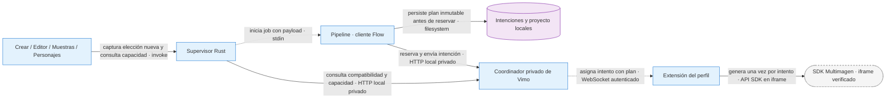

# Preparación de Multimagen sin cambiar intenciones RPC

- **Fecha:** 2026-10-07.
- **Rama:** `feat/flow-tools-contract-20261007`.
- **Base:** `344f1c45f801a7b5225d8c271c8570ec9e46a381`.
- **Alcance:** tipos compartidos y mapa de integración. No es una entrega de
  generación Multimagen ni una app QA ejecutable. La copia de preparación parte
  de producto y no contiene los aislamientos nativos de la QA canónica.

> **Registro histórico de 84b8a93e.** El contrato detallado recibido después
> sustituye el alcance preparatorio de tipos descrito aquí. La implementación y
> los límites vigentes se documentan en [integration.md](integration.md). Los
> controles de esta nota pertenecen a ese commit, no a la integración posterior.

## Implementado en esta preparación

`pipeline/types/flow-execution-plan.ts` define el plan literal acordado:
`version:1`, `kind:'flow-tools'`,
`toolId:'e42285e2-1038-4e24-adc1-ed30c690ab29'`, `seedMode:'provider'`.
Define también el valor de capability del worker, sin asumir su ubicación en
`status`: versión/toolId correspondientes, `ready:boolean`, `seedSupported:false`.

El tipo de entrada permite omitir la semilla únicamente con plan Tools. El tipo
normalizado exige `seed:null` para Tools y `seed:number` sin plan para RPC.
`FlowSavedRequest` declara explícitamente el caso RPC vigente; no se ha ampliado
su lector ni la transmisión para aceptar Tools. Los tipos se consumen mediante
`import type`, sin dependencias de Node en el contrato compartido.

Estos tipos reflejan el anuncio preliminar recibido de Root; no certifican una
versión distribuida. Comprueban compatibilidad estática, no validan JSON
desconocido, enteros, rangos, claves extra, capacidades actuales ni autenticación.
Los opcionales admiten `undefined` con la configuración TypeScript actual;
`readonly` no congela objetos de JavaScript en ejecución. La validación de
runtime se integrará junto al contrato definitivo; agregar sólo tipos no permite
activar un selector. No se modifican clientes, hashes, pausas, límites, vendor,
precios, importación ni artefactos nativos.

## Flujo propuesto, todavía no habilitado

**Contrato:** plan por intención nueva; capacidades del coordinador y del worker
más admisión completa de al menos cinco perfiles compatibles. El valor
`ready:true` del Tool no sustituye identidad, proyecto, pausa, presupuesto,
reservas, historial ni retenciones del proveedor. La política sigue siendo
500 envíos locales por perfil en 24 horas móviles y la concurrencia existente.

**Fallo:** versión/Tool ausentes o incompatibles impiden el modo nuevo. No se
convierte el lote anterior, cambia de proveedor, reintenta una generación ni
reanuda una pausa para suplir ese fallo. Los resultados se importan con el
mismo contrato existente de JPEG canónico, `scene_<id>.jpg` y recibos verificables.

**Motivo:** extender sólo el motor de generación conservando prompts, recuperación,
orden, identidad y recursos ya importados. La preparación no demuestra que
Google acepte el SDK ni resuelve por sí misma el bloqueo externo observado.

## Fronteras que hay que completar con la entrega definitiva

| Frontera                        | Cambio necesario antes de activar                                                                                                                                                                                                       |
| ------------------------------- | --------------------------------------------------------------------------------------------------------------------------------------------------------------------------------------------------------------------------------------- |
| `src-tauri/src/flow.rs`         | `public_command` hoy rechaza plan en `capacity.check`; ampliar exclusivamente con esquema estricto definitivo. Los jobs ya transportan payload/config como JSON; no ampliar `flowRuntime` con secretos o preferencias.                  |
| Tipos/API/hooks de capacidad    | Acordar anuncio exacto del coordinador y ubicación de `flowTools` por conexión. Aislar caché, `verify` y refresh por plan además de cantidad. Mantener mínimos combinados y fences de pausa.                                            |
| Crear y proyecto persistido     | Capturar elección sólo al crear una intención; `project.json` gobierna reanudaciones. No aplicar la preferencia actual a proyectos antiguos.                                                                                            |
| Editor y regeneración           | Capturar plan con UUID en `RegenQueueEntry`; agrupar sólo selecciones compatibles. No mezclar proveedor pago con plan Tools ni descartar éste silenciosamente. Conservar `visualSourceSceneId` y `animation_image_locked`.              |
| Mi estilo, catálogo y personaje | Transportar plan hasta previews/muestras Flow; validar antes de elegir proveedor/redactar. La búsqueda de lotes pendientes sigue recuperando la intención original. Clonado de estilo sigue con proveedores pagos.                      |
| Cliente y almacenamiento        | `createBatch`, `wireRequest`, `savedFlowRequests`, `validBatch`, equivalencia de revisión y recibos necesitan conservar plan/semilla. Mantener el scope que permite detectar una intención pendiente; no esconderla creando otro scope. |
| Reserva y envío                 | Acordar campos de `capacity.check`, `batch.prepare`, `submit {jobs}` y el `job.submit` hacia worker. Validar correspondencia entre plan de reserva, trabajos y recibos.                                                                 |
| Retry, galería y borrado        | Operar sobre IDs y plan ya persistidos; no reconstruir con la preferencia actual. Una revisión del proveedor no se transforma en una generación nueva.                                                                                  |

## Entrega pendiente de EXTENSION-RPC-FLOW

1. Commit final y helper `extension/execution-plan.js`: normalización, orden
   canónico, casos inválidos y vectores de hash. No se ha inventado un hash Tools.
   El hash RPC existente sigue utilizando sus cinco elementos; añadir un sexto
   `undefined` a un array lo serializaría como `null` y cambiaría ese hash.
2. Anuncio exacto del coordinador, capabilities por conexión y respuesta de
   capacidad específica del plan. Un coordinador viejo no recibe Tools.
3. DTOs definitivos y códigos de error de capacidad/reserva/submit/recibos;
   contrato de snapshots, pérdida de conexión, retry y borrado.
4. Procedencia del vendor y regresiones de reservas RPC anteriores. Incorporación
   selectiva, conservando parches Vimo; no reemplazo ciego del coordinador.

La selección permanecerá ausente o deshabilitada hasta completar estos puntos.
No se fija un default nuevo ni se interpreta ausencia de plan como Tools.

## Validación de esta preparación

Comprobaciones locales: **47/47** (11 casos válidos, 29 rechazos esperados y siete
controles de infraestructura). Incluyen plan/seed incompatibles, literales
incorrectos, capability inválida, contrato browser sin tipos Node, asignabilidad
bidireccional de recibos RPC anteriores y borrado de imports de tipos en JS.
No son pruebas de validación JSON ni de runtime.

`pnpm format --ignore-path <evidencia>/prettier-scope.ignore`, `pnpm lint` y
`pnpm build`: salida 0. El formato se limita a los tres archivos del bloque,
comprobando con `--file-info` inclusiones y exclusiones; no reformatea el vendor.
El build comprueba tipos de UI/pipeline y bundling de fuente: no se copiaron
variables de entorno, claves ni sesiones; **no acredita una app lista para login**.

Fixture local no versionado:
`node <evidencia>/check-flow-execution-types.cjs`. Evidencia fuera del repositorio
en `Vimo-Flow-QA/2026-10-07-multimagen-contract-evidence/`, con fixture, informes,
comandos, hashes y logs. Los casos negativos deben producir diagnósticos en el
caso esperado; un error de imports/configuración no cuenta como rechazo válido.

La revisión independiente de tipos no encontró bloqueos en este alcance.
No se ejecutó app, bridge, SDK, Google, generación, pagos ni vinculación. No se
compiló Rust/SEA ni se cambió el wrapper. El lote real de 323 escenas y su pausa
permanecen bajo control de Root en la QA canónica congelada; no se accedió a sus
datos para estas comprobaciones.
