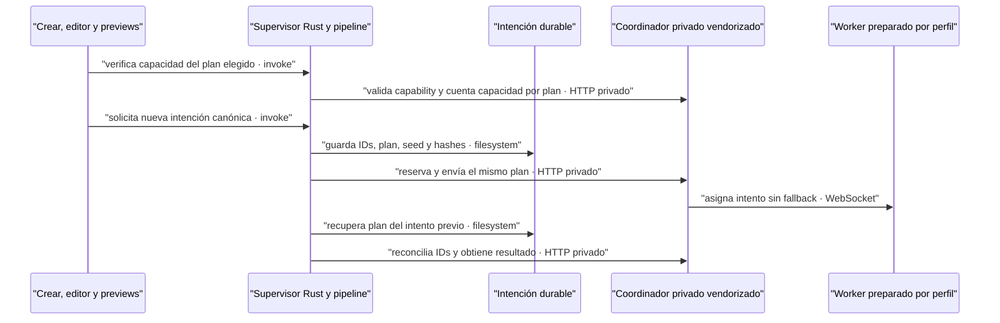

# Fuente integrada; QA nativa permanece congelada

- **Rama:** `feat/flow-tools-contract-20261007`.
- **Base inmediata:** `e79787cb680925af3446159a9c5df3a8d0a6f44a`; preparación completa desde `344f1c45`.
- **Checkout de fuente:** `/Users/sebas/Documents/Vimo-Flow-QA/2026-10-07-multimagen-worktree`.
- **Extensión:** `adc042044d8dcd709f4327375493c50fbae57d8b`, paquete 0.2.20.
- **Contrato autoritativo:** `INTEGRACION-MULTIMAGEN-VIMO.md` de ese commit.
- **Helper original:** SHA256 `4b2bfb1c371a8a72fdcf6f4ade6da4e7115869130baaaee557cf1836cd6e95be`.

Esta entrega reemplaza el estado «sin vendor ni selector» de la etapa e797.
Conserva su contrato nativo/DTO/hash/capacidad y añade selección por intención,
recuperación durable del editor y port selectivo. No equivale a instalación en
QA ni a generación real. La copia fuente no tiene los overrides nativos de QA:
**no se debe iniciar como aplicación**.

## Cambios visibles y contrato

Crear, regeneración del editor/galería, muestras de catálogo/Mi estilo y previews
de personajes comparten la elección **Flow directo / Multimagen** dentro de
Flow (Gratis). Multimagen se habilita sólo con capability global exacta y al menos
el mínimo vigente de perfiles conectados que anuncien Tools preparado. Esto
prueba preparación del ejecutor; la capacidad específica del plan vuelve a
comprobar identidad, proyecto, pausas, reservas, historial y saldo antes de admitir.
No sustituye los guards ni promete tres envíos simultáneos a una cuenta en checking.

Al seleccionar Multimagen se explica que **la semilla la elige el proveedor**.
No existe semilla numérica Tools, cambio de precio ni fallback a pago/RPC.
Pérdida de capability deja la elección visible y bloquea la generación; no la
convierte silenciosamente. Cambiar a pago/demo elimina el plan de una intención
nueva. Reanudar un proyecto sigue usando su projectId y metadata, no el selector.

En previews, elegir Flow deja el botón de generar explícito para poder escoger
el ejecutor antes de enviar. El plan queda copiado en el payload y en el scope
de consentimiento de reinicio solamente si es Tools; los scopes RPC conservan
sus bytes. Una recuperación conserva el ejecutor original y bloquea cambios de
proveedor mientras esa recuperación está pendiente.

**Contratos:** plan opcional por intención; ausencia conserva RPC. El mínimo
sigue en cinco, el presupuesto local por perfil en 500/24 h y las cuentas antiguas
con 400 conservan su saldo real. **Fallo:** incompatibilidad no admite un lote;
un medio pendiente no se regenera al recuperar. **Motivo:** cambiar ejecutor de
una nueva solicitud no debe transformar recibos ni proyectos existentes.

## Port vendorizado y procedencia

Sólo cambian `vendor/bridge/server.js`, `vendor/bridge/capacity.js`, se añade
`vendor/extension/execution-plan.js` y se actualiza su README. No se sustituye
el servidor completo ni se incorpora SDK, worker, UI o estado del repo extensión.
El helper se adapta únicamente al formato local; equivalencia AST contrastada,
por eso su SHA local no coincide byte por byte con el original.

Se conservan los parches Vimo de identidad, canje automático, arranque privado,
recuperación de descargas/snapshots atrasados y limpieza. Siete archivos previos
son idénticos; 39 funciones fuera del alcance y el arranque/cleanup permanecen
iguales. Nueve funciones afectadas coinciden con la lógica del commit externo.
La validación de estado persistido añade el plan sin migrar RPC. La falta de saldo
RPC conserva `batch_size_exceeded`; Tools usa `execution_plan_unavailable`.
Detalle y hashes del port en el README del vendor.

## Recuperación del editor tras remonte

`flowRecoverOnly:true` es una señal interna del comando de regeneración, nunca un
campo enviado al bridge. Exige UUID y un intento durable coincidente. Sin plan
explícito recupera el del recibo, aun si la metadata del proyecto fue RPC y esa
regeneración fue Tools. Valida escenas, revisión, destinos y protecciones de
animación; un plan explícito contradictorio se rechaza.

Sin intento coincidente se devuelve conflicto antes de redactar prompts,
consultar capacidad o crear una intención. La cola conserva una copia canónica
por UUID y separa batches por plan/modo de recuperación. No se borra metadata,
no se regeneran imágenes importadas y el destino sigue siendo `scene_<id>.jpg`.
Los componentes ocultan la selección de nuevo ejecutor durante esa recuperación.

## Verificación y límites

Evidencia reproducible local fuera del repositorio:
`/Users/sebas/Documents/Vimo-Flow-QA/2026-10-07-multimagen-port-evidence/`.
Los scripts son fixtures de desarrollo, no una suite oficial del repositorio.

- Vendor real: 101 controles en 13 escenarios con cinco workers sintéticos.
- Recuperación con vendor: 17 RPC y 17 Tools; cero submit/retry nuevos.
- Productores reales con IO/client simulados: 79 comprobaciones, incluyendo
  revisión/hash legacy, importación por ID, animation locks y remonte Tools/RPC.
- Crear/selector/Query: 48 comprobaciones de componentes/hooks reales, API simulada;
  restauración ProjectRunOptions: otras 12, con cableado de vistas revisado.
- Hooks de previews: 23 comprobaciones de payload, consentimiento, plan inmutable
  y rechazo de configuraciones incompatibles. No acreditan render de todos los modales.
- Editor/galería: 40 comprobaciones de componentes, API y cola reales; frontera
  invoke simulada. Previews DOM: 21/21, con contraprueba anterior 14/21; sólo
  tres bloqueos de proveedor explican los siete negativos corregidos.
- Cliente/storage, helpers service y vendor reales: 24 comprobaciones, con
  cinco workers sintéticos y transporte HTTP en memoria. Dos imágenes por modo
  RPC/Tools llegan 2→1, conservan IDs/destinos/hash/plan y se recuperan sin nuevas
  reservas/envíos/descargas. No ejercita framing/auth HTTP, SEA, Rust, JPEG importer
  ni Google.
- La contraprueba del productor e797 falla en el caso de remonte Tools que pasa
  con el productor corregido.
- Formato, lint, build y tipos pipeline se registran contra las fuentes finales.

No se ha construido ni arrancado SEA, app nativa o wrapper en esta fase. No se
ha concedido permiso de Chrome, ejecutado SDK real contra Google ni probado una
nueva imagen. El bloqueo externo anterior sigue sin diagnóstico de desbloqueo.
La demora de navegación WebKit continúa separada y no se declara arreglada.

## Preparación siguiente QA — no ejecutada

1. Root coordina cierre de la QA canónica y comprueba puertos libres. Preserva
   snapshot/huellas del lote 323, manualPaused, intenciones y archivos importados.
   No consultar claves ni copiar cookies/sesiones.
2. En una rama QA auditar preimágenes de este rango fuente frente a frontend
   5b11d711 y los overrides aprobados. Portar sólo las rutas de esta integración;
   no arrastrar ancestría completa ni reemplazar Rust/config QA a ciegas.
3. Mantener identifier, namespace keychain sin migración legacy, dataStore WebKit,
   projectsRoot, perfil OAuth Beta exclusivo, callback localhost:5173 y strictPort,
   coordinador QA43137 y datos persistentes. Nunca usar43127.
4. Como cambian pipeline/vendor y DTO Rust respecto al artefacto congelado,
   reconstruir SEA y Cargo DEV en esa ventana con inputs exactos, smoke aislado,
   manifiestos de fuentes/binarios, wrapper firmado y guardas comprobadas. No
   actualizar sólo un hash esperado para aceptar un binario de procedencia incierta.
5. Root inicia la única QA canónica. Antes de acciones comprueba lote323 RPC,
   mismos IDs/hash/semilla/pausa, cero nuevos intentos y conservación de vínculos.
   No convertir ni reanudar ese lote por instalar el código.
6. Con permiso explícito del usuario, preparar Tools en cada perfil y comprobar
   capability global/perfiles/capacidad del plan. Cero generación por preparar.
   Una prueba de nueva intención, referencias/orden/importación/recuperación se
   coordina aparte; no se presupone que Multimagen elimine el rechazo Google.

Esta entrega autoriza revisar/preparar fuente; el arranque e instalación en la QA
activa siguen bajo coordinación de Root. Sin push ni publicación.
