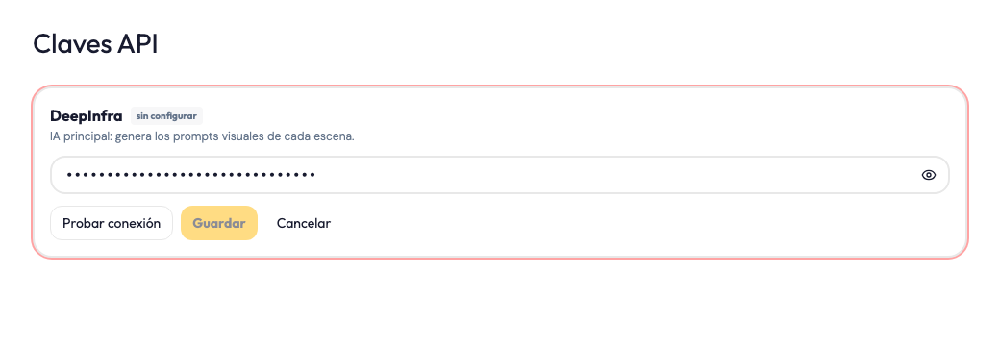
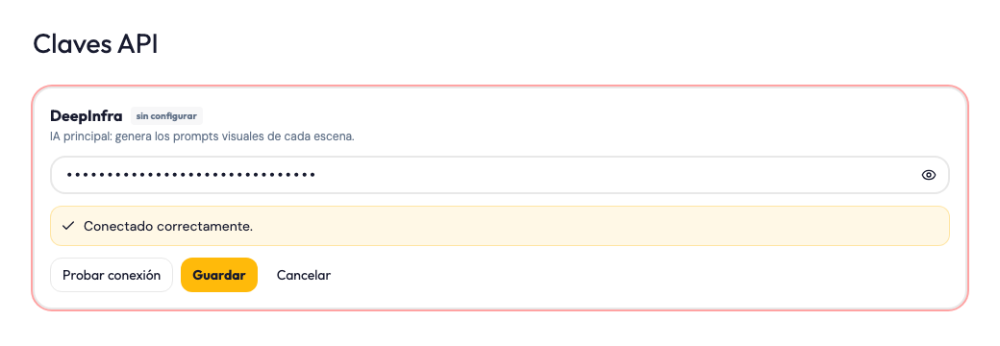
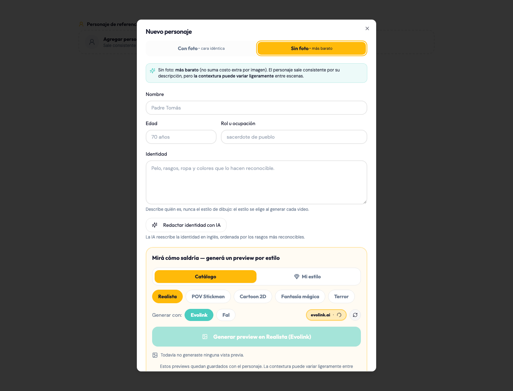
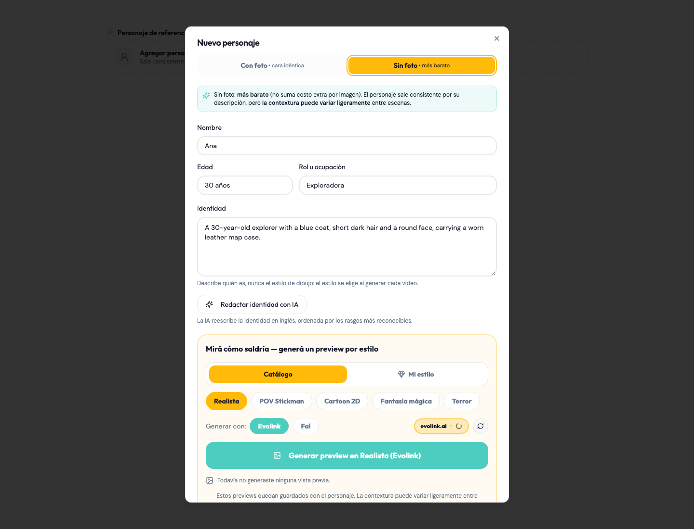
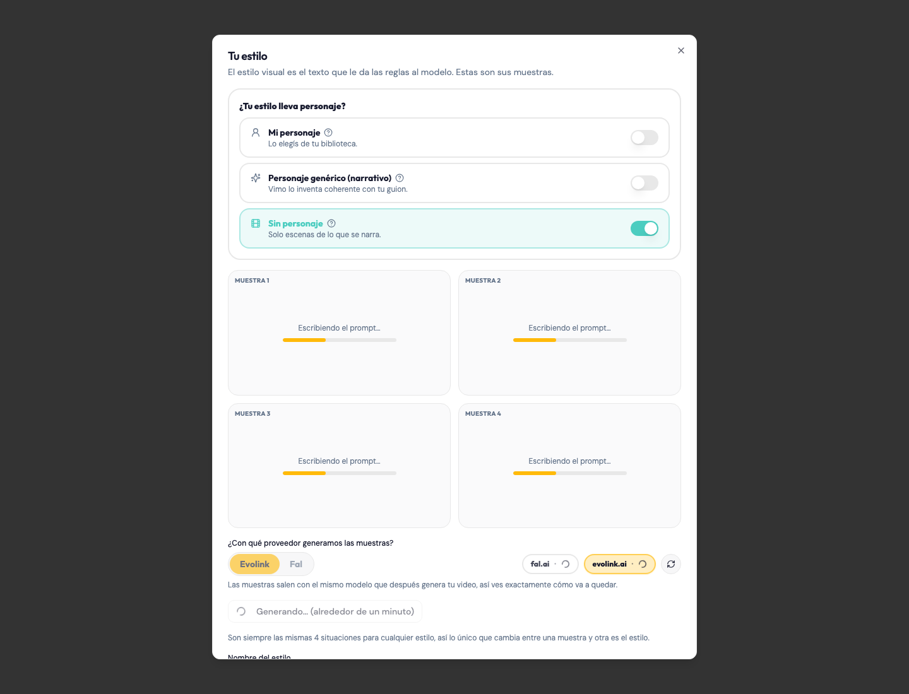
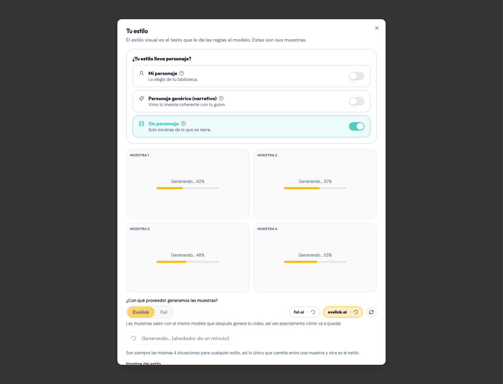
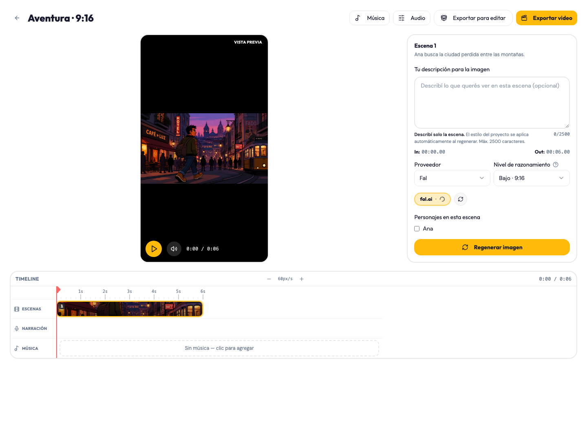
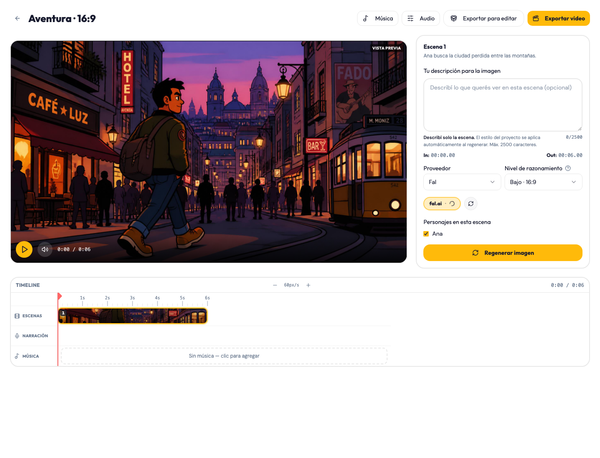

# Evidencia visual — correcciones de Vimo

Fecha: 2026-09-13. Rama: `feat/fix-bugs-vimo`. Destino del PR: `dev`.

Estas son capturas de componentes React reales con el CSS del build, tomadas en
Chrome aislado. No son mockups ni imágenes generadas para representar una UI.
Las APIs, proyectos, resultados de IA y porcentajes son **fixtures ficticios**:
documentan los estados visibles, no prueban latencia ni calidad del proveedor.
No contienen claves, cuentas ni proyectos reales del usuario.

## Claves API

Antes de probar la conexión, una clave escrita no habilita Guardar.



Después de una respuesta exitosa para esa misma clave, Guardar se habilita.
Editar el valor invalida esa autorización. La respuesta de conexión aquí es simulada.



## Identidad desde Catálogo

Con guion cargado y biblioteca vacía, Crear personaje permite redactar con IA
aunque los campos estén vacíos. Los textos grises de esta captura son placeholders.



La respuesta completa llena nombre, edad, rol e identidad; `30 años` es un valor
del input, no su placeholder. La captura usa una respuesta ficticia controlada.



## Previews de Mi estilo

Las cuatro tarjetas se mantienen visibles mientras se redactan los prompts.
Las barras de texto representan avance estimado, no porcentaje real del LLM.



En la fase de imágenes, cada tarjeta muestra su progreso. Los porcentajes de
esta captura son ficticios; la concurrencia de peticiones se comprueba con
`scripts/check-preview-regressions.mjs`, no con una imagen estática.



## Editor: Exportar y selección de personaje

Short 9:16: Exportar video en el header, sin flotante sobre el timeline. El panel
muestra el personaje desmarcado antes de regenerar.



Formato largo 16:9: misma ubicación; personaje marcado en el panel.



La imagen del visor en ambos casos es la referencia estática ya existente
`public/style-references/cartoon_1.jpg`, usada solo para mostrar el layout.
**No es una regeneración** ni evidencia de presencia/ausencia de Ana, estilo o
fidelidad narrativa. Cambiar el checkbox conserva la imagen anterior hasta una
regeneración explícita. El guardado, rollback y prompt según selección se verifican
en los scripts del editor y en la QA manual con proveedores.

## Reproducir las capturas

Desde la raíz del repo, con dependencias instaladas y Chrome disponible:

```sh
pnpm build
node scripts/capture-bugfix-pr.mjs
```

El script acepta la ruta del ejecutable Chrome como primer argumento. Usa un
perfil temporal propio, no abre la app instalada, no guarda claves y no genera
imágenes ni videos pagados. Las capturas se escriben en esta carpeta.

Las comprobaciones funcionales están documentadas en [los informes de cada corrección](../../fixes/)
y la auditoría inicial [HTML](../2026-09-12-vimo-bugfix-audit.html) / [PDF](../2026-09-12-vimo-bugfix-audit.pdf).
Los informes de personaje del editor, claves API y ADR-0017 complementan el PDF
con los ajustes posteriores. Windows empaquetado requiere validación propia.
