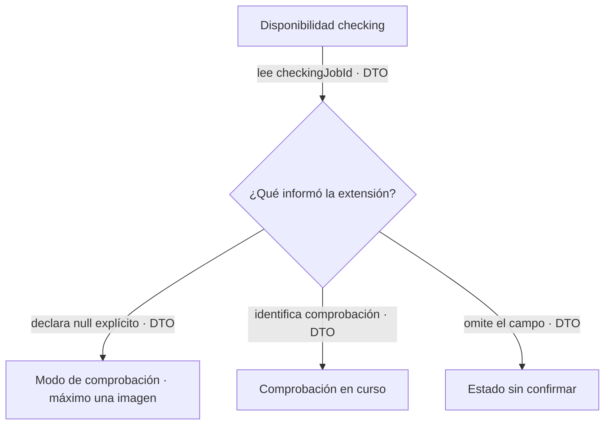

# Fix: distinguir comprobación disponible de comprobación en curso

- **Fecha:** 2026-10-07.
- **Rama:** `fix/flow-generation-controls-20261007`.
- **Base:** `8230d4eb62ffd7b1e742ad7b286d743315667b26`.

## Causa

Root comunicó un snapshot nativo de cinco identidades verificadas y cinco cuentas
con capacidad, con cuatro tarjetas Comprobando y una Lista, sin jobs ni envíos.
No era una contradicción del conteo: `capacityReport` y el despacho permiten
`checking` con `checkingJobId === null`, con límite de una imagen por perfil.
Una comprobación con ID ocupa ese permiso; un campo ausente no equivale a null.

El DTO del bridge ya conserva `checkingJobId` y Rust devuelve el resultado JSON
sin recortar ese campo. Faltaba declararlo en TypeScript y usar su semántica en
presentación. Las tarjetas agrupaban todos los checking como una operación
activa; el panel de generación los trataba como hold externo y el resumen podía
decir listo sin advertir del límite. Las razones de reservas también podían
presentarse incorrectamente como una comprobación en curso.

## Corrección

La UI tipa el campo opcional y comparte su clasificación, sin modificar admisión:

**Contrato:** null explícito describe modo limitado; no acredita saldo, reservas,
identidad, frescura o ausencia de pausa. **Fallo:** un dato ausente/incompleto nunca
se interpreta como disponible ni como trabajo activo. **Motivo:** presentar el
mismo significado que el coordinador sin alterar su política de recuperación.

- Tarjetas y detalles conservan prioridad de offline, identidad y proyecto;
  explican cuándo aún no hay comprobación en curso y cuándo ya hay una imagen.
- El conteo se nombra cuentas disponibles, no cuentas plenamente listas. Mantiene
  disponibles/vinculadas y mínimo cinco separado. Si se cumple el mínimo con
  cuentas limitadas, badge y detalle explican disponibilidad limitada y conservan
  el desglose por cuenta.
- El panel de generaciones separa modo limitado, comprobación activa y estado
  sin confirmar de los holds reales. Pausa manual, cooldown, revisión del
  proveedor y deshabilitación siguen presentes; no se ejecuta ninguna acción.
- Capacidad y motivos de bloqueo usan ayudas coherentes. Una reserva en un perfil
  checking/null no dice que haya una comprobación en curso. ES/EN/PT completos.

## Límites deliberados

Sólo frontend. No se cambia vendor, Rust, scheduling, `capacityReport`,
`profileEligible`, preflight, reservas, recuperación ni datos. El SEA
`d8b78c91a87e5e09808620e8d2db7f70e7488fc709da4ada1b65db82191d2912` y el wrapper
staged de8230d4eb siguen válidos; no se recompilan ni se prueban otra vez sin
cambio. La extensión0.2.18/6547a8c ya se incorporó selectivamente en8230d4eb.

El refresh de8230d4eb comparte resultado y espacio estable. Root confirmó por AX
que ruta y detalle se conservan; no se afirma recarga total. Layout, scroll y
pintado de WebKit requieren la ventana nativa de Root, no se certifican por SSR.

## Validación reproducible

Fixture local fuera de Git: compila utilidades/componentes reales, compara fuente
8230d4eb con el complemento y usa hooks controlados en memoria. Cubre null/ID/
ausencia, cinco disponibles con cuatro limitadas, precedencia de identidad y
proyecto, pausas/holds y reservas. El vendor puro se usa como referencia para
`[1,1,1,1,500]` de capacidad; no se conecta al bridge abierto ni genera imágenes.
Los resultados definitivos viven en `generation-controls/checking-availability/`.

Ejecutar `pnpm format`, `pnpm lint`, `pnpm build` y `node scripts/test/check-locales.mjs`
en la copia aislada. El informe de entrega registra resultados y hashes finales.

## Pruebas manuales realizadas

Ninguna mutación ni prueba nueva en runtime. El snapshot y la comprobación AX
anteriores fueron comunicados por Root; no son una ejecución de esta sesión.
La QA servida continúa sin HMR ni cambios de código, sesión, datos o procesos.
Pendiente instalar ambos commits en ventana coordinada y verificar tarjetas,
badge, detalles y layout real. Cero generaciones, pagos y llamadas a Google.
