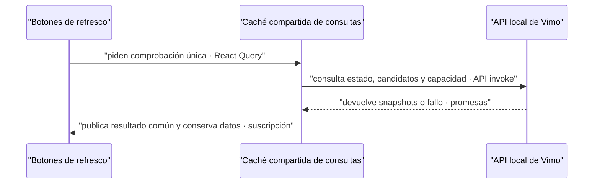

# Fix: cuentas preparadas, pausa explícita y refresco estable

- **Fecha:** 2026-10-07.
- **Rama:** `fix/flow-generation-controls-20261007`.
- **Base:** `8e3f371e` sobre `718eac29`; trabajo en copia aislada.

## Causa

El detalle interpolaba cuentas listas sobre el mínimo, produciendo «5 de3» aunque hubiese cinco vinculadas. La UI heredaba mínimo3 del bridge y no imponía el nuevo mínimo de producto5. Vinculación, preparación y pausa aparecían mezcladas; la pausa persistente podía bloquear generaciones sin un CTA suficientemente visible. Un control de pausa se ofrecía también sin trabajo.

El refresco conservaba feedback local por instancia. Después de fallar un botón, otro podía seguir mostrando su éxito previo; desmontar todos borraba ese feedback. El texto cambiaba el ancho del botón y un párrafo condicional alteraba el espacio ocupado. Además, un error de capacidad devolvía `null` y retiraba las listas previas. La prueba anterior no navegaba ni desmontaba el formulario: no está demostrada una recarga completa de página ni una causa WebKit/App Nap.

La verificación previa de generación sólo renovaba capacidad. Durante el desfase entre pausa global y ACK del worker podía recibir capacidad positiva; faltaba comprobar también el estado global fresco.

## Corrección

- `FlowAccountCounts` comparte «listas de vinculadas» en Extensión, detalle y capacidad de Crear/Editor/previews. Mínimo obligatorio5 en fila independiente; máximo de diez vinculaciones permanece separado. `flowMinimumProfiles` impone suelo5 y conserva una exigencia superior del coordinador.
- Estado y capacidad invalidan autorización ante errores, aunque conservan el último snapshot para evitar vaciar tarjetas. El preflight consulta ambos, exige cinco listas, ausencia de pausa global/manual y `canPrepare` verdadero. El servidor sigue siendo la autoridad de admisión y despacho. La galería usa ese mismo preflight con el número exacto de escenas seleccionadas; deja de aceptar únicamente `canPrepare` de una consulta independiente.
- `FlowGenerationControls` distingue generaciones pausadas por el usuario, espera/revisión externa y trabajo en curso/cola. Reanudar sigue accesible ante pausa manual, incluso idle o con lectura fallida; antes del comando conserva el baseline fresco del hook. Pausar se ofrece con trabajo/cola o una operación pendiente. Recibos inciertos y reservas se consideran trabajo de manera conservadora sólo para visibilidad.
- Cada composición tiene un único dueño del CTA. Abrir el detalle no duplica Pausar/Reanudar; durante recuperación, el badge conserva el control cuando no se monta el panel de capacidad.
- `useFlowRefresh` usa una consulta compartida iniciada únicamente por clic, sin cancelación por segundo clic. Todos los botones comparten operación, feedback y error, incluso tras remonte. Conserva cachés durante el chequeo y espera todas las lecturas antes de confirmar. La consulta local no queda detenida por `navigator.onLine`.
- Botón de refresh con texto fijo, icono de actividad, espacio estable para dos líneas y detalle completo accesible por foco/tooltip. Catálogos ES/EN/PT completos.

**Contrato:** sólo el clic inicia esta comprobación; concurrentes comparten operación y un fallo no se convierte en éxito. **Fallo:** se conservan datos anteriores identificados como desactualizados y se bloquea generación. **Motivo:** mantener continuidad visual y una misma respuesta en todos los controles. No cambia el protocolo Tauri ni la persistencia del bridge.

## Límites deliberados

El mínimo5 también se incorpora al coordinador mediante port selectivo de
`MIN_LINKED_PROFILES` desde extensión0.2.18,
`6547a8c2156b2a59b44b4c6a25e27d7d1f509272`. Es el único archivo backend modificado
por ese commit externo. Se conservan los demás parches propios y los planes
ya preparados; no hay migración de estado ni readmisión de recibos. El SEA se
reconstruyó y validó fuera de la QA servida: SHA256
`d8b78c91a87e5e09808620e8d2db7f70e7488fc709da4ada1b65db82191d2912`.

Sin cambios en auth/licencia, proveedores pagos, proyectos, referencias, `visualSourceSceneId`, `animation_image_locked`, cadencia, concurrencia ni cuotas500/24h. No se reanuda ningún hold de proveedor automáticamente. Lista no garantiza todas las condiciones de admisión; capacidad y preflight siguen comprobándolas.

No se tocó la QA servida `3c06d605`, su HMR, procesos, perfiles, appData, llavero, login o puertos43127/43137. La aceptación nativa del fix previo13:37–13:39 no se reutiliza como aceptación de este cambio.

## Validación reproducible

Los scripts son fixtures locales fuera de Git, no tests oficiales del producto. Compilan componentes/hooks de esta fuente; API shim en memoria, sin Google ni datos reales.

- Contadores:70 comprobaciones aprobadas. `node <entrega>/generation-controls/validation/validate-counts.cjs`. ES/EN/PT, Extensión/Detalle/CapacityNotice; control negativo `8e3f371` reproduce5de3; suelo5, mínimos superiores, error que conserva listas y preflight con pausa/error global.
- Pausa: `node /private/tmp/check-flow-generation-controls-20261007.mjs`;42 casos React/TanStack reales, incluidos deadline15s, ACK tardío, dobleclic, baseline fallido y refresh concurrente. Confirmación previa:11 casos de latch.
- Composición: `node /private/tmp/check-flow-controls-composition-20261007.mjs`;18 casos SSR, negativo2CTA→1 y recuperación con un solo CTA.
- Refresh:29/29 comprobaciones aprobadas;15 fallaban en el control anterior. Fixture before/after React/TanStack/jsdom con controles negativos, lecturas parciales fallidas, remonte y clic real. Evidencia durable en la entrega externa `generation-controls/refresh/`; no equivale a píxeles de WebKit.
- Ejecutar `pnpm format`, `pnpm lint`, `pnpm build` sobre la copia aislada; format/lint/build exit0. Catálogos alineados:2051 claves en cada idioma.

- Galería:7 escenarios con `useGalleryActions` y `useFlowCapacity` reales. Seis controles negativos del preflight anterior admitían; ahora rechazan con cero llamadas a regenerar. Cinco listas admite; IDs duplicados consultan sólo el número de escenas únicas. Sin transporte real.
- SEA real:29 comprobaciones aprobadas con tres procesos efímeros cerrados exit0. Control negativo anterior `036584…` admite3; nuevo `d8b78…` rechaza3/4 sin crear lote y admite5. Lote previamente preparado con3 conserva ID, asignaciones, reservas y replay idempotente. Máximo10, rechazo de scheduling4, política500/24h y pausa/reanudación comprobados. Cero `job.submit`, jobs y Google. No es un benchmark de generación.
- Artefacto DEV preparado sólo en staging con main fuenteQA `914fe1b`; firma deep strict aprobada.13/13 hashes de aislamiento/runtimeQA previos intactos; no instalado ni iniciado. La fuente pipelineQA sólo difiere por constante5 y README, sin omitir overrides.

## Pruebas manuales realizadas

Ninguna nueva sobre la app nativa: Root conserva su runtime. No hubo generaciones, pagos ni llamadas a Google. Pendiente aceptación coordinada en QA: cinco de cinco y mínimo separado; pausa idle/Reanudar; hold externo persistente; refresh durante scroll y detalles abiertos; fallo que conserva tarjetas y bloquea generación. El SEA de mínimo5 ya está comprobado en aislamiento; su instalación requiere la ventana de Root.
