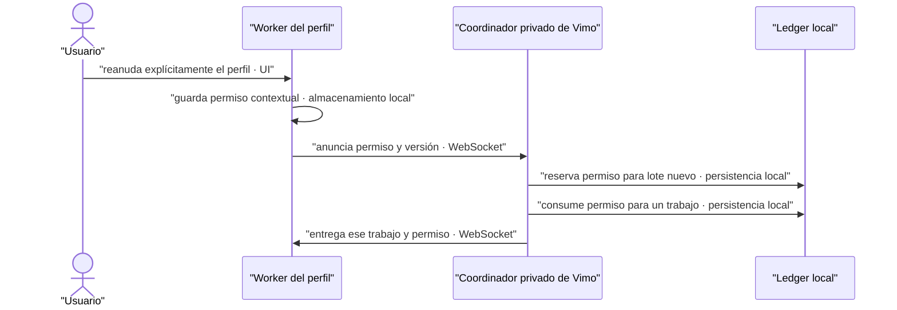

# Fix: una comprobación nueva con permiso explícito de perfil

- **Fecha:** 2026-10-10
- **Rama:** `fix/flow-qa-recovery-permit-20261010`
- **Base QA:** `ceed1fca50bdde888ad7e7d755c4deca2e954937`

## Causa

En checking, un `unknown` histórico ocupaba la única plaza de comprobación.
Reanudar explícitamente el perfil no podía admitir una intención nueva aunque
quedaran plazas físicas. Con tres perfiles en ese estado, el lote nuevo no
alcanzaba el mínimo de cinco. Excluir unknown de cuota o concurrencia borraría
una incertidumbre real y permitiría exceder los límites.

## Corrección

Port selectivo del parche aprobado por la sesión de extensión, SHA-256
`3d95e9c5e0f56b029029a5bf83d9a2bce12da0ef9a33f711c64e3d0f343efe03`,
entregado sobre `698ef1f` (el delta de permiso no pertenece a ese commit).
Tres módulos del bridge y un helper nuevo implementan el protocolo optativo
`recoveryPermitVersion:1`. Los demás archivos de producto permanecen intactos.

**Contrato:** un permiso durable por cuenta/proyecto/binding, secuencia monótona,
un lote y un trabajo; persistencia antes del ACK o envío. Los unknown conservan
cuota, historial y concurrencia. Se suma actividad remota y local de manera
conservadora, se exige mínimo cinco y se mantienen pausas y holds.
**Fallo:** permiso inválido, gastado, ajeno, snapshot antiguo, falta de plaza o
fallo de persistencia no autorizan envío. Cancelar no devuelve el permiso.
**Motivo:** separar un gesto explícito de comprobación del estado automático
checking, sin reinterpretar recibos inciertos ni reenviarlos.

Se conservan los parches de Vimo: 400/500 por worker, identidad/vinculación,
recuperación del mismo medio, snapshots tardíos, servicio privado y lifecycle
SEA. No se incorpora `connection.test`; el worker no está vendorizado aquí.
El DTO Rust ya transporta JSON y no necesita nuevos comandos.

## Límites deliberados

- No se modifican UI, editor, escenas, prompts, seed, requestHash ni executionPlan.
- No se resuelven ni reenvían los tres unknown reales; tampoco se reanuda nada.
- La reanudación global de Vimo no emite un permiso nuevo de perfil.
- Workers antiguos conservan su contrato; no se infiere compatibilidad.
- Se prepara una copia aislada y artefactos; instalación y arranque canónicos
  quedan bajo Root en una ventana coordinada. No se publica.
- La preparación no prueba Google, extensión real ni importación de imágenes.

## Validación reproducible

La evidencia temporal se conserva fuera del repo en
`/private/tmp/vimo-ui-permit-20261010-pniarkxu/`. Debe trasladarse antes de limpiar
TMP. No se agrega un framework ni se versionan fixtures locales.

1. Verificar SHA-256 del parche y preimágenes; revisar `port-adaptations.json`.
2. Ejecutar `node check-vendor-permit.mjs after permit-fixture`: 36/36 controles
   del contrato aprobado sobre los cuatro archivos vendorizados, incluidos
   permisos durables, mínimo cinco, suma de actividad, replay y worker simulado.
3. Ejecutar `pnpm format`, `pnpm lint`, `pnpm build`. En esta copia las dependencias
   se copiaron sin enlazar el directorio original: se usa
   `pnpm_config_verify_deps_before_run=warn` para avisar del cambio de ruta sin
   reinstalación automática. No se modifica configuración de producto.
4. Reconstruir SEA con el Node oficial pineado mediante `scripts/build-sidecar.mjs`.
   Ejecutar el smoke aislado con el SHA del artefacto y HEAD exactos; sólo puertos
   efímeros, cinco workers sintéticos y red saliente denegada.
5. Cargo DEV `--no-default-features --message-format=json`, deployment target14;
   comparar los 107 inputs nativos con el baseline QA. Envolver sólo el DEV
   comprobado, usando launcher y runner originales; verificar firma y guardas.

Los informes de build, smoke y wrapper acompañan la entrega local con hashes;
no se considera una prueba real de Google ni una instalación exitosa.

## Pruebas manuales realizadas

Ninguna sobre la app, perfiles o jobs reales. Root mantiene control exclusivo.
El estado comunicado antes del port es 333 trabajos: 318 cancelados, 10 fallidos,
2 listos y 3 inciertos. Esta sesión no abrió ni alteró ese ledger.
