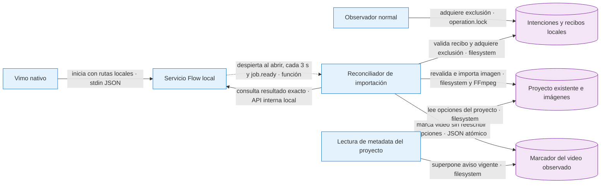

# Fix: importar resultados Flow listos al reabrir Vimo

- **Fecha:** 2026-10-11
- **Rama:** `fix/flow-qa-recovery-permit-20261010`

## Causa

El coordinador y los workers conservaban sus recibos, pero el observador de imágenes nativo vivía en el proceso del pipeline. Al cerrar Vimo se perdía ese observador: reabrir arrancaba el puente, pero no importaba por sí solo los resultados ya listos. Reutilizar `generateFlowBatch` como reconciliador sería incorrecto: esa función también puede preparar y enviar trabajos faltantes.

## Corrección

Un reconciliador en el servicio Flow realiza un barrido inicial, se despierta ante `job.ready` y repite cada tres segundos mientras la app permanece abierta. Sólo acepta intenciones nuevas que persisten `autoRecoveryVersion: 1`, pertenecen a proyectos existentes bajo la raíz configurada y conservan el mismo scope, lote, imagen, hash de solicitud y plan Tools.

Usa el mismo `operation.lock` que el observador normal: omite al dueño vivo y sólo puede recuperar el lock de un proceso terminado mediante el helper existente. Antes de publicar comprueba de nuevo escena, estilo, referencias, destino y revisión; reutiliza `importFlowImage`, sus locks y la protección frente a una imagen local más nueva. Guarda primero el archivo del lote y después `current.json`, como el observador original. Una caída después de publicar la imagen y antes de guardar el recibo se recupera con los mismos bytes sin volver a generar ni sobrescribir una edición posterior.

El arranque Rust entrega únicamente la raíz local de proyectos y FFmpeg; no entrega credenciales al reconciliador. La entrada de arranque antigua sin ambos campos sigue siendo válida y deja este reconciliador desactivado. El estado público añade `nativeImport`: `instanceId`, `running`, `pending`, `imported`, `failed` y `lastErrorCode` de vocabulario cerrado. `imported` es acumulativo durante el proceso del servicio; no contiene rutas, identificadores de trabajos, prompts ni secretos. `instanceId` es un UUID no secreto por instancia; la Biblioteca observa ese identificador junto al contador para refrescar también cuando el servicio reinicia y ya importó antes del siguiente sondeo.



**Contratos y fallos:** el reconciliador sólo consulta estado y un resultado ya listo. No llama prepare, submit, generate, cancel ni LLM. Un lock vivo, resultado pendiente o incertidumbre conserva el trabajo; una revisión, hash, MIME o scope distintos bloquean la importación. Los fallos de escritura no se anuncian como importación completada. El siguiente barrido puede reintentar únicamente la importación local idempotente.

## Límites deliberados

- No migra intenciones históricas ni recupera resultados por proximidad de tiempo o contenido.
- No genera resultados nuevos, no reanuda tareas audiovisuales completas y no borra errores ajenos del proyecto.
- Sólo proyectos existentes, hijos directos de la raíz recibida al arrancar el servicio. No crea proyectos ni sigue enlaces simbólicos de proyecto/escenas/metadatos/referencias/destino.
- La raíz queda fijada durante la vida del servicio; un cambio de configuración se aplica al siguiente arranque.
- El contador `imported` se reinicia con el servicio; `instanceId` distingue reinicios incluso con contador igual o menor sin observar cero.
- Tres segundos es la cadencia del barrido, no un plazo duro para FFmpeg, disco o cierre del servicio.
- La exclusión compartida protege al observador normal de Flow; no cambia el esquema global de tareas del editor.

## Validación reproducible

Fixtures temporales fuera del repo, sin llamadas al proveedor ni cambios en proyectos reales:

```sh
node /private/tmp/vimo-recovery-import-20261011/build-test.mjs
node /private/tmp/vimo-recovery-import-20261011/check.mjs
node /private/tmp/vimo-recovery-import-20261011/check-hook.mjs
node /private/tmp/vimo-recovery-import-20261011/typecheck.mjs
node /private/tmp/vimo-recovery-import-20261011/lint.mjs
rustfmt --edition 2021 --check /private/tmp/vimo-recovery-import-20261011/candidate/src-tauri/src/flow.rs
```

Resultados del candidato: **29/29** casos sobre funciones reales de revisión, storage, locks, importación y FFmpeg local; **6/6** casos del parser real de arranque. TypeScript, ESLint focal y rustfmt pasan. Incluye reopen idempotente, lock vivo, rechazo de scope/rutas/revisión obsoletos, cambio de estilo/referencia, correlación/hash/MIME/base64, escritura fallida y recuperación tras publicar JPEG antes del recibo, dos observadores concurrentes, polling sin click y cancelación durante lectura. Cero llamadas de red/proveedor.

Los tests y sus imágenes de fixture son temporales; no se incluyen como tests oficiales ni artefactos del repositorio. Esta validación del candidato no sustituye la compilación/aceptación del artefacto integrado.

## Pruebas manuales realizadas

Abrí el wrapper final de Vimo QA0.10.0 por la lanzadera guardada, confirmé cinco perfiles preparados en la ruta Extensión y abrí el proyecto real Elías/Claymation16 con audio de1:18 y16escenas pendientes. Actualicé QA01a0.2.30 por UI; preparación y vínculo se conservaron, y el puente confirmó recuperación1. Las otras cuatro instalaciones están pendientes. No se generaron imágenes nuevas con esta versión ni se certificó todavía cierre/reapertura durante una generación Google.

### Corrección de concurrencia de metadatos

La revisión independiente encontró una carrera real en el primer candidato: `markVideoOutdated(paths, snapshot)` reescribe todo `project.json`. Si una edición de mezcla guardaba `voiceVolume: 0.4` después de leer el snapshot con volumen `1`, el importador restauraba `1` al marcar el video. La prueba temporal reproduce ese orden con `readProjectMetadata`, `updateAudioMix` y `markVideoOutdated` reales.

El importador deja de escribir `project.json`. Tras importar guarda exclusivamente un marcador de invalidación `.flow-video-outdated.json`, mediante escritura atómica estricta, que contiene versión 1 e identidad stat del video existente (`dev`, `ino`, `size`, `mtimeNs`, `ctimeNs` como cadenas). `readProjectMetadata` superpone `videoOutdated: true` sólo cuando el marcador coincide con el mismo video. Nunca limpia una invalidación persistida ni borra un marcador durante la lectura. El render normal ya guarda `videoOutdated: false`; reemplazar o sobrescribir el mp4 cambia su identidad y deja inactivo el marcador anterior.

El marcador admite sólo un esquema cerrado de hasta 2048 bytes, archivos regulares y video regular sin symlinks. No crea directorios ni recrea proyectos eliminados. Debe guardarse antes del recibo `imported/completed`: si falla, la imagen puede estar publicada, pero el recibo permanece pendiente y sólo se repite su importación idempotente. La identidad stat evita que el marcador de un mp4 anterior contamine uno nuevo; no demuestra qué imágenes consumió un render concurrente. No se migran aquí todos los escritores preexistentes de metadatos.

Pruebas de este ajuste (sin app, red ni proveedor): **16/16** sobre la carrera/marker con funciones reales, incluyendo proceso nuevo, render por reemplazo/in-place, invalidación persistida, esquema, symlinks y escritura fallida; **31/31** del importador completo, incluyendo marcador antes del recibo y project.json intacto. TypeScript y ESLint focal pasan.

```sh
node /private/tmp/vimo-import-metadata-race-20261011/build-test.mjs
node /private/tmp/vimo-import-metadata-race-20261011/check-marker.mjs
node /private/tmp/vimo-import-metadata-race-20261011/check-importer.mjs
node /private/tmp/vimo-import-metadata-race-20261011/typecheck.mjs
node /private/tmp/vimo-import-metadata-race-20261011/lint.mjs
```

Esta sección reemplaza la invalidación de metadatos del candidato inicial; no cambia la política de generación, los hashes de solicitudes ni los jobs históricos. La lectura independiente de los tres archivos no encontró otros bloqueos; la aceptación sobre el artefacto integrado sigue pendiente.

### Actualización de Biblioteca tras reinicio

La contraprueba anterior basada sólo en el contador perdía invalidaciones al saltar entre instancias de cinco a uno o de cinco a cinco sin observar cero. El hook compara `instanceId` y `imported`, ambos en las dependencias del efecto. **16/16** pruebas temporales pasan con semántica de dependencias y cliente estable (`node /private/tmp/vimo-panel-auto-20261011/check-native-refresh.mjs`); la contraprueba del contador anterior falla como se esperaba. Compilación integrada y aceptación visual se verifican por separado.

### Ejecutable integrado y preservación histórica

El SEA final `5ba18ad240a1b80ab9a0fb7c9a61fb869cda602b5e3eed61aef4eea765d96c67` pasa **8/8** controles de coordinación y **5/5** de importación con red saliente bloqueada. Se comprueban ambas órdenes de ganador tras120s reales, importación PNG→JPEG con FFmpeg real, metadata intacta, marcador y reinicio sin nuevos envíos. Estas pruebas usan fixtures, no Google.

Los438jobs previos y sus lotes permanecen conservados. Al arrancar,105ready añadieron únicamente `attentionIncident:null`, normalización que ya existía antes del parche; quitar sólo ese campo recupera exactamente cada hash original. Los otros333jobs y todos los lotes mantienen hash bruto. El auditor conserva la diferencia raw y rechaza cualquier otro cambio; no se reescribió el ledger para ocultarla. Evidencias en la carpeta externa `2026-10-11/automatic-recovery/evidence/`.

### Aceptación real de importación al reabrir · 2026-10-11

Este resultado reemplaza el estado pendiente de proveedor/reapertura indicado en las secciones anteriores. El lote nuevo `cfcf15ec-dd7f-4b86-94f0-5b10022250d0`, con cinco extensiones 0.2.30, generó 16/16 JPEG 1376×768 del guion real de Elías con Claymation y siete referencias de personaje. Se cerró Vimo QA durante el lote y antes de reabrir se registraron 14 ready y dos generating; después quedaron 16 imágenes importadas y visibles sin pulsar Recuperar/Reanudar ni volver a generar. Las cinco cuentas terminaron ready y sin pausa.

El auditor validó 24 contratos, 16 envíos confirmados, cero reintentos/sustituciones, recibos/contenido/referencias/modelo exactos y preservación de 438 históricos y cinco lotes con la excepción null ya documentada. Revisión visual por SHA: estilo/personaje reconocibles, pero texto incidental no solicitado en escenas 1/4/15/16 y diferencias de encuadre. La aceptación es funcional; no acredita fidelidad perfecta al prompt ni failover real en un lote sin errores. Evidencias: `2026-10-11/automatic-recovery/evidence/qa16/audit-reviewed.json`, `visual-review.json` y capturas fuera del repositorio.

La extensión 0.2.31 corrige aparte una pausa manual tras preparación local fallida: QA01 actualizada y preparada sin Reanudar; el pendiente de QA02–QA05 de ese corte queda superado por la comprobación siguiente. Ese parche del worker/panel no cambia este ejecutable y su recuperación temporal sólo se probó con respuestas controladas.

### Cinco cuentas con 0.2.31 · 2026-10-11

Reemplaza el pendiente de actualización anterior: el usuario confirmó 0.2.31 en los cinco perfiles; QA01 también tiene versión observada por UI. El puente no anuncia manifest.version, por lo que no se atribuye una lectura independiente de versión a QA02–QA05.

Desde la UI oficial de Vimo QA se inició una sola vez el lote `a35ca5d6-4ea1-4867-b69a-2868342ad430`, en otro proyecto de cinco escenas, con un fragmento real de 25 segundos del guion/audio de Elías, estilo Claymation y Nano Banana 2 Lite. Las escenas 2–5 llevan la referencia exacta; la 1 es un paisaje. No se pulsó Reanudar ni se repitió el envío.

Resultado: **5/5 JPEG 1376×768 importados, uno por cuenta**, cinco inicios/envíos confirmados, cero reintentos, sustituciones o resultados inciertos nuevos. Las cinco cuentas quedaron preparadas, reconciliadas, disponibles y sin pausa. El auditor comprobó 19 contratos y conservó exactamente los hashes brutos de 454 trabajos anteriores y seis lotes, incluidos los tres inciertos históricos. El modelo/plan/semilla, prompts, referencias, recibos y bytes de las imágenes coinciden; las cinco miniaturas se vieron juntas en el editor y se abrió la escena 2.

La revisión visual por SHA confirma generación e importación funcionales y apariencia artesanal. Escena 2 abre el plano más de lo solicitado; escena 5 mantiene mochila y parte del rostro, pero cambia la chaqueta mostaza por marrón. No se declara fidelidad perfecta a personaje/prompt. No hubo fallos de proveedor en esta prueba: la recuperación automática por error conserva su evidencia controlada, sin atribuirle una sustitución real.

Auditoría puntual de solo lectura: `/private/tmp/vimo-audit-qa5-0231.py` (scope e IDs explícitos; no genera). Evidencia fuera del repo: `2026-10-11/automatic-recovery/evidence/qa5-0231/`, archivos `audit-reviewed.json`, `visual-review.json` y `cinco-imagenes-en-vimo.png`. No cambia código, paquete ni SEA. Queda integración y validación de un video completo en Vimo habitual; sin push, PR ni despliegue.
