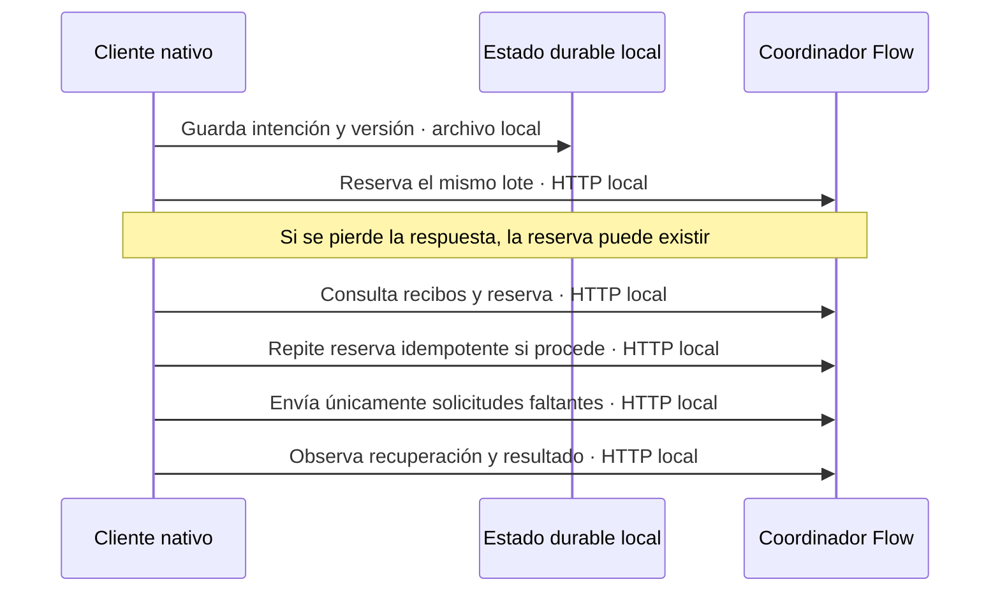

# Fix: recuperación automática y admisión durable de Flow

- **Fecha:** 2026-10-11.
- **Rama:** `fix/flow-qa-recovery-permit-20261010`.
- **Alcance:** cliente nativo, validación del estado durable y observación de trabajos Flow. Este documento no certifica una nueva ejecución del proveedor.

## Causa

El observador trataba `unknown` o `failed` como final aunque el coordinador aún estuviera conciliando un intento o preparando su sustitución autorizada. Además, perder la respuesta de `batch.prepare` terminaba la observación aunque la reserva pudiera haber quedado persistida. El cálculo del tamaño de las páginas omitía `autoRecoveryVersion`, presente en el comando enviado; cerca del límite podía admitir una página demasiado grande.

## Corrección

Las nuevas intenciones Tools persisten `autoRecoveryVersion: 1` en el lote y sus solicitudes. El cliente exige la misma versión en capacidades, reserva y recibos; conserva la ausencia del campo en trabajos históricos y RPC. Un resumen válido `pending`, `reconciling` o `backoff` mantiene la observación sin llamar a `onFailed`; un resultado `ready` tardío sigue la importación normal. Los estados agotado y cancelado terminan la espera.

Si se pierde la respuesta de la reserva, el cliente vuelve a consultar el estado y puede repetir únicamente la reserva idempotente con el mismo `batchId`. El máximo es de tres recuperaciones adicionales, con esperas de 1,5, 3 y 4,5 segundos. También se consulta el estado después de perder una respuesta de envío para evitar volver a enviar identificadores ya aceptados. La desconexión al consultar utiliza reintentos de lectura acotados; un fallo de transporte persistente no se transforma en un rechazo del proveedor ni en una llamada a `onFailed`.

El presupuesto de bytes ahora incluye el indicador de recuperación exactamente como aparece en el comando real. Se conservan los identificadores, el contenido y las referencias de cada solicitud.



**Contrato y fallo:** la persistencia de la intención precede a la admisión; las consultas no generan imágenes. La repetición de una reserva conserva el lote y no autoriza por sí sola otro envío al proveedor. Las sustituciones, su límite y la selección de un único resultado pertenecen al coordinador.

## Límites deliberados

- Los trabajos históricos sin versión y el camino RPC no adquieren recuperación automática.
- El cliente no reenvía una generación por un timeout de transporte ni decide que `unknown` significa rechazo.
- Una sustitución autorizada de un intento incierto puede producir más de una imagen en el proveedor. El protocolo conserva los intentos y selecciona un único resultado para Vimo; no promete ejecución única en Google.
- No se resuelven CAPTCHA ni se relajan las comprobaciones de identidad, contenido o recibos.
- La recuperación del transporte es finita. Si se agota, queda un error de transporte; no se inventa un resultado ni se borra la intención durable.
- Este bloque no valida el importador de arranque ni la ejecución real del proveedor.

## Validación reproducible

Harness temporal, excluido del repositorio:

```sh
node /private/tmp/vimo-native-auto-recovery-20261011/check.mjs /Users/sebas/Documents/Vimo-Flow-QA/2026-10-06/app/pipeline/providers/flow/client.ts
```

Resultado sobre la fuente canónica final: **39/39 casos correctos**. Informe: `/private/tmp/vimo-native-auto-recovery-20261011/report.json`. SHA-256 de `client.ts`: `b33c0fcdfb9773bd752876b52be063d84a03ab3188c6062d929cebab33aaff19`.

La matriz cubre nuevas intenciones Tools frente a históricos y RPC; `unknown`/`failed` con recuperación pendiente y resultado tardío; agotamiento, cancelación, versiones incompatibles y validación durable; respuestas de reserva y envío perdidas; desconexión transitoria y persistente al consultar; y el límite real de bytes con referencias. Dos contrapruebas reproducen los defectos de reserva y presupuesto sobre la fuente anterior, antes de comprobar su corrección.

Se empaquetan las funciones reales de cliente, almacenamiento y guardas; sólo se sustituyen las esperas y el transporte por controles locales. No se consulta el ledger real ni se accede a perfiles, UI o Google.

## Pruebas manuales realizadas

No se realizaron pruebas manuales ni generaciones reales en este bloque. La validación de instalación y ejecución integrada queda a cargo de la revisión de QA; los resultados anteriores de generación no certifican esta nueva recuperación automática.
