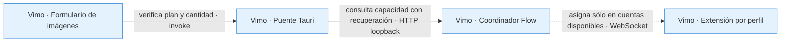

# Fix: mantener generación disponible con perfiles temporalmente ocupados

- **Fecha:** 2026-10-13
- **Rama:** `feat/flow-export-motion`

## Causa

El preflight común exigía cinco `readyProfiles` tanto en `status` como en el informe de capacidad. `useFlowCapacity` volvía a imponer el mismo requisito mediante `useFlowStatus.ready`. Cuando una cuenta consumía su permiso de comprobación, las cuatro restantes podían generar pero el editor y las muestras quedaban bloqueados. La consulta de capacidad de la UI tampoco enviaba `autoRecoveryVersion: 1`, aunque la reserva de Multimagen sí utilizaba recuperación automática.

El resumen de configuración de Extensión repetía la condición visual de preparación antes de atender la autorización del coordinador, y los textos confundían cinco cuentas configuradas con cinco cuentas libres en todo momento.

## Corrección

La consulta Tools lleva `autoRecoveryVersion: 1`. El coordinador distingue `configuredProfiles` de disponibilidad instantánea. El preflight de Vimo exige `canPrepare: true`, el mínimo de perfiles configurados y un plan compatible; conserva las pausas globales. No vuelve a rechazar una admisión aprobada porque otro snapshot indique cuatro disponibles.

`useFlowStatus` presenta el conjunto preparado con alguna cuenta disponible; el badge indica disponibilidad limitada si parte del conjunto espera. La ruta Extensión permite avanzar con un informe moderno autorizado, sin convertir su contador visual de preparación en una segunda decisión de capacidad. El fallback anterior sigue exigiendo cinco disponibles cuando no existe el campo nuevo. Los textos ES/EN/PT distinguen configuración y disponibilidad.



**Contratos:** la UI solicita el mismo modo de recuperación que el sidecar; el coordinador decide admisión y asignación con datos propios. Cinco configuradas no significa cinco envíos en curso ni cinco cuentas libres. El permiso de preparación no autoriza usar una cuenta que está en pausa.

**Fallo:** error de consulta, plan incompatible, pausa global, mínimo sin configurar o `canPrepare: false` mantienen el bloqueo. Una cuenta temporalmente ocupada no bloquea las otras cuando el informe confirma capacidad suficiente. Recibos, IDs y trabajos anteriores no se alteran.

**Por qué:** evitar que varias validaciones calculen mínimos con significados distintos. [ADR-0055](../docs/adr/ADR-0055-regeneracion-concurrente-por-escena.md) describe el resto del despacho y sus reservas por escena.

## Límites deliberados

No se decide la capacidad a partir de un simple número de cuentas vinculadas ni se elimina la verificación del proyecto, identidad o compatibilidad. Un puente antiguo conserva el comportamiento anterior. La recuperación del perfil y la cola dentro del coordinador se validan en su bloque correspondiente; esta corrección cubre autorización y presentación en Vimo.

## Validación reproducible

```sh
node /Users/sebas/Documents/Vimo-Flow-QA/2026-10-13/editor-unlimited/vimo-flow-configured-ui-check-20261013.mjs
pnpm --config.verify-deps-before-run=false lint
pnpm --config.verify-deps-before-run=false exec tsc -b --pretty false
pnpm --config.verify-deps-before-run=false check:locales
```

El arnés temporal carga helpers, hooks y API de producción, simulando consultas y transporte. **11 escenarios** cubren cinco configuradas/cuatro disponibles, estado temporal anterior, pausas globales, mínimo insuficiente, tipos inválidos, informes legacy, plan incompatible, fallo de consulta, texto de déficit, navegación de Extensión, badge/snapshot y payload real del preflight. No se añaden tests temporales al repositorio.

## Pruebas manuales realizadas

No se realizaron generaciones reales ni se cambiaron las cuentas del usuario desde estas pruebas. La frontera de transporte está simulada y no consume créditos. La validación del artefacto integrado y la comprobación con cuentas reales se informan por separado.
