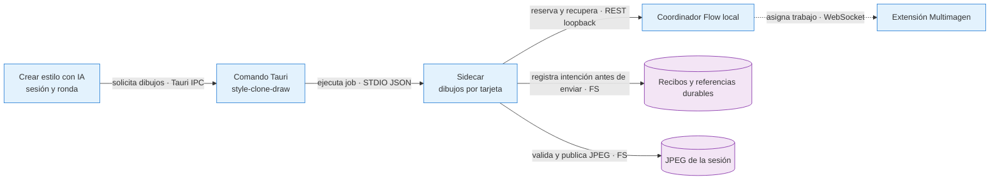

# Fix: dibujos de Crear estilo con IA con Vimo gratis

- **Fecha:** 2026-10-13
- **Rama:** feat/flow-export-motion

## Causa

El creador de estilos sólo permitía Fal y Evolink para dibujar sus tres diseños de personaje y cuatro escenas de prueba. Sus tipos, selección de clave, preparación del runtime nativo y recuperación de sesiones excluían Flow, aunque otros puntos de generación ya ofrecían Vimo gratis. Un lote único por ronda tampoco permitiría reintentar únicamente una tarjeta conservando la identidad del trabajo original.

## Corrección

- El selector ofrece **Vimo (gratis)**, **Evolink (pago)** y **Fal (pago)**. Flow muestra un badge compacto, verifica capacidad para tres diseños o cuatro escenas y no exige clave de imagen paga ni muestra su costo. Las ayudas de recarga paga no se aplican a ese proveedor.
- La sesión guarda el plan Multimagen seleccionado y lo reenvía al dibujar y reintentar. El sidecar exige y valida ese plan para Flow; rechaza planes con proveedores pagos. Rust incluye `style-clone-draw` entre los comandos que intentan obtener el runtime Flow. Se intenta para todo dibujo, igual que en los demás comandos de imagen; su ausencia no impide usar un proveedor pago.
- Los dibujos Flow usan el cliente durable existente y el importador JPEG con FFmpeg empaquetado. Comparten las funciones de prompt de los proveedores pagos: diseño directo, escena sin personaje neutralizada, identidad textual o referencia visual adjunta. Un envío ambiguo no degrada la foto a texto ni cambia de proveedor.
- Cada tarjeta conserva su intención en `style-clone:<kind>:<round>:<index>:<session-directory>`. La revisión incluye prompt final, identidad, hash de referencia y plan. Su UUID inicial deriva de ese scope. Reabrir o reintentar la misma tarjeta usa el UUID del recibo actual y comprueba el hash del JPEG ya importado; no crea otra imagen completada. Una ronda nueva tiene otra identidad.
- Reintentar una tarjeta con rechazo terminal confirmado admite un único intento nuevo, con UUID derivado del batch anterior. El preflight usa el mismo predicado terminal del cliente para rechazos generales, cuotas agotadas y revisión de cuenta confirmada. El cliente valida de nuevo bajo `operation.lock` con `terminalRetry`; si entre ambos snapshots el estado pasó a incierto, no genera ni registra un alias que bloquearía un reintento posterior. Clics concurrentes comparten la identidad del reintento. Un estado incierto conserva sus IDs para recuperar el resultado tardío.
- La sesión y la foto deben existir antes de enviar. La publicación comprueba que siguen vigentes, que el destino es el previsto y que otro archivo no sustituyó su hash anterior. Las tarjetas fallidas conservan su diagnóstico y recibo; las restantes pueden completarse.

## Flujo y contratos

**Contratos:** la sesión identifica sus tarjetas por ronda, clase e índice; el cliente serializa las operaciones de cada scope. El recibo y las referencias se guardan antes del envío y sobreviven al cierre. Un resultado sólo se publica después de verificar su identidad y decodificar los bytes; el recibo conserva el hash importado.

**Fallo:** una desconexión o respuesta incierta no autoriza otro pedido. Reintentar recupera el mismo recibo; sólo un rechazo terminal confirmado permite iniciar otro intento explícito. Una sesión descartada o referencia cambiada impide publicar. La UI puede mostrar el error por tarjeta sin borrar las imágenes completadas.

**Por qué:** separar por tarjeta permite recuperar una sola imagen pendiente sin reenviar sus hermanas ni convertir un cambio en el conjunto de tarjetas en una intención diferente.

## Límites deliberados

- El análisis del video/material y la redacción del estilo siguen usando el servidor de Vimo como antes. Este cambio corresponde al proveedor de los dibujos, no a convertir todo el análisis en gratuito.
- No modifica modelos, precios ni políticas de Fal/Evolink. Flow usa el plan Multimagen y su recuperación de cuentas/modelos existente.
- La recuperación de estas tarjetas se realiza al reanudar/reintentar su sesión; no se incorporan al importador en segundo plano de escenas de videos.
- No se promete ausencia de cuotas o rechazos externos. No se efectuaron generaciones reales en Google Flow ni llamadas pagas durante esta validación.

## Validación reproducible

1. En Crear estilo con IA, elegir Vimo gratis sin claves pagas. Comprobar badge compacto, ausencia de información de cuentas y de costo de imagen paga. Una conexión no preparada debe impedir iniciar; con capacidad preparada se envía el plan Multimagen.
2. Crear una prueba con personaje: generar sus tres diseños, elegir uno y generar cuatro escenas con foto. Repetir con identidad textual y sin personaje. Comparar que la identidad y estilo solicitados se conserven.
3. Interrumpir la conexión tras admitir una tarjeta y reanudar la sesión: debe conservar `batchId`, `imageJobId`, prompt, referencia y plan; recuperar su resultado no añade un envío. Reintentar una sola tarjeta no regenera las que ya tienen imagen.
4. Simular un rechazo confirmado antes de recibir imagen y reintentar la tarjeta: un solo nuevo intento; repetir tras éxito no genera de nuevo. Un cambio de prompt dentro de la misma tarjeta/ronda se rechaza como conflicto.
5. Ejecutar `npx tsc -b --pretty false`, ESLint focal y `cargo test --manifest-path src-tauri/Cargo.toml --lib`. Para las sesiones/vistas oficiales: `node --experimental-strip-types --test scripts/test/check-app-style-clone.mjs scripts/test/check-app-style-clone-sessions.mjs`.
6. La comprobación funcional temporal, fuera del repo, está en `/private/tmp/vimo-style-clone-check-20261013.mjs`. Usa los comandos y cliente reales, intercepta todos los HTTP y convierte con FFmpeg real: 20/20 casos, incluidos tres diseños, cuatro escenas, reintento parcial/completado, foto/texto equivalentes al request pago, resultado incierto/tardío, rechazo seguro, doble clic, planes inválidos, foto ausente y sesión descartada. Incluye cuotas y revisión de cuenta con rechazo confirmado o estado incierto, además de la carrera terminal → incierto entre el preflight y el lock: no agrega alias ni envía, y una confirmación terminal posterior permite reintentar. No se incorpora al control de versiones.

## Pruebas manuales

Se inspeccionó la captura del componente real en Chrome aislado: tres proveedores, badge pequeño y ausencia de los bloques extensos de Multimagen/cuentas/costo pago. El harness de UI pasó 5/5 controles, incluidas comprobación de capacidad para 3/4 imágenes, Flow sin claves, desconexión y fallo de la verificación aunque el snapshot anterior figurara listo. Evidencia fuera del repo: `/private/tmp/vimo-styleclone-ui-20261013-wLzZKc/report.json` y `styleclone-free.png`.

Pasaron los 31 controles oficiales del store, cuatro adicionales de persistencia/reintento del plan Flow (35/35) y los 22 oficiales de vista. Los 20 controles nativos usaron HTTP interceptado y FFmpeg real, todos los pedidos Flow sin ninguna clave paga (`apiKeys: {}`), sin generación externa. Los dos archivos oficiales se ejecutaron juntos con `--test`: 53/53. Typecheck y ESLint focal pasaron. Rust pasó 61/61; `rustfmt --edition 2021 --config skip_children=true --check src-tauri/src/pipeline/commands.rs` pasó. El formato global de Rust señala archivos preexistentes ajenos al cambio, que se conservaron. La prueba manual con cuentas reales y la aceptación visual de la app instalada quedan pendientes.

### Artefacto final y contraprueba

El sidecar SEA incluido en la app final se ejecutó por stdin/NDJSON, con el FFmpeg empaquetado, sin instrumentar fuentes ni binario: **8/8** controles. SHA-256 del sidecar: `bcc4993399a169efe91374a31da6526b8b8cb2758d07b496fa506c95405d82d3`. El sandbox deniega red externa, sólo permite el servidor de prueba en un puerto loopback efímero y restringe escrituras a la carpeta sintética. Cada job usa `apiKeys: {}` y no hereda credenciales.

El artefacto produjo tres JPEG de diseños, recuperó una tarjeta completada desde otro proceso sin POST ni reescritura, generó una escena con los bytes del JPEG anterior como referencia, recuperó un resultado incierto/tardío sin regenerar y permitió un reintento tras cuota rechazada de forma confirmada. También rechazó un plan ausente antes de consultar el puente y dejó seis recibos completos con hashes importados. Reporte: `/private/tmp/vimo-style-clone-sea-RpPHRw/report.json`. Repetir con `node /private/tmp/vimo-style-clone-sea-check-20261013.mjs <sha256-del-sidecar-final>`.

La revisión independiente repitió **20/20** controles nativos. Una contramutación AST temporal que retiró sólo la guarda `terminalRetry` en memoria falló en el caso terminal → incierto: el diagnóstico volvió a `flow_accounts_exhausted` y no al veto `flow_review_required`. Con la guarda original pasa. La contraprueba no modificó fuentes ni el artefacto y confirma que el control de la carrera ejercita la corrección. La regresión del editor con el cliente compartido conservó **12/12** controles.
