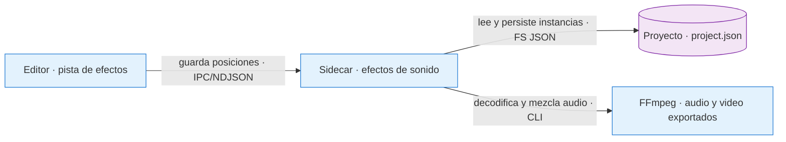

# Fix: efectos de sonido sincronizados con el editor y la exportación

- **Fecha:** 2026-10-14
- **Rama:** `feat/flow-export-motion`

## Causa

El editor no tenía una pista persistente para efectos de sonido. Agregar un click
a una transición requería hacerlo después de exportar; tampoco existía un contrato
compartido que conservara su posición al recortar una escena y lo incorporara al
video final y a los archivos para editar.

## Corrección

- La barra de herramientas a la izquierda reúne Animar, Audio, Transiciones y
  Música en botones con iconos y tooltips. Sus paneles se ensanchan con el borde
  lateral y desplazan la vista previa; el prompt se oculta con transición y conserva
  su contenido al volver. Se cierran con X, el mismo botón, Escape o clic afuera.
- Animación y Música conservan sus opciones y operaciones anteriores dentro de
  los paneles. Transiciones incorpora búsqueda, filtro y una tarjeta de fundido
  cruzado con previsualización animada al pasar el cursor.
- Audio incluye la pestaña SFX, preescucha, inserción en el cursor y arrastre a
  cualquier posición de la línea de tiempo. La pista SFX permite mover, eliminar,
  silenciar para el preview y bloquear instancias, sin cambiar su duración.
- El preview se amplía y restaura en el mismo árbol de React, conservando el
  elemento de media, su cursor y reproducción. Admite el botón, X y Escape.
- El catálogo incorpora el archivo `click-effect.MP3` proporcionado por el usuario,
  sin modificar sus bytes. Se incluye en el sidecar como base64, por lo que no
  depende de una descarga ni de un archivo externo al instalar la aplicación.
  Su duración decodificada es `17555 / 48000` segundos, aproximadamente 0,366 s.
- `options.soundEffects` guarda instancias identificadas por UUID con efecto,
  posición y una ancla de escena opcional. Los proyectos anteriores, que no tienen
  este campo, conservan su comportamiento.
- Una instancia manual conserva su posición. Una instancia aplicada a una
  transición sigue el inicio actual de su escena; si esta desaparece, se omite
  el efecto. Arrastrar una instancia anclada la convierte en manual. El inicio
  del primer bloque no se considera transición.
- El último cambio de escena conserva su click aunque quede menos tiempo que la
  duración del efecto. La fuente mantiene su duración fija; la salida termina al
  final del video. Una instancia manual nueva debe caber completamente.
- El comando de guardado valida la lista completa y obtiene la exclusión del
  proyecto antes de persistir. Guarda las instancias y la marca de video pendiente
  de regenerar en la misma escritura; evita duplicados y rutas de audio arbitrarias.
- El render decodifica el efecto una sola vez, coloca sus muestras a 48 kHz en
  las posiciones guardadas y suma los solapamientos antes de limitar los picos.
  Usa archivos temporales y bloques acotados de memoria; el WAV anterior queda
  intacto si la operación falla o se cancela.
- La mezcla final incorpora los efectos tanto al copiar el video como al aplicar
  filtros. Mantiene la mezcla previa de narración y música cuando no hay efectos.
  La exportación para editar agrega `sound-effects.wav` alineado desde el segundo
  cero junto a los clips y al resto del audio.



**Contratos:** la lista se valida antes de escribir y se guarda bajo la exclusión
del proyecto. Las anclas se resuelven al consultar el proyecto y al exportar. El
WAV tiene la duración de la línea de tiempo, con silencio fuera de los efectos.

**Fallo:** un dato inválido o un proyecto ocupado rechazan el guardado sin cambiar
su metadata. Un fallo de FFmpeg o una cancelación no publican un WAV parcial; una
exportación incompleta limpia sus archivos de salida.

**Por qué:** un efecto integrado evita diferencias entre instalaciones. Las
instancias, en lugar de una opción global implícita, permiten editar cada click y
mantener las transiciones sincronizadas al cambiar las escenas.

## Límites deliberados

- El catálogo contiene únicamente el click solicitado; no admite rutas ni audio
  arbitrarios del usuario.
- La duración de la fuente es fija, sin tiradores de recorte. La cola anclada puede
  terminar con el video, sin alterar la definición del efecto.
- La exportación para editar entrega una pista WAV independiente; no incrusta los
  efectos en cada clip visual. Permite mantener las colas entre clips al importarlos
  juntos en otro editor.
- No hay proveedores externos, generación de sonido, migración obligatoria de
  proyectos anteriores ni cambios en sus archivos de audio originales.
- Se conserva el contrato de narración de `dev`: un video final requiere su
  audio maestro. Silenciar la voz mantiene el reloj del preview. La exportación
  de clips tolera proyectos incompletos sin narración y puede incluir su WAV de
  efectos; esto no incorpora un modo nuevo de proyecto sin audio maestro.

## Validación reproducible

Desde el repositorio con sus dependencias instaladas y FFmpeg disponible:

```sh
pnpm exec tsc --project tsconfig.pipeline.json --noEmit
node --test scripts/test/check-final-mix-copy.mjs scripts/test/check-render-chunks.mjs
```

Las comprobaciones oficiales del sidecar deben apuntar al ejecutable que viaja
dentro de la aplicación construida:

```sh
VIMO_QA_PIPELINE="src-tauri/target/release/bundle/macos/Vimo.app/Contents/MacOS/vimo-pipeline"
node scripts/test/check-packaged-resume.mjs "$VIMO_QA_PIPELINE"
node scripts/test/check-packaged-editor.mjs "$VIMO_QA_PIPELINE"
node scripts/test/check-packaged-catalog.mjs "$VIMO_QA_PIPELINE"
```

La validación local adicional, mantenida fuera del repositorio, comprobó con
FFmpeg real:

1. Identidad exacta de los bytes del MP3 y su duración decodificada.
2. Persistencia canónica, marca de regeneración y rechazo de una lista inválida
   sin modificar `project.json`; exclusión durante una generación del proyecto.
3. Movimiento de las anclas al recortar escenas y omisión al borrar su escena.
4. Posición exacta de las muestras, silencio entre efectos, suma de solapamientos
   y límites de picos; 500 instancias en una línea de tiempo de 1001 segundos.
5. Video de 3 segundos con una transición en 2,9 segundos: el ancla permanece,
   el WAV conserva exactamente 3 segundos y las muestras del click coinciden
   hasta ese límite. La misma posición manual se rechaza sin sobrescribir el WAV.
6. Conservación del WAV anterior ante cancelación y ausencia de pista obsoleta
   al eliminar todas las instancias.
7. Mezcla final con copia de video y con filtros, posición sonora correcta y
   ganancia de narración conservada fuera del efecto.
8. Exportación de clips con WAV sincronizado y eliminación de ese WAV al quitar
   los efectos y volver a exportar.
9. Exportación de clips y efectos sin narración; el render final rechaza ese
   proyecto incompleto y conserva el MP4 anterior.

Resultados de la validación local:

- **TypeScript:** sin errores.
- **FFmpeg:** 22 comprobaciones aprobadas entre los casos adicionales y las
  regresiones oficiales de mezcla y render por fragmentos.
- **SEA:** 10 comprobaciones y 10 comandos aprobados, primero sobre el sidecar
  construido y después sobre `vimo-pipeline` con el `ffmpeg` incluido en la misma
  `.app`. Verifican catálogo idéntico al MP3 original, compatibilidad del proyecto
  anterior, guardado, validación, lectura de anclas, clips, WAV y video final.
  Los jobs mantuvieron stdin abierto durante su ejecución, igual que la app.
- **Editor:** 71 comprobaciones de integración aprobadas y 16 capturas en claro
  y oscuro, con los componentes reales y APIs aisladas.
- **WKWebView real:** cuatro escenarios aprobados, cada uno con 66 aserciones,
  a 1040 y 1440 px, en claro y oscuro. Los paneles desplazan el preview, conservan
  las mismas instancias del reproductor y del prompt, y restauran su posición al
  cerrar. El ancho máximo es 600 px a 1040 y 720 px a 1440, dejando 302 y 582 px
  de preview respectivamente, sin desbordar la ventana.
- **Web Audio en WKWebView:** el MP3 se decodifica como estéreo a 48 kHz. El
  scheduler real programa cada click una vez y se rearma después de detenerse,
  con el offset correcto al buscar dentro del efecto. La comparación de muestras
  renderizadas con `OfflineAudioContext` tuvo error cero para la programación
  anticipada y para la reanudación desde 0,2 s. WebKit decodifica una muestra menos
  que FFmpeg; el límite a la duración real del buffer ya cubre esa diferencia.
- **Comprobaciones oficiales del paquete:** `check-packaged-resume`,
  `check-packaged-editor` y `check-packaged-catalog` aprobadas sobre la `.app`.

Los arneses adicionales y sus capturas permanecen fuera del repositorio. Las
pruebas usan proyectos temporales y APIs aisladas, sin proveedores de pago.

La comprobación temporal del timeline y del reproductor usa el MP3 entregado y
medios reales del navegador: arrastre, duración fija, eliminar, bloqueo, seek,
pausa, silencio, ausencia de duplicados y ampliación sin remontar el audio. Pasó
sobre los componentes de esta rama. La regresión de los tiradores conserva hover
y drag exclusivos, gradiente pastel, foco de teclado y marcadores visibles.

## Pruebas manuales realizadas

Se inspeccionaron visualmente las capturas compuestas de la ventana WKWebView
en claro y oscuro: el panel de audio y sus controles se ven completos, la vista
previa permanece visible y los controles superpuestos no quedan tapados. Las
capturas corresponden a componentes reales del editor en un entorno aislado.

Las acciones de apertura, cierre y cambio de ancho de esa prueba fueron eventos
DOM simulados; no representan una sesión humana en la aplicación instalada. La
decodificación y los tiempos de audio se comprobaron mediante muestras y nodos
reales de Web Audio, sin afirmar una escucha humana ni la aceptación de autoplay
mediante un gesto real. No se usaron proveedores de pago ni proyectos del usuario.

La aceptación auditiva humana pendiente en la aplicación final consiste en:

1. Abrir un proyecto anterior y comprobar reproducción y exportación sin efectos.
2. Agregar un click, reproducirlo, desplazarlo y volver a abrir el proyecto para
   verificar que conserva su posición y su duración fija.
3. Aplicarlo a todas las transiciones, recortar una escena y comprobar que sigue
   el límite. Desactivar la aplicación a todas y comprobar que permanecen los
   clicks colocados manualmente.
4. Incluir una última escena menor de 0,366 s: su transición debe sonar hasta el
   final del video, sin prolongarlo. Probar pausa y búsqueda durante un click.
5. Exportar el video y escuchar narración, música y efectos. Exportar para editar
   e importar el WAV desde el segundo cero junto a los clips para comprobar su
   sincronización.
