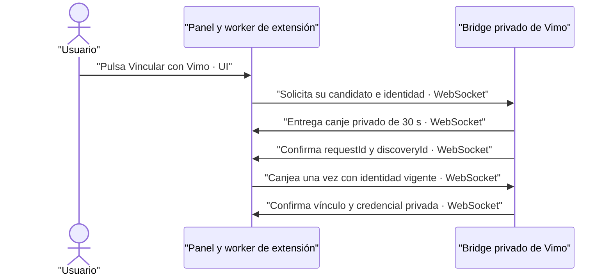

# Coordinador local Flow incorporado en Vimo

## Recuperación automática opt-in (2026-10-11)

Port selectivo de la extensión0.2.30, commit local `39166e7`. Sólo los nuevos
lotes `autoRecoveryVersion:1` autorizan hasta dos sustituciones en otra cuenta;
los históricos preservan la política anterior. Reemplaza cualquier restricción
manual previa exclusivamente dentro de ese opt-in. Conserva permisos, cuota,
plan/semilla/hash, mínimo cinco al admitir, identidad histórica, confianza local,
compatibilidad400/500, cierre de recursos y el arranque SEA sin CLI ni
`connection.test`. No se copia el worker, applet ni UI de la extensión.

| Archivo vendorizado              | SHA-256 final tras formato nativo                                  |
| -------------------------------- | ------------------------------------------------------------------ |
| `bridge/server.js`               | `05813ed15c12d7c19f50b1b9d98141e70d2e6a95304de49e3aa916802031dcd4` |
| `bridge/capacity.js`             | `edf70204e1831c094a369012a1b7b06f06d04d4d4a995508465b74300236eab2` |
| `bridge/automatic-recovery.js`   | `f758fb4732847f40638998921e45265f57d8b38182f1c7e42bd58abb248b907d` |
| `extension/generation-errors.js` | `0987ce14b93764022cec4fd0213528d595e4bc399019468926cf0322e7622805` |

El primer recibo válido persistido gana; los intentos anteriores siguen
archivados y ocupan reservas cuando son inciertos. Dos sustituciones totales,
cuentas no repetidas, ventana120s y pausa/cancelación/proyecto respetados. Las
lecturas de descarga huérfanas tras restart se recuperan sobre el mismo medio.
El reconciliador nativo `recovery-import.ts` sólo importa recibos ready exactos,
sin admitir trabajos nuevos al abrir Vimo.

Validación del port:31/31 escenarios WebSocket sintéticos y3/3 pruebas de
persistencia del upstream;37 funciones y9 archivos previos preservados antes de
esta nota. Scripts externos en `/private/tmp/vimo-auto-recovery-vendor-20261011`
y `/private/tmp/vimo-auto-recovery-20261011`. No equivalen a aceptación del SEA
ni del proveedor. QA final se registra por separado. Fuente compilada y
procedencia en la carpeta QA `2026-10-11/automatic-recovery/build`.

Aceptación del ejecutable final: SEA `5ba18ad240a1b80ab9a0fb7c9a61fb869cda602b5e3eed61aef4eea765d96c67`,
8/8 controles de scheduler (ambos órdenes de ganador tras120s reales) y5/5 de
importación, con workers sintéticos y red saliente denegada.1021fuentes y
bundle/blob coinciden. QA real con cinco extensiones0.2.30 completada:
16/16 Elías/Claymation (7con referencia), 16confirmaciones y0retries, importadas
tras cerrar/reabrir Vimo durante el lote. Cinco perfiles finales disponibles,
sin Reanudar/Recuperar. Auditor24contratos+revisiónSHA16; conserva438históricos.
Hay texto incidental no solicitado y encuadres imperfectos: aceptación funcional,
no fidelidad estricta ni prueba real de failover. La extensión0.2.31 añade sólo
espera automática del fallo local de preparación. El usuario confirmó las cinco
actualizadas y la prueba posterior terminó 5/5, una imagen por cuenta, cuatro
referencias y cinco perfiles activos sin Reanudar. Auditor de 19 contratos:
454 trabajos y seis lotes previos conservan hash bruto exacto. QA01 tiene
versión observada por UI; las otras cuatro por confirmación del usuario.
Hay variación de chaqueta en escena 5 y de encuadre en escena 2.
Cero sustituciones: no acredita failover real. Reemplaza el pendiente de
cuatro perfiles del corte anterior; evidencia en `evidence/qa5-0231/`.
El vendor y el SEA no cambian por ese ajuste del worker/panel externo.
Evidencia externa: `2026-10-11/automatic-recovery/evidence/`.

Las secciones siguientes conservan el historial de ports anteriores; esta
sección manda respecto de la política nueva. No se retiran protecciones
nativas documentadas allí.

Fuente propia: repositorio privado `SCRIPZY-DEV/Extension-vimo-RPC`, versión
`0.2.7`, commit `e3eb274ea647d231b79473593e6ae75ef2160b50` (2026-09-17).
No contiene estado, credenciales, resultados, referencias, imágenes, historial
git, pruebas locales ni código de terceros usado durante la investigación.

Se incorporan `bridge/server.js`, `storage.js`, `download.js`, `capacity.js`,
`profiles.js` y `cli.js`, junto a los dos helpers puros
`extension/attempt-audit.js` y `extension/generation-errors.js`.
`server.d.ts` declara el contrato de importación para TypeScript.

La adaptación de empaquetado retira de `server.js` el arranque
CLI y sus imports exclusivos (`pathToFileURL` y `cli.js`). El dueño del proceso
es `service.ts`; no se evalúa `import.meta` dentro del bundle CommonJS de Node
SEA. La política de perfiles, cuotas locales, persistencia, reintentos y formatos
permanece en el coordinador original, con el endurecimiento de canje y la
compatibilidad de presupuesto y el estado de recuperación de descargas descritos
abajo. El formato de
código se adapta al Prettier del repositorio sin cambiar su comportamiento.

La dependencia de runtime es `ws`, fijada en el manifiesto de Vimo. Esbuild
incluye estos módulos y el código JavaScript de `ws` en el binario existente;
no se importa código desde otra instalación ni se necesita Node del sistema.

## Actualización

Comparar una versión futura contra este commit y conservar las adaptaciones
anteriores. Revisar cambios de contrato y regenerar el sidecar real antes de
validar. No copiar carpetas de datos ni agregar logs del puente: sus eventos
`bridge.ready` y `bridge.pairing` contienen códigos temporales de vinculación.

El origen de Chrome confiable debe configurarse desde la distribución nativa,
con un ID público estable entregado por la extensión. Un anuncio descubierto
no basta para confiar en un origen nuevo. La interfaz recibe estados y las
respuestas de sus operaciones autorizadas; nunca la credencial privada del
servicio entre procesos.

## Parche local de seguridad sobre 0.2.7

El 2026-09-17 se añade a `auth.pair` la normalización de `frame.identity` y
se exige que esté verificada y coincida con `accountKey` del canje anunciado.
El socket, origen, instalación, vencimiento, token y anuncio vigente se siguen
validando. Si la cuenta cambia entre anunciar y canjear, la conexión se
rechaza sin guardar una credencial ni enviar trabajos.

Este parche acotado coincide con el endurecimiento observado en la sesión
de extensión; no declara incorporada una versión externa 0.2.8 final ni un
commit externo nuevo. El snapshot de referencia sigue siendo el de arriba.

La identidad pública candidata fue verificada independientemente a partir
del SPKI de `manifest.key`, sin leer ni copiar una clave privada:

- ID: `bjpjjnjiikhccbjlkgmfpfhenbdpikbm`.
- Origen: `chrome-extension://bjpjjnjiikhccbjlkgmfpfhenbdpikbm`.
- SHA-256 del SPKI: `19f99d988a72219ba6c5f574d13f8a1c82bc1703026291f46b5e46c92d036d7e`.

El ID se deriva de los primeros 16 bytes del SHA-256, convirtiendo cada
nibble hexadecimal a las letras `a`–`p`, y coincide con la identidad pública
documentada por la extensión. Es una allowlist de distribución, no un token
ni una certificación de Chrome Web Store.

## Compatibilidad revisada con 0.2.9

El 2026-09-17 se comparó la fuente con
`664909d3b2cc77e431e86d724874472c24a0dfe9` de la extensión. Los ocho módulos
JavaScript incorporados son equivalentes tras el formato y la retirada CLI
documentados; no se requiere actualizar código. El parche local de canje ya
coincide con el upstream. La procedencia original del snapshot se conserva.

La identidad estable también coincide con el paquete final0.2.9, cuya paridad
fuente/carpeta/ZIP se comprobó. Véase la
[revisión de compatibilidad](../../../../docs/handoff/2026-09-17-flow-extension/review-extension-0.2.9.md)
para el límite operativo entre un vínculo al puente independiente y un nuevo
almacén privado de Vimo.

## Compatibilidad acotada con el presupuesto de 0.2.11

El 2026-09-19 se revisó la extensión `0.2.11`, commit
`9a595c7`, y su contrato `PARA-VIMO-VINCULACION-Y-PRUEBA.md`. Esa versión
sube la política local del worker a 500 envíos por ventana móvil de 24 horas.
No es una cuota publicada por Google.

Vimo aplica un parche propio únicamente a `bridge/capacity.js`: admite los
límites explícitos 400 y 500, siempre con ventana exacta de 24 horas, uso entero
no negativo y `remaining = max(0, limit - used)`. El saldo se calcula usando
el límite informado por cada worker; una cuenta antigua de 400 no adquiere
100 envíos adicionales. Los cálculos orientativos de perfiles nuevos usan
500 como capacidad máxima posible; la admisión usa los saldos reales y sigue
descontando pendientes, reservas y posiciones del historial.

Este parche permite actualizar perfiles gradualmente y difiere del upstream
0.2.11, que exige que todos informen exactamente 500. No cambia el esquema
de estado ni modifica contadores, credenciales, referencias, trabajos o pausas.
Los snapshots se actualizan por el contrato existente `session.status`; un
estado inválido o antiguo continúa excluido de la capacidad. En esa revisión se conservaba el mínimo de tres cuentas distintas y el máximo
de diez vinculaciones. **Mínimo3 superado el 2026-10-07 por0.2.18**, descrito
al final: mínimo vigente5; máximo10 sin cambios.

No se incorpora el `server.js` de 0.2.11 ni su nuevo comando `connection.test`.
Esa operación genera una imagen y requiere una intención explícita y un
contrato de producto separado. La procedencia del snapshot sigue siendo
0.2.7 más los parches locales enumerados en este documento.

## Solicitud explícita desde el panel (parche local del 2026-09-20)

`createBridge({ allowExtensionLinkRequests: true })` habilita únicamente la
solicitud de vinculación desde el candidato que la envía. El valor por defecto
es `false`; `runFlowService` lo activa en el servicio nativo de Vimo. No incorpora
el resto de cambios de upstream 0.2.12 ni modifica colas, generación o pausas.
Se adoptan además sus guards de invalidación del canje ante cambios de identidad
o preparación y `linkedAccountKey`, reservado antes de confirmar la credencial
para impedir dos vínculos de la misma cuenta entre el ACK y `session.status`.
El predicado `profiles.identityConflict` también respeta esa reserva cuando
otro perfil publica su sesión: el cambio de identidad no habilita admisión
para una cuenta ya reservada por otra conexión aún sin heartbeat.

**Contrato:** presencia pasiva, consentimiento por gesto y nonce de un uso.
**Fallo:** un canje rechazado no crea credenciales ni inicia trabajos.
**Motivo:** completar el vínculo desde el panel sin transportar tokens por React.

- `discovery.ready` añade `capabilities: { extensionLinkRequest: true }` sólo
  cuando la opción está activa. `discovery.hello` por sí solo nunca vincula.
- El frame es `{ type: "discovery.link.request", requestId, discoveryId,
installationId, identity }`, sin campos adicionales; `requestId` es UUID v4.
  Se exige el mismo socket, candidato, instalación, origen en la allowlist
  configurada e identidad verificada con el mismo `accountKey` anunciado.
  La extensión debe consultar la identidad fresca antes del gesto y del canje;
  el bridge comprueba su consistencia, no consulta Google para verificarla.
- Se reutilizan `linkDiscovery`, `discovery.pair` y `auth.pair`. El acuse nuevo es
  `{ type: "discovery.linking", requestId, discoveryId }`, sin token ni
  credencial. Los secretos sólo atraviesan los frames privados de canje ya
  existentes; no se añaden al renderer, eventos de servicio ni logs.
- Un doble clic mientras el nonce sigue vigente comparte ese nonce. El mismo
  UUID sólo recibe otro acuse si conserva el candidato y el nonce original
  sin vencer. Cambiar identidad, `hasFlowTab`, cerrar panel o cerrar socket
  invalida el canje; A → B → A no lo restaura. Como el DTO de presencia no incluye
  proyecto, el worker debe cerrar el socket ante cambios de proyecto/binding.
- El registro en memoria conserva UUID consumidos o vencidos: máximo 128 por
  instalación y 12.800 total por proceso, sin expulsión automática. Al alcanzar
  el límite se rechaza. Un replay tras redescubrir no crea otro nonce. No se
  promete deduplicación de intención entre reinicios del proceso; la extensión
  descarta su intención al reconectar/reiniciar, limita el gesto a 30 s y exige
  otro clic. Las restricciones durables de instalación/cuenta siguen vigentes.
- Errores propios: `discovery_link_request_disabled`,
  `discovery_link_request_invalid`, `discovery_link_request_mismatch`,
  `discovery_link_request_expired` y `discovery_link_request_limit`. Conserva
  `discovery_origin_untrusted`, `discovery_expired`, `discovery_already_linked`,
  `account_already_linked`, `discovery_not_ready` y `connection_limit_reached`.
  Un error de preautenticación conserva el `requestId` válido en
  `protocol.error` y cierra el socket; no se reintenta automáticamente.

## Última identidad verificada para presentación (2026-09-20)

El resumen de cada conexión añade `lastVerifiedIdentity`, una identidad
normalizada verificada o `null`. Se conserva desde `auth.pair`, desde la
identidad anterior a `auth.resume` y desde cada `session.status` verificado.
La identidad verificada de una cuenta nueva reemplaza el dato anterior.
El commit de `auth.pair` ya guarda la identidad actual sin verificar: si se
revincula A → B y se reinicia antes del primer heartbeat, no persiste A como
identidad vigente ni sobrescribe el nombre histórico recién comprobado de B.
Al arrancar se normaliza el campo opcional y se migra desde la identidad
anterior válida; nunca se reconstruye un correo a partir de su hash.

Este metadato es exclusivamente visual y la UI debe rotularlo como última
cuenta verificada cuando la identidad actual ya no está verificada. No
participa en autenticación, conflictos de cuenta, presupuesto, preparación
ni despacho. El reset de `identity` al autenticar/reanudar permanece, y un
heartbeat no verificado sigue dejando la cuenta sin capacidad aunque exista
el dato histórico. `connection.ready`, `connection.status` y `status` comparten
el mismo resumen. El estado conserva su versión 1; el campo nuevo es opcional
para registros antiguos y los datos inválidos se normalizan a `null`.

`safeIdentity` exige ahora que `accountKey` sea un string antes de comprobar
su hash hexadecimal. Un array JSON con un string no se considera identidad
verificada por coerción de la expresión regular. No se incorporan otros
cambios del coordinador externo 0.2.13.

## Estado observable de recuperación de descarga (2026-09-21)

Parche local únicamente en `bridge/server.js`: `download` sigue recuperando
el mismo `mediaId`. Antes de iniciar I/O publica y persiste `downloading`;
antes de pedir `media.refresh` publica y persiste `awaiting_url`. El comando
confirma el comienzo de la recuperación; sólo un archivo recibido y guardado
produce `ready`. Las operaciones de inicio y commit pasan por la cola serial,
pero la transferencia queda fuera para que `status` continúe respondiendo.

Una lectura de URL en vuelo se deduplica por recibo y socket. Se descarta
únicamente la URL ya rechazada; el medio y la identidad del intento se conservan.
La respuesta explícita sin URL termina en `download_failed/image_url_missing`;
un `jobs.snapshot` anterior sin URL no cancela una lectura vigente. Un error o
cierre del socket libera la lectura. El fallo tardío del worker no interrumpe
una transferencia local ya activa; el downloader conserva su resultado final.

La lectura tiene un plazo en memoria de cinco minutos. Los comandos y el
heartbeat comprueban su vencimiento en la cola serial y publican
`download_failed/media_refresh_timeout`. El plazo no genera ni reintenta nada:
sólo permite que una recuperación posterior vuelva a consultar el mismo medio.
Es necesario para workers 0.2.13 que guardan `recoveryError` sin devolver un
frame de error al bridge. Se mantienen errores reales, pausas y políticas del
proveedor; no cambia `generation.retry`, el esquema durable ni el protocolo.

Este parche debe conservarse al actualizar el vendor y coordinarse con la
sesión de extensión; no afirma paridad con su `server.js` externo.
[Handoff y validación aislada](../../../../docs/handoff/2026-09-21-flow-recovery/prompt-extension.md).

## Autoridad local ante snapshots tardíos (2026-10-06)

Se porta únicamente el guard de `acceptResult` revisado en el working tree
externo que declara 0.2.15, sobre HEAD `6ac9d03`. Ese árbol externo tenía
cambios sin commit: esto no declara una actualización completa ni una entrega
final de 0.2.15. SHA-256 de su `bridge/server.js` leído durante la revisión:
`277e8a9f5349c1fdfaede58d932d821a22d22e59a587fde81f13f69a3d435905`.
La comparación de AST, sin posiciones ni comentarios, confirma equivalencia
de `acceptResult`, `startDownload` y `requestDownloadUrl` con ese archivo.

Un resultado ya conocido se reconoce sin sustituir su autoridad local cuando
existe una descarga activa o un archivo `ready`; para un `jobs.snapshot`,
también cuando hay una lectura de URL en vuelo o un `download_failed`.
Se conservan medio, URL vigente o descartada, error y archivo. Las comprobaciones
de propietario, intento, hash del snapshot, medio y URL siguen antes del guard;
la auditoría de intento se persiste antes del ACK. Un `job.result` explícito
puede completar la recuperación pendiente del mismo medio.

Esto complementa el parche de descarga del 2026-09-21: evita que una copia
antigua borre `downloading` o un error confirmado, o vuelva a descargar una URL
ya rechazada. No cambia admisión, cadencia, reintentos de generación, pausas,
credenciales, formato del ledger ni protocolo. Se conservan los parches propios
de Vimo, incluidos 400/500, solicitud de vínculo opt-in, identidad histórica,
servicio privado y arranque SEA sin CLI. No se incorpora `connection.test`.

Validación temporal con cinco workers WebSocket sintéticos, puerto efímero y
almacén TMP: 14 comprobaciones aprobadas; cinco reproducían el fallo con el
vendor anterior. Sin Google, perfiles reales ni generaciones.
[Detalle y reproducción](../../../../fixes/2026-10-06_flow-snapshots-de-descarga.md).

## Mínimo cinco — port selectivo de0.2.18 (2026-10-07)

Referencia exacta: `6547a8c2156b2a59b44b4c6a25e27d7d1f509272`,
repositorio de extensión, versión0.2.18. El diff de ese commit sólo modifica
`bridge/profiles.js` en el backend: `MIN_LINKED_PROFILES` pasa de3 a5.
Se aplica únicamente esa constante, sin reemplazar el resto del vendor.

`status`, `capacity.check`, reservas y admisión de lotes nuevos consumen la
misma constante. Un lote ya preparado conserva sus IDs, asignaciones y recibos;
no se readmite ni se migra estado para aumentar el mínimo. Se preservan diez
vínculos máximos, tres trabajos simultáneos por perfil, cadencia existente,
consumo móvil500/24h y compatibilidad400 de workers antiguos. Ninguna cuota se
reinicia. Las guardas de identidad, pairing, recuperación y resultados locales
siguen siendo las de Vimo.

La UI exige mínimo5 aun frente a un coordinador antiguo, pero eso no sustituye
la reconstrucción del SEA. El artefacto nuevo se valida con puerto efímero y
workers sintéticos; no actualizar ni iniciar el runtime QA abierto. Evidencia y
procedimiento coordinado en `fixes/2026-10-07_flow-generation-controls.md` y en
la entrega durable de QA.

## Tools — contrato opcional y port selectivo (2026-10-07)

Referencia fija: `adc042044d8dcd709f4327375493c50fbae57d8b` del repositorio
`EXTENSION-RPC-FLOW`; base local anterior
`e79787cb680925af3446159a9c5df3a8d0a6f44a`. Se porta el delta del commit
sobre `bridge/server.js` y `bridge/capacity.js`, y se agrega únicamente su
nueva dependencia `extension/execution-plan.js`. No es un reemplazo completo
del vendor ni una afirmación de que un paquete o SEA esté instalado.

| Archivo                       | SHA-256 del blob upstream adc0420                                  | SHA-256 del archivo vendorizado                                    |
| ----------------------------- | ------------------------------------------------------------------ | ------------------------------------------------------------------ |
| `bridge/server.js`            | `5e6623f89d23328889bd048f4ec4db6e1957cff30b318184036f96cddfd08087` | `9c2ac6dc07fe3c2c292525734c1c8dd1f57d98bd2bd26b1f463350069c6c4682` |
| `bridge/capacity.js`          | `7739accc1366ebd12a205aa18f927ccc72570695e59c130d814c5b95f403fab3` | `33b6e0cb111c6835f825df08c48f1287da3728c4ccc4f3be2c7741a93cb04692` |
| `extension/execution-plan.js` | `4b2bfb1c371a8a72fdcf6f4ade6da4e7115869130baaaee557cf1836cd6e95be` | `337927906ea5002e8a212459c68f3b5ee8cd50b6c5a94a8f6dc67577f1386a1c` |

El helper sólo difiere por formato; su AST es idéntico al blob fijo. El plan
opcional exacto es `{version:1, kind:'flow-tools',
toolId:'e42285e2-1038-4e24-adc1-ed30c690ab29', seedMode:'provider'}`.
Ausente conserva RPC; `null`, extras o valores incompatibles fallan. Tools
conserva `seed:null`, exige `HARBOR_SEAL` y proporción `16:9` o `9:16`.
RPC conserva su tupla de hash de cinco campos; Tools añade el plan canónico
como sexto campo. El descriptor viaja con reserva, trabajo, snapshot, recibo,
reintento y cancelación; una discrepancia no convierte el trabajo a RPC.

La capability global declara soporte de protocolo, no disponibilidad de los
perfiles. Capacidad y despacho de Tools exigen además compatibilidad del
binding y capability de cada worker. Se bloquean mezclas de plan en un lote y
se valida el plan persistido al arrancar. Recuperar un recibo existente no
requiere readiness de generación: conserva medio, intento y hash.

Se preservan los parches locales anteriores: mínimo cinco, diez vínculos,
políticas 400/500 sin reiniciar consumo, checking limitado a una plaza,
identidad verificada y reserva de cuenta, vínculo opt-in con protección de
replay, identidad histórica sólo visual, I/O fuera de la cola, deduplicación
y expiración de lecturas de URL, autoridad de descargas ante snapshots tardíos,
pausa manual independiente del hold de proveedor, arranque SEA sin CLI y
limpieza de recursos ante fallo de inicialización. Como ajuste de compatibilidad
respecto de adc0420, una reserva RPC agotada conserva `batch_size_exceeded`;
Tools usa `execution_plan_unavailable`.

`profiles.js`, `storage.js`, `download.js`, `cli.js`, `server.d.ts`,
`attempt-audit.js` y `generation-errors.js` permanecen idénticos byte a byte.
El backend sólo consume `safeAttemptStats` y `mergeAttemptStats` de la
auditoría: ambos ya tienen AST idéntico a adc0420. Los cambios de auditoría
propios del worker no se necesitan aquí. No se copian `jobs.js`,
`extension-identity.js`, SDK, UI de extensión ni `connection.test`.

Validación local externa contra estas fuentes finales: 101 controles en 13
escenarios de admisión/protocolo y 17 escenarios de recuperación por modo
(RPC y Tools), todos aprobados. Cada fixture usa cinco workers WebSocket
sintéticos y puerto efímero; se excluyen 43127/43137. Las recuperaciones emiten
cero `job.submit`/`job.retry`; el downloader es un stub y no llama a Google.
La comparación estática conserva 39 funciones sin cambios, siete archivos
idénticos y la configuración/limpieza exterior del arranque; nueve funciones
modificadas coinciden con el AST de adc0420. Hashes antes/después coinciden.

Las recetas y los informes locales están fuera del repo, en la carpeta QA
`2026-10-07-multimagen-port-evidence/vendor/`: `check-final-vendor.mjs`,
`check-final-recovery.mjs` (argumento `rpc` o `tools`) y
`check-preservation.mjs`. Son verificaciones temporales de fuente, no una
suite oficial. No acreditan extensión Chrome, Google, SEA/Tauri, instalación
ni aceptación manual en la app. La QA canónica y sus datos no se modificaron.

## Permiso explícito de comprobación (2026-10-10)

Port selectivo del parche aprobado `recovery-permit.patch`, SHA-256
`3d95e9c5e0f56b029029a5bf83d9a2bce12da0ef9a33f711c64e3d0f343efe03`.
La sesión de extensión lo entregó sobre `698ef1f`; ese commit no contiene por
sí solo este delta. La referencia reproducible es el parche congelado y sus
preimágenes, no el working tree futuro de la extensión.

Se modifican sólo `bridge/profiles.js`, `bridge/capacity.js`, `bridge/server.js`
y se incorpora `extension/recovery-permit.js`, equivalente al helper aprobado
salvo formato. No existe `background.js` en este vendor: el emisor y consumidor
worker del permiso se distribuyen en la extensión. Se omiten los dos hunks de
`connection.test`, comando deliberadamente ausente de Vimo.

La capacidad de comprobación puede admitir una intención nueva con un permiso
explícito durable, ligado a cuenta, proyecto y binding. El permiso se reserva
para un lote, se consume para un trabajo antes de persistir/enviar, y no revive
por replay, cancelación o reinicio. `recoveryPermitVersion:1` es optativo:
ausente conserva el comportamiento anterior. Reanudar globalmente desde Vimo
no crea permisos de perfil.

Los `unknown` históricos siguen reservando cuota y concurrencia física. La
admisión suma `remoteCount + activeCount` porque no puede probar solapamiento;
no usa `max()` ni borra históricos. Se conserva mínimo cinco, políticas 400/500,
pausas, holds de proveedor y límite físico del worker. Este ajuste **reemplaza
únicamente** la restricción de una plaza de checking descrita en la sección
Tools cuando existe un permiso válido; el checking automático sigue igual.

Sin cambios en UI, importador, seed/hash/plan de intención, DTO Rust o
configuración QA. Se conservan los parches nativos y de recuperación anteriores.
Véase `fixes/2026-10-10_flow-recovery-permit.md` para validación y límites.
